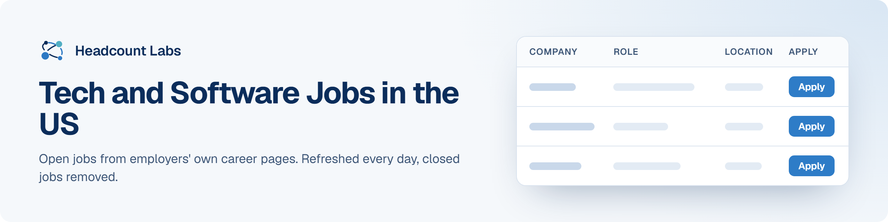

# Tech and Software Jobs in the US

Software, data, AI, security, cloud and IT jobs at US employers, sorted by field.

**400 open jobs** · 396 new since the last update · 396 removed because they closed or left the employer's board · updated October 22, 2026 at 6:01 AM EDT

This list is built and refreshed every day by [Headcount Labs](https://headcountlabs.com/?utm_source=github&utm_medium=job-list&utm_campaign=tech-jobs), which reads jobs straight from employers' own career pages and job boards. Every job here was still listed on its source board when we last read that board, within the past 3 days, and was posted in the past 30 days. Copies of the same job are merged into one row, and jobs that close are removed at the next update.

Want this data in your own app or agent? Use the [Headcount Labs jobs API](https://headcountlabs.com/docs/?utm_source=github&utm_medium=job-list&utm_campaign=tech-jobs) (free tier), the [MCP server](https://headcountlabs.com/mcp/?utm_source=github&utm_medium=job-list&utm_campaign=tech-jobs) for Claude, ChatGPT and other AI assistants, or the [public dataset subsets](https://huggingface.co/HeadcountLabs) on Hugging Face (the full dataset is coming soon).

**Full dataset.** A bigger, one-off snapshot dated 2026-10-19 (all matching jobs, not only the open jobs below) is on Hugging Face: [Tech and software jobs](https://huggingface.co/datasets/HeadcountLabs/tech-jobs). It loads with `datasets.load_dataset` and is under the Open Database License (ODbL) 1.0.

**Jump to:** [Software engineering (214)](#software-engineering) · [Data, AI and machine learning (148)](#data-ai-and-machine-learning) · [Product and design (3)](#product-and-design) · [Hardware and engineering (26)](#hardware-and-engineering) · [Business, finance and operations (4)](#business-finance-and-operations) · [Other roles (5)](#other-roles)

**Columns.** *Apply* opens the original posting on the employer's site. *Details* opens the job on Headcount Labs, with every posting we found for it. *Remote* shows what the employer states; a dash means the posting doesn't say. *Pay* is the range the employer published.

## Software engineering

| Company | Role | Location | Remote | Pay | Posted | Apply | Details |
| --- | --- | --- | --- | --- | --- | :---: | :---: |
| **Zipline** | Staff Software Engineer - Routing Engine | 

2 locations
South San Francisco, CA Ann Arbor, Michigan USA
 | — | $220k–$260k/yr | Oct 21 |  | <a href="https://headcountlabs.com/catalog/jobs/903fb212-d527-41f8-bcb6-c5fc9af06fde?utm_source=github&utm_medium=job-list&utm_campaign=tech-jobs">via Headcount Labs</a> |
| **Wonder Group, INC** | Sr. Software Engineer (Dev Ops) | Boston | Hybrid | $176k–$184k/yr | Oct 21 |  | <a href="https://headcountlabs.com/catalog/jobs/0e6e4318-9365-4e42-b8a5-0afd12aeed44?utm_source=github&utm_medium=job-list&utm_campaign=tech-jobs">via Headcount Labs</a> |
| **Vantor Services Inc.** | Principal Full Stack Software Engineer (TS/SCI with CI poly) | Herndon, VA | On-site | $200k–$270k/yr | Oct 21 |  | <a href="https://headcountlabs.com/catalog/jobs/0b3d61bd-5f30-4e5b-bc2d-969d854f8477?utm_source=github&utm_medium=job-list&utm_campaign=tech-jobs">via Headcount Labs</a> |
| **US: Mastercard Technologies, LLC** | Software Engineer I | 

3 locations
O Fallon, MO O Fallon O'Fallon, MO
 | On-site | $72k–$115k/yr | Oct 21 |  | <a href="https://headcountlabs.com/catalog/jobs/b3ff056d-eeb0-464a-8f88-a8b2096b1005?utm_source=github&utm_medium=job-list&utm_campaign=tech-jobs">via Headcount Labs</a> |
| **US: Mastercard International Incor** | Software Engineer I | O'Fallon, MO | On-site | $72k–$115k/yr | Oct 21 |  | <a href="https://headcountlabs.com/catalog/jobs/ffce5cc2-7eae-4680-980c-b13afc6ee854?utm_source=github&utm_medium=job-list&utm_campaign=tech-jobs">via Headcount Labs</a> |
| **US: Mastercard International Incor** | Manager, Software Engineering &#124; Data &amp; AI Platform | 

2 locations
Arlington, VA Arlington
 | On-site | $161k–$266k/yr | Oct 21 |  | <a href="https://headcountlabs.com/catalog/jobs/2e804e5a-be07-4fe1-a901-32802aca807e?utm_source=github&utm_medium=job-list&utm_campaign=tech-jobs">via Headcount Labs</a> |
| **US: Mastercard International Incor** | Senior Software Engineer &#124; Data &amp; AI Platform | 

2 locations
Arlington, VA Arlington
 | On-site | $132k–$212k/yr | Oct 21 |  | <a href="https://headcountlabs.com/catalog/jobs/25d698fc-a24b-47b4-90c4-958a281a3810?utm_source=github&utm_medium=job-list&utm_campaign=tech-jobs">via Headcount Labs</a> |
| **Travelscape, LLC** | Software Developer I | Springfield, MO | — | — | Oct 21 |  | <a href="https://headcountlabs.com/catalog/jobs/98b0c3c3-5fe4-42f4-9a6c-c0e871d4a6f2?utm_source=github&utm_medium=job-list&utm_campaign=tech-jobs">via Headcount Labs</a> |
| **Tower Loan of Mississippi, LLC** | DevOps Engineer | Flowood, MS | Remote | — | Oct 21 |  | <a href="https://headcountlabs.com/catalog/jobs/89674a9d-c5d9-4336-8079-f909883ecc87?utm_source=github&utm_medium=job-list&utm_campaign=tech-jobs">via Headcount Labs</a> |
| **Tower Loan of Mississippi, LLC** | Senior AI Software Engineer | Flowood, MS | Remote | — | Oct 21 |  | <a href="https://headcountlabs.com/catalog/jobs/2dfb7a34-e770-433d-9779-c038cda80a23?utm_source=github&utm_medium=job-list&utm_campaign=tech-jobs">via Headcount Labs</a> |
| **Tower Loan of Mississippi, LLC** | Senior Infrastructure Security Engineer | Flowood, MS | Remote | — | Oct 21 |  | <a href="https://headcountlabs.com/catalog/jobs/0e356052-f0c7-40ae-86f3-cb5e3eaee3bc?utm_source=github&utm_medium=job-list&utm_campaign=tech-jobs">via Headcount Labs</a> |
| **The Boeing Company** | Software Engineer (Experienced or Senior) | 

2 locations
Albuquerque, NM El Segundo, CA
 | On-site | $127k–$183k/yr | Oct 21 |  | <a href="https://headcountlabs.com/catalog/jobs/e1589091-68e2-4258-bcce-01cf96abab04?utm_source=github&utm_medium=job-list&utm_campaign=tech-jobs">via Headcount Labs</a> |
| **The Boeing Company** | Experienced Software Engineer | 

2 locations
El Segundo, CA Chantilly, VA
 | On-site | $135k–$183k/yr | Oct 21 |  | <a href="https://headcountlabs.com/catalog/jobs/7464637b-a4ab-4cd9-9848-9cd32ce9ee1c?utm_source=github&utm_medium=job-list&utm_campaign=tech-jobs">via Headcount Labs</a> |
| **The Boeing Company** | Software Engineer - Developer ( Experienced or Lead) | 

2 locations
Chantilly, VA Seal Beach, CA
 | On-site | $135k–$183k/yr | Oct 21 |  | <a href="https://headcountlabs.com/catalog/jobs/60930cd9-d185-4a48-aaba-dfd10e7efb00?utm_source=github&utm_medium=job-list&utm_campaign=tech-jobs">via Headcount Labs</a> |
| **The Boeing Company** | Flight Software Engineers (Associate / Experienced / Senior) | El Segundo, CA | On-site | $106k–$144k/yr | Oct 21 |  | <a href="https://headcountlabs.com/catalog/jobs/4c19d34f-f932-410a-963a-3345ffbccce3?utm_source=github&utm_medium=job-list&utm_campaign=tech-jobs">via Headcount Labs</a> |
| **Stryker Employment Company, LLC** | Staff Cybersecurity Engineer | Redmond, WA | On-site | $118k–$197k/yr | Oct 21 |  | <a href="https://headcountlabs.com/catalog/jobs/c7689621-62a4-4a13-bc59-1c1f33907902?utm_source=github&utm_medium=job-list&utm_campaign=tech-jobs">via Headcount Labs</a> |
| **Stryker Employment Company, LLC** | Lead Full-Stack Software Engineer (Remote) | 

3 locations
Flower Mound, TX Chicago, IL Kalamazoo, MI
 | Remote | $78k–$130k/yr | Oct 21 |  | <a href="https://headcountlabs.com/catalog/jobs/645e2049-f8c7-44d3-b28d-388def389628?utm_source=github&utm_medium=job-list&utm_campaign=tech-jobs">via Headcount Labs</a> |
| **Salesforce, Inc.** | Software Engineer, DNS &amp; Cloud Infrastructure | 

4 locations
Washington - Bellevue California - San Francisco Bellevue, WA San Francisco, CA
 | — | $117k–$177k/yr | Oct 21 |  | <a href="https://headcountlabs.com/catalog/jobs/4ed2d73b-f58e-4e1b-b6c5-cdcd174d4e45?utm_source=github&utm_medium=job-list&utm_campaign=tech-jobs">via Headcount Labs</a> |
| **Rakuten USA, Inc.** | Intern - Software Engineer, AI User Experience | Bellevue, WA | — | — | Oct 21 |  | <a href="https://headcountlabs.com/catalog/jobs/733e3b1a-0c2f-43c8-8e09-66530e07406e?utm_source=github&utm_medium=job-list&utm_campaign=tech-jobs">via Headcount Labs</a> |
| **Proseal America, Inc.** | New Business Developer | Richmond, VA | — | — | Oct 21 |  | <a href="https://headcountlabs.com/catalog/jobs/8cb449da-2565-4ca3-a72a-32f28c84a4ab?utm_source=github&utm_medium=job-list&utm_campaign=tech-jobs">via Headcount Labs</a> |
| **PayPal, Inc.** | Staff Software Engineer | San Jose, CA | — | $176k–$262k/yr | Oct 21 |  | <a href="https://headcountlabs.com/catalog/jobs/011b9d31-27ae-47b3-a7d4-c73ef3f9d9bc?utm_source=github&utm_medium=job-list&utm_campaign=tech-jobs">via Headcount Labs</a> |
| **O. C. Credit Union** | Senior Automation Developer | Santa Ana, CA | — | $146k–$183k/yr | Oct 21 |  | <a href="https://headcountlabs.com/catalog/jobs/ab7f4b14-a54e-46e3-a9bc-b6a1891a76e5?utm_source=github&utm_medium=job-list&utm_campaign=tech-jobs">via Headcount Labs</a> |
| **Nou Systems Inc** | Data Platform Engineer | 

2 locations
Colorado Springs, CO Huntsville, AL
 | — | $155k–$205k/yr | Oct 21 |  | <a href="https://headcountlabs.com/catalog/jobs/3f0ea324-a985-4817-ba3a-a45180d21c07?utm_source=github&utm_medium=job-list&utm_campaign=tech-jobs">via Headcount Labs</a> |
| **Mozilla** | Contract Software Engineer - WebCompat Tooling (Dashboards and Reporting), Firefox | United States | Remote | — | Oct 21 |  | <a href="https://headcountlabs.com/catalog/jobs/c11639a7-753b-4bfa-a9fe-b6ca08168d95?utm_source=github&utm_medium=job-list&utm_campaign=tech-jobs">via Headcount Labs</a> |
| **LE1 HEALTHPLANONE, LLC** | Software Engineer | 

8 locations
United States Dallas, TX Gilbert, AZ Orlando, FL Phoenix, AZ San Antonio, TX Saint Petersburg, FL Tampa, FL
 | Remote | — | Oct 21 |  | <a href="https://headcountlabs.com/catalog/jobs/f540732d-875e-42b4-a307-60ae963b0395?utm_source=github&utm_medium=job-list&utm_campaign=tech-jobs">via Headcount Labs</a> |
| **Interstate Gas Supply, LLC** | Software Engineering Lead | 

2 locations
Ohio United States
 | Remote | $111k–$177k/yr | Oct 21 |  | <a href="https://headcountlabs.com/catalog/jobs/b811ead9-30ca-4529-a18f-62b6c8f711cb?utm_source=github&utm_medium=job-list&utm_campaign=tech-jobs">via Headcount Labs</a> |
| **Grubhub Holdings Inc.** | Senior Software Engineer (Web) | United States | Remote | $176k–$191k/yr | Oct 21 |  | <a href="https://headcountlabs.com/catalog/jobs/ff8cf768-7ff6-4dd1-a274-5cacd6f35855?utm_source=github&utm_medium=job-list&utm_campaign=tech-jobs">via Headcount Labs</a> |
| **Grubhub Holdings Inc.** | Software Engineer II (Backend) | United States | — | $140k–$158k/yr | Oct 21 |  | <a href="https://headcountlabs.com/catalog/jobs/0ef7873b-0b50-4f78-95dc-d0322e1c9a94?utm_source=github&utm_medium=job-list&utm_campaign=tech-jobs">via Headcount Labs</a> |
| **EMINENT, INC.** | Product and Yarn Developer | Los Angeles, CA | — | $90k–$100k/yr | Oct 21 |  | <a href="https://headcountlabs.com/catalog/jobs/ebb43f0b-dfe2-4e04-96ab-b120b32a0d92?utm_source=github&utm_medium=job-list&utm_campaign=tech-jobs">via Headcount Labs</a> |
| **Delaware Nation Industries** | Cybersecurity System Engineer-306341 | Alexandria, VA | On-site | — | Oct 21 |  | <a href="https://headcountlabs.com/catalog/jobs/b55f3f7a-e096-428f-b51c-7a0ad91cba9c?utm_source=github&utm_medium=job-list&utm_campaign=tech-jobs">via Headcount Labs</a> |
| **CME Chicago Mercantile Exchange Inc.** | Cyber Defense Analyst II | United States | — | $94k–$156k/yr | Oct 21 |  | <a href="https://headcountlabs.com/catalog/jobs/8abc834e-9746-43db-a92b-674705276463?utm_source=github&utm_medium=job-list&utm_campaign=tech-jobs">via Headcount Labs</a> |
| **Clera** | Product Engineer (Software Engineer) | San Francisco, CA | On-site | — | Oct 21 |  | <a href="https://headcountlabs.com/catalog/jobs/da2cc361-dbcd-400e-93d8-a8aad1b687ca?utm_source=github&utm_medium=job-list&utm_campaign=tech-jobs">via Headcount Labs</a> |
| **Clera** | Senior Android Software Engineer | San Francisco, CA | On-site | — | Oct 21 |  | <a href="https://headcountlabs.com/catalog/jobs/b5658e6d-4321-4d61-b4e1-d14dc345ee7d?utm_source=github&utm_medium=job-list&utm_campaign=tech-jobs">via Headcount Labs</a> |
| **Clera** | Principal Robotics Software Engineer | San Francisco, CA | On-site | — | Oct 21 |  | <a href="https://headcountlabs.com/catalog/jobs/58be1cc9-fccf-4b4f-bb7c-c466779ba7bb?utm_source=github&utm_medium=job-list&utm_campaign=tech-jobs">via Headcount Labs</a> |
| **Clera** | Full-Stack Software Engineer, Design | San Francisco, CA | On-site | — | Oct 21 |  | <a href="https://headcountlabs.com/catalog/jobs/3b0c453e-9110-4ad8-b5c8-2ba774efa4fb?utm_source=github&utm_medium=job-list&utm_campaign=tech-jobs">via Headcount Labs</a> |
| **CA Inc.** | Senior Software Engineer - Quality Assurance | United States | — | — | Oct 21 |  | <a href="https://headcountlabs.com/catalog/jobs/52cc83ab-ad2f-4fa4-b89b-987df3e5db2e?utm_source=github&utm_medium=job-list&utm_campaign=tech-jobs">via Headcount Labs</a> |
| **BLN24** | Junior Software Developer | McLean, VA | Remote | — | Oct 21 |  | <a href="https://headcountlabs.com/catalog/jobs/cb9ced47-cebe-406e-b818-7b4f59c815c0?utm_source=github&utm_medium=job-list&utm_campaign=tech-jobs">via Headcount Labs</a> |
| **BlackRock** | Developer Platform &amp; AI, Technology Product Manager - Director | New York, NY | Hybrid | $215k–$275k/yr | Oct 21 |  | <a href="https://headcountlabs.com/catalog/jobs/aff931f8-2b13-4d65-9b5e-71da99239696?utm_source=github&utm_medium=job-list&utm_campaign=tech-jobs">via Headcount Labs</a> |
| **Blackboard** | Sr Dir, Software Engineering | Phoenix | — | $186k–$233k/yr | Oct 21 |  | <a href="https://headcountlabs.com/catalog/jobs/bab2833f-c2bf-478f-b604-347a5dc60b77?utm_source=github&utm_medium=job-list&utm_campaign=tech-jobs">via Headcount Labs</a> |
| **Blackboard** | Software Engineer, Sr I | Phoenix | — | $116k–$120k/yr | Oct 21 |  | <a href="https://headcountlabs.com/catalog/jobs/5fcd3c4a-686b-4e62-afa9-1fd177c9d21c?utm_source=github&utm_medium=job-list&utm_campaign=tech-jobs">via Headcount Labs</a> |
| **Avago Technologies Wireless (U.S.A.) Manufacturing LLC** | R&amp;D Senior Engineer Software | San Jose Innovation Drive, CA | On-site | — | Oct 21 |  | <a href="https://headcountlabs.com/catalog/jobs/db40a7f6-5f0f-437b-b11b-c9b6cac5ea2f?utm_source=github&utm_medium=job-list&utm_campaign=tech-jobs">via Headcount Labs</a> |
| **Avago Technologies Wireless (U.S.A.) Manufacturing LLC** | R&amp;D Staff Engineer Software | San Jose Innovation Drive, CA | On-site | — | Oct 21 |  | <a href="https://headcountlabs.com/catalog/jobs/28cc7ba9-0785-4d0b-9f6d-1c8c80e5387d?utm_source=github&utm_medium=job-list&utm_campaign=tech-jobs">via Headcount Labs</a> |
| **Armanino Advisory LLC** | ServiceNow Business Systems Developer | 

20 locations
New York City, NY Atlanta, GA Austin, TX Bellevue, WA Boca Raton, FL Century City, CA Chicago, IL Dallas, TX Denver, CO Downtown Los Angeles, CA Garden City, NY Irvine, CA +8 more
 | — | $134k–$183k/yr | Oct 21 |  | <a href="https://headcountlabs.com/catalog/jobs/72d143b1-a13b-4fc0-b472-3d3ff9c5113e?utm_source=github&utm_medium=job-list&utm_campaign=tech-jobs">via Headcount Labs</a> |
| **3Cloud** | Architect - DevOps | United States | Remote | $125k–$188k/yr | Oct 21 |  | <a href="https://headcountlabs.com/catalog/jobs/0708d153-517e-4588-84b6-182e4bf749b8?utm_source=github&utm_medium=job-list&utm_campaign=tech-jobs">via Headcount Labs</a> |
| **1 Vizient, Inc.** | Senior Software Engineer | 

2 locations
Edina, MN United States
 | — | $102k–$179k/yr | Oct 21 |  | <a href="https://headcountlabs.com/catalog/jobs/68cd5d68-b16a-42ee-816c-1f47e590a3fb?utm_source=github&utm_medium=job-list&utm_campaign=tech-jobs">via Headcount Labs</a> |
| **1 Vizient, Inc.** | Staff Software Engineer | 

3 locations
Edina, MN Chicago, IL United States
 | — | $118k–$206k/yr | Oct 21 |  | <a href="https://headcountlabs.com/catalog/jobs/40d5f6cb-8c7a-4ec6-8999-907533817b04?utm_source=github&utm_medium=job-list&utm_campaign=tech-jobs">via Headcount Labs</a> |
| **1 Vizient, Inc.** | Associate Software Engineer | 

2 locations
United States Cape Girardeau, MO
 | — | $60k–$101k/yr | Oct 21 |  | <a href="https://headcountlabs.com/catalog/jobs/396ace33-96e8-4954-af0f-0474a8e94352?utm_source=github&utm_medium=job-list&utm_campaign=tech-jobs">via Headcount Labs</a> |
| **TE Connectivity** | SR SOFTWARE ENGINEER | United States | On-site | $128k–$192k/yr | Oct 20 |  | <a href="https://headcountlabs.com/catalog/jobs/9535cd24-4745-47d8-b6ab-42bf1ccc4c1a?utm_source=github&utm_medium=job-list&utm_campaign=tech-jobs">via Headcount Labs</a> |
| **Salesforce, Inc.** | Software Engineering, AI Systems (SMTS) | 

6 locations
California - San Francisco New York - New York Washington - Bellevue San Francisco, CA New York Bellevue, WA
 | — | $148k–$224k/yr | Oct 20 |  | <a href="https://headcountlabs.com/catalog/jobs/c845408b-cfe7-4e35-b744-a3807e8280a8?utm_source=github&utm_medium=job-list&utm_campaign=tech-jobs">via Headcount Labs</a> |
| **PROTRANS INTERNATIONAL LLC** | EDI Integration Software Developer | Indiana | — | — | Oct 20 |  | <a href="https://headcountlabs.com/catalog/jobs/d1219591-1676-40b4-92d8-5fd2a2ae9bd3?utm_source=github&utm_medium=job-list&utm_campaign=tech-jobs">via Headcount Labs</a> |
| **Lifetime Workforce Solutions, LLC** | Software Engineer IV - ETL Developer | 

6 locations
Rochester Albany Buffalo United States Dewitt Utica
 | — | $88k–$158k/yr | Oct 20 |  | <a href="https://headcountlabs.com/catalog/jobs/d3742a6a-bc30-4b5e-8f08-a2761208655d?utm_source=github&utm_medium=job-list&utm_campaign=tech-jobs">via Headcount Labs</a> |
| **Department of Administrative and Financial Services** | Senior Programmer Analyst - MaineDOT Data Warehousing Team | Augusta, ME | — | $75k–$106k/yr | Oct 20 |  | <a href="https://headcountlabs.com/catalog/jobs/04a21396-65e5-481b-91bb-aa5dc6c5b982?utm_source=github&utm_medium=job-list&utm_campaign=tech-jobs">via Headcount Labs</a> |
| **Celestica International LP** | AI Security Engineer | Richardson, TX | — | — | Oct 20 |  | <a href="https://headcountlabs.com/catalog/jobs/f9d348a1-ef1d-41ba-8d0c-37c6dd961bd6?utm_source=github&utm_medium=job-list&utm_campaign=tech-jobs">via Headcount Labs</a> |
| **Avago Technologies Wireless (U.S.A.) Manufacturing LLC** | R&amp;D Engineer Software 5 | San Jose Innovation Drive, CA | On-site | — | Oct 20 |  | <a href="https://headcountlabs.com/catalog/jobs/60e70d79-6203-4f08-88db-063f970eaf50?utm_source=github&utm_medium=job-list&utm_campaign=tech-jobs">via Headcount Labs</a> |
| **Alteryx, Inc.** | Senior Software Development Engineer in Test | 

2 locations
Irvine, CA US
 | Remote | $140k–$160k/yr | Oct 20 |  | <a href="https://headcountlabs.com/catalog/jobs/fce0527f-95ec-4c4a-a1c6-3ecce584cdc8?utm_source=github&utm_medium=job-list&utm_campaign=tech-jobs">via Headcount Labs</a> |
| **Alteryx, Inc.** | Sr. Software Engineer, Dataplane | 

2 locations
US Irvine, CA
 | Remote | $130k–$175k/yr | Oct 20 |  | <a href="https://headcountlabs.com/catalog/jobs/baab5011-fbf1-44e1-9b59-81525241f502?utm_source=github&utm_medium=job-list&utm_campaign=tech-jobs">via Headcount Labs</a> |
| **Alteryx, Inc.** | Lead Software Development Engineer in Test | 

2 locations
Irvine, CA US
 | Remote | $165k–$185k/yr | Oct 20 |  | <a href="https://headcountlabs.com/catalog/jobs/69149a09-de4a-4702-98cf-dfed02a2806f?utm_source=github&utm_medium=job-list&utm_campaign=tech-jobs">via Headcount Labs</a> |
| **Alteryx, Inc.** | Software Engineer - Cloud Platform &amp; Data Plane Transport | Irvine, CA | — | $120k–$139k/yr | Oct 20 |  | <a href="https://headcountlabs.com/catalog/jobs/895d1343-cdbb-4d72-a39d-8dc0c60f2ae2?utm_source=github&utm_medium=job-list&utm_campaign=tech-jobs">via Headcount Labs</a> |
| **USA-Medtronic MiniMed, Inc 1017** | Principal Site Reliability Engineer | Northridge, CA | On-site | $153k–$261k/yr | Oct 19 |  | <a href="https://headcountlabs.com/catalog/jobs/13817152-888a-4ce7-acf1-a258e28d3a4f?utm_source=github&utm_medium=job-list&utm_campaign=tech-jobs">via Headcount Labs</a> |
| **Coherent Corp.** | Lead Embedded Software Engineer | 

3 locations
Horsham, PA Markham Ottawa
 | On-site | — | Oct 19 |  | <a href="https://headcountlabs.com/catalog/jobs/46ec4cdf-1035-4d5e-8a18-b4d114924133?utm_source=github&utm_medium=job-list&utm_campaign=tech-jobs">via Headcount Labs</a> |
| **Coherent Corp.** | Principal Embedded Software Engineer | 

3 locations
Ottawa Horsham, PA Markham
 | On-site | — | Oct 19 |  | <a href="https://headcountlabs.com/catalog/jobs/7f3d47fd-3a54-4a3e-a8e3-6f5ac17b38b3?utm_source=github&utm_medium=job-list&utm_campaign=tech-jobs">via Headcount Labs</a> |
| **Citi** | Data Platform Engineer, Cybersecurity Operations | 

2 locations
Irving, TX United States
 | Hybrid | $156k–$234k/yr | Oct 19 |  | <a href="https://headcountlabs.com/catalog/jobs/67120edc-4f88-4dc2-9789-84c45404de93?utm_source=github&utm_medium=job-list&utm_campaign=tech-jobs">via Headcount Labs</a> |
| **CA Inc.** | R&amp;D Engineer Software 3 | United States | — | — | Oct 19 |  | <a href="https://headcountlabs.com/catalog/jobs/3812471a-dbf5-41aa-95f4-0bd07bad6caa?utm_source=github&utm_medium=job-list&utm_campaign=tech-jobs">via Headcount Labs</a> |
| **Alteryx, Inc.** | Senior Software Engineer - Cloud Platform &amp; Data Plane Transport | Southern California | Remote | $140k–$160k/yr | Oct 19 |  | <a href="https://headcountlabs.com/catalog/jobs/20a2bcf0-3fd2-4db4-ad09-0fa382599fc1?utm_source=github&utm_medium=job-list&utm_campaign=tech-jobs">via Headcount Labs</a> |
| **1 Vizient, Inc.** | Senior DevOps and Reliability Engineer | 

2 locations
United States Chicago, IL
 | — | $102k–$179k/yr | Oct 19 |  | <a href="https://headcountlabs.com/catalog/jobs/49da8216-114b-461d-9c58-fabad4e1292f?utm_source=github&utm_medium=job-list&utm_campaign=tech-jobs">via Headcount Labs</a> |
| **Fantom Corporation** | Senior Software Engineer | Chantilly, VA | Hybrid | — | Oct 16 |  | <a href="https://headcountlabs.com/catalog/jobs/00a3ebde-ce65-44f6-9d35-1116803d49e2?utm_source=github&utm_medium=job-list&utm_campaign=tech-jobs">via Headcount Labs</a> |
| **Fantom Corporation** | Full Stack Engineer | Chantilly, VA | Hybrid | — | Oct 16 |  | <a href="https://headcountlabs.com/catalog/jobs/d3acd4dd-d336-4dd3-8a70-1e8922d7c171?utm_source=github&utm_medium=job-list&utm_campaign=tech-jobs">via Headcount Labs</a> |
| **Fantom Corporation** | Senior Cloud Engineer | Chantilly, VA | Hybrid | — | Oct 16 |  | <a href="https://headcountlabs.com/catalog/jobs/17ba3ee7-e4da-46ba-bbbd-26622028787b?utm_source=github&utm_medium=job-list&utm_campaign=tech-jobs">via Headcount Labs</a> |
| **CA Inc.** | Account Director, Broadcom Software | United States | — | — | Oct 16 |  | <a href="https://headcountlabs.com/catalog/jobs/7d234d46-3d1f-400b-9b7c-696c056d7876?utm_source=github&utm_medium=job-list&utm_campaign=tech-jobs">via Headcount Labs</a> |
| **VMware LLC** | R&amp;D Software Engineer VMKernel | Promontory B, CA | — | — | Oct 15 |  | <a href="https://headcountlabs.com/catalog/jobs/b043e651-c0e8-4244-b204-bfaa708b1c43?utm_source=github&utm_medium=job-list&utm_campaign=tech-jobs">via Headcount Labs</a> |
| **Fantom Corporation** | Front End Developer | Chantilly, VA | Hybrid | — | Oct 15 |  | <a href="https://headcountlabs.com/catalog/jobs/d8d3ffaa-3973-4c67-8a41-3ea67d449f5b?utm_source=github&utm_medium=job-list&utm_campaign=tech-jobs">via Headcount Labs</a> |
| **Empower** | Security Engineer | 

2 locations
Greenwood Village, CO United States
 | Remote | $106k–$149k/yr | Oct 15 |  | <a href="https://headcountlabs.com/catalog/jobs/285c640d-96ae-416d-89ba-9789e3519b6d?utm_source=github&utm_medium=job-list&utm_campaign=tech-jobs">via Headcount Labs</a> |
| **CA Inc.** | R&amp;D Staff Software Engineer | 

2 locations
Pittsburgh Holiday Drive, PA Melville, NY
 | — | — | Oct 15 |  | <a href="https://headcountlabs.com/catalog/jobs/d99915c1-27f8-457e-b254-50164c3f4d0e?utm_source=github&utm_medium=job-list&utm_campaign=tech-jobs">via Headcount Labs</a> |
| **Alteryx, Inc.** | Staff Developer Platform Engineer | Washington | Remote | $183k–$200k/yr | Oct 15 |  | <a href="https://headcountlabs.com/catalog/jobs/939346d9-5238-4fb8-a891-57b2e2f1e2d4?utm_source=github&utm_medium=job-list&utm_campaign=tech-jobs">via Headcount Labs</a> |
| **VMware LLC** | R &amp; D Engineer Software 5 | Promontory D, CA | — | — | Oct 14 |  | <a href="https://headcountlabs.com/catalog/jobs/5a9afebc-f322-45d3-b717-1f8f17dfcef2?utm_source=github&utm_medium=job-list&utm_campaign=tech-jobs">via Headcount Labs</a> |
| **Boeing** | Entry Level B1 Software Systems Engineer | 

2 locations
Tinker AFB, OK Oklahoma City, OK
 | On-site | $71k–$95k/yr | Oct 14 |  | <a href="https://headcountlabs.com/catalog/jobs/da67b373-9d7c-445b-bac7-61fe3af92ec4?utm_source=github&utm_medium=job-list&utm_campaign=tech-jobs">via Headcount Labs</a> |
| **Boeing** | Entry Level Software Engineer–Developer (Development) | Tinker AFB, OK | On-site | $73k–$99k/yr | Oct 14 |  | <a href="https://headcountlabs.com/catalog/jobs/922913d7-19f5-4ba3-a0b4-722f7f37c26a?utm_source=github&utm_medium=job-list&utm_campaign=tech-jobs">via Headcount Labs</a> |
| **Belay Technologies** | Senior Application Developer | Fort Meade, MD | On-site | $190k–$240k/yr | Oct 14 |  | <a href="https://headcountlabs.com/catalog/jobs/140f12c3-465e-4440-97b0-9be1536cc8e3?utm_source=github&utm_medium=job-list&utm_campaign=tech-jobs">via Headcount Labs</a> |
| **a16z** | Partner 20, Senior IT &amp; AI Platform Engineer, San Francisco/Menlo Park | 

2 locations
Menlo Park, CA San Francisco, CA
 | Hybrid | $221k–$258k/yr | Oct 14 |  | <a href="https://headcountlabs.com/catalog/jobs/714283e8-91be-4223-8574-e3693b40ace5?utm_source=github&utm_medium=job-list&utm_campaign=tech-jobs">via Headcount Labs</a> |
| **Wonder Group, INC** | Sr. Software Engineer (Back End) | 

2 locations
Spyce Boston
 | Hybrid | $176k–$184k/yr | Oct 13 |  | <a href="https://headcountlabs.com/catalog/jobs/718ba6db-f8ba-4d1c-829b-1c843073b8e9?utm_source=github&utm_medium=job-list&utm_campaign=tech-jobs">via Headcount Labs</a> |
| **Vontier** | Senior Net Software Developer | 

2 locations
Des Moines, IA Stow, OH
 | Hybrid | $112k–$130k/yr | Oct 13 |  | <a href="https://headcountlabs.com/catalog/jobs/22890dc0-adae-4bf3-b199-af2c6d9f40e9?utm_source=github&utm_medium=job-list&utm_campaign=tech-jobs">via Headcount Labs</a> |
| **US: Mastercard Technologies, LLC** | Senior Software Engineer - Java Full Stack &amp; AI | O'Fallon, MO | On-site | $115k–$184k/yr | Oct 13 |  | <a href="https://headcountlabs.com/catalog/jobs/09e0bb26-b14a-413a-bd7d-1c1f2bd63983?utm_source=github&utm_medium=job-list&utm_campaign=tech-jobs">via Headcount Labs</a> |
| **Mercury Systems** | Software Engineer, Rotational Engineering Program | Torrance, CA | — | — | Oct 13 |  | <a href="https://headcountlabs.com/catalog/jobs/8ffd7c6a-b39e-4710-9fe1-0be224e89c5f?utm_source=github&utm_medium=job-list&utm_campaign=tech-jobs">via Headcount Labs</a> |
| **KLA Corporation** | Software Engineer ( Embedded Software/Firmware Development &#124; Embedded Image Processing ) | Ann Arbor, MI | — | $83k–$122k/yr | Oct 13 |  | <a href="https://headcountlabs.com/catalog/jobs/ba390bd4-7400-4e5c-a44d-ef384c637d67?utm_source=github&utm_medium=job-list&utm_campaign=tech-jobs">via Headcount Labs</a> |
| **FormFactor, Inc.** | Sr. Software Quality Assurance Engineer | Beaverton, OR | — | $116k–$152k/yr | Oct 13 |  | <a href="https://headcountlabs.com/catalog/jobs/99c0ba17-a71b-41e7-b2b3-4e23c612c012?utm_source=github&utm_medium=job-list&utm_campaign=tech-jobs">via Headcount Labs</a> |
| **FormFactor, Inc.** | Sr Principal Software Development Engineer | Beaverton, OR | — | $116k–$152k/yr | Oct 13 |  | <a href="https://headcountlabs.com/catalog/jobs/686231fc-b945-4304-a945-8b0d3577fa73?utm_source=github&utm_medium=job-list&utm_campaign=tech-jobs">via Headcount Labs</a> |
| **Altera Corporation** | Cyber Offense, SOC, and IR Lead | San Jose, CA | — | $149k–$216k/yr | Oct 13 |  | <a href="https://headcountlabs.com/catalog/jobs/edbc0f64-8a03-4576-bc26-7b3c0f7da0d5?utm_source=github&utm_medium=job-list&utm_campaign=tech-jobs">via Headcount Labs</a> |
| **US: Finicity Corporation** | Senior Software Engineer | 

2 locations
Salt Lake City, UT Salt Lake City
 | On-site | $115k–$184k/yr | Oct 12 |  | <a href="https://headcountlabs.com/catalog/jobs/ef41c2f7-8f4d-4211-b5ff-307db1c17d58?utm_source=github&utm_medium=job-list&utm_campaign=tech-jobs">via Headcount Labs</a> |
| **Staritas** | Software Engineer III | United States | Remote | $115k–$130k/yr | Oct 12 |  | <a href="https://headcountlabs.com/catalog/jobs/1febea8a-360e-4184-9e2d-128d442f3e87?utm_source=github&utm_medium=job-list&utm_campaign=tech-jobs">via Headcount Labs</a> |
| **SAMC SitusAMC Holdings Corp** | Cloud Security Engineer - Infrastructure - AWS - Remote | United States | Remote | $135k–$180k/yr | Oct 12 |  | <a href="https://headcountlabs.com/catalog/jobs/491417fa-8313-4b05-835d-4a3ba606a6fb?utm_source=github&utm_medium=job-list&utm_campaign=tech-jobs">via Headcount Labs</a> |
| **Salesforce, Inc.** | GTMA Trust - Principal Full-Stack Software Engineer – PMTS | San Francisco, CA | — | $197k–$314k/yr | Oct 12 |  | <a href="https://headcountlabs.com/catalog/jobs/8e9d3d6a-cd1f-489f-aae7-bbde75616b8b?utm_source=github&utm_medium=job-list&utm_campaign=tech-jobs">via Headcount Labs</a> |
| **FMR LLC** | SkillBridge Senior Full Stack Engineer | 

2 locations
Westlake, TX Merrimack, NH
 | — | — | Oct 12 |  | <a href="https://headcountlabs.com/catalog/jobs/62092248-417c-4b20-87ae-60d8cd38df18?utm_source=github&utm_medium=job-list&utm_campaign=tech-jobs">via Headcount Labs</a> |
| **Fidelity Technology Group, LLC** | Senior Software Quality Engineer (Rest Assured or Karate) | Westlake, TX | — | — | Oct 12 |  | <a href="https://headcountlabs.com/catalog/jobs/f7b4da07-9abd-4791-b2e0-8f5eed893c61?utm_source=github&utm_medium=job-list&utm_campaign=tech-jobs">via Headcount Labs</a> |
| **Fidelity Technology Group, LLC** | Principal Software Quality Engineer (Rest Assured or Karate) | Westlake, TX | — | — | Oct 12 |  | <a href="https://headcountlabs.com/catalog/jobs/b796be5e-6a87-4572-a2dd-aa1f920f64b6?utm_source=github&utm_medium=job-list&utm_campaign=tech-jobs">via Headcount Labs</a> |
| **Expedia, Inc.** | Software Development Engineer III - Full Stack | Washington | — | $146k–$204k/yr | Oct 12 |  | <a href="https://headcountlabs.com/catalog/jobs/9eb4b0ca-69b2-46ed-beb3-98ac29bd1ced?utm_source=github&utm_medium=job-list&utm_campaign=tech-jobs">via Headcount Labs</a> |
| **CA Inc.** | Senior Software Engineer – Mainframe Modernization | 

2 locations
Pittsburgh Holiday Drive, PA United States
 | — | — | Oct 12 |  | <a href="https://headcountlabs.com/catalog/jobs/23c66cb9-3b20-4db2-9c5f-0558bbcc582e?utm_source=github&utm_medium=job-list&utm_campaign=tech-jobs">via Headcount Labs</a> |
| **Shield AI** | Senior Engineer, Full-Stack - Forge (R6244) | 

2 locations
San Diego, CA San Mateo, CA
 | On-site | $130k–$240k/yr | Oct 10 |  | <a href="https://headcountlabs.com/catalog/jobs/e25d28e3-ca13-48e8-8eea-331b6f42711d?utm_source=github&utm_medium=job-list&utm_campaign=tech-jobs">via Headcount Labs</a> |
| **Wix** | Site Reliability Engineer - DeviantArt | Oregon | Remote | $160k–$190k/yr | Oct 9 |  | <a href="https://headcountlabs.com/catalog/jobs/b71f6e91-8d9f-4eff-8212-47b4bf15f747?utm_source=github&utm_medium=job-list&utm_campaign=tech-jobs">via Headcount Labs</a> |
| **Turo Inc.** | Senior Software Engineer, Backend | San Francisco | Hybrid | $156k–$195k/yr | Oct 9 |  | <a href="https://headcountlabs.com/catalog/jobs/5b7abafd-b798-49f0-94e2-7dcca9e39e10?utm_source=github&utm_medium=job-list&utm_campaign=tech-jobs">via Headcount Labs</a> |
| **Texas A&amp;M Agrilife Research** | Web Applications Developer II - WordPress &amp; Full Stack Web Development | College Station, TX | On-site | — | Oct 9 |  | <a href="https://headcountlabs.com/catalog/jobs/f6751b26-4392-45c9-a3d6-27fb3f9e7839?utm_source=github&utm_medium=job-list&utm_campaign=tech-jobs">via Headcount Labs</a> |
| **Brooks Automation US LLC** | Robotics Software Engineer | Chelmsford, MA | — | $94k–$128k/yr | Oct 9 |  | <a href="https://headcountlabs.com/catalog/jobs/1a3c4702-59da-4c07-865d-e71ff723e8dd?utm_source=github&utm_medium=job-list&utm_campaign=tech-jobs">via Headcount Labs</a> |
| **Avago Technologies U.S. Inc.** | Senior Software Engineer | 

2 locations
United States USA-TX Plano Legacy Drive Suite 700
 | — | — | Oct 9 |  | <a href="https://headcountlabs.com/catalog/jobs/bc8dd99e-252b-4ee9-a60a-d49d562c9f04?utm_source=github&utm_medium=job-list&utm_campaign=tech-jobs">via Headcount Labs</a> |
| **Akamai** | Senior Site Reliability Engineer - Hardware, Infrastructure, and Virtualization (HIVE) - Core Linux Platforms Team | 

2 locations
United States Cambridge, MA
 | Remote | $121k–$219k/yr | Oct 9 |  | <a href="https://headcountlabs.com/catalog/jobs/ea7adbb2-0448-4d8f-a058-a88051845bf3?utm_source=github&utm_medium=job-list&utm_campaign=tech-jobs">via Headcount Labs</a> |
| **Verisk Careers &#124; Verisk** | DevOps Engineer III | Jersey City, NJ | Hybrid | $110k–$135k/yr | Oct 8 |  | <a href="https://headcountlabs.com/catalog/jobs/67865973-a664-405f-84c5-fad96e42c0fd?utm_source=github&utm_medium=job-list&utm_campaign=tech-jobs">via Headcount Labs</a> |
| **US: Mastercard Technologies, LLC** | Lead Software Engineer(Recorded Future) | 

3 locations
O'Fallon, MO O Fallon, MO O Fallon
 | On-site | $140k–$231k/yr | Oct 8 |  | <a href="https://headcountlabs.com/catalog/jobs/5a2067c3-2349-4618-a27a-4bf1eb41c225?utm_source=github&utm_medium=job-list&utm_campaign=tech-jobs">via Headcount Labs</a> |
| **Salesforce, Inc.** | Senior Software Engineer, Identity Security | 

4 locations
San Francisco, CA Atlanta, GA Bellevue, WA Seattle, WA
 | — | $172k–$260k/yr | Oct 8 |  | <a href="https://headcountlabs.com/catalog/jobs/c02d7338-2672-4863-9756-9737b3a861b5?utm_source=github&utm_medium=job-list&utm_campaign=tech-jobs">via Headcount Labs</a> |
| **Rugged Robotics** | Robotic Software Intern/Co-op (Spring or Summer 2027) | Houston, TX | On-site | — | Oct 8 |  | <a href="https://headcountlabs.com/catalog/jobs/3c0b13f8-14c8-4e43-8993-b1d39c802af0?utm_source=github&utm_medium=job-list&utm_campaign=tech-jobs">via Headcount Labs</a> |
| **Roger Healthcare** | Software Engineer, Full-Stack | San Francisco, CA | Hybrid | $160k–$220k/yr | Oct 8 |  | <a href="https://headcountlabs.com/catalog/jobs/6b775065-63ef-4876-9ba4-6f8f9b56dfeb?utm_source=github&utm_medium=job-list&utm_campaign=tech-jobs">via Headcount Labs</a> |
| **Nokia Corporation** | Sr. Principal Software Engineer | 

3 locations
United States Ottawa Sunnyvale, CA
 | On-site | $203k–$335k/yr | Oct 8 |  | <a href="https://headcountlabs.com/catalog/jobs/79faa0f7-2d69-47e1-91f5-c9b153699317?utm_source=github&utm_medium=job-list&utm_campaign=tech-jobs">via Headcount Labs</a> |
| **Momentive Software, Inc.** | Job Title SQL Developer / Data Migration Specialist | Arlington, VA | — | — | Oct 8 |  | <a href="https://headcountlabs.com/catalog/jobs/dd965761-45eb-4f75-abd7-b5574fb9e7f5?utm_source=github&utm_medium=job-list&utm_campaign=tech-jobs">via Headcount Labs</a> |
| **Hewlett Packard Enterprise** | Storage Systems/Software Engineer | Andover, MA | On-site | — | Oct 8 |  | <a href="https://headcountlabs.com/catalog/jobs/70fbbbf4-d778-4522-ac43-9005fd96653e?utm_source=github&utm_medium=job-list&utm_campaign=tech-jobs">via Headcount Labs</a> |
| **ExtraHop** | Senior Software Engineer &#124; Cloud | (US) &#124; Seattle, WA | Remote | $160k–$180k/yr | Oct 8 |  | <a href="https://headcountlabs.com/catalog/jobs/67d35b03-27c1-433c-9b70-ecec12f894d5?utm_source=github&utm_medium=job-list&utm_campaign=tech-jobs">via Headcount Labs</a> |
| **Credence** | AI Software Engineer | Tysons, VA | On-site | — | Oct 8 |  | <a href="https://headcountlabs.com/catalog/jobs/1a51b035-000c-4080-b9c8-326445000b98?utm_source=github&utm_medium=job-list&utm_campaign=tech-jobs">via Headcount Labs</a> |
| **Cenero LLC** | Software Engineer II Location: Malvern, PA | Malvern, PA | — | $80k–$110k/yr | Oct 8 |  | <a href="https://headcountlabs.com/catalog/jobs/980c33e5-e4a1-40d6-9093-11f8dbca16e4?utm_source=github&utm_medium=job-list&utm_campaign=tech-jobs">via Headcount Labs</a> |
| **Alpha Omega Integration** | CMPPS Developer III | Arlington, VA | Hybrid | $126k–$165k/yr | Oct 8 |  | <a href="https://headcountlabs.com/catalog/jobs/a2310a8e-e22b-4f64-826f-331aafeccfae?utm_source=github&utm_medium=job-list&utm_campaign=tech-jobs">via Headcount Labs</a> |
| **Accenture Federal Services** | Apply Here!! - AFS Cyber Contract to Modernize IT Operations | 

2 locations
Herndon, VA Leesburg, VA
 | — | $80k–$200k/yr | Oct 8 |  | <a href="https://headcountlabs.com/catalog/jobs/555f8adc-d022-4cbd-938f-9aad9e26bb8e?utm_source=github&utm_medium=job-list&utm_campaign=tech-jobs">via Headcount Labs</a> |
| **NHA** | Innovation Development Developer | Grand Rapids, MI | On-site | — | Oct 7 |  | <a href="https://headcountlabs.com/catalog/jobs/5229a337-f842-4dc7-bbe1-6a9f89fd8014?utm_source=github&utm_medium=job-list&utm_campaign=tech-jobs">via Headcount Labs</a> |
| **NCR VOYIX** | System Software Developer | ATLANTA, GA | — | — | Oct 7 |  | <a href="https://headcountlabs.com/catalog/jobs/d69825d8-b7e3-4db1-8de5-28b3d9a568ed?utm_source=github&utm_medium=job-list&utm_campaign=tech-jobs">via Headcount Labs</a> |
| **Invictus International Consulting, LLC** | Business Development Director ~ Cyber | Alexandria, VA | Hybrid | $230k–$250k/yr | Oct 7 |  | <a href="https://headcountlabs.com/catalog/jobs/ca2b6f23-235f-4a1a-a385-3041e78d4e54?utm_source=github&utm_medium=job-list&utm_campaign=tech-jobs">via Headcount Labs</a> |
| **General Dynamics Mission Systems, Inc** | Embedded Software Engineer – Entry Level | Bloomington, MN | — | $88k/yr | Oct 7 |  | <a href="https://headcountlabs.com/catalog/jobs/a2028a41-87a6-4a65-a4ba-803874e22abe?utm_source=github&utm_medium=job-list&utm_campaign=tech-jobs">via Headcount Labs</a> |
| **Fathom Management LLC** | Senior DevOps Engineer with Active Secret Clearance | Clarksburg, WV | — | $110k–$120k/yr | Oct 7 |  | <a href="https://headcountlabs.com/catalog/jobs/aa3ce263-e386-49f0-b1e1-59cd0cc8c036?utm_source=github&utm_medium=job-list&utm_campaign=tech-jobs">via Headcount Labs</a> |
| **DLH** | CANES SME Course Developer (Job 1488 ) | United States | Remote | $34.90–$52.88/hr | Oct 7 |  | <a href="https://headcountlabs.com/catalog/jobs/e01bc483-d5ad-4afe-a56a-eb4f8bd67308?utm_source=github&utm_medium=job-list&utm_campaign=tech-jobs">via Headcount Labs</a> |
| **Boeing** | Experienced Product Security Engineer (Integration)***Signing Bonus Potential*** | Berkeley, MO | On-site | $128k–$174k/yr | Oct 7 |  | <a href="https://headcountlabs.com/catalog/jobs/e758f0b0-c9e2-4449-b177-5b40fe89639a?utm_source=github&utm_medium=job-list&utm_campaign=tech-jobs">via Headcount Labs</a> |
| **Belay Technologies** | Mid-Level Software Engineer | Ft. Meade, MD | On-site | $70k–$190k/yr | Oct 7 |  | <a href="https://headcountlabs.com/catalog/jobs/d9da6d3d-5ee1-4c29-be58-b3014f1cd220?utm_source=github&utm_medium=job-list&utm_campaign=tech-jobs">via Headcount Labs</a> |
| **Aviture** | Senior Software Engineer - Chicago based | Chicago, IL | On-site | — | Oct 7 |  | <a href="https://headcountlabs.com/catalog/jobs/aa547166-4aaf-4eb9-99fd-bfd680bc1103?utm_source=github&utm_medium=job-list&utm_campaign=tech-jobs">via Headcount Labs</a> |
| **Yahoo Holdings Inc.** | Paranoids Endpoint Security Engineer | United States of America | — | $111k–$231k/yr | Oct 6 |  | <a href="https://headcountlabs.com/catalog/jobs/c2f10a71-cfb2-470c-801f-7beb724bac51?utm_source=github&utm_medium=job-list&utm_campaign=tech-jobs">via Headcount Labs</a> |
| **Snap Inc.** | Staff Software Engineer, Ads Signals and Measurement | 

4 locations
Bellevue, WA Los Angeles, CA New York, NY Palo Alto, CA
 | — | $229k–$343k/yr | Oct 6 |  | <a href="https://headcountlabs.com/catalog/jobs/58c8b79a-956b-4546-bb22-62896ee1c43c?utm_source=github&utm_medium=job-list&utm_campaign=tech-jobs">via Headcount Labs</a> |
| **Roblox** | Senior Machine Learning Platform Engineer, Foundation AI | San Mateo, CA | Hybrid | $243k–$313k/yr | Oct 6 |  | <a href="https://headcountlabs.com/catalog/jobs/324643af-723c-40a7-8b5b-e1bf5ebfe470?utm_source=github&utm_medium=job-list&utm_campaign=tech-jobs">via Headcount Labs</a> |
| **Raydar** | Forward Deployed Software Engineer | San Francisco, CA | On-site | — | Oct 6 |  | <a href="https://headcountlabs.com/catalog/jobs/819ca3e7-97f4-4cb3-b42f-a63cb9740a65?utm_source=github&utm_medium=job-list&utm_campaign=tech-jobs">via Headcount Labs</a> |
| **Prosource** | Software Solutions Specialist | Cincinnati, OH | — | $60k–$80k/yr | Oct 6 |  | <a href="https://headcountlabs.com/catalog/jobs/413fc40a-a0e5-4198-b055-dbbf70648487?utm_source=github&utm_medium=job-list&utm_campaign=tech-jobs">via Headcount Labs</a> |
| **Moser Consulting** | Senior DevOps Engineer | Indianapolis, IN | Remote | $85k–$152k/yr | Oct 6 |  | <a href="https://headcountlabs.com/catalog/jobs/b930d6b2-1f5d-44f4-944d-bf71dae77976?utm_source=github&utm_medium=job-list&utm_campaign=tech-jobs">via Headcount Labs</a> |
| **Mercury Systems** | Software Systems Test Engineer, Rotational Engineering Program | Andover, MA | — | — | Oct 6 |  | <a href="https://headcountlabs.com/catalog/jobs/365f8eb2-099d-440d-a3e3-59930ba4e019?utm_source=github&utm_medium=job-list&utm_campaign=tech-jobs">via Headcount Labs</a> |
| **LE001 Northwest Bank** | Core App Developer II | Columbus, OH | — | — | Oct 6 |  | <a href="https://headcountlabs.com/catalog/jobs/1ba634f1-4650-4ac0-a959-e35027ddd8f9?utm_source=github&utm_medium=job-list&utm_campaign=tech-jobs">via Headcount Labs</a> |
| **JSC Federal Credit Union** | Full Stack Developer | Webster, TX | On-site | — | Oct 6 |  | <a href="https://headcountlabs.com/catalog/jobs/9c00ffec-ab49-47e4-abe0-05aeed5a136e?utm_source=github&utm_medium=job-list&utm_campaign=tech-jobs">via Headcount Labs</a> |
| **Innoflight LLC** | Embedded Software Engineer III | San Diego, CA | On-site | $125k–$150k/yr | Oct 6 |  | <a href="https://headcountlabs.com/catalog/jobs/56f32d9b-1465-4108-8f89-3ea6645326dd?utm_source=github&utm_medium=job-list&utm_campaign=tech-jobs">via Headcount Labs</a> |
| **HJF** | Systems Engineer II - Infrastructure Engineer | Bethesda, MD | Hybrid | $78k–$125k/yr | Oct 6 |  | <a href="https://headcountlabs.com/catalog/jobs/70738027-1151-4ed7-94b8-e61dc67dc263?utm_source=github&utm_medium=job-list&utm_campaign=tech-jobs">via Headcount Labs</a> |
| **Disney Entertainment &amp; Sports LLC** | Lead Product Software Engineer (Kotlin) | Seattle, WA | Hybrid | $166k–$222k/yr | Oct 6 |  | <a href="https://headcountlabs.com/catalog/jobs/44af480e-4c1c-4c04-933e-28f4e053ca94?utm_source=github&utm_medium=job-list&utm_campaign=tech-jobs">via Headcount Labs</a> |
| **Commure** | Software Engineer, AI Integrations | Mountain View, CA | Hybrid | $130k–$190k/yr | Oct 6 |  | <a href="https://headcountlabs.com/catalog/jobs/ab6eb673-3e9b-4245-b457-16b7b1d86ea1?utm_source=github&utm_medium=job-list&utm_campaign=tech-jobs">via Headcount Labs</a> |
| **CHRIST PANOS FOOD CORPORATION** | Data Platform Engineer | Itasca | — | — | Oct 6 |  | <a href="https://headcountlabs.com/catalog/jobs/185763f5-91bb-4934-b52e-6c9d4b83ffac?utm_source=github&utm_medium=job-list&utm_campaign=tech-jobs">via Headcount Labs</a> |
| **Anduril Industries** | Senior Security Engineer, Identity | 

3 locations
Boston, MA Washington, DC Seattle, WA
 | — | $166k–$220k/yr | Oct 6 |  | <a href="https://headcountlabs.com/catalog/jobs/222bc094-93d6-4216-bcd1-30188251b45a?utm_source=github&utm_medium=job-list&utm_campaign=tech-jobs">via Headcount Labs</a> |
| **Alteryx, Inc.** | Software Engineer | Irvine, CA | Remote | $105k–$140k/yr | Oct 6 |  | <a href="https://headcountlabs.com/catalog/jobs/c8556be9-ca1f-4d8a-81b4-c93605db11bf?utm_source=github&utm_medium=job-list&utm_campaign=tech-jobs">via Headcount Labs</a> |
| **Alteryx, Inc.** | Lead Cloud Infrastructure Engineer | Southern California | Remote | $160k–$185k/yr | Oct 6 |  | <a href="https://headcountlabs.com/catalog/jobs/8cc96652-765c-4251-8f65-acae306c01fc?utm_source=github&utm_medium=job-list&utm_campaign=tech-jobs">via Headcount Labs</a> |
| **Acculynx** | Site Reliability Engineer | United States | — | — | Oct 6 |  | <a href="https://headcountlabs.com/catalog/jobs/ab067f44-44d8-4ead-9919-cc554a12f3fb?utm_source=github&utm_medium=job-list&utm_campaign=tech-jobs">via Headcount Labs</a> |
| **Striveworks** | Senior Front-End Engineer | or Austin, TX | Remote | $160k–$200k/yr | Oct 5 |  | <a href="https://headcountlabs.com/catalog/jobs/ac7b5716-b118-476d-834d-fdaa7a412978?utm_source=github&utm_medium=job-list&utm_campaign=tech-jobs">via Headcount Labs</a> |
| **State Farm** | Mid-Level/Lead Software Engineer (ServiceNow Developer)-HYBRID | 

4 locations
Bloomington, IL Dunwoody, GA Richardson, TX Tempe, AZ
 | Hybrid | $86k–$140k/yr | Oct 5 |  | <a href="https://headcountlabs.com/catalog/jobs/121661cb-278d-415b-91cb-333f9a773201?utm_source=github&utm_medium=job-list&utm_campaign=tech-jobs">via Headcount Labs</a> |
| **Space Ground System Solutions** | IT &amp; DevOps Operations Manager | Welcome, MD | — | $129k–$214k/yr | Oct 5 |  | <a href="https://headcountlabs.com/catalog/jobs/7cb55f25-2295-4c48-a876-00cb4dff4354?utm_source=github&utm_medium=job-list&utm_campaign=tech-jobs">via Headcount Labs</a> |
| **Runpod** | Cloud Infrastructure Security Engineer (Systems/Kernel) | United States | Remote | — | Oct 5 |  | <a href="https://headcountlabs.com/catalog/jobs/d998419e-190f-452e-abfa-a6f1524dfe7c?utm_source=github&utm_medium=job-list&utm_campaign=tech-jobs">via Headcount Labs</a> |
| **Raydar** | Software Engineer | San Francisco, CA | On-site | — | Oct 5 |  | <a href="https://headcountlabs.com/catalog/jobs/eca533f9-fd4f-4c57-9bf0-4d6ea2544a78?utm_source=github&utm_medium=job-list&utm_campaign=tech-jobs">via Headcount Labs</a> |
| **Praescient Analytics** | Full Stack Developer (TS/SCI w/ FSP) | McLean, VA | On-site | — | Oct 5 |  | <a href="https://headcountlabs.com/catalog/jobs/fd67b56d-e033-467f-8321-0edfc59df2b9?utm_source=github&utm_medium=job-list&utm_campaign=tech-jobs">via Headcount Labs</a> |
| **Particle Measuring Systems, Inc.** | IT Cloud Engineer | Niwot, CO | Hybrid | $95k–$142k/yr | Oct 5 |  | <a href="https://headcountlabs.com/catalog/jobs/6bd96844-825b-4cad-9aa5-aac72f6effa3?utm_source=github&utm_medium=job-list&utm_campaign=tech-jobs">via Headcount Labs</a> |
| **Northgate Arinso** | Senior Java Developer | Austin, TX | — | — | Oct 5 |  | <a href="https://headcountlabs.com/catalog/jobs/7f18afd0-6a3e-449c-8216-8aa8b77aaa6e?utm_source=github&utm_medium=job-list&utm_campaign=tech-jobs">via Headcount Labs</a> |
| **Fisher Investments** | Marketing Technology Senior Developer | Tampa, FL | On-site | — | Oct 5 |  | <a href="https://headcountlabs.com/catalog/jobs/bb0d037a-2aef-4e37-baba-659d38ddec14?utm_source=github&utm_medium=job-list&utm_campaign=tech-jobs">via Headcount Labs</a> |
| **Credence** | Senior Google Cloud Platform Looker Developer | Tysons, VA | — | — | Oct 5 |  | <a href="https://headcountlabs.com/catalog/jobs/6f0a0b4b-6dc4-4fe9-ba11-2925f54149fb?utm_source=github&utm_medium=job-list&utm_campaign=tech-jobs">via Headcount Labs</a> |
| **CHAOS Industries** | Guidance, Navigation, and Control Software Engineer | El Segundo, CA | On-site | $160k–$240k/yr | Oct 5 |  | <a href="https://headcountlabs.com/catalog/jobs/88909b3c-73bb-4c5f-8d52-6984253dd8c7?utm_source=github&utm_medium=job-list&utm_campaign=tech-jobs">via Headcount Labs</a> |
| **BlackRock** | Associate Database Platform Developer | Wilmington, DE | Hybrid | — | Oct 5 |  | <a href="https://headcountlabs.com/catalog/jobs/c4979212-b576-404f-af98-6982e44e63c8?utm_source=github&utm_medium=job-list&utm_campaign=tech-jobs">via Headcount Labs</a> |
| **Hercules** | Staff Software Engineer, Growth &amp; Experimentation | 

2 locations
San Francisco, CA North America
 | Hybrid | $100k–$300k/yr | Oct 4 |  | <a href="https://headcountlabs.com/catalog/jobs/4ff74e2e-8a70-42f8-b729-6622cbcb88a0?utm_source=github&utm_medium=job-list&utm_campaign=tech-jobs">via Headcount Labs</a> |
| **Wayve** | Senior Software Engineer, Fleet Management | Sunnyvale | Hybrid | $210k–$238k/yr | Oct 3 |  | <a href="https://headcountlabs.com/catalog/jobs/7952b9d6-ac87-428e-8161-d3aeb8374d92?utm_source=github&utm_medium=job-list&utm_campaign=tech-jobs">via Headcount Labs</a> |
| **USA-Medtronic MiniMed, Inc 1017** | Senior Software Quality Engineer | 

2 locations
Northridge, CA San Diego, CA
 | On-site | $87k–$149k/yr | Oct 2 |  | <a href="https://headcountlabs.com/catalog/jobs/ad97d676-12a7-4fd2-8c33-6b66172b958b?utm_source=github&utm_medium=job-list&utm_campaign=tech-jobs">via Headcount Labs</a> |
| **Systems Engineering Solutions Corporation** | JIRA Developer - Administrator | 

2 locations
Boston, MA Montgomery, AL
 | On-site | — | Oct 2 |  | <a href="https://headcountlabs.com/catalog/jobs/81f93a92-372b-4f9a-889d-ddfb23d90a0c?utm_source=github&utm_medium=job-list&utm_campaign=tech-jobs">via Headcount Labs</a> |
| **Swarmbotics AI** | Software Deployment Engineer | Phoenix, AZ | On-site | — | Oct 2 |  | <a href="https://headcountlabs.com/catalog/jobs/8454b00c-f421-499e-be6c-db9cabce0b21?utm_source=github&utm_medium=job-list&utm_campaign=tech-jobs">via Headcount Labs</a> |
| **Snap Inc.** | Software Engineer, Android, Level 5 | 

5 locations
Los Angeles, CA Bellevue, WA New York, NY Palo Alto, CA San Francisco, CA
 | — | $209k–$313k/yr | Oct 2 |  | <a href="https://headcountlabs.com/catalog/jobs/7136af66-f09b-455f-b763-96b5819d375d?utm_source=github&utm_medium=job-list&utm_campaign=tech-jobs">via Headcount Labs</a> |
| **Snap Inc.** | Software Engineer, iOS, Level 5 | 

5 locations
Los Angeles, CA Bellevue, WA New York, NY Palo Alto, CA San Francisco, CA
 | — | $209k–$313k/yr | Oct 2 |  | <a href="https://headcountlabs.com/catalog/jobs/b324b17b-ae10-4591-b48f-b2b8bb779890?utm_source=github&utm_medium=job-list&utm_campaign=tech-jobs">via Headcount Labs</a> |
| **Snap Inc.** | Software Engineer, Android, Level 4 | 

5 locations
Los Angeles, CA Bellevue, WA New York, NY Palo Alto, CA San Francisco, CA
 | — | $157k–$235k/yr | Oct 2 |  | <a href="https://headcountlabs.com/catalog/jobs/75acdff0-2b62-49b9-8251-d928c0976c83?utm_source=github&utm_medium=job-list&utm_campaign=tech-jobs">via Headcount Labs</a> |
| **Nourish** | Staff Software Engineer | San Francisco, CA | — | — | Oct 2 |  | <a href="https://headcountlabs.com/catalog/jobs/67bd307e-3d5f-4f16-b69c-9fc8e9dfcf55?utm_source=github&utm_medium=job-list&utm_campaign=tech-jobs">via Headcount Labs</a> |
| **National Charitable Services LLC** | Principal Software Engineer | Durham, NC | — | — | Oct 2 |  | <a href="https://headcountlabs.com/catalog/jobs/9d300547-ae6b-472f-b459-6d34deec67aa?utm_source=github&utm_medium=job-list&utm_campaign=tech-jobs">via Headcount Labs</a> |
| **Lockheed Martin** | Cyber Systems Security Engineering - E2 | 

2 locations
Huntsville, AL Alabama
 | On-site | — | Oct 2 |  | <a href="https://headcountlabs.com/catalog/jobs/9cfe7e8e-ceeb-4a9d-ad5a-367dabcc992e?utm_source=github&utm_medium=job-list&utm_campaign=tech-jobs">via Headcount Labs</a> |
| **Fluidstack** | Software Engineer, Manufacturing &amp; Supply Chain | New York, NY | On-site | $224k–$300k/yr | Oct 2 |  | <a href="https://headcountlabs.com/catalog/jobs/399073d2-0f52-4e39-b216-4aaed1fd9d12?utm_source=github&utm_medium=job-list&utm_campaign=tech-jobs">via Headcount Labs</a> |
| **Element 84** | Digital and Interactive Content Developer (Active NOAA CAC Preferred) | Alexandria HQ, VA | Remote | — | Oct 2 |  | <a href="https://headcountlabs.com/catalog/jobs/fe492057-551c-41bb-9500-d8c818e6877f?utm_source=github&utm_medium=job-list&utm_campaign=tech-jobs">via Headcount Labs</a> |
| **DESE Research, Inc.** | Software Engineer - Containerization | Huntsville, AL | — | — | Oct 2 |  | <a href="https://headcountlabs.com/catalog/jobs/341a9e04-e8d4-44b9-a493-75539ab8f086?utm_source=github&utm_medium=job-list&utm_campaign=tech-jobs">via Headcount Labs</a> |
| **DESE Research, Inc.** | Software Engineer | Huntsville, AL | On-site | — | Oct 2 |  | <a href="https://headcountlabs.com/catalog/jobs/554cd921-0d7f-41a8-82a8-a6bc305d4a21?utm_source=github&utm_medium=job-list&utm_campaign=tech-jobs">via Headcount Labs</a> |
| **CA Inc.** | Sr. Mainframe Software and Open Systems Client Services Consultant | 

5 locations
United States San Jose, CA Lisle Warrenville Road, IL Durham, NC Pittsburgh Holiday Drive, PA
 | — | — | Oct 2 |  | <a href="https://headcountlabs.com/catalog/jobs/575274e3-b4ce-4295-bced-26907eadd37f?utm_source=github&utm_medium=job-list&utm_campaign=tech-jobs">via Headcount Labs</a> |
| **UEC Ameren Missouri** | Cyber Security &amp; Nuclear Systems Program Engineer | Steedman, MO | — | $71k–$172k/yr | Oct 1 |  | <a href="https://headcountlabs.com/catalog/jobs/b34ca802-a834-45cc-bcdb-89dd0f650e8e?utm_source=github&utm_medium=job-list&utm_campaign=tech-jobs">via Headcount Labs</a> |
| **Sand Tech Holdings Limited** | Site Reliability Engineer | United States | — | — | Oct 1 |  | <a href="https://headcountlabs.com/catalog/jobs/7b7e0786-13af-4f46-8df4-b1c36d64dc19?utm_source=github&utm_medium=job-list&utm_campaign=tech-jobs">via Headcount Labs</a> |
| **Raydar** | Founding Software Engineer | New York, NY | On-site | — | Oct 1 |  | <a href="https://headcountlabs.com/catalog/jobs/de39178c-b4e9-47a5-8c24-1bb0a726340f?utm_source=github&utm_medium=job-list&utm_campaign=tech-jobs">via Headcount Labs</a> |
| **Radiance Technologies, Inc.** | Software Engineer Intern Spring/Summer 2027 | Dayton | — | $21–$26/hr | Oct 1 |  | <a href="https://headcountlabs.com/catalog/jobs/858a685a-f118-4b52-bf5e-cdb388d6f47d?utm_source=github&utm_medium=job-list&utm_campaign=tech-jobs">via Headcount Labs</a> |
| **Nokia Corporation** | Senior Embedded 5GC Software Development Engineer | 

2 locations
United States Plano, TX
 | On-site | $125k–$232k/yr | Oct 1 |  | <a href="https://headcountlabs.com/catalog/jobs/6cbc0df3-2043-4819-911f-f11742ab9698?utm_source=github&utm_medium=job-list&utm_campaign=tech-jobs">via Headcount Labs</a> |
| **Ford Motor Company** | Senior Staff Software Engineer OTA | Palo Alto, CA | Hybrid | — | Oct 1 |  | <a href="https://headcountlabs.com/catalog/jobs/52ae56bf-3226-4115-8024-46d2912e39cc?utm_source=github&utm_medium=job-list&utm_campaign=tech-jobs">via Headcount Labs</a> |
| **Circle Internet Management Services LLC** | Senior Site Reliability Engineer - Infra Ops | 

2 locations
San Francisco, CA United States
 | Remote | $152k–$205k/yr | Oct 1 |  | <a href="https://headcountlabs.com/catalog/jobs/1e196922-ddda-4a17-8677-5c28ebae848d?utm_source=github&utm_medium=job-list&utm_campaign=tech-jobs">via Headcount Labs</a> |
| **Asana** | Developer Advocate | San Francisco, CA | — | $182k–$207k/yr | Oct 1 |  | <a href="https://headcountlabs.com/catalog/jobs/cf4a5f82-064e-47ef-bb4f-48be01a74537?utm_source=github&utm_medium=job-list&utm_campaign=tech-jobs">via Headcount Labs</a> |
| **Anaconda, Inc.** | Security Engineer - Platform &amp; Shared Services | United States | Remote | $120k–$185k/yr | Oct 1 |  | <a href="https://headcountlabs.com/catalog/jobs/cc55fd98-5025-4ba9-9e19-6a3bc4ef973f?utm_source=github&utm_medium=job-list&utm_campaign=tech-jobs">via Headcount Labs</a> |
| **Snap Inc.** | Principal Software Engineer, Ads Platform | 

4 locations
Palo Alto, CA Bellevue, NE New York United States
 | On-site | $276k–$414k/yr | Sep 30 |  | <a href="https://headcountlabs.com/catalog/jobs/dc0378f9-7b70-4ad5-b9a2-e2c8d343f031?utm_source=github&utm_medium=job-list&utm_campaign=tech-jobs">via Headcount Labs</a> |
| **Ryan, LLC** | Senior DevOps Engineer | 

69 locations
Plano Albuquerque Alexandria, VA Atlanta Austin United States Baton Rouge Bedford Bellevue Boston Buffalo Burlington +57 more
 | Hybrid | $124k–$164k/yr | Sep 30 |  | <a href="https://headcountlabs.com/catalog/jobs/fb4ac821-14d0-407f-8b2d-3640988046d3?utm_source=github&utm_medium=job-list&utm_campaign=tech-jobs">via Headcount Labs</a> |
| **Raydar** | Senior Security Engineer | San Francisco, CA | Hybrid | — | Sep 30 |  | <a href="https://headcountlabs.com/catalog/jobs/5bc8da65-88c9-438c-be27-1c6bc061184e?utm_source=github&utm_medium=job-list&utm_campaign=tech-jobs">via Headcount Labs</a> |
| **Raydar** | Senior Software Engineer | Los Angeles, CA | — | — | Sep 30 |  | <a href="https://headcountlabs.com/catalog/jobs/24ff243c-6588-4de3-9954-ac0c52c079a8?utm_source=github&utm_medium=job-list&utm_campaign=tech-jobs">via Headcount Labs</a> |
| **Parexel International, LLC** | Scientist II - Laboratory Informatics &amp; VBA Developer - FSP | Client, PA | Remote | — | Sep 30 |  | <a href="https://headcountlabs.com/catalog/jobs/bc8a974f-5481-42e1-9868-b2b2dc1a3d76?utm_source=github&utm_medium=job-list&utm_campaign=tech-jobs">via Headcount Labs</a> |
| **Matthews International Corporation** | Entry - Design &amp; Product Engineer (Software)-M325J04 | Cranberry Township, PA | Hybrid | — | Sep 30 |  | <a href="https://headcountlabs.com/catalog/jobs/a8f56ab5-57d9-4fc5-8216-6e0dd09b3bd0?utm_source=github&utm_medium=job-list&utm_campaign=tech-jobs">via Headcount Labs</a> |
| **Lawelawe Defense Inc** | Senior Software Engineer | Fort Knox, KY | Remote | — | Sep 30 |  | <a href="https://headcountlabs.com/catalog/jobs/0565c69b-bfb5-4f3b-bd5f-a0bcbf9ee1ad?utm_source=github&utm_medium=job-list&utm_campaign=tech-jobs">via Headcount Labs</a> |
| **Interclypse Inc.** | ServiceNow Developer | Annapolis Junction, MD | — | — | Sep 30 |  | <a href="https://headcountlabs.com/catalog/jobs/06879cec-d413-4384-9dbe-45627d42f760?utm_source=github&utm_medium=job-list&utm_campaign=tech-jobs">via Headcount Labs</a> |
| **BlackRock** | Vice President, Senior Full Stack Engineer - SMA Solutions | Princeton, NJ | Hybrid | $148k–$200k/yr | Sep 30 |  | <a href="https://headcountlabs.com/catalog/jobs/87373455-4254-43c7-8277-892106ae88af?utm_source=github&utm_medium=job-list&utm_campaign=tech-jobs">via Headcount Labs</a> |
| **94-1687665 Bank of America, National Association** | Software Engineer III - Flutter Engineer | 

3 locations
Charlotte Chandler Kennesaw
 | On-site | — | Sep 30 |  | <a href="https://headcountlabs.com/catalog/jobs/98446161-22cf-4cb3-aade-2b6cbef67b26?utm_source=github&utm_medium=job-list&utm_campaign=tech-jobs">via Headcount Labs</a> |
| **Vantor Services Inc.** | Senior Software Engineer (Hybrid) | 

2 locations
Bolling AFB, DC Arlington, VA
 | Hybrid | $140k–$206k/yr | Sep 29 |  | <a href="https://headcountlabs.com/catalog/jobs/28921cdb-eb1e-41b8-b8fd-f70defc96187?utm_source=github&utm_medium=job-list&utm_campaign=tech-jobs">via Headcount Labs</a> |
| **The Charles Stark Draper Laboratory, Inc.** | Principal Embedded Software Engineer | Cambridge, MA | — | $95k–$245k/yr | Sep 29 |  | <a href="https://headcountlabs.com/catalog/jobs/9c2728cf-3081-403c-b991-cf46604cf94c?utm_source=github&utm_medium=job-list&utm_campaign=tech-jobs">via Headcount Labs</a> |
| **Snap Inc.** | Security Engineer, Level 5, Production Security | 

3 locations
Los Angeles, CA Bellevue, WA Palo Alto, CA
 | — | $209k–$313k/yr | Sep 29 |  | <a href="https://headcountlabs.com/catalog/jobs/6df1c560-7a29-4b32-b465-9e6d7daf9503?utm_source=github&utm_medium=job-list&utm_campaign=tech-jobs">via Headcount Labs</a> |
| **Nokia Corporation** | Embedded Systems Platform Software Engineer 37823 | 

2 locations
United States Plano, TX
 | On-site | $105k–$195k/yr | Sep 29 |  | <a href="https://headcountlabs.com/catalog/jobs/a50ea4b6-1a58-4748-8c0f-f032381c915f?utm_source=github&utm_medium=job-list&utm_campaign=tech-jobs">via Headcount Labs</a> |
| **Interstate Gas Supply, LLC** | Software Engineer Intern | 

2 locations
Ohio United States
 | Remote | $31k–$62k/yr | Sep 29 |  | <a href="https://headcountlabs.com/catalog/jobs/f94d4f3c-f1d6-4c72-b456-d0979c3c204c?utm_source=github&utm_medium=job-list&utm_campaign=tech-jobs">via Headcount Labs</a> |
| **Innoflight LLC** | Sr. Embedded Software Engineer | San Diego, CA | On-site | $158k–$210k/yr | Sep 29 |  | <a href="https://headcountlabs.com/catalog/jobs/fac20627-39a3-4a78-a355-ec72c3657f1f?utm_source=github&utm_medium=job-list&utm_campaign=tech-jobs">via Headcount Labs</a> |
| **Clay Labs** | Software Engineering Intern | New York, NY | On-site | — | Sep 29 |  | <a href="https://headcountlabs.com/catalog/jobs/4a2d1eb5-a5c6-406e-a8bf-4a7e5cef0abd?utm_source=github&utm_medium=job-list&utm_campaign=tech-jobs">via Headcount Labs</a> |
| **VMware LLC** | Software Engineer 3 | Promontory B, CA | — | — | Sep 28 |  | <a href="https://headcountlabs.com/catalog/jobs/281add57-d915-4ad1-9775-e003d0866a72?utm_source=github&utm_medium=job-list&utm_campaign=tech-jobs">via Headcount Labs</a> |
| **US: Mastercard Technologies, LLC** | Software Engineer II | O'Fallon, MO | On-site | $92k–$147k/yr | Sep 28 |  | <a href="https://headcountlabs.com/catalog/jobs/7ebef97a-e432-4058-8328-7d85e601ebbc?utm_source=github&utm_medium=job-list&utm_campaign=tech-jobs">via Headcount Labs</a> |
| **LCS Lifespan Corporate Services d/b/a Brown University Health** | Cloud Engineer II | A Boston, MA | Remote | $95k–$157k/yr | Sep 28 |  | <a href="https://headcountlabs.com/catalog/jobs/22801f99-611d-4471-bde3-3f5bf118c928?utm_source=github&utm_medium=job-list&utm_campaign=tech-jobs">via Headcount Labs</a> |
| **Green Dot Corporation** | Mobile Engineer | Los Angeles, CA | — | $149k–$214k/yr | Sep 28 |  | <a href="https://headcountlabs.com/catalog/jobs/ffe8ee25-9b63-466a-83c0-6399751f8641?utm_source=github&utm_medium=job-list&utm_campaign=tech-jobs">via Headcount Labs</a> |
| **Broadcom Corporation** | R&amp;D Engineer Software 5 | Promontory E, CA | — | — | Sep 28 |  | <a href="https://headcountlabs.com/catalog/jobs/39e3461c-47ec-4c61-b7f8-42658497f355?utm_source=github&utm_medium=job-list&utm_campaign=tech-jobs">via Headcount Labs</a> |
| **US: Mastercard Technologies, LLC** | Senior Software Engineer | O'Fallon, MO | On-site | $115k–$184k/yr | Sep 25 |  | <a href="https://headcountlabs.com/catalog/jobs/92abeb48-7be1-4c62-8c43-1f58af732da0?utm_source=github&utm_medium=job-list&utm_campaign=tech-jobs">via Headcount Labs</a> |
| **US: Mastercard Technologies, LLC** | Lead Software Engineer | O'Fallon, MO | On-site | $140k–$231k/yr | Sep 25 |  | <a href="https://headcountlabs.com/catalog/jobs/52b363e0-0cae-41a7-873c-97b889c59c52?utm_source=github&utm_medium=job-list&utm_campaign=tech-jobs">via Headcount Labs</a> |
| **Umbra** | Senior/Staff Flight Software Systems Engineer | 

2 locations
Arlington, VA Reston, VA
 | On-site | — | Sep 25 |  | <a href="https://headcountlabs.com/catalog/jobs/b4fa9bbe-f1a1-4dd5-a4f6-3e25465c4abd?utm_source=github&utm_medium=job-list&utm_campaign=tech-jobs">via Headcount Labs</a> |
| **Synera GmbH** | Senior Fullstack Developer (f/m/d) - Remote in Germany | Boston, MA | Remote | — | Sep 25 |  | <a href="https://headcountlabs.com/catalog/jobs/425a403d-988d-4ca7-9fbe-f122c04038f5?utm_source=github&utm_medium=job-list&utm_campaign=tech-jobs">via Headcount Labs</a> |
| **Specs Inc.** | Embedded Software/Firmware Engineer | Vancouver, WA | — | $157k–$235k/yr | Sep 25 |  | <a href="https://headcountlabs.com/catalog/jobs/0a5efe34-7592-494a-aef6-4e4fc1e78766?utm_source=github&utm_medium=job-list&utm_campaign=tech-jobs">via Headcount Labs</a> |
| **Sony Pictures Ent Inc** | Lead, Cyber Incident Response | Culver City, CA | Hybrid | $142k–$178k/yr | Sep 25 |  | <a href="https://headcountlabs.com/catalog/jobs/35ec4015-d7ba-4621-a8df-bbbf8ab29a4a?utm_source=github&utm_medium=job-list&utm_campaign=tech-jobs">via Headcount Labs</a> |
| **Forward Service** | Employment &amp; Employer Relations Specialist (Job Developer) | Sheboygan, WI | — | $23–$25/hr | Sep 25 |  | <a href="https://headcountlabs.com/catalog/jobs/e677cce7-d178-468b-b81d-75aab64b9e4f?utm_source=github&utm_medium=job-list&utm_campaign=tech-jobs">via Headcount Labs</a> |
| **Robert W. Baird &amp; Co. Incorporated** | Software Developer | 

2 locations
Milwaukee, WI Madison, WI
 | Hybrid | — | Sep 24 |  | <a href="https://headcountlabs.com/catalog/jobs/5a904976-b91b-4ae3-99b7-4cb914756c14?utm_source=github&utm_medium=job-list&utm_campaign=tech-jobs">via Headcount Labs</a> |
| **PayPal, Inc.** | Senior Lead Product Manager, Developer Platform | 

4 locations
New York City, NY Austin, TX Chicago, IL San Jose, CA
 | — | $196k–$292k/yr | Sep 24 |  | <a href="https://headcountlabs.com/catalog/jobs/d50b5353-765e-4c0b-b783-a1f7aeca33c0?utm_source=github&utm_medium=job-list&utm_campaign=tech-jobs">via Headcount Labs</a> |
| **Gulf of Maine Research Institute** | Web Application Developer | Portland, ME | — | $75k–$79k/yr | Sep 24 |  | <a href="https://headcountlabs.com/catalog/jobs/556bdb2f-e72f-46ba-be43-1051123b9d78?utm_source=github&utm_medium=job-list&utm_campaign=tech-jobs">via Headcount Labs</a> |
| **CA Inc.** | Software Engineer (ICB 4) | United States | — | — | Sep 24 |  | <a href="https://headcountlabs.com/catalog/jobs/457a643c-e3e1-47d2-9b51-a0f26f410115?utm_source=github&utm_medium=job-list&utm_campaign=tech-jobs">via Headcount Labs</a> |
| **alliantgroup LP** | Software Product Manager | Houston, TX | — | — | Sep 24 |  | <a href="https://headcountlabs.com/catalog/jobs/af2248d9-704c-474a-badc-08c1e0d01c93?utm_source=github&utm_medium=job-list&utm_campaign=tech-jobs">via Headcount Labs</a> |

## Data, AI and machine learning

| Company | Role | Location | Remote | Pay | Posted | Apply | Details |
| --- | --- | --- | --- | --- | --- | :---: | :---: |
| **Clera** | Founding Engineer, AI Product | San Francisco, CA | On-site | — | Oct 22 |  | <a href="https://headcountlabs.com/catalog/jobs/d1af8be3-1cc7-43a6-897b-50f936657671?utm_source=github&utm_medium=job-list&utm_campaign=tech-jobs">via Headcount Labs</a> |
| **Wonder Data Science** | Data Scientist (Staff - Senior Staff Levels) | 

2 locations
New York, NY Chicago
 | — | $208k–$225k/yr | Oct 21 |  | <a href="https://headcountlabs.com/catalog/jobs/3417ce8d-8d90-4da7-a62e-9394f2ca8265?utm_source=github&utm_medium=job-list&utm_campaign=tech-jobs">via Headcount Labs</a> |
| **Ventura County** | Enterprise AI &amp; Data Systems Manager | Ventura, CA | Hybrid | $129k–$180k/yr | Oct 21 |  | <a href="https://headcountlabs.com/catalog/jobs/cd6278df-9ab2-402a-a16e-cbc80db602f8?utm_source=github&utm_medium=job-list&utm_campaign=tech-jobs">via Headcount Labs</a> |
| **Tower Loan of Mississippi, LLC** | Senior AI Engineer – Voice &amp; Conversational AI | Flowood, MS | Remote | — | Oct 21 |  | <a href="https://headcountlabs.com/catalog/jobs/2bf7ac36-7672-49c5-9f52-e52e11a4947a?utm_source=github&utm_medium=job-list&utm_campaign=tech-jobs">via Headcount Labs</a> |
| **The Boeing Company** | Benefits Data Management Specialist | Mesa, AZ | On-site | $89k–$121k/yr | Oct 21 |  | <a href="https://headcountlabs.com/catalog/jobs/3d235431-fd28-4b2d-8db5-509da1636e00?utm_source=github&utm_medium=job-list&utm_campaign=tech-jobs">via Headcount Labs</a> |
| **The Boeing Company** | Survivability Systems Engineer/Scientist (Lead or Senior) | El Segundo, CA | On-site | $146k–$198k/yr | Oct 21 |  | <a href="https://headcountlabs.com/catalog/jobs/54db7558-1d21-4166-8582-b1673155ca68?utm_source=github&utm_medium=job-list&utm_campaign=tech-jobs">via Headcount Labs</a> |
| **The Boeing Company** | Senior/Expert Electromagnetic Compatibility Engineer/Scientist | 

2 locations
El Segundo, CA Seal Beach, CA
 | On-site | $177k–$239k/yr | Oct 21 |  | <a href="https://headcountlabs.com/catalog/jobs/425e1e0e-7933-4df9-8c61-a1ead2089a90?utm_source=github&utm_medium=job-list&utm_campaign=tech-jobs">via Headcount Labs</a> |
| **Strategic Advisers LLC** | Associate Investment Data Analyst | Greenwood Village, CO | — | $67k–$127k/yr | Oct 21 |  | <a href="https://headcountlabs.com/catalog/jobs/fb70f897-330e-4c7e-ba9e-5036b32e1bc7?utm_source=github&utm_medium=job-list&utm_campaign=tech-jobs">via Headcount Labs</a> |
| **Re:Car, Inc** | VP-Distinguished Engineer of Generative AI Engineering | Troy, MI | — | $222k–$371k/yr | Oct 21 |  | <a href="https://headcountlabs.com/catalog/jobs/b444dc65-0523-4c50-a83a-1c6fa3719939?utm_source=github&utm_medium=job-list&utm_campaign=tech-jobs">via Headcount Labs</a> |
| **Radiance Technologies, Inc.** | GIS Data Analyst | Wright-Patt AFB, OH | — | — | Oct 21 |  | <a href="https://headcountlabs.com/catalog/jobs/d30d3011-fc57-4bb9-85d2-b0801a2e6b29?utm_source=github&utm_medium=job-list&utm_campaign=tech-jobs">via Headcount Labs</a> |
| **Radiance Technologies, Inc.** | Data Scientist | Colorado Springs, CO | — | $150k–$175k/yr | Oct 21 |  | <a href="https://headcountlabs.com/catalog/jobs/577947db-04cb-4649-be75-784321ec8498?utm_source=github&utm_medium=job-list&utm_campaign=tech-jobs">via Headcount Labs</a> |
| **PrimeSource Building Products** | Master Data Analyst | Irving, TX | — | — | Oct 21 |  | <a href="https://headcountlabs.com/catalog/jobs/e23a8a87-827b-470c-96fa-7fc6e21cc516?utm_source=github&utm_medium=job-list&utm_campaign=tech-jobs">via Headcount Labs</a> |
| **PayPal, Inc.** | Staff Data Scientist | San Jose, CA | — | $176k–$262k/yr | Oct 21 |  | <a href="https://headcountlabs.com/catalog/jobs/f0737a96-bd75-4923-a6fa-227660e2ad87?utm_source=github&utm_medium=job-list&utm_campaign=tech-jobs">via Headcount Labs</a> |
| **Nou Systems Inc** | Data Network Engineer | 

2 locations
Colorado Springs, CO Huntsville, AL
 | — | $155k–$205k/yr | Oct 21 |  | <a href="https://headcountlabs.com/catalog/jobs/6d12bf4b-67b5-467e-85e0-a0db2ab71cfb?utm_source=github&utm_medium=job-list&utm_campaign=tech-jobs">via Headcount Labs</a> |
| **National Financial Services LLC** | Principal, AI / ML Engineer | Westlake, TX | — | — | Oct 21 |  | <a href="https://headcountlabs.com/catalog/jobs/6d79f7b2-b1cb-4501-a2d4-96e6bc6504ea?utm_source=github&utm_medium=job-list&utm_campaign=tech-jobs">via Headcount Labs</a> |
| **JENSEN INFRASTRUCTURE** | Inventory Control / Data Accuracy Specialist - Receiving | Fontana, CA | — | $21–$24/hr | Oct 21 |  | <a href="https://headcountlabs.com/catalog/jobs/ee8ef227-cbf8-47fb-8412-1a78afc04f9c?utm_source=github&utm_medium=job-list&utm_campaign=tech-jobs">via Headcount Labs</a> |
| **GXO Logistics** | Data Center Logistics Associate - 1st Shift | United States | — | — | Oct 21 |  | <a href="https://headcountlabs.com/catalog/jobs/9d354bdc-d8d9-4bbb-b247-adab5772c2f7?utm_source=github&utm_medium=job-list&utm_campaign=tech-jobs">via Headcount Labs</a> |
| **GXO Logistics** | Data Center Operations Supervisor - Weekend 1st Shift | United States | — | — | Oct 21 |  | <a href="https://headcountlabs.com/catalog/jobs/ca97d1ee-d64d-4ab9-8ae9-5ef49b729340?utm_source=github&utm_medium=job-list&utm_campaign=tech-jobs">via Headcount Labs</a> |
| **GXO Logistics** | Data Center Lead - 1st Shift | United States | — | — | Oct 21 |  | <a href="https://headcountlabs.com/catalog/jobs/ef3dedf9-ecad-42b2-b8f5-b793137be18b?utm_source=github&utm_medium=job-list&utm_campaign=tech-jobs">via Headcount Labs</a> |
| **Grubhub Holdings Inc.** | Staff Data Engineer | United States | — | $208k–$225k/yr | Oct 21 |  | <a href="https://headcountlabs.com/catalog/jobs/f023bad0-571a-480e-98b5-0928e5645319?utm_source=github&utm_medium=job-list&utm_campaign=tech-jobs">via Headcount Labs</a> |
| **DICK'S Sporting Goods, Inc.** | Sustainability Data Analyst | Pittsburgh, PA | — | — | Oct 21 |  | <a href="https://headcountlabs.com/catalog/jobs/c4e2ccba-8ddb-463f-bebc-531f67c5ef2e?utm_source=github&utm_medium=job-list&utm_campaign=tech-jobs">via Headcount Labs</a> |
| **Creation Technologies International Inc** | Product Data Management Coordinator | 

12 locations
Newark, NY Albuquerque Boise Changzhou Dallas, TX Denver, CO Everett, WA Milwaukee, WI Mississauga Saint Peter, MN Toronto Vancouver
 | Remote | $25–$30/hr | Oct 21 |  | <a href="https://headcountlabs.com/catalog/jobs/e607e06f-1d68-4adf-bf6b-8d2bafb7d8e7?utm_source=github&utm_medium=job-list&utm_campaign=tech-jobs">via Headcount Labs</a> |
| **Clera** | Lead Research Engineer, Data Quality | United States | On-site | — | Oct 21 |  | <a href="https://headcountlabs.com/catalog/jobs/978adaea-d62e-4c38-b845-00a5c934d3bb?utm_source=github&utm_medium=job-list&utm_campaign=tech-jobs">via Headcount Labs</a> |
| **Clera** | Founding Engineer, Environments and Data | San Francisco, CA | On-site | — | Oct 21 |  | <a href="https://headcountlabs.com/catalog/jobs/92c5c4de-af69-475d-a2ba-f0ad9e86a5fa?utm_source=github&utm_medium=job-list&utm_campaign=tech-jobs">via Headcount Labs</a> |
| **Clera** | Founding Engineer, Applied AI | San Francisco, CA | On-site | — | Oct 21 |  | <a href="https://headcountlabs.com/catalog/jobs/418795d1-34dd-42d7-b634-fc6b75c25182?utm_source=github&utm_medium=job-list&utm_campaign=tech-jobs">via Headcount Labs</a> |
| **Church &amp; Dwight Co., Inc.** | AI Engineer, R&amp;D | Princeton North | Hybrid | $71k–$101k/yr | Oct 21 |  | <a href="https://headcountlabs.com/catalog/jobs/6a2c2d8a-3018-4fa0-9b2f-5a4ce2c98318?utm_source=github&utm_medium=job-list&utm_campaign=tech-jobs">via Headcount Labs</a> |
| **Church &amp; Dwight Co., Inc.** | Data Scientist, R&amp;D | Princeton North | Hybrid | $71k–$101k/yr | Oct 21 |  | <a href="https://headcountlabs.com/catalog/jobs/17b4c367-c768-4b71-89f7-b9edaf2bb44a?utm_source=github&utm_medium=job-list&utm_campaign=tech-jobs">via Headcount Labs</a> |
| **Bloom Energy** | Sr. Predictive Analytics Engineer - Operational Excellence | San Jose, CA | — | $156k–$224k/yr | Oct 21 |  | <a href="https://headcountlabs.com/catalog/jobs/08242425-44d2-492c-bfb8-11ef38465fc1?utm_source=github&utm_medium=job-list&utm_campaign=tech-jobs">via Headcount Labs</a> |
| **Black Box Intelligence** | Data Analyst | Dallas, TX | — | — | Oct 21 |  | <a href="https://headcountlabs.com/catalog/jobs/99ec39b1-75d1-4cf3-babc-8ad74f43d2eb?utm_source=github&utm_medium=job-list&utm_campaign=tech-jobs">via Headcount Labs</a> |
| **Andersons, Inc.** | Forward Deployed AI Engineer | Maumee, OH | — | — | Oct 21 |  | <a href="https://headcountlabs.com/catalog/jobs/4d8e470b-374a-417c-8b38-fb432da02a34?utm_source=github&utm_medium=job-list&utm_campaign=tech-jobs">via Headcount Labs</a> |
| **WM001 William &amp; Mary** | Financial Data &amp; Reporting Analyst | Miller Hall | Hybrid | — | Oct 20 |  | <a href="https://headcountlabs.com/catalog/jobs/e6428903-f0ed-4374-b87c-2a323d5819ad?utm_source=github&utm_medium=job-list&utm_campaign=tech-jobs">via Headcount Labs</a> |
| **University of Nevada, Reno** | Patient Safety Data Analyst | United States | — | — | Oct 20 |  | <a href="https://headcountlabs.com/catalog/jobs/906f33bd-7cc1-400a-81b6-862981ab9b8c?utm_source=github&utm_medium=job-list&utm_campaign=tech-jobs">via Headcount Labs</a> |
| **GXO Logistics** | Data Center Logistics Associate - Weekend 1st Shift | United States | — | — | Oct 20 |  | <a href="https://headcountlabs.com/catalog/jobs/b64a8f6e-858a-4d23-8aa7-15726d88e26c?utm_source=github&utm_medium=job-list&utm_campaign=tech-jobs">via Headcount Labs</a> |
| **GXO Logistics** | Data Center Logistics Associate - Weekend 3rd Shift | United States | — | — | Oct 20 |  | <a href="https://headcountlabs.com/catalog/jobs/ab4f49f7-353f-4b38-b8ac-085185f22d87?utm_source=github&utm_medium=job-list&utm_campaign=tech-jobs">via Headcount Labs</a> |
| **GXO Logistics** | Data Center Logistics Associate - 3rd Shift | United States | — | — | Oct 20 |  | <a href="https://headcountlabs.com/catalog/jobs/1efde35d-dc76-4a8d-ba14-e10b162c078a?utm_source=github&utm_medium=job-list&utm_campaign=tech-jobs">via Headcount Labs</a> |
| **3Cloud** | Senior Consultant - Data Platforms &amp; Architecture | United States | Remote | $103k–$155k/yr | Oct 20 |  | <a href="https://headcountlabs.com/catalog/jobs/d3f245c9-868b-414f-b1f9-746fa6a43159?utm_source=github&utm_medium=job-list&utm_campaign=tech-jobs">via Headcount Labs</a> |
| **Wonder Data Science** | Senior Staff Data Scientist | 

2 locations
New York, NY Chicago
 | Hybrid | $240k–$250k/yr | Oct 19 |  | <a href="https://headcountlabs.com/catalog/jobs/a8fd8abc-27f4-4c68-b380-f8587232bbda?utm_source=github&utm_medium=job-list&utm_campaign=tech-jobs">via Headcount Labs</a> |
| **US063 Oliver Wyman, LLC** | Oliver Wyman - Sr. Analyst; Associate Team Lead; Team Lead; Director - Data &amp; Analytics (DNA) Team | 

2 locations
Raleigh United States
 | Hybrid | — | Oct 19 |  | <a href="https://headcountlabs.com/catalog/jobs/0d418ab1-9205-46bb-8d3b-1994fb564ef5?utm_source=github&utm_medium=job-list&utm_campaign=tech-jobs">via Headcount Labs</a> |
| **International Imaging Materials, Inc** | Supply Chain Data Analyst | Hebron, KY | — | — | Oct 19 |  | <a href="https://headcountlabs.com/catalog/jobs/fcd363ac-b3c2-42f9-93e1-85d1a612340e?utm_source=github&utm_medium=job-list&utm_campaign=tech-jobs">via Headcount Labs</a> |
| **Grubhub Holdings Inc.** | Staff Machine Learning Engineer | New York, NY | Hybrid | $208k–$225k/yr | Oct 19 |  | <a href="https://headcountlabs.com/catalog/jobs/3f1e43c7-9958-4e96-9083-e39e639793cc?utm_source=github&utm_medium=job-list&utm_campaign=tech-jobs">via Headcount Labs</a> |
| **Grubhub Holdings Inc.** | Senior Staff Data Scientist | 

2 locations
New York, NY Chicago
 | Hybrid | $240k–$250k/yr | Oct 19 |  | <a href="https://headcountlabs.com/catalog/jobs/ae790360-3cca-41cf-8941-dcf71d47d5d4?utm_source=github&utm_medium=job-list&utm_campaign=tech-jobs">via Headcount Labs</a> |
| **Grubhub Holdings Inc.** | Senior Staff Machine Learning Engineer | New York, NY | Hybrid | $240k–$250k/yr | Oct 19 |  | <a href="https://headcountlabs.com/catalog/jobs/57d8cbbe-4bd8-424c-935c-ae61121c9b13?utm_source=github&utm_medium=job-list&utm_campaign=tech-jobs">via Headcount Labs</a> |
| **Fantom Corporation** | Senior Data Architect | Chantilly, VA | Hybrid | — | Oct 19 |  | <a href="https://headcountlabs.com/catalog/jobs/480f8e9a-2593-4f1e-a82c-2927fff2eadf?utm_source=github&utm_medium=job-list&utm_campaign=tech-jobs">via Headcount Labs</a> |
| **Cumming Management Group, Inc.** | Project Manager - Data Center Construction | United States | — | $105k–$139k/yr | Oct 19 |  | <a href="https://headcountlabs.com/catalog/jobs/169e66aa-3953-4efa-b3ee-d4924954daf7?utm_source=github&utm_medium=job-list&utm_campaign=tech-jobs">via Headcount Labs</a> |
| **1 Vizient, Inc.** | Senior AI Quality &amp; Reliability Engineer | 

3 locations
Chicago, IL Edina, MN United States
 | — | $102k–$179k/yr | Oct 19 |  | <a href="https://headcountlabs.com/catalog/jobs/bd28c7dd-a914-4079-9d7b-b839a7ac1c56?utm_source=github&utm_medium=job-list&utm_campaign=tech-jobs">via Headcount Labs</a> |
| **1 Vizient, Inc.** | Senior AI Tooling Engineer | 

2 locations
Chicago, IL Edina, MN
 | — | $118k–$206k/yr | Oct 19 |  | <a href="https://headcountlabs.com/catalog/jobs/bc868eae-886a-4297-ade2-1fb418a0b08f?utm_source=github&utm_medium=job-list&utm_campaign=tech-jobs">via Headcount Labs</a> |
| **1 Vizient, Inc.** | Executive Assistant - Data &amp; Digital (Operations) | Chicago, IL | Hybrid | $68k–$116k/yr | Oct 19 |  | <a href="https://headcountlabs.com/catalog/jobs/0c6b9182-04da-4720-9363-e6d63329bb44?utm_source=github&utm_medium=job-list&utm_campaign=tech-jobs">via Headcount Labs</a> |
| **Ryan, LLC** | Manager, Financial Reporting and Data Analytics | Plano | — | — | Oct 16 |  | <a href="https://headcountlabs.com/catalog/jobs/9e8c6d53-035c-4573-bd33-1d437d0aaa0f?utm_source=github&utm_medium=job-list&utm_campaign=tech-jobs">via Headcount Labs</a> |
| **Millennium Space Systems** | Data Platform &amp; Analytics Manager – Millennium Space Systems | El Segundo, CA | On-site | $173k–$255k/yr | Oct 16 |  | <a href="https://headcountlabs.com/catalog/jobs/83f366bb-b81b-4158-ba94-bc8584b661d9?utm_source=github&utm_medium=job-list&utm_campaign=tech-jobs">via Headcount Labs</a> |
| **Fantom Corporation** | Senior Data Engineer | Chantilly, VA | Hybrid | — | Oct 16 |  | <a href="https://headcountlabs.com/catalog/jobs/16671d8f-92eb-41fb-a9ec-0ba957b3d8d7?utm_source=github&utm_medium=job-list&utm_campaign=tech-jobs">via Headcount Labs</a> |
| **Lynx Career Center** | TRANSIT DATA &amp; COMPLIANCE ANALYST - MOBILITY/PARATRANSIT/ADA | Orlando, FL | On-site | $23.78–$30/hr | Oct 15 |  | <a href="https://headcountlabs.com/catalog/jobs/ebdd5ce4-ae4b-4a26-942f-c4863ceffbc2?utm_source=github&utm_medium=job-list&utm_campaign=tech-jobs">via Headcount Labs</a> |
| **1 Vizient, Inc.** | Sr Dir, EDI &amp; Data Integration Services | 

3 locations
United States Centennial, CO Chicago, IL
 | Remote | $156k–$290k/yr | Oct 15 |  | <a href="https://headcountlabs.com/catalog/jobs/395ec761-4c94-4599-9193-97ab071e7ad7?utm_source=github&utm_medium=job-list&utm_campaign=tech-jobs">via Headcount Labs</a> |
| **WM001 William &amp; Mary** | Professor of Data Science | United States | Remote | — | Oct 14 |  | <a href="https://headcountlabs.com/catalog/jobs/21d57030-00f5-4b22-82a9-85fbd73d10dd?utm_source=github&utm_medium=job-list&utm_campaign=tech-jobs">via Headcount Labs</a> |
| **LE2203 Newrez LLC - Servicing** | Sr Data Analyst (On-site) | 

3 locations
Tempe, AZ Coppell, TX Houston, TX
 | On-site | — | Oct 14 |  | <a href="https://headcountlabs.com/catalog/jobs/8cd54c74-683b-4ad2-8396-271acdb1eb47?utm_source=github&utm_medium=job-list&utm_campaign=tech-jobs">via Headcount Labs</a> |
| **Broadcom Corporation** | Infrastructure AI/ML Engineer for Memory Design, Characterization, and Yield Optimization | 

3 locations
Austin, TX United States San Jose, CA
 | — | — | Oct 14 |  | <a href="https://headcountlabs.com/catalog/jobs/40a74dde-7e2c-4030-b52d-601e4d5c6719?utm_source=github&utm_medium=job-list&utm_campaign=tech-jobs">via Headcount Labs</a> |
| **a16z** | Partner 18, IT Engineer, AI &amp; Innovation Enablement, San Francisco/Menlo Park | 

2 locations
Menlo Park, CA San Francisco, CA
 | Hybrid | $189k–$221k/yr | Oct 14 |  | <a href="https://headcountlabs.com/catalog/jobs/c59681b8-b77e-4d52-8c6b-fa18e73bf8b9?utm_source=github&utm_medium=job-list&utm_campaign=tech-jobs">via Headcount Labs</a> |
| **LE2201 Newrez LLC - Corporate** | Compliance Data Assurance Advisor | 

2 locations
Coppell, TX Greenville, SC
 | — | — | Oct 13 |  | <a href="https://headcountlabs.com/catalog/jobs/ecbc7d42-98b8-47dc-87c9-b5f5130b3fea?utm_source=github&utm_medium=job-list&utm_campaign=tech-jobs">via Headcount Labs</a> |
| **Etched** | Facilities Engineering Operations Lead, Data Center | San Jose, CA | On-site | — | Oct 13 |  | <a href="https://headcountlabs.com/catalog/jobs/abcb83a1-9988-4a1c-b0f2-97bbb0214550?utm_source=github&utm_medium=job-list&utm_campaign=tech-jobs">via Headcount Labs</a> |
| **US: Mastercard International Incor** | Director, AI &amp; Data Strategy | 

2 locations
Purchase, NY O'Fallon, MO
 | On-site | $179k–$305k/yr | Oct 12 |  | <a href="https://headcountlabs.com/catalog/jobs/3233340e-bb2a-46db-9f7a-7a7ee5b21ef9?utm_source=github&utm_medium=job-list&utm_campaign=tech-jobs">via Headcount Labs</a> |
| **The New School** | FWS Research Assistant - People’s AI &amp; Data Lab for Social Research | United States | Hybrid | $31.37/hr | Oct 12 |  | <a href="https://headcountlabs.com/catalog/jobs/f5e03d93-0610-4b15-aa03-14d0dbb60d88?utm_source=github&utm_medium=job-list&utm_campaign=tech-jobs">via Headcount Labs</a> |
| **Millennium Healthcare Management Serv LLC** | Manager, Risk Adjustment Data Science | New York | Remote | $138k–$207k/yr | Oct 12 |  | <a href="https://headcountlabs.com/catalog/jobs/931f96f9-91c4-4dc8-930e-1acc39dcbd80?utm_source=github&utm_medium=job-list&utm_campaign=tech-jobs">via Headcount Labs</a> |
| **Expedia, Inc.** | Global Data Sharing Engineer | 

2 locations
Washington United States
 | — | $116k–$163k/yr | Oct 12 |  | <a href="https://headcountlabs.com/catalog/jobs/6d630c2c-32c5-41bf-a9dc-66a86aed2487?utm_source=github&utm_medium=job-list&utm_campaign=tech-jobs">via Headcount Labs</a> |
| **Corteva Agriscience LLC** | Biologicals Discovery Data Scientist | Indianapolis, IN | On-site | — | Oct 12 |  | <a href="https://headcountlabs.com/catalog/jobs/31e99b5f-546f-4d7f-92cb-7eab37b8fed9?utm_source=github&utm_medium=job-list&utm_campaign=tech-jobs">via Headcount Labs</a> |
| **Milestone Technologies, Inc.** | Data Center Logistics Associate L2 | Altoona, IA | On-site | — | Oct 10 |  | <a href="https://headcountlabs.com/catalog/jobs/574c742a-bae9-4564-b168-11d58075a818?utm_source=github&utm_medium=job-list&utm_campaign=tech-jobs">via Headcount Labs</a> |
| **Under Secretary of War for Research &amp; Engineering** | CDAO - War Data Platform - Data Engineering Project Manager | Arlington, VA | On-site | — | Oct 9 |  | <a href="https://headcountlabs.com/catalog/jobs/71dc3edc-38e3-47e1-90ef-a527b0c79adb?utm_source=github&utm_medium=job-list&utm_campaign=tech-jobs">via Headcount Labs</a> |
| **Turo Inc.** | Staff Data Scientist, Dynamic Pricing | San Francisco | Hybrid | $182k–$228k/yr | Oct 9 |  | <a href="https://headcountlabs.com/catalog/jobs/4925b307-4483-489c-a2a3-c5304bb9fa1d?utm_source=github&utm_medium=job-list&utm_campaign=tech-jobs">via Headcount Labs</a> |
| **Montefiore Medical Center** | Clinical Data Analyst | United States | — | $106k–$132k/yr | Oct 9 |  | <a href="https://headcountlabs.com/catalog/jobs/38550c0c-1532-4abf-98e2-f4e77c40adcf?utm_source=github&utm_medium=job-list&utm_campaign=tech-jobs">via Headcount Labs</a> |
| **MAHEC01 MAHEC** | AI &amp; Data Architect | United States | — | $89k/yr | Oct 9 |  | <a href="https://headcountlabs.com/catalog/jobs/1b2d723f-3769-45fb-bd0a-1a6feffe5175?utm_source=github&utm_medium=job-list&utm_campaign=tech-jobs">via Headcount Labs</a> |
| **Department of Health and Human Services** | Rate Setting Data Specialist | Augusta, ME | — | $57k–$80k/yr | Oct 9 |  | <a href="https://headcountlabs.com/catalog/jobs/2f110f76-dad5-457a-b807-1ad49f89c5fc?utm_source=github&utm_medium=job-list&utm_campaign=tech-jobs">via Headcount Labs</a> |
| **Convergint** | Project Manager 3 (Data Centers) - Franklin Furnace, OH | Franklin Furnace, OH | — | — | Oct 9 |  | <a href="https://headcountlabs.com/catalog/jobs/b6a39287-a9e6-4e46-858a-ba34711fd81a?utm_source=github&utm_medium=job-list&utm_campaign=tech-jobs">via Headcount Labs</a> |
| **Broadcom Corporation** | AI Systems Performance Engineer | 

2 locations
USA-CA San Jose Innovation Drive San Jose Innovation Drive, CA
 | — | — | Oct 9 |  | <a href="https://headcountlabs.com/catalog/jobs/b6bfcab4-1a68-4b77-a015-57e72ebfc042?utm_source=github&utm_medium=job-list&utm_campaign=tech-jobs">via Headcount Labs</a> |
| **Auto-Owners Insurance Company** | Attorney – Contract Review &amp; Data Privacy | Lansing, MI | On-site | — | Oct 9 |  | <a href="https://headcountlabs.com/catalog/jobs/85e06e2b-7370-4810-8b2e-9f089d1ebdeb?utm_source=github&utm_medium=job-list&utm_campaign=tech-jobs">via Headcount Labs</a> |
| **ARA** | Nuclear Weapons Effects Modeling &amp; Simulation Engineer/Scientist | Raleigh, NC | — | — | Oct 9 |  | <a href="https://headcountlabs.com/catalog/jobs/8ce32e8f-62e4-49d8-b11d-6acb278fc193?utm_source=github&utm_medium=job-list&utm_campaign=tech-jobs">via Headcount Labs</a> |
| **45 Kaufman Hall &amp; Associates, LLC (OpCo)** | Assistant Vice President, Healthcare Data &amp; AI | United States | Remote | $155k–$225k/yr | Oct 9 |  | <a href="https://headcountlabs.com/catalog/jobs/7a7dc839-58ff-44c1-a22d-851b37cccba0?utm_source=github&utm_medium=job-list&utm_campaign=tech-jobs">via Headcount Labs</a> |
| **Staritas** | Director, Data Engineering | United States | Remote | $165k–$175k/yr | Oct 8 |  | <a href="https://headcountlabs.com/catalog/jobs/6dd7be06-54ae-40b4-8315-0dd0cd6cba7f?utm_source=github&utm_medium=job-list&utm_campaign=tech-jobs">via Headcount Labs</a> |
| **Staritas** | Data Engineer | United States | Remote | $120k–$130k/yr | Oct 8 |  | <a href="https://headcountlabs.com/catalog/jobs/0a738cfe-f55e-46f0-8ffa-dbee71434ff7?utm_source=github&utm_medium=job-list&utm_campaign=tech-jobs">via Headcount Labs</a> |
| **Solvd** | Principal Solutions Architect (Cloud, Infrastructure &amp; Data) | United States | Remote | — | Oct 8 |  | <a href="https://headcountlabs.com/catalog/jobs/7b0081f4-fbc9-4fb3-a5c3-09a9f146e553?utm_source=github&utm_medium=job-list&utm_campaign=tech-jobs">via Headcount Labs</a> |
| **Providence** | Quality Improvement Specialist - Clinical Data Outcome | Torrance, CA | On-site | $41.81–$64.91/hr | Oct 8 |  | <a href="https://headcountlabs.com/catalog/jobs/19fd31c4-0214-4235-bd3c-24ecb6fedd26?utm_source=github&utm_medium=job-list&utm_campaign=tech-jobs">via Headcount Labs</a> |
| **Perpay - Career's Page** | Super Day - Data Engineering Internship | Philadelphia, PA | On-site | — | Oct 8 |  | <a href="https://headcountlabs.com/catalog/jobs/f9327077-1111-4348-a40e-4e472920565f?utm_source=github&utm_medium=job-list&utm_campaign=tech-jobs">via Headcount Labs</a> |
| **Perpay - Career's Page** | Super Day - Data Science Internship | Philadelphia, PA | On-site | — | Oct 8 |  | <a href="https://headcountlabs.com/catalog/jobs/44b50c00-fe69-44b0-ba40-711d7628e281?utm_source=github&utm_medium=job-list&utm_campaign=tech-jobs">via Headcount Labs</a> |
| **MP Nexlevel, LLC** | Data Center Installer - OSP | Cedar Rapids, IA | — | — | Oct 8 |  | <a href="https://headcountlabs.com/catalog/jobs/a7167d90-bf46-4049-87f4-de880df0dc6b?utm_source=github&utm_medium=job-list&utm_campaign=tech-jobs">via Headcount Labs</a> |
| **Montefiore Health System, Inc.** | Senior Data Architect | United States | — | $160k–$200k/yr | Oct 8 |  | <a href="https://headcountlabs.com/catalog/jobs/96abd628-4251-4e1a-b6aa-1d3c60103a18?utm_source=github&utm_medium=job-list&utm_campaign=tech-jobs">via Headcount Labs</a> |
| **Merck** | Associate Director, Patient Support Data Strategy &amp; Management | North Wales, PA | — | $142k–$224k/yr | Oct 8 |  | <a href="https://headcountlabs.com/catalog/jobs/41d7314b-66b9-4f52-ad7b-3d746cdc8cd0?utm_source=github&utm_medium=job-list&utm_campaign=tech-jobs">via Headcount Labs</a> |
| **KaylaTek** | Data Center Network Engineer | Joint Base Andrews, MD | — | $125k–$130k/yr | Oct 8 |  | <a href="https://headcountlabs.com/catalog/jobs/82833df0-da14-4f53-a6db-1c76b181ba2d?utm_source=github&utm_medium=job-list&utm_campaign=tech-jobs">via Headcount Labs</a> |
| **GG BRANDS COMPANY** | Data Product &amp; Governance Lead | Sharonville, OH | — | — | Oct 8 |  | <a href="https://headcountlabs.com/catalog/jobs/38609834-d858-4df0-8e16-87219e1128a4?utm_source=github&utm_medium=job-list&utm_campaign=tech-jobs">via Headcount Labs</a> |
| **EnableComp** | Data Analyst (Databricks) REMOTE | 

2 locations
Franklin, TN United States
 | Remote | — | Oct 8 |  | <a href="https://headcountlabs.com/catalog/jobs/defcd4d7-dfc5-4f64-af81-1bb4135ddd32?utm_source=github&utm_medium=job-list&utm_campaign=tech-jobs">via Headcount Labs</a> |
| **Educational Empowerment Group** | Data Analyst Math_ELA | Columbus, OH | — | — | Oct 8 |  | <a href="https://headcountlabs.com/catalog/jobs/29295308-c73b-4e6f-a3ee-3fe86d425e91?utm_source=github&utm_medium=job-list&utm_campaign=tech-jobs">via Headcount Labs</a> |
| **Cupertino Electric** | Manager, Constructability - Modular - Data Center | 

5 locations
San Francisco, CA Salt Lake City, UT Edgerton, WI Houston, TX United States
 | Remote | $106k–$200k/yr | Oct 8 |  | <a href="https://headcountlabs.com/catalog/jobs/49990f02-0e0e-44fc-9448-f446b2e00dc4?utm_source=github&utm_medium=job-list&utm_campaign=tech-jobs">via Headcount Labs</a> |
| **Boeing** | Experienced Data Product Lifecycle Management Analyst | Edwards AFB, CA | On-site | $96k–$130k/yr | Oct 8 |  | <a href="https://headcountlabs.com/catalog/jobs/1d2b0378-8f0a-4f0d-8620-019f13131345?utm_source=github&utm_medium=job-list&utm_campaign=tech-jobs">via Headcount Labs</a> |
| **Babson College** | AI Solutions Engineer, Advancement | Wellesley, MA | — | $128k–$143k/yr | Oct 8 |  | <a href="https://headcountlabs.com/catalog/jobs/c00edcb0-59c6-4e95-bd3b-59cb6ccb3912?utm_source=github&utm_medium=job-list&utm_campaign=tech-jobs">via Headcount Labs</a> |
| **VivSoft Technologies** | Senior AI/ML Engineer | Springfield, VA | On-site | — | Oct 7 |  | <a href="https://headcountlabs.com/catalog/jobs/3b47f961-39c2-4e29-a625-3d2241429a51?utm_source=github&utm_medium=job-list&utm_campaign=tech-jobs">via Headcount Labs</a> |
| **Turner Construction** | TRAVELING Quality Control Manager - Data Centers | 

6 locations
Nashville, TN Cincinnati, OH Fort Wayne, IN Detroit, MI Minneapolis, MN Kansas City, MO
 | — | $140k–$180k/yr | Oct 7 |  | <a href="https://headcountlabs.com/catalog/jobs/4ab1799a-a668-401c-8192-5ad48b212258?utm_source=github&utm_medium=job-list&utm_campaign=tech-jobs">via Headcount Labs</a> |
| **Trace3** | Sr. Architect &#124; Data &amp; Analytics/Databricks/Snowflake (Remote) | Atlanta, GA | Remote | $170k–$200k/yr | Oct 7 |  | <a href="https://headcountlabs.com/catalog/jobs/37eac81b-2bfc-4c23-9848-8ceb990bbc62?utm_source=github&utm_medium=job-list&utm_campaign=tech-jobs">via Headcount Labs</a> |
| **Regeneron Pharmaceuticals, Inc (USA)** | Director, External Data Acquisition and Delivery | Warren, NJ | Hybrid | $183k–$305k/yr | Oct 7 |  | <a href="https://headcountlabs.com/catalog/jobs/cf814479-6cf4-4ce4-bcd6-661f1942cdb1?utm_source=github&utm_medium=job-list&utm_campaign=tech-jobs">via Headcount Labs</a> |
| **QTS Data Centers** | Senior Development Project Manager (Retrofit Data Center Construction) | 

2 locations
Ashburn, VA Virginia
 | — | $132k–$202k/yr | Oct 7 |  | <a href="https://headcountlabs.com/catalog/jobs/91115c6d-d1f5-4543-b0ac-ccb947038022?utm_source=github&utm_medium=job-list&utm_campaign=tech-jobs">via Headcount Labs</a> |
| **OpenDataJobs** | Senior Data Engineer (SQL) | Washington, DC | Hybrid | — | Oct 7 |  | <a href="https://headcountlabs.com/catalog/jobs/4177ef81-b295-4250-ac97-3debc7067a92?utm_source=github&utm_medium=job-list&utm_campaign=tech-jobs">via Headcount Labs</a> |
| **MultiCare Health System** | Supervisor, Cancer Registry &amp; Quality Data | Working Virtually | Remote | $72k–$104k/yr | Oct 7 |  | <a href="https://headcountlabs.com/catalog/jobs/19ca3fcb-b2d6-4a92-9d95-2940012978ca?utm_source=github&utm_medium=job-list&utm_campaign=tech-jobs">via Headcount Labs</a> |
| **Georg Fischer LLC** | Sales Manager, Microelectronics &amp; Data Centers | Boston, MA | Remote | — | Oct 7 |  | <a href="https://headcountlabs.com/catalog/jobs/03b4c2e4-c4b9-4a7d-acce-1999d8625e4a?utm_source=github&utm_medium=job-list&utm_campaign=tech-jobs">via Headcount Labs</a> |
| **Endurance Services Limited (US)** | Data Quality Assurance Lead | 

3 locations
Purchase, NY Charlotte, NC Conshohocken, PA
 | Hybrid | $140k–$155k/yr | Oct 7 |  | <a href="https://headcountlabs.com/catalog/jobs/4348b316-9f85-45a2-84b4-fb113c51aab6?utm_source=github&utm_medium=job-list&utm_campaign=tech-jobs">via Headcount Labs</a> |
| **Veterans Prime, Inc.** | Data Center Senior HVAC Mechanic | Abilene, TX | — | $90k–$150k/yr | Oct 6 |  | <a href="https://headcountlabs.com/catalog/jobs/9d900bf7-1e25-4944-b05e-b310fdf3c9a0?utm_source=github&utm_medium=job-list&utm_campaign=tech-jobs">via Headcount Labs</a> |
| **USA - 3310 Takeda Pharmaceuticals U.S.A., Inc.** | Head of AI and Data Science Foundation | Cambridge, MA | — | $212k–$333k/yr | Oct 6 |  | <a href="https://headcountlabs.com/catalog/jobs/88a87a20-4845-4fb9-bcf8-620632a0efa6?utm_source=github&utm_medium=job-list&utm_campaign=tech-jobs">via Headcount Labs</a> |
| **US: Mastercard International Incor** | Director, Data Analytics | 

3 locations
O'Fallon, MO O Fallon, MO O Fallon
 | On-site | $142k–$234k/yr | Oct 6 |  | <a href="https://headcountlabs.com/catalog/jobs/a6f353fc-8d20-4646-91e5-30a4b935467f?utm_source=github&utm_medium=job-list&utm_campaign=tech-jobs">via Headcount Labs</a> |
| **OpusClip** | Data Science Lead | Mountain View, CA | On-site | $230k–$300k/yr | Oct 6 |  | <a href="https://headcountlabs.com/catalog/jobs/ac655d18-e617-4bce-b4e3-7e161931a4f3?utm_source=github&utm_medium=job-list&utm_campaign=tech-jobs">via Headcount Labs</a> |
| **Green Dot Corporation** | Director, Data Management | California Los Angeles/Orange County, CA | — | $180k–$260k/yr | Oct 6 |  | <a href="https://headcountlabs.com/catalog/jobs/e76f2545-49de-409c-bbb4-30ff7a096284?utm_source=github&utm_medium=job-list&utm_campaign=tech-jobs">via Headcount Labs</a> |
| **FormFactor, Inc.** | Principal AI Solutions Engineer | Kentucky | Remote | $132k–$174k/yr | Oct 6 |  | <a href="https://headcountlabs.com/catalog/jobs/513c7801-a3b8-4810-8abc-dc570133c539?utm_source=github&utm_medium=job-list&utm_campaign=tech-jobs">via Headcount Labs</a> |
| **Cupertino Electric** | Project Coordinator - Data Center Construction | Santa Teresa, NM | — | $20–$26/hr | Oct 6 |  | <a href="https://headcountlabs.com/catalog/jobs/28052672-a241-430b-8b0b-5130c94d6216?utm_source=github&utm_medium=job-list&utm_campaign=tech-jobs">via Headcount Labs</a> |
| **Cambia Health Solutions** | Manager, Data Governance Access &amp; Provisioning | 

11 locations
Salt Lake City, UT Arkansas Boise, ID Fargo, ND Idaho North Dakota Oregon Portland, OR Renton, WA Utah Washington
 | — | $141k–$231k/yr | Oct 6 |  | <a href="https://headcountlabs.com/catalog/jobs/ea15cf63-2f9c-4940-b16f-00e27f8a14d7?utm_source=github&utm_medium=job-list&utm_campaign=tech-jobs">via Headcount Labs</a> |
| **Accenture Federal Services** | Data Architect | Washington, DC | — | $103k–$196k/yr | Oct 6 |  | <a href="https://headcountlabs.com/catalog/jobs/0643a237-7ca7-4849-98ef-354c6f934dc2?utm_source=github&utm_medium=job-list&utm_campaign=tech-jobs">via Headcount Labs</a> |
| **Wayve** | Principal Machine Learning Engineer, 3D Geometric Vision | Sunnyvale | Hybrid | $370k–$420k/yr | Oct 5 |  | <a href="https://headcountlabs.com/catalog/jobs/bcbd9190-99b6-4b74-afe4-ed80b09bcf50?utm_source=github&utm_medium=job-list&utm_campaign=tech-jobs">via Headcount Labs</a> |
| **Striveworks** | Senior Machine Learning Engineer, Agentic Systems (Active Secret Clearance) | or Austin, TX | Remote | $185k–$230k/yr | Oct 5 |  | <a href="https://headcountlabs.com/catalog/jobs/fac19582-9e39-41aa-a3dc-56366040f280?utm_source=github&utm_medium=job-list&utm_campaign=tech-jobs">via Headcount Labs</a> |
| **Salute Inc.** | Data Center Site Manager | Meridian, MS | — | $80k–$95k/yr | Oct 5 |  | <a href="https://headcountlabs.com/catalog/jobs/d7c1aa12-3e08-4853-98fe-f4aa37195d70?utm_source=github&utm_medium=job-list&utm_campaign=tech-jobs">via Headcount Labs</a> |
| **Panduit** | Master Data Management Analyst | Tinley Park WHQ, IL | — | $30–$37/hr | Oct 5 |  | <a href="https://headcountlabs.com/catalog/jobs/14739e62-1ebc-491d-940b-32472cfbea72?utm_source=github&utm_medium=job-list&utm_campaign=tech-jobs">via Headcount Labs</a> |
| **Modern Family Law** | AI Workflow Engineer/Automation Architect | Texas | Remote | — | Oct 5 |  | <a href="https://headcountlabs.com/catalog/jobs/6ccade09-bf10-4f7f-98a8-23104668909c?utm_source=github&utm_medium=job-list&utm_campaign=tech-jobs">via Headcount Labs</a> |
| **Expedia, Inc.** | Senior Manager, Machine Learning Science - Vrbo Pricing | United States | — | $173k–$242k/yr | Oct 5 |  | <a href="https://headcountlabs.com/catalog/jobs/d1d12bf1-9777-4c09-8776-448e18c3abef?utm_source=github&utm_medium=job-list&utm_campaign=tech-jobs">via Headcount Labs</a> |
| **Cumming Management Group, Inc.** | Senior Electrical/Commissioning Project Manager - Data Center Construction | 

2 locations
Dallas, TX Fort Worth, TX
 | — | $116k–$162k/yr | Oct 5 |  | <a href="https://headcountlabs.com/catalog/jobs/1f6dedcb-2aeb-4acc-9214-7f1bc6eb2d89?utm_source=github&utm_medium=job-list&utm_campaign=tech-jobs">via Headcount Labs</a> |
| **Barnes &amp; Thornburg LLP** | Data Privacy and AI Associate | Indianapolis, IN | — | — | Oct 5 |  | <a href="https://headcountlabs.com/catalog/jobs/8ae51d00-5f9d-4ed9-94bd-ec8e19475c84?utm_source=github&utm_medium=job-list&utm_campaign=tech-jobs">via Headcount Labs</a> |
| **The University of Central Florida Board of Trustees** | Professor and Director, Dr. Yvette Kanouff School of Data, Mathematical and Statistical Sciences | Orlando, FL | — | — | Oct 2 |  | <a href="https://headcountlabs.com/catalog/jobs/5e0c4e23-4d9d-4919-ad4c-3a77b06513d9?utm_source=github&utm_medium=job-list&utm_campaign=tech-jobs">via Headcount Labs</a> |
| **Rekor Systems Inc** | Traffic Data Collection Technician | Denver, CO | — | $20–$24/hr | Oct 2 |  | <a href="https://headcountlabs.com/catalog/jobs/18d4b147-f805-44fa-a074-d9e89f5ed0ec?utm_source=github&utm_medium=job-list&utm_campaign=tech-jobs">via Headcount Labs</a> |
| **Danaher** | Sr Engineer, AI/Machine Learning | Irvine, CA | On-site | $140k–$170k/yr | Oct 2 |  | <a href="https://headcountlabs.com/catalog/jobs/1d831230-3169-4cc3-ab93-e9f5e4bb9cf8?utm_source=github&utm_medium=job-list&utm_campaign=tech-jobs">via Headcount Labs</a> |
| **Armanino Advisory LLC** | Workday PSA &amp; Financials Data Engineer | 

23 locations
New York City, NY Austin, TX Bellevue, WA Boise, ID Century City, CA Chicago, IL Dallas, TX Denver, CO Irvine, CA San Francisco, CA San Jose, CA San Ramon, CA +11 more
 | — | $119k–$162k/yr | Oct 2 |  | <a href="https://headcountlabs.com/catalog/jobs/d65633f7-ae4c-40c6-b17a-1f554eeaa6c8?utm_source=github&utm_medium=job-list&utm_campaign=tech-jobs">via Headcount Labs</a> |
| **Snap Inc.** | Machine Learning Engineer, Level 4 | 

5 locations
Palo Alto, CA Bellevue, WA Los Angeles, CA New York, NY San Francisco, CA
 | — | $173k–$259k/yr | Oct 1 |  | <a href="https://headcountlabs.com/catalog/jobs/c7752301-5557-4dee-a5b9-eab3d90b5a55?utm_source=github&utm_medium=job-list&utm_campaign=tech-jobs">via Headcount Labs</a> |
| **Nokia Corporation** | AI R&amp;D Engineer Co-op | 

2 locations
United States Sunnyvale, CA
 | On-site | $23.55–$73.25/hr | Oct 1 |  | <a href="https://headcountlabs.com/catalog/jobs/fce9061d-2559-4f21-9fb5-ee55d7fcd845?utm_source=github&utm_medium=job-list&utm_campaign=tech-jobs">via Headcount Labs</a> |
| **EOS** | Data Center FieldOps Technician | Santa Clara, CA | — | $26.45–$36.06/hr | Oct 1 |  | <a href="https://headcountlabs.com/catalog/jobs/9994ff84-d8cd-48e5-8f77-53f2df883c4f?utm_source=github&utm_medium=job-list&utm_campaign=tech-jobs">via Headcount Labs</a> |
| **CO1000 H. Lee Moffitt Cancer Center and Research Institute Hospital, Inc.** | BMT-CI DATA QUALITY SENIOR | United States | — | $35.30–$53.79/hr | Oct 1 |  | <a href="https://headcountlabs.com/catalog/jobs/f8e584fc-6f78-4fd7-a66b-6073282b4315?utm_source=github&utm_medium=job-list&utm_campaign=tech-jobs">via Headcount Labs</a> |
| **PrimeSource Building Products** | Data Governance Specialist | Irving, TX | — | — | Sep 30 |  | <a href="https://headcountlabs.com/catalog/jobs/8b3a1ecc-018e-46ff-a46c-a73296d33b51?utm_source=github&utm_medium=job-list&utm_campaign=tech-jobs">via Headcount Labs</a> |
| **L10n People Ltd** | Sales Director - AI &amp; Data Services (USA) | - | — | — | Sep 30 |  | <a href="https://headcountlabs.com/catalog/jobs/d8752c4b-623b-45bc-949e-450680484e39?utm_source=github&utm_medium=job-list&utm_campaign=tech-jobs">via Headcount Labs</a> |
| **JFL Consulting LLC** | AI Engineer – Agentic Orchestration | Springfield, VA | — | $160k–$190k/yr | Sep 30 |  | <a href="https://headcountlabs.com/catalog/jobs/4284f705-4212-4220-ba5f-d1b012b0ce0f?utm_source=github&utm_medium=job-list&utm_campaign=tech-jobs">via Headcount Labs</a> |
| **Gauss Management Research &amp; Engineering** | DCGS SR Technical Data Manager | Robins, GA | — | — | Sep 30 |  | <a href="https://headcountlabs.com/catalog/jobs/179adfb7-2589-4870-81cf-d9c804376994?utm_source=github&utm_medium=job-list&utm_campaign=tech-jobs">via Headcount Labs</a> |
| **AlphaX** | Data Governance Lead | United States | Remote | — | Sep 30 |  | <a href="https://headcountlabs.com/catalog/jobs/83a2e72f-ea52-4ba4-be52-96ba362afab0?utm_source=github&utm_medium=job-list&utm_campaign=tech-jobs">via Headcount Labs</a> |
| **Synera GmbH** | Senior AI Engineer (f/m/d) - Remote in Germany | Boston, MA | Remote | — | Sep 29 |  | <a href="https://headcountlabs.com/catalog/jobs/dc0e77e4-bd86-4a0a-9bc6-e1894fe9046a?utm_source=github&utm_medium=job-list&utm_campaign=tech-jobs">via Headcount Labs</a> |
| **Ryan, LLC** | AI Engineer | Dallas | — | — | Sep 29 |  | <a href="https://headcountlabs.com/catalog/jobs/3178868b-328f-4e3f-99ba-e3e80a6d18fb?utm_source=github&utm_medium=job-list&utm_campaign=tech-jobs">via Headcount Labs</a> |
| **Fuyao Glass Illinois** | Manufacturing Data Analyst - ARG Lamination Dept | Moraine, OH | — | — | Sep 29 |  | <a href="https://headcountlabs.com/catalog/jobs/90c58a33-dde8-4d73-9efa-877e0dd22ee6?utm_source=github&utm_medium=job-list&utm_campaign=tech-jobs">via Headcount Labs</a> |
| **Albireo Energy** | Senior Systems Specialist - Data Centers | Sterling, VA | On-site | — | Sep 29 |  | <a href="https://headcountlabs.com/catalog/jobs/3a152335-07f1-49ef-bc66-821f41c7c190?utm_source=github&utm_medium=job-list&utm_campaign=tech-jobs">via Headcount Labs</a> |
| **Swinerton Builders** | Assistant Project Manager Data Centers | 

2 locations
Atlanta, GA Mesa, AZ
 | — | — | Sep 28 |  | <a href="https://headcountlabs.com/catalog/jobs/0fc70a35-0c87-45c5-9953-100bedcf80a7?utm_source=github&utm_medium=job-list&utm_campaign=tech-jobs">via Headcount Labs</a> |
| **H&amp;R Block** | Embark Financial Services Data Analytics Intern - S | KANSAS CITY, MO | — | — | Sep 28 |  | <a href="https://headcountlabs.com/catalog/jobs/83f5fb51-4dee-457e-bcf0-10866329453b?utm_source=github&utm_medium=job-list&utm_campaign=tech-jobs">via Headcount Labs</a> |
| **Greenleaf Trust** | Data Engineer - Kalamazoo, MI | Kalamazoo, MI | — | — | Sep 28 |  | <a href="https://headcountlabs.com/catalog/jobs/5696357b-bb37-4bd6-a52d-1f3af6cd3d26?utm_source=github&utm_medium=job-list&utm_campaign=tech-jobs">via Headcount Labs</a> |
| **AM Pierce and Associates** | Data Scientist Journeyman | Patuxent River, MD | — | $150k–$175k/yr | Sep 28 |  | <a href="https://headcountlabs.com/catalog/jobs/2759e896-e006-4890-8ff4-c1d9fe6c74c1?utm_source=github&utm_medium=job-list&utm_campaign=tech-jobs">via Headcount Labs</a> |
| **ZT Group Intl, Inc. dba ZT Systems** | Principal Early Supplier Involvement (ESI) Engineer - AI / Hyperscale Hardware | 

2 locations
Secaucus, NJ Georgetown, TX
 | — | $116k–$194k/yr | Sep 25 |  | <a href="https://headcountlabs.com/catalog/jobs/825d543d-73c2-4654-8ac6-84b9dd71c636?utm_source=github&utm_medium=job-list&utm_campaign=tech-jobs">via Headcount Labs</a> |
| **Snap Inc.** | Lead Data Scientist, Core, Level 6 | 

6 locations
Los Angeles, CA Bellevue, WA New York, NY Palo Alto, CA San Francisco, CA Seattle, WA
 | — | $229k–$343k/yr | Sep 25 |  | <a href="https://headcountlabs.com/catalog/jobs/00ba04e0-7830-450d-b7ba-1865da9a4d92?utm_source=github&utm_medium=job-list&utm_campaign=tech-jobs">via Headcount Labs</a> |
| **HSS Fund Inc** | Data Integrity and Governance Manager | New York, NY | Hybrid | $88k–$135k/yr | Sep 25 |  | <a href="https://headcountlabs.com/catalog/jobs/567ff4b1-4415-408b-bf70-dc41a7167735?utm_source=github&utm_medium=job-list&utm_campaign=tech-jobs">via Headcount Labs</a> |
| **92 Archer Western Construction, LLC** | OFCI Manager – Data Center Construction | Goodyear, AZ | — | — | Sep 25 |  | <a href="https://headcountlabs.com/catalog/jobs/e55b21d1-9edc-409b-9976-d9795f4bb41d?utm_source=github&utm_medium=job-list&utm_campaign=tech-jobs">via Headcount Labs</a> |
| **ZT Group Intl, Inc. dba ZT Systems** | Sr. Business Intelligence Data Analyst | Secaucus, NJ | — | $82k–$110k/yr | Sep 24 |  | <a href="https://headcountlabs.com/catalog/jobs/46e98396-8b5e-4882-92be-46bb219cf558?utm_source=github&utm_medium=job-list&utm_campaign=tech-jobs">via Headcount Labs</a> |
| **Schlumberger** | Ethics &amp; Compliance Data Analyst | Houston, TX | Hybrid | — | Sep 24 |  | <a href="https://headcountlabs.com/catalog/jobs/227f868e-82dc-4497-8c6b-bdc622e0c6ba?utm_source=github&utm_medium=job-list&utm_campaign=tech-jobs">via Headcount Labs</a> |
| **Salesforce, Inc.** | Consumption Lead, Data Foundation (MuleSoft + Informatica) | 

6 locations
San Francisco, CA Chicago, IL New York California - San Francisco Illinois - Chicago New York - New York
 | — | $97k–$210k/yr | Sep 24 |  | <a href="https://headcountlabs.com/catalog/jobs/accc8ead-3688-42bd-956b-023b7c65f3d0?utm_source=github&utm_medium=job-list&utm_campaign=tech-jobs">via Headcount Labs</a> |
| **Littelfuse, Inc.** | Manager, Customer Master Data &amp; Governance | Chicago, IL | Hybrid | $104k–$162k/yr | Sep 24 |  | <a href="https://headcountlabs.com/catalog/jobs/2358351d-bb9e-4f78-94a3-6a679cc3bc51?utm_source=github&utm_medium=job-list&utm_campaign=tech-jobs">via Headcount Labs</a> |
| **LE04 Public Consulting Group LLC (TC)** | Data Conversion Specialist | 

6 locations
US Boston, MA Sacramento, CA US CO Texas Colorado
 | Hybrid | $75k–$125k/yr | Sep 24 |  | <a href="https://headcountlabs.com/catalog/jobs/c387b2f5-1458-4c82-8c42-40a6332b3bfb?utm_source=github&utm_medium=job-list&utm_campaign=tech-jobs">via Headcount Labs</a> |
| **F5, Inc. (United States)** | Sr. AI Solutions Engineer | Seattle | Hybrid | $199k–$298k/yr | Sep 24 |  | <a href="https://headcountlabs.com/catalog/jobs/ac8f8dff-5c57-4a81-862c-d13e6b1207df?utm_source=github&utm_medium=job-list&utm_campaign=tech-jobs">via Headcount Labs</a> |
| **BlackRock** | Aladdin Data Implementation Lead, AI-Enabled Delivery - Director | Wilmington, DE | Hybrid | $170k–$225k/yr | Sep 24 |  | <a href="https://headcountlabs.com/catalog/jobs/47442ae4-7018-427c-ac9d-9a60350c46dc?utm_source=github&utm_medium=job-list&utm_campaign=tech-jobs">via Headcount Labs</a> |

## Product and design

| Company | Role | Location | Remote | Pay | Posted | Apply | Details |
| --- | --- | --- | --- | --- | --- | :---: | :---: |
| **PS&amp;S, LLC** | Site Civil Designer/Engineer | Warren, NJ | — | $90k–$120k/yr | Oct 21 |  | <a href="https://headcountlabs.com/catalog/jobs/150ec6e9-c058-4849-8bc0-3672bf3067be?utm_source=github&utm_medium=job-list&utm_campaign=tech-jobs">via Headcount Labs</a> |
| **Department of Transportation** | Transportation Engineer III - Senior Designer | Augusta, ME | — | $82k–$115k/yr | Oct 19 |  | <a href="https://headcountlabs.com/catalog/jobs/778191c6-3724-4ad7-bcd8-477d65544fc2?utm_source=github&utm_medium=job-list&utm_campaign=tech-jobs">via Headcount Labs</a> |
| **Broadcom Corporation** | Memory System Designer and Place and Route Engineer | 

2 locations
Mendota Heights Austin, TX
 | — | — | Oct 6 |  | <a href="https://headcountlabs.com/catalog/jobs/fee134c7-1304-4493-b8b3-7360b5874276?utm_source=github&utm_medium=job-list&utm_campaign=tech-jobs">via Headcount Labs</a> |

## Hardware and engineering

| Company | Role | Location | Remote | Pay | Posted | Apply | Details |
| --- | --- | --- | --- | --- | --- | :---: | :---: |
| **Vantor Services Inc.** | Model Based Systems Engineering (MBSE) Engineer | El Segundo, CA | On-site | $99k–$145k/yr | Oct 21 |  | <a href="https://headcountlabs.com/catalog/jobs/1c0d1459-6948-4964-a4db-5cb003d42da0?utm_source=github&utm_medium=job-list&utm_campaign=tech-jobs">via Headcount Labs</a> |
| **US8J Shell C&amp;T US LP** | Project and Control Systems Engineer | Indiana | — | $124k–$186k/yr | Oct 21 |  | <a href="https://headcountlabs.com/catalog/jobs/7fa461a1-25c7-4b40-b690-76f9c7205324?utm_source=github&utm_medium=job-list&utm_campaign=tech-jobs">via Headcount Labs</a> |
| **The Boeing Company** | Modeling and Simulation Systems Engineer (Mid-Level or Senior) | Albuquerque, NM | On-site | $112k–$152k/yr | Oct 21 |  | <a href="https://headcountlabs.com/catalog/jobs/614a4756-5224-486e-a9b9-cdb8bded93a0?utm_source=github&utm_medium=job-list&utm_campaign=tech-jobs">via Headcount Labs</a> |
| **Computable Insights LLC** | Senior Systems Engineer (Cleared) | Herndon, VA | On-site | $172k–$260k/yr | Oct 21 |  | <a href="https://headcountlabs.com/catalog/jobs/f3fb6c3f-713a-4e80-9df7-04d72b220dda?utm_source=github&utm_medium=job-list&utm_campaign=tech-jobs">via Headcount Labs</a> |
| **Acclaim Technical Services** | Linux Systems Engineer (2026-0243) | Laurel, MD | On-site | $200k–$220k/yr | Oct 21 |  | <a href="https://headcountlabs.com/catalog/jobs/003a6069-2491-4ee1-ad20-d77bbb57bbd1?utm_source=github&utm_medium=job-list&utm_campaign=tech-jobs">via Headcount Labs</a> |
| **Carestream Dental LLC** | Senior Engineering Manager, Sensei Cloud | United States | — | — | Oct 20 |  | <a href="https://headcountlabs.com/catalog/jobs/c480b412-6d73-4ab3-b230-57f4f068a9c1?utm_source=github&utm_medium=job-list&utm_campaign=tech-jobs">via Headcount Labs</a> |
| **HBD Industries** | IT Systems Engineer | Dublin, OH | — | — | Oct 19 |  | <a href="https://headcountlabs.com/catalog/jobs/5741333c-ef27-4849-ad38-8dd5363a8f22?utm_source=github&utm_medium=job-list&utm_campaign=tech-jobs">via Headcount Labs</a> |
| **Fantom Corporation** | Senior Network Engineer | Chantilly, VA | Hybrid | — | Oct 19 |  | <a href="https://headcountlabs.com/catalog/jobs/0fdb9045-37c9-4ae9-8eda-88dbbb9b7fac?utm_source=github&utm_medium=job-list&utm_campaign=tech-jobs">via Headcount Labs</a> |
| **SEAKR Engineering** | Space Electronics Systems Engineer II | Centennial, CO | — | $90k–$130k/yr | Oct 14 |  | <a href="https://headcountlabs.com/catalog/jobs/b8c3dec7-22e7-4b09-978c-4d3b6803da6f?utm_source=github&utm_medium=job-list&utm_campaign=tech-jobs">via Headcount Labs</a> |
| **CROWN Cork &amp; Seal USA, Inc.** | Division Reliability &amp; Maintenance Systems Engineer | 

5 locations
Dubuque Alsip, IL Aurora, IL Faribault, MN Owatonna, MN
 | — | — | Oct 14 |  | <a href="https://headcountlabs.com/catalog/jobs/d62fcc88-94f1-4c41-b990-fc20265bafe2?utm_source=github&utm_medium=job-list&utm_campaign=tech-jobs">via Headcount Labs</a> |
| **XSITE LLC** | Systems Engineer III | San Diego, CA | — | $130k–$165k/yr | Oct 13 |  | <a href="https://headcountlabs.com/catalog/jobs/fc3182bd-0ded-4ec7-8e8b-d2516a3aafde?utm_source=github&utm_medium=job-list&utm_campaign=tech-jobs">via Headcount Labs</a> |
| **NHA** | Sr Network Engineer | Grand Rapids, MI | On-site | — | Oct 13 |  | <a href="https://headcountlabs.com/catalog/jobs/759456e0-216a-420a-8b50-eedae22413a3?utm_source=github&utm_medium=job-list&utm_campaign=tech-jobs">via Headcount Labs</a> |
| **Thrive** | Systems Engineer | United States | Remote | — | Oct 8 |  | <a href="https://headcountlabs.com/catalog/jobs/cfe72551-c071-433f-bb12-e2bab29cd0f9?utm_source=github&utm_medium=job-list&utm_campaign=tech-jobs">via Headcount Labs</a> |
| **DATAVOX INC** | Network Engineer | Houston, TX | — | — | Oct 8 |  | <a href="https://headcountlabs.com/catalog/jobs/0ad3d58e-39e7-4489-b582-47250578de9a?utm_source=github&utm_medium=job-list&utm_campaign=tech-jobs">via Headcount Labs</a> |
| **Ursa Major** | Systems Engineer | Berthoud, CO | — | $81k–$101k/yr | Oct 7 |  | <a href="https://headcountlabs.com/catalog/jobs/10d999fe-acef-4268-947e-647cd713b23b?utm_source=github&utm_medium=job-list&utm_campaign=tech-jobs">via Headcount Labs</a> |
| **RoviSys Building Technologies** | Lead Control Systems Engineer | Tulsa, OK | — | $80k–$130k/yr | Oct 7 |  | <a href="https://headcountlabs.com/catalog/jobs/31d6ad89-ff1d-4b3d-a1cd-2a7a3cd68674?utm_source=github&utm_medium=job-list&utm_campaign=tech-jobs">via Headcount Labs</a> |
| **HPE** | Senior Presales Systems Engineer | 

2 locations
All, CA All, NY
 | Remote | — | Oct 7 |  | <a href="https://headcountlabs.com/catalog/jobs/c5d3ffdc-bad8-400e-b2e1-060cd9ba5d1d?utm_source=github&utm_medium=job-list&utm_campaign=tech-jobs">via Headcount Labs</a> |
| **HPE** | Principal Presales, Consulting Systems Engineer | All, CA | Remote | — | Oct 7 |  | <a href="https://headcountlabs.com/catalog/jobs/17fe78c3-d158-447b-b9f8-7cc652d8a549?utm_source=github&utm_medium=job-list&utm_campaign=tech-jobs">via Headcount Labs</a> |
| **Anduril Industries** | Staff Mission Systems Engineer, Electronic Assemblies, Active Clearance | Costa Mesa, CA | — | $191k–$253k/yr | Oct 7 |  | <a href="https://headcountlabs.com/catalog/jobs/457d2a3f-1a03-48fc-92bf-a18dc53a5e60?utm_source=github&utm_medium=job-list&utm_campaign=tech-jobs">via Headcount Labs</a> |
| **Lockheed Martin** | Electro-Optical Lead Systems Engineer V | Louisville, CO | On-site | — | Oct 1 |  | <a href="https://headcountlabs.com/catalog/jobs/d4eddfba-f906-425a-a245-9156d515c82a?utm_source=github&utm_medium=job-list&utm_campaign=tech-jobs">via Headcount Labs</a> |
| **FormFactor, Inc.** | Sr Principal Optical Systems Engineer | Beaverton, OR | — | $116k–$152k/yr | Oct 1 |  | <a href="https://headcountlabs.com/catalog/jobs/14f011ed-090e-4363-8fcd-6603abb91d4b?utm_source=github&utm_medium=job-list&utm_campaign=tech-jobs">via Headcount Labs</a> |
| **Lockheed Martin** | Field Sales Support Systems Engineer - E2 | Bryan, TX | Remote | — | Sep 29 |  | <a href="https://headcountlabs.com/catalog/jobs/b112c2ca-60e1-45df-879b-97b34644280d?utm_source=github&utm_medium=job-list&utm_campaign=tech-jobs">via Headcount Labs</a> |
| **FiberLight LLC** | Network Engineer | Allen, TX | — | — | Sep 29 |  | <a href="https://headcountlabs.com/catalog/jobs/105606c6-0d09-4867-84f8-5daef54dff61?utm_source=github&utm_medium=job-list&utm_campaign=tech-jobs">via Headcount Labs</a> |
| **Sierra Space** | Systems Engineer III - MBSE | 

2 locations
Centennial, CO Louisville, CO
 | — | $119k–$164k/yr | Sep 25 |  | <a href="https://headcountlabs.com/catalog/jobs/dc3a0bd1-5f1c-4417-a1c8-ceae8c219d38?utm_source=github&utm_medium=job-list&utm_campaign=tech-jobs">via Headcount Labs</a> |
| **Sierra Space** | Dream Chaser Flight Controller Instructor (Systems Engineer III) | Louisville, CO | — | $119k–$164k/yr | Sep 25 |  | <a href="https://headcountlabs.com/catalog/jobs/aafd6fde-8401-4b59-b7ea-3fac2bfd17aa?utm_source=github&utm_medium=job-list&utm_campaign=tech-jobs">via Headcount Labs</a> |
| **Lockheed Martin** | Air Vehicle Health Management / IVHM Systems Engineer - Level 2 | Fort Worth, TX | On-site | — | Sep 24 |  | <a href="https://headcountlabs.com/catalog/jobs/493a8ea3-8f76-4d8b-a750-2cec0334a9ec?utm_source=github&utm_medium=job-list&utm_campaign=tech-jobs">via Headcount Labs</a> |

## Business, finance and operations

| Company | Role | Location | Remote | Pay | Posted | Apply | Details |
| --- | --- | --- | --- | --- | --- | :---: | :---: |
| **Salesforce, Inc.** | Director, Product Marketing, Marketing Cloud Portfolio Messaging | 

2 locations
Atlanta, GA Indianapolis, IN
 | — | — | Oct 21 |  | <a href="https://headcountlabs.com/catalog/jobs/e950bdf0-f5e5-4102-b5f7-29b7087d7953?utm_source=github&utm_medium=job-list&utm_campaign=tech-jobs">via Headcount Labs</a> |
| **Salesforce, Inc.** | Customer Success Manager, Director - Marketing Cloud | 

5 locations
Indianapolis, IN Atlanta, GA Chicago, IL Dallas, TX Seattle, WA
 | Hybrid | $171k–$273k/yr | Oct 21 |  | <a href="https://headcountlabs.com/catalog/jobs/de24d555-7b79-40e4-a6ae-e56fac542a0b?utm_source=github&utm_medium=job-list&utm_campaign=tech-jobs">via Headcount Labs</a> |
| **Salesforce, Inc.** | Customer Success Manager - Marketing Cloud | 

5 locations
Indianapolis, IN Atlanta, GA Chicago, IL Dallas, TX Seattle, WA
 | Hybrid | $123k–$186k/yr | Oct 21 |  | <a href="https://headcountlabs.com/catalog/jobs/acfd34e1-b588-49dc-a83b-d796e5e9403b?utm_source=github&utm_medium=job-list&utm_campaign=tech-jobs">via Headcount Labs</a> |
| **Bolt Talent Solutions** | Oracle Fusion Cloud Techno - Functional Consultant | 

3 locations
Charlotte, NC Pennington / Jersey City, NJ Plano, TX
 | — | — | Oct 9 |  | <a href="https://headcountlabs.com/catalog/jobs/30c4599b-f8cd-43c5-9a50-0d45d7f38395?utm_source=github&utm_medium=job-list&utm_campaign=tech-jobs">via Headcount Labs</a> |

## Other roles

| Company | Role | Location | Remote | Pay | Posted | Apply | Details |
| --- | --- | --- | --- | --- | --- | :---: | :---: |
| **Vantor Services Inc.** | Senior Cloud Systems Administrator | United States | Remote | $109k–$160k/yr | Oct 21 |  | <a href="https://headcountlabs.com/catalog/jobs/79692518-e0b5-4d3d-904d-ba34dcbac6a6?utm_source=github&utm_medium=job-list&utm_campaign=tech-jobs">via Headcount Labs</a> |
| **VMware LLC** | Technical Trainer / Certified Instructor (VCI) – VMware Cloud Foundation (VCF) | 

3 locations
Hilltop Bld. G, CA San Jose, CA Austin, TX
 | — | — | Oct 7 |  | <a href="https://headcountlabs.com/catalog/jobs/664d8ee5-4f99-4a0d-8746-8033960a3ac1?utm_source=github&utm_medium=job-list&utm_campaign=tech-jobs">via Headcount Labs</a> |
| **UVM Medical Center** | VP Cloud &amp; Infrastructure Modernization | South Burlington, VT | — | — | Oct 6 |  | <a href="https://headcountlabs.com/catalog/jobs/d0980ee3-ae8f-4540-83b1-3cdf2f13da93?utm_source=github&utm_medium=job-list&utm_campaign=tech-jobs">via Headcount Labs</a> |
| **SHI International Corp** | Manager - Cloud Foundation Services | United States | Remote | $165k–$185k/yr | Oct 1 |  | <a href="https://headcountlabs.com/catalog/jobs/6d1728d8-eda1-477f-a247-1b27b7235502?utm_source=github&utm_medium=job-list&utm_campaign=tech-jobs">via Headcount Labs</a> |
| **NCR VOYIX** | IT Procurement Manager – Infrastructure &amp; Cloud | ATLANTA, GA | On-site | — | Sep 29 |  | <a href="https://headcountlabs.com/catalog/jobs/74be03a3-2c23-44c8-9068-b048f36b3a28?utm_source=github&utm_medium=job-list&utm_campaign=tech-jobs">via Headcount Labs</a> |

## Related data on Headcount Labs

- [US job market report: open jobs by state, top employers, pay and remote share](https://headcountlabs.com/reports/us-job-market/)

## More lists from Headcount Labs

[Software Engineering Internships](https://github.com/HeadcountLabs/software-engineering-internships) · [Data Science, AI and Machine Learning Internships](https://github.com/HeadcountLabs/data-science-ai-internships) · [Engineering Internships](https://github.com/HeadcountLabs/engineering-internships) · [Business, Finance and Marketing Internships](https://github.com/HeadcountLabs/business-finance-internships) · [Internships in the US](https://github.com/HeadcountLabs/internships) · [New Grad Software Engineer Jobs](https://github.com/HeadcountLabs/new-grad-software-engineer-jobs) · [Entry-Level and New Grad Jobs](https://github.com/HeadcountLabs/entry-level-jobs) · [Entry-Level Data Analyst Jobs](https://github.com/HeadcountLabs/entry-level-data-analyst-jobs) · [Remote Software Engineer Jobs](https://github.com/HeadcountLabs/remote-software-engineer-jobs) · [Remote Data, AI and Machine Learning Jobs](https://github.com/HeadcountLabs/remote-data-jobs) · [Remote Product Manager Jobs](https://github.com/HeadcountLabs/remote-product-manager-jobs) · [Remote Marketing Jobs](https://github.com/HeadcountLabs/remote-marketing-jobs) · [Remote Sales Jobs](https://github.com/HeadcountLabs/remote-sales-jobs) · [Remote Customer Support and Success Jobs](https://github.com/HeadcountLabs/remote-customer-support-jobs) · [Remote Healthcare Jobs](https://github.com/HeadcountLabs/remote-healthcare-jobs) · [Remote Finance and Accounting Jobs](https://github.com/HeadcountLabs/remote-finance-accounting-jobs) · [Remote Jobs in the US](https://github.com/HeadcountLabs/remote-jobs) · [AI and Machine Learning Engineer Jobs](https://github.com/HeadcountLabs/ai-ml-engineer-jobs) · [Data Engineer Jobs](https://github.com/HeadcountLabs/data-engineer-jobs) · [Cybersecurity Jobs](https://github.com/HeadcountLabs/cybersecurity-jobs) · [Product Manager Jobs](https://github.com/HeadcountLabs/product-manager-jobs) · [Registered Nurse Jobs](https://github.com/HeadcountLabs/registered-nurse-jobs) · [Software Jobs Paying $200k+](https://github.com/HeadcountLabs/high-paying-software-jobs) · [Jobs with Salary Listed in the US](https://github.com/HeadcountLabs/pay-transparency-jobs) · [San Francisco Bay Area Tech Jobs](https://github.com/HeadcountLabs/bay-area-tech-jobs) · [New York City Tech Jobs](https://github.com/HeadcountLabs/new-york-tech-jobs) · [Seattle Tech Jobs](https://github.com/HeadcountLabs/seattle-tech-jobs) · [Austin Tech Jobs](https://github.com/HeadcountLabs/austin-tech-jobs) · [Boston Tech Jobs](https://github.com/HeadcountLabs/boston-tech-jobs) · [Los Angeles Tech Jobs](https://github.com/HeadcountLabs/los-angeles-tech-jobs) · [Washington, DC Tech Jobs](https://github.com/HeadcountLabs/washington-dc-tech-jobs)

## Contributing

This README is generated, so edits to it are overwritten at the next update. If a job is closed, a link is broken or a detail is wrong, [open an issue](../../issues/new) with the link and we'll fix it in the data, which fixes it everywhere. Requests for new lists are welcome too.

## License

The list data is under the [Open Database License (ODbL) 1.0](LICENSE). Our own values in it are under the [Database Contents License (DbCL) 1.0](https://opendatacommons.org/licenses/dbcl/1-0/). Credit "Headcount Labs (https://headcountlabs.com)" when you reuse it. Job description text is the employer's own text and is not licensed by us. Takedown requests: [https://headcountlabs.com/remove/](https://headcountlabs.com/remove/). Location data includes data from OpenStreetMap contributors (ODbL) and Overture Maps. The same rows are in [`data/jobs.csv`](data/jobs.csv).

Generated by Headcount Labs from the jobs API on October 22, 2026 at 6:01 AM EDT. At most 8 jobs per employer are shown in each list.
