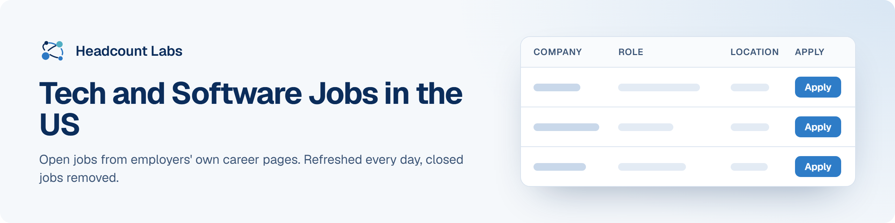

# Tech and Software Jobs in the US

Software, data, AI, security, cloud and IT jobs at US employers, sorted by field.

**400 open jobs** · 127 new since the last update · 127 removed because they closed or left the employer's board · updated November 22, 2026 at 5:03 AM EST

This list is built and refreshed every day by [Headcount Labs](https://headcountlabs.com/?utm_source=github&utm_medium=job-list&utm_campaign=tech-jobs), which reads jobs straight from employers' own career pages and job boards. Every job here was still listed on its source board when we last read that board, within the past 3 days, and was posted in the past 30 days. Copies of the same job are merged into one row, and jobs that close are removed at the next update.

Want this data in your own app or agent? Use the [Headcount Labs jobs API](https://headcountlabs.com/docs/?utm_source=github&utm_medium=job-list&utm_campaign=tech-jobs) (free tier), the [MCP server](https://headcountlabs.com/mcp/?utm_source=github&utm_medium=job-list&utm_campaign=tech-jobs) for Claude, ChatGPT and other AI assistants, or the [public dataset subsets](https://huggingface.co/HeadcountLabs) on Hugging Face (the full dataset is coming soon).

**Full dataset.** A bigger, one-off snapshot dated 2026-10-19 (all matching jobs, not only the open jobs below) is on Hugging Face: [Tech and software jobs](https://huggingface.co/datasets/HeadcountLabs/tech-jobs). It loads with `datasets.load_dataset` and is under the Open Database License (ODbL) 1.0.

**Jump to:** [Software engineering (198)](#software-engineering) · [Data, AI and machine learning (142)](#data-ai-and-machine-learning) · [Product and design (2)](#product-and-design) · [Hardware and engineering (51)](#hardware-and-engineering) · [Business, finance and operations (4)](#business-finance-and-operations) · [Other roles (3)](#other-roles)

**Columns.** *Apply* opens the original posting on the employer's site. *Details* opens the job on Headcount Labs, with every posting we found for it. *Remote* shows what the employer states; a dash means the posting doesn't say. *Pay* is the range the employer published.

## Software engineering

| Company | Role | Location | Remote | Pay | Posted | Apply | Details |
| --- | --- | --- | --- | --- | --- | :---: | :---: |
| **World Wide Technology** | Cyber Security Sales Specialist -- Commercial Enterprise (OH/MI) | 

2 locations
Columbus, OH Detroit, MI
 | Remote | $140k–$160k/yr | Nov 20 |  | <a href="https://headcountlabs.com/catalog/jobs/89aceadd-ecf3-4e9b-a808-aedadfeb1fc3?utm_source=github&utm_medium=job-list&utm_campaign=tech-jobs">via Headcount Labs</a> |
| **World Wide Technology** | Cyber Security Sales Specialist -- Tennessee | 

5 locations
Chattanooga, TN Mount Juliet, TN Memphis, TN Nashville, TN Knoxville, TN
 | Remote | $140k–$160k/yr | Nov 20 |  | <a href="https://headcountlabs.com/catalog/jobs/40c932c0-b40c-4410-bc44-43fe4c12ddba?utm_source=github&utm_medium=job-list&utm_campaign=tech-jobs">via Headcount Labs</a> |
| **Waste Connections** | Application Developer | The Woodlands, TX | — | — | Nov 20 |  | <a href="https://headcountlabs.com/catalog/jobs/0cdf2f56-daa3-49b3-a83d-f87cdd6da574?utm_source=github&utm_medium=job-list&utm_campaign=tech-jobs">via Headcount Labs</a> |
| **Schwab** | Senior .NET Software Engineer | Austin, TX | — | $155k–$170k/yr | Nov 20 |  | <a href="https://headcountlabs.com/catalog/jobs/7c79ff79-467b-4fc6-a8f9-5600415a4673?utm_source=github&utm_medium=job-list&utm_campaign=tech-jobs">via Headcount Labs</a> |
| **Ralliant** | Senior Software Engineer- Precision Motion &amp; Sensing Systems | Boxborough, MA | Hybrid | — | Nov 20 |  | <a href="https://headcountlabs.com/catalog/jobs/6bac4cad-7551-48a8-8edb-2a9879ecc251?utm_source=github&utm_medium=job-list&utm_campaign=tech-jobs">via Headcount Labs</a> |
| **Koniag Government Services** | SharePoint/PowerApps Developer | Vienna, VA | — | — | Nov 20 |  | <a href="https://headcountlabs.com/catalog/jobs/7c80e671-69a7-42a2-aa90-11d00c7931fd?utm_source=github&utm_medium=job-list&utm_campaign=tech-jobs">via Headcount Labs</a> |
| **Horizon Behavioral Health** | IT Cyber Security Specialist | Lynchburg, VA | — | $61k–$83k/yr | Nov 20 |  | <a href="https://headcountlabs.com/catalog/jobs/663bfe54-f559-4cf2-bd4c-05da838e3473?utm_source=github&utm_medium=job-list&utm_campaign=tech-jobs">via Headcount Labs</a> |
| **Ford Motor Company** | Software Development Engineer | Cary, NC | On-site | $85k–$143k/yr | Nov 20 |  | <a href="https://headcountlabs.com/catalog/jobs/bc9156bc-d32c-413c-81c0-a1cc61848501?utm_source=github&utm_medium=job-list&utm_campaign=tech-jobs">via Headcount Labs</a> |
| **Ford Motor Company** | Senior Staff Android App Developer — Android Automotive OS Applications | Palo Alto, CA | On-site | $167k–$317k/yr | Nov 20 |  | <a href="https://headcountlabs.com/catalog/jobs/46af21bd-66c6-41f6-afc8-f065ad62231f?utm_source=github&utm_medium=job-list&utm_campaign=tech-jobs">via Headcount Labs</a> |
| **Experian** | Software Engineer - .NET | Schaumburg, IL | Hybrid | — | Nov 20 |  | <a href="https://headcountlabs.com/catalog/jobs/39f0ea35-bbf1-4a69-b645-461e437a12ea?utm_source=github&utm_medium=job-list&utm_campaign=tech-jobs">via Headcount Labs</a> |
| **CGI Technologies and Solutions, Inc.** | webMethods Developer | Columbus, OH | — | — | Nov 20 |  | <a href="https://headcountlabs.com/catalog/jobs/233d540d-1c0d-4e58-b1b3-4d9fc664c1fb?utm_source=github&utm_medium=job-list&utm_campaign=tech-jobs">via Headcount Labs</a> |
| **CGI Technologies and Solutions, Inc.** | Azure Quality Assurance/DevOps | Plano, TX | — | — | Nov 20 |  | <a href="https://headcountlabs.com/catalog/jobs/061e71b3-dd40-423c-a4e1-aff51f88622f?utm_source=github&utm_medium=job-list&utm_campaign=tech-jobs">via Headcount Labs</a> |
| **Airwallex** | Developer Product Marketing Manager, Agentic | US - San Francisco | Hybrid | $190k–$270k/yr | Nov 20 |  | <a href="https://headcountlabs.com/catalog/jobs/322a40f3-4866-4d8d-869c-148ed5175653?utm_source=github&utm_medium=job-list&utm_campaign=tech-jobs">via Headcount Labs</a> |
| **Xcelerate Solutions** | Software Developer SME (SIPR Case Management Systems) – TS/SCI | Quantico, VA | — | — | Nov 19 |  | <a href="https://headcountlabs.com/catalog/jobs/3b471252-0913-4631-8bbe-a966fb5a110e?utm_source=github&utm_medium=job-list&utm_campaign=tech-jobs">via Headcount Labs</a> |
| **World Wide Technology** | Senior Sharepoint Developer | 

5 locations
Washington, DC Dulles, VA Falls Church, VA Chantilly, VA Springfield, VA
 | Hybrid | $140k–$150k/yr | Nov 19 |  | <a href="https://headcountlabs.com/catalog/jobs/1dd2dbd3-97ef-41ac-b6ec-dda70319d8a5?utm_source=github&utm_medium=job-list&utm_campaign=tech-jobs">via Headcount Labs</a> |
| **UL, LLC** | Senior Business Manager - Risk &amp; Compliance Software team | United States | Remote | — | Nov 19 |  | <a href="https://headcountlabs.com/catalog/jobs/7a711b1c-c5cc-4e1e-8060-3ff756b597c6?utm_source=github&utm_medium=job-list&utm_campaign=tech-jobs">via Headcount Labs</a> |
| **Tektronix** | Software Engineering Intern (Summer 2027) | Beaverton, OR | Hybrid | — | Nov 19 |  | <a href="https://headcountlabs.com/catalog/jobs/6f48b6ff-536d-4416-be62-b1e736543687?utm_source=github&utm_medium=job-list&utm_campaign=tech-jobs">via Headcount Labs</a> |
| **Talan** | Senior Oracle APEX Developer | Texas City, TX | Remote | $110k–$130k/yr | Nov 19 |  | <a href="https://headcountlabs.com/catalog/jobs/5ed84f25-23d9-4052-a188-3db3a31751ce?utm_source=github&utm_medium=job-list&utm_campaign=tech-jobs">via Headcount Labs</a> |
| **SteerBridge** | Security Engineer Lead - Security Operations | Vienna, VA | Hybrid | $120k–$160k/yr | Nov 19 |  | <a href="https://headcountlabs.com/catalog/jobs/128c1d33-b0d1-45f0-90e8-03d9c925f9b0?utm_source=github&utm_medium=job-list&utm_campaign=tech-jobs">via Headcount Labs</a> |
| **Search Jobs - INL Interns** | Software Engineering Intern - Summer 2027 — Java/API Development for Neutronics Code | Idaho Falls, ID | On-site | $29.39–$32.41/hr | Nov 19 |  | <a href="https://headcountlabs.com/catalog/jobs/32f38ef4-74b1-4356-8b2a-8fad76e27fc8?utm_source=github&utm_medium=job-list&utm_campaign=tech-jobs">via Headcount Labs</a> |
| **Schwab** | Software Development Engineer in Test (SDET) – Data Quality &amp; Automation Engineering | 

2 locations
Southlake, TX Austin, TX
 | — | $112k–$153k/yr | Nov 19 |  | <a href="https://headcountlabs.com/catalog/jobs/e7aaff65-a84b-4050-8d76-1a4ae434ccb6?utm_source=github&utm_medium=job-list&utm_campaign=tech-jobs">via Headcount Labs</a> |
| **Schwab** | Software Development Engineer (React/.NET) | Austin, TX | — | $135k–$148k/yr | Nov 19 |  | <a href="https://headcountlabs.com/catalog/jobs/d7cadc6e-77cb-4df6-b520-f86cb762806b?utm_source=github&utm_medium=job-list&utm_campaign=tech-jobs">via Headcount Labs</a> |
| **Schwab** | Manager, Software Development &amp; Engineering | 

2 locations
Westlake, TX Austin, TX
 | — | $160k–$224k/yr | Nov 19 |  | <a href="https://headcountlabs.com/catalog/jobs/bde9424e-41eb-4329-ae1e-c80eace924f8?utm_source=github&utm_medium=job-list&utm_campaign=tech-jobs">via Headcount Labs</a> |
| **Schwab** | Sr Manager, Software Development &amp; Engineering Senior | 

2 locations
Phoenix, AZ Austin, TX
 | — | $157k–$235k/yr | Nov 19 |  | <a href="https://headcountlabs.com/catalog/jobs/bba5b620-0f7c-4b4f-805f-95548a5c1163?utm_source=github&utm_medium=job-list&utm_campaign=tech-jobs">via Headcount Labs</a> |
| **Sallie Mae** | Software Engineering Intern | Newark, DE | — | — | Nov 19 |  | <a href="https://headcountlabs.com/catalog/jobs/b839ba28-f3ff-47e5-a16b-5fa272bd630d?utm_source=github&utm_medium=job-list&utm_campaign=tech-jobs">via Headcount Labs</a> |
| **SAIC** | Cloud Engineer | 

2 locations
Charleston, SC New Orleans, LA
 | On-site | $120k–$160k/yr | Nov 19 |  | <a href="https://headcountlabs.com/catalog/jobs/2568ee9d-7119-4041-9d87-4e34cb43cf28?utm_source=github&utm_medium=job-list&utm_campaign=tech-jobs">via Headcount Labs</a> |
| **Red Arch Solutions** | Jr. Software Engineer | Annapolis Junction, MD | On-site | $90k–$105k/yr | Nov 19 |  | <a href="https://headcountlabs.com/catalog/jobs/c4fdddd3-8a17-4d09-9129-a9a7ff03eebe?utm_source=github&utm_medium=job-list&utm_campaign=tech-jobs">via Headcount Labs</a> |
| **Red Arch Solutions** | Cyber Threat Intelligence and Data Integration SME | Reston, VA | On-site | $190k–$230k/yr | Nov 19 |  | <a href="https://headcountlabs.com/catalog/jobs/684e153d-d33e-48d0-83dd-724378253338?utm_source=github&utm_medium=job-list&utm_campaign=tech-jobs">via Headcount Labs</a> |
| **Ralliant** | Software Engineering Intern (Summer 2027) | Beaverton, OR | Hybrid | — | Nov 19 |  | <a href="https://headcountlabs.com/catalog/jobs/9e4233e6-dac3-43e0-87b5-c6283d466cfd?utm_source=github&utm_medium=job-list&utm_campaign=tech-jobs">via Headcount Labs</a> |
| **Petual** | Software Engineer | San Francisco, CA | On-site | — | Nov 19 |  | <a href="https://headcountlabs.com/catalog/jobs/7c9f88da-e279-45e4-a620-436cb2d2e903?utm_source=github&utm_medium=job-list&utm_campaign=tech-jobs">via Headcount Labs</a> |
| **PDS Defense** | Software Engineer 5 | Melbourne, FL | — | — | Nov 19 |  | <a href="https://headcountlabs.com/catalog/jobs/345c6884-9877-4775-bb8c-905b1331386c?utm_source=github&utm_medium=job-list&utm_campaign=tech-jobs">via Headcount Labs</a> |
| **Parallel Web Systems** | Member of Technical Staff, Developer Experience | 

2 locations
San Francisco or Palo Alto New York, NY
 | On-site | $150k–$300k/yr | Nov 19 |  | <a href="https://headcountlabs.com/catalog/jobs/31dffdc5-9a45-4ae7-8eae-4f1c390ccab2?utm_source=github&utm_medium=job-list&utm_campaign=tech-jobs">via Headcount Labs</a> |
| **Novalink Solutions LLC** | Senior .NET - Angular Full Stack Developer | Lansing, MI | — | $68.40/hr | Nov 19 |  | <a href="https://headcountlabs.com/catalog/jobs/c9455905-1ac7-42c2-a4c6-f2a5eb1bb302?utm_source=github&utm_medium=job-list&utm_campaign=tech-jobs">via Headcount Labs</a> |
| **National Vision** | Software Developer II | Alpharetta, GA | Hybrid | — | Nov 19 |  | <a href="https://headcountlabs.com/catalog/jobs/bce25ea6-f45d-4488-8577-aa71383e17ac?utm_source=github&utm_medium=job-list&utm_campaign=tech-jobs">via Headcount Labs</a> |
| **Loma Linda** | Full-Stack Developer | Loma Linda, CA | Hybrid | $49.97–$67.21/hr | Nov 19 |  | <a href="https://headcountlabs.com/catalog/jobs/101a7a87-8170-40ca-80c2-962e2a684cdb?utm_source=github&utm_medium=job-list&utm_campaign=tech-jobs">via Headcount Labs</a> |
| **Library Systems &amp; Services LLC** | Junior Web Developer | Aurora, CO | Remote | $70k–$90k/yr | Nov 19 |  | <a href="https://headcountlabs.com/catalog/jobs/2d98cd0e-3aa8-469d-b541-817f1441e87f?utm_source=github&utm_medium=job-list&utm_campaign=tech-jobs">via Headcount Labs</a> |
| **Legrand Group** | CNC Machine Programmer II | Farmingdale, NY | On-site | — | Nov 19 |  | <a href="https://headcountlabs.com/catalog/jobs/4314734a-bb18-43ed-b107-e7766a8ed72c?utm_source=github&utm_medium=job-list&utm_campaign=tech-jobs">via Headcount Labs</a> |
| **Lambda** | Principal Software Engineer | 

2 locations
Bellevue, WA San Francisco Office (Fremont St)
 | Hybrid | $372k–$495k/yr | Nov 19 |  | <a href="https://headcountlabs.com/catalog/jobs/c4dbb2ea-815b-49a7-a29e-7aa2eacac779?utm_source=github&utm_medium=job-list&utm_campaign=tech-jobs">via Headcount Labs</a> |
| **JPMorganChase** | Sr. Lead Software Engineer — Trust and Security | 

3 locations
New York, NY Jersey City, NJ United States
 | On-site | — | Nov 19 |  | <a href="https://headcountlabs.com/catalog/jobs/b24e01f0-dcf3-4938-9dc2-007a3f290ce9?utm_source=github&utm_medium=job-list&utm_campaign=tech-jobs">via Headcount Labs</a> |
| **JPMorganChase** | Security Engineer II -Python Developer | Jersey City, NJ | On-site | $124k–$150k/yr | Nov 19 |  | <a href="https://headcountlabs.com/catalog/jobs/f0400502-8cac-409a-a9ed-2c1e15ff77e2?utm_source=github&utm_medium=job-list&utm_campaign=tech-jobs">via Headcount Labs</a> |
| **Johndeere** | Software Engineer | Milan, IL | On-site | $87k–$130k/yr | Nov 19 |  | <a href="https://headcountlabs.com/catalog/jobs/ab649fd5-86e5-4f1d-9384-9d3d35e1597f?utm_source=github&utm_medium=job-list&utm_campaign=tech-jobs">via Headcount Labs</a> |
| **Johndeere** | 2026018 Information Security Engineer | Chicago, IL | On-site | $151k–$161k/yr | Nov 19 |  | <a href="https://headcountlabs.com/catalog/jobs/466b2b5c-fa2d-4285-b638-c01b032fb524?utm_source=github&utm_medium=job-list&utm_campaign=tech-jobs">via Headcount Labs</a> |
| **Intuit** | Staff Software Engineer | 

2 locations
Mountain View, CA New York, NY
 | — | $202k–$274k/yr | Nov 19 |  | <a href="https://headcountlabs.com/catalog/jobs/29a8366b-b7a2-4905-8254-67a8c5df205b?utm_source=github&utm_medium=job-list&utm_campaign=tech-jobs">via Headcount Labs</a> |
| **IIIIIIUS** | ServiceNow Developer (EAM, HAM, SAM)) - Remote | Reston, VA | Remote | $99k–$168k/yr | Nov 19 |  | <a href="https://headcountlabs.com/catalog/jobs/0650c03e-1295-4cad-925a-e0c3d7ced163?utm_source=github&utm_medium=job-list&utm_campaign=tech-jobs">via Headcount Labs</a> |
| **HealthPartners** | Senior SharePoint Developer | Bloomington, MN | Hybrid | $53.41–$80.11/hr | Nov 19 |  | <a href="https://headcountlabs.com/catalog/jobs/5146c463-688c-4ebf-9f2e-e1d3fa62acb5?utm_source=github&utm_medium=job-list&utm_campaign=tech-jobs">via Headcount Labs</a> |
| **GRVTY** | Web Developer | McLean, VA | — | $150k–$250k/yr | Nov 19 |  | <a href="https://headcountlabs.com/catalog/jobs/839a1074-dd61-4e93-a9de-900b8f00ebb7?utm_source=github&utm_medium=job-list&utm_campaign=tech-jobs">via Headcount Labs</a> |
| **Fitch Group** | Senior Gen AI Software Engineer | Chicago, IL | — | $120k–$140k/yr | Nov 19 |  | <a href="https://headcountlabs.com/catalog/jobs/bab645d3-427e-423e-a09d-8b348c68c5f2?utm_source=github&utm_medium=job-list&utm_campaign=tech-jobs">via Headcount Labs</a> |
| **Esri** | Software Development Engineer | Vienna, VA | — | $131k–$135k/yr | Nov 19 |  | <a href="https://headcountlabs.com/catalog/jobs/d857f8cf-d5be-4443-aace-130a68c01979?utm_source=github&utm_medium=job-list&utm_campaign=tech-jobs">via Headcount Labs</a> |
| **CGI Technologies and Solutions, Inc.** | Senior Java Developer with Kafka* | 

2 locations
Dallas, TX Pittsburgh, PA
 | — | — | Nov 19 |  | <a href="https://headcountlabs.com/catalog/jobs/40d96308-6f8d-4943-a93a-32e51707a164?utm_source=github&utm_medium=job-list&utm_campaign=tech-jobs">via Headcount Labs</a> |
| **CGI Technologies and Solutions, Inc.** | Java Developer with Kafka* | Pittsburgh, PA | — | — | Nov 19 |  | <a href="https://headcountlabs.com/catalog/jobs/e804be48-a2f1-477e-9293-9e131bffd874?utm_source=github&utm_medium=job-list&utm_campaign=tech-jobs">via Headcount Labs</a> |
| **Bombardier** | Software Engineering Intern (Year-round) | Wichita, KS | — | — | Nov 19 |  | <a href="https://headcountlabs.com/catalog/jobs/f27fe399-f3b7-46bf-85f9-eef48cf44ce7?utm_source=github&utm_medium=job-list&utm_campaign=tech-jobs">via Headcount Labs</a> |
| **Boeing** | Senior Embedded Software Engineer | 

2 locations
Long Beach, CA United States
 | — | $172k–$232k/yr | Nov 19 |  | <a href="https://headcountlabs.com/catalog/jobs/64ac2886-971e-45a1-9b27-159ead1592ee?utm_source=github&utm_medium=job-list&utm_campaign=tech-jobs">via Headcount Labs</a> |
| **Boeing** | Advanced Technologist - Associate Cloud Engineer | Hazelwood, MO | — | $98k–$132k/yr | Nov 19 |  | <a href="https://headcountlabs.com/catalog/jobs/a04ae259-cbf1-4a6a-a6b9-195adcc56bdd?utm_source=github&utm_medium=job-list&utm_campaign=tech-jobs">via Headcount Labs</a> |
| **Boeing** | Advanced Technologist - Mid-Level Cloud Engineer | Hazelwood, MO | — | $119k–$161k/yr | Nov 19 |  | <a href="https://headcountlabs.com/catalog/jobs/3def3cbb-cab0-4d18-a121-2f9b42bb2f47?utm_source=github&utm_medium=job-list&utm_campaign=tech-jobs">via Headcount Labs</a> |
| **Boeing** | Mission Systems (MS) Senior Software Manager | Berkeley, MO | — | $234k–$316k/yr | Nov 19 |  | <a href="https://headcountlabs.com/catalog/jobs/1b7ce91c-9a25-487f-b989-0201d2206110?utm_source=github&utm_medium=job-list&utm_campaign=tech-jobs">via Headcount Labs</a> |
| **August Health** | Senior Security Engineer | United States | Remote | — | Nov 19 |  | <a href="https://headcountlabs.com/catalog/jobs/eb5eff9a-7f60-444d-bfe8-df33a61faf69?utm_source=github&utm_medium=job-list&utm_campaign=tech-jobs">via Headcount Labs</a> |
| **ASEC, Inc** | Software Engineer | Lexington Park, MD | — | $130k–$180k/yr | Nov 19 |  | <a href="https://headcountlabs.com/catalog/jobs/d2f70632-8ac5-41ec-9b50-b2611c8e3f2e?utm_source=github&utm_medium=job-list&utm_campaign=tech-jobs">via Headcount Labs</a> |
| **Alumni** | Lead Software Engineer - Reliability Support | Plano, TX | On-site | — | Nov 19 |  | <a href="https://headcountlabs.com/catalog/jobs/f0dc808c-060d-4a1b-803e-a4a038c3712f?utm_source=github&utm_medium=job-list&utm_campaign=tech-jobs">via Headcount Labs</a> |
| **Alumni** | Software Engineer III – Data Engineer - PySpark/AWS/Databricks | Plano, TX | On-site | — | Nov 19 |  | <a href="https://headcountlabs.com/catalog/jobs/c255f5b8-48a1-47eb-a397-4ad3e67e1f4f?utm_source=github&utm_medium=job-list&utm_campaign=tech-jobs">via Headcount Labs</a> |
| **Alumni** | Lead Software Engineer - AWS &#124; Full Stack Java Development | 

2 locations
United States Columbus, OH
 | On-site | — | Nov 19 |  | <a href="https://headcountlabs.com/catalog/jobs/93732e98-1890-4e3d-898e-2c2e4162db6e?utm_source=github&utm_medium=job-list&utm_campaign=tech-jobs">via Headcount Labs</a> |
| **Alumni** | Lead Software Engineer - Full Stack Java Development &#124; Critical Platform Modernization | Columbus, OH | On-site | — | Nov 19 |  | <a href="https://headcountlabs.com/catalog/jobs/927cf98f-0b40-4551-ae96-ba0bef34f3ea?utm_source=github&utm_medium=job-list&utm_campaign=tech-jobs">via Headcount Labs</a> |
| **Alumni** | Sr Director of Software Engineering- AI Infrastructure Platforms | 

3 locations
Seattle, WA Palo Alto, CA San Francisco, CA
 | Hybrid | — | Nov 19 |  | <a href="https://headcountlabs.com/catalog/jobs/0e37ea9b-de7e-4e02-8cae-0b59d0f95b07?utm_source=github&utm_medium=job-list&utm_campaign=tech-jobs">via Headcount Labs</a> |
| **Alumni** | Lead Software Engineer - SRE Cloud Engineer | 

2 locations
Columbus, OH Jersey City, NJ
 | On-site | $157k–$215k/yr | Nov 19 |  | <a href="https://headcountlabs.com/catalog/jobs/061c69d1-81da-4210-a6c6-6fe6be1b461d?utm_source=github&utm_medium=job-list&utm_campaign=tech-jobs">via Headcount Labs</a> |
| **Alumni** | Senior Lead Software Engineer - Full Stack Java or Python, AWS, AI | Jersey City, NJ | On-site | $176k–$260k/yr | Nov 19 |  | <a href="https://headcountlabs.com/catalog/jobs/0030bb68-35a6-4b58-aa79-bffba08f67ce?utm_source=github&utm_medium=job-list&utm_campaign=tech-jobs">via Headcount Labs</a> |
| **Alumni** | Senior Lead Software Engineer - Data &amp; AI Platform Engineer | Jersey City, NJ | On-site | $176k–$260k/yr | Nov 19 |  | <a href="https://headcountlabs.com/catalog/jobs/c6e5aa61-af2c-48bb-b1b6-de2914330ac4?utm_source=github&utm_medium=job-list&utm_campaign=tech-jobs">via Headcount Labs</a> |
| **070 Humana Government Business, Inc.** | ECM Software Engineer | Kentucky | Remote | $81k–$110k/yr | Nov 19 |  | <a href="https://headcountlabs.com/catalog/jobs/8bcedff9-2496-4f5d-8796-7d9fd2f2dc4f?utm_source=github&utm_medium=job-list&utm_campaign=tech-jobs">via Headcount Labs</a> |
| **003 Humana Inc.** | Senior Full-Stack Engineer | 

5 locations
New York, NY Dallas, TX Louisville, KY Nashville, TN Washington, DC
 | Remote | $128k–$176k/yr | Nov 19 |  | <a href="https://headcountlabs.com/catalog/jobs/69d35393-80bb-49eb-80e9-2993ed4efcd3?utm_source=github&utm_medium=job-list&utm_campaign=tech-jobs">via Headcount Labs</a> |
| **Yes Energy** | Senior Backend Engineer | Boston, MA | Hybrid | $116k–$186k/yr | Nov 18 |  | <a href="https://headcountlabs.com/catalog/jobs/2092eb01-996f-44ab-99a5-3bed93350a0c?utm_source=github&utm_medium=job-list&utm_campaign=tech-jobs">via Headcount Labs</a> |
| **TheStaffed** | Project Manager – Cyber Incident Response | New York, NY | — | — | Nov 18 |  | <a href="https://headcountlabs.com/catalog/jobs/9ed482d2-74b6-4994-90d2-d107d086b29b?utm_source=github&utm_medium=job-list&utm_campaign=tech-jobs">via Headcount Labs</a> |
| **The Church of Jesus Christ of Latter-day Saints** | Email Developer Intern | Salt Lake City, UT | Hybrid | — | Nov 18 |  | <a href="https://headcountlabs.com/catalog/jobs/a428a41b-dec4-48f2-8e6b-4b0c7e403516?utm_source=github&utm_medium=job-list&utm_campaign=tech-jobs">via Headcount Labs</a> |
| **Tanaq Technical Services LLC** | Senior Security Engineer | United States | Remote | — | Nov 18 |  | <a href="https://headcountlabs.com/catalog/jobs/af8485a6-2cb6-47a5-985c-8b585cc45001?utm_source=github&utm_medium=job-list&utm_campaign=tech-jobs">via Headcount Labs</a> |
| **SteerBridge** | Security Engineer - Security Operations | Vienna, VA | On-site | $120k–$140k/yr | Nov 18 |  | <a href="https://headcountlabs.com/catalog/jobs/08c44140-685d-4046-bd85-ff6696f07306?utm_source=github&utm_medium=job-list&utm_campaign=tech-jobs">via Headcount Labs</a> |
| **Paradigm Health** | Staff Software Engineer, Full Stack | 

2 locations
United States Columbus
 | Remote | $187k–$234k/yr | Nov 18 |  | <a href="https://headcountlabs.com/catalog/jobs/8fa837e4-a8a2-4095-9140-8bceccae3954?utm_source=github&utm_medium=job-list&utm_campaign=tech-jobs">via Headcount Labs</a> |
| **Novalink Solutions LLC** | .Net Developer | Austin, TX | — | — | Nov 18 |  | <a href="https://headcountlabs.com/catalog/jobs/de7fcf04-1618-4fa2-ae49-2b5bff4f5bb6?utm_source=github&utm_medium=job-list&utm_campaign=tech-jobs">via Headcount Labs</a> |
| **Novalink Solutions LLC** | OA-IES-Software Process Engineer | Harrisburg, PA | — | — | Nov 18 |  | <a href="https://headcountlabs.com/catalog/jobs/a46cce10-54b3-4722-bff8-aeedca55ee79?utm_source=github&utm_medium=job-list&utm_campaign=tech-jobs">via Headcount Labs</a> |
| **Novalink Solutions LLC** | Cybersecurity Engineer 4 - hybrid Richmond, VA | Richmond, VA | Hybrid | — | Nov 18 |  | <a href="https://headcountlabs.com/catalog/jobs/326d0586-d245-4cb4-972a-a465d15e8d6e?utm_source=github&utm_medium=job-list&utm_campaign=tech-jobs">via Headcount Labs</a> |
| **Novalink Solutions LLC** | Senior Java Developer | Lansing, MI | — | — | Nov 18 |  | <a href="https://headcountlabs.com/catalog/jobs/2d0c9d40-ed25-4bd3-8a18-90cf95e3a73d?utm_source=github&utm_medium=job-list&utm_campaign=tech-jobs">via Headcount Labs</a> |
| **Novalink Solutions LLC** | Application Java Developer Expert | Lincoln, NE | — | — | Nov 18 |  | <a href="https://headcountlabs.com/catalog/jobs/242ad337-5541-4fd6-ac8d-5b7f007f91ce?utm_source=github&utm_medium=job-list&utm_campaign=tech-jobs">via Headcount Labs</a> |
| **Mercedes-Benz Group AG** | Adv, IT Software Architect | Fort Worth, TX | — | — | Nov 18 |  | <a href="https://headcountlabs.com/catalog/jobs/a6b64ec8-ed18-498e-a57b-711f1fc4b943?utm_source=github&utm_medium=job-list&utm_campaign=tech-jobs">via Headcount Labs</a> |
| **Kioxia** | Staff Embedded Software Engineer - 2300 | Folsom, CA | Hybrid | $115k–$192k/yr | Nov 18 |  | <a href="https://headcountlabs.com/catalog/jobs/25fe4555-5ce2-425f-b110-b9286e6c6d3a?utm_source=github&utm_medium=job-list&utm_campaign=tech-jobs">via Headcount Labs</a> |
| **Insperity** | Business Intelligence Developer | Phoenix, AZ | — | — | Nov 18 |  | <a href="https://headcountlabs.com/catalog/jobs/ac80437a-e948-4fee-b5b5-e6860c49bfd6?utm_source=github&utm_medium=job-list&utm_campaign=tech-jobs">via Headcount Labs</a> |
| **IIIIIIUS** | Salesforce Developer- Remote | Reston, VA | Remote | $81k–$139k/yr | Nov 18 |  | <a href="https://headcountlabs.com/catalog/jobs/23121aa1-9464-465e-a000-943e72758897?utm_source=github&utm_medium=job-list&utm_campaign=tech-jobs">via Headcount Labs</a> |
| **Harry's** | Senior Software Engineer, DTC | New York, NY | — | $130k–$140k/yr | Nov 18 |  | <a href="https://headcountlabs.com/catalog/jobs/81408d84-1f60-47eb-80d3-656f25789524?utm_source=github&utm_medium=job-list&utm_campaign=tech-jobs">via Headcount Labs</a> |
| **General Atomics** | Cyber Analyst III | Chantilly, VA | On-site | — | Nov 18 |  | <a href="https://headcountlabs.com/catalog/jobs/f2e866d3-4612-42d5-8613-952eb0079ae0?utm_source=github&utm_medium=job-list&utm_campaign=tech-jobs">via Headcount Labs</a> |
| **GameChanger** | Staff Software Engineer | GameChanger | Remote | $193k–$210k/yr | Nov 18 |  | <a href="https://headcountlabs.com/catalog/jobs/c2b5a930-360e-49d9-bcd4-aba72486d266?utm_source=github&utm_medium=job-list&utm_campaign=tech-jobs">via Headcount Labs</a> |
| **Florida Blue** | IT Systems Engineer (macOS and iOS Management) | Jacksonville, FL | Hybrid | $84k–$106k/yr | Nov 18 |  | <a href="https://headcountlabs.com/catalog/jobs/c49b918e-303a-4ca1-8acd-cf8e993f9a52?utm_source=github&utm_medium=job-list&utm_campaign=tech-jobs">via Headcount Labs</a> |
| **County of Monterey** | SOFTWARE ENGINEER II | Salinas, CA | — | $8k–$11k/mo | Nov 18 |  | <a href="https://headcountlabs.com/catalog/jobs/8965e5d7-2d0e-4ddf-ac7d-b160b2ac556b?utm_source=github&utm_medium=job-list&utm_campaign=tech-jobs">via Headcount Labs</a> |
| **Cherokee Nation Entertainment** | ERP Developer | Tulsa, OK | On-site | — | Nov 18 |  | <a href="https://headcountlabs.com/catalog/jobs/7f73f72b-789a-4999-a907-c275f0a07fc5?utm_source=github&utm_medium=job-list&utm_campaign=tech-jobs">via Headcount Labs</a> |
| **Astrion** | Cybersecurity Engineer | United States | Remote | $165k–$175k/yr | Nov 18 |  | <a href="https://headcountlabs.com/catalog/jobs/9ced02da-8e66-41d6-ad76-8052a7d5a85f?utm_source=github&utm_medium=job-list&utm_campaign=tech-jobs">via Headcount Labs</a> |
| **Acuity Inc.** | Brand &amp; Product Marketing Manager (Software and Services) | Conyers, GA | — | $69k–$110k/yr | Nov 18 |  | <a href="https://headcountlabs.com/catalog/jobs/02e65cf1-1b3f-4e62-90e8-cba2e7205cd3?utm_source=github&utm_medium=job-list&utm_campaign=tech-jobs">via Headcount Labs</a> |
| **003 Humana Inc.** | Senior Full Stack Engineer - NBA | United States | Remote | $107k–$147k/yr | Nov 18 |  | <a href="https://headcountlabs.com/catalog/jobs/4d9b146d-074e-4602-9987-2b932ee5f68d?utm_source=github&utm_medium=job-list&utm_campaign=tech-jobs">via Headcount Labs</a> |
| **Stanley Martin Homes** | Software Engineer | Reston, VA | On-site | — | Nov 17 |  | <a href="https://headcountlabs.com/catalog/jobs/49bcf2dc-6958-4d99-8beb-b2364defdce1?utm_source=github&utm_medium=job-list&utm_campaign=tech-jobs">via Headcount Labs</a> |
| **Revolutional, LLC** | Lead Application Developer | Suitland, MD | Hybrid | $160k–$190k/yr | Nov 17 |  | <a href="https://headcountlabs.com/catalog/jobs/e3a602e8-0f65-4a7d-9a2e-7e59342d08b7?utm_source=github&utm_medium=job-list&utm_campaign=tech-jobs">via Headcount Labs</a> |
| **Red Arch Solutions** | Cloud Software Engineer | Laurel, MD | On-site | $170k–$183k/yr | Nov 17 |  | <a href="https://headcountlabs.com/catalog/jobs/8670d724-ce2c-43ec-b111-a4a1be5d699f?utm_source=github&utm_medium=job-list&utm_campaign=tech-jobs">via Headcount Labs</a> |
| **Red Arch Solutions** | Information System Security Engineer (ISSE) | Laurel, MD | On-site | — | Nov 17 |  | <a href="https://headcountlabs.com/catalog/jobs/60ec73fc-b38f-4f72-9928-43f66b30c80e?utm_source=github&utm_medium=job-list&utm_campaign=tech-jobs">via Headcount Labs</a> |
| **READY 3 LLC** | Software Developer II (Mid-Level) | Oklahoma City, OK | — | — | Nov 17 |  | <a href="https://headcountlabs.com/catalog/jobs/dea59572-9cc5-4834-9420-3bd3cd43116d?utm_source=github&utm_medium=job-list&utm_campaign=tech-jobs">via Headcount Labs</a> |
| **NODA AI** | Forward-Deployed Engineer, Full-Stack Software | Austin, TX | Hybrid | — | Nov 17 |  | <a href="https://headcountlabs.com/catalog/jobs/9cb5c6d0-a2b1-44b7-9d55-a27684b33784?utm_source=github&utm_medium=job-list&utm_campaign=tech-jobs">via Headcount Labs</a> |
| **IEWC** | Application Engineer - Data Center Power Whips | Carrollton, TX | On-site | — | Nov 17 |  | <a href="https://headcountlabs.com/catalog/jobs/b2463860-25e4-4991-8d20-d79cb52eff0e?utm_source=github&utm_medium=job-list&utm_campaign=tech-jobs">via Headcount Labs</a> |
| **GameChanger** | Principal Software Engineer | GameChanger | Remote | $210k–$230k/yr | Nov 17 |  | <a href="https://headcountlabs.com/catalog/jobs/0289260e-bde6-435c-9323-76f773dd9961?utm_source=github&utm_medium=job-list&utm_campaign=tech-jobs">via Headcount Labs</a> |
| **Fieldguide** | Senior Software Engineer, Production Support | United States | Remote | $178k–$208k/yr | Nov 17 |  | <a href="https://headcountlabs.com/catalog/jobs/f3c228a3-a939-461c-8122-e314c0ae387f?utm_source=github&utm_medium=job-list&utm_campaign=tech-jobs">via Headcount Labs</a> |
| **Cherokee Federal** | Google Workspace App Developer | 

3 locations
Falls Church, VA San Antonio, TX Bethesda, MD
 | Remote | — | Nov 17 |  | <a href="https://headcountlabs.com/catalog/jobs/f95d1950-a184-4ef1-8fb0-ca6f7c0f51e3?utm_source=github&utm_medium=job-list&utm_campaign=tech-jobs">via Headcount Labs</a> |
| **AppFolio Inc** | Staff Software Engineer - Owner / Investor | 

6 locations
Office Hub - Santa Barbara Hub Office Hub - Dallas, TX Office Hub Hub - Washington, DC Office Hub - Columbus, OH
 | Remote | $167k–$230k/yr | Nov 17 |  | <a href="https://headcountlabs.com/catalog/jobs/3dbff613-cde0-40b9-b9b9-7e356ed1b657?utm_source=github&utm_medium=job-list&utm_campaign=tech-jobs">via Headcount Labs</a> |
| **TheStaffed** | Front-End React Developer | New York, NY | — | — | Nov 16 |  | <a href="https://headcountlabs.com/catalog/jobs/e5cc331a-78e0-46b9-ab1f-fac73ae0ae5d?utm_source=github&utm_medium=job-list&utm_campaign=tech-jobs">via Headcount Labs</a> |
| **Starbridge** | Software Engineer, Federal | New York City, NY | On-site | $200k–$300k/yr | Nov 16 |  | <a href="https://headcountlabs.com/catalog/jobs/6e7f9d76-e690-45cd-9931-f09dea677f27?utm_source=github&utm_medium=job-list&utm_campaign=tech-jobs">via Headcount Labs</a> |
| **Quora** | Senior Software Engineer - Infrastructure Security (Remote) | 

2 locations
Multiple Locations United States
 | Remote | — | Nov 16 |  | <a href="https://headcountlabs.com/catalog/jobs/14f0e341-22e1-4949-b957-4197d838324f?utm_source=github&utm_medium=job-list&utm_campaign=tech-jobs">via Headcount Labs</a> |
| **Pennymac** | Executive Vice President, Software Engineering | 

2 locations
Westlake Village, CA Cary, NC
 | — | $180k–$383k/yr | Nov 16 |  | <a href="https://headcountlabs.com/catalog/jobs/fb4c4517-50fd-4a46-af34-4c1aaa8997d5?utm_source=github&utm_medium=job-list&utm_campaign=tech-jobs">via Headcount Labs</a> |
| **NuScale Power, LLC** | Software Engineer 4 (Commercial Nuclear) | United States | — | $141k–$170k/yr | Nov 16 |  | <a href="https://headcountlabs.com/catalog/jobs/9ef01f25-f73f-401e-9039-59197ad45689?utm_source=github&utm_medium=job-list&utm_campaign=tech-jobs">via Headcount Labs</a> |
| **Innovative Systems** | Software Support Analyst - Portuguese Speaker | Pittsburgh, PA | Hybrid | — | Nov 16 |  | <a href="https://headcountlabs.com/catalog/jobs/8c09d295-5f66-46fc-9378-cf541be99c2b?utm_source=github&utm_medium=job-list&utm_campaign=tech-jobs">via Headcount Labs</a> |
| **Harrison.ai** | Site Reliability Engineer, Teleradiology | United States | Remote | — | Nov 16 |  | <a href="https://headcountlabs.com/catalog/jobs/1493ef95-1aa9-4651-9632-727cd09ada7b?utm_source=github&utm_medium=job-list&utm_campaign=tech-jobs">via Headcount Labs</a> |
| **ECP** | Lead Software Engineer, Clinical | 

3 locations
Chicago, IL Denver, CO Madison, WI
 | Remote | — | Nov 16 |  | <a href="https://headcountlabs.com/catalog/jobs/46a5d606-04e3-4239-a9ed-ee1a8be54f84?utm_source=github&utm_medium=job-list&utm_campaign=tech-jobs">via Headcount Labs</a> |
| **AppFolio Inc** | Manager, Software Engineering - Owner/Investor | 

6 locations
Office Hub - Santa Barbara Hub Office Hub - Dallas, TX Office Hub Hub - Washington, DC Office Hub - Columbus, OH
 | Remote | $167k–$230k/yr | Nov 16 |  | <a href="https://headcountlabs.com/catalog/jobs/e96b3e54-67c4-4080-a48d-c440883121c1?utm_source=github&utm_medium=job-list&utm_campaign=tech-jobs">via Headcount Labs</a> |
| **Vicor Corporation** | Manufacturing Engineer - Molding and Back End | Andover, MA | — | $95k–$105k/yr | Nov 15 |  | <a href="https://headcountlabs.com/catalog/jobs/5b4d0c61-14ae-440c-b866-f9c8d0199908?utm_source=github&utm_medium=job-list&utm_campaign=tech-jobs">via Headcount Labs</a> |
| **Netic** | Software Engineer, Product | San Francisco, CA | On-site | $145k–$330k/yr | Nov 15 |  | <a href="https://headcountlabs.com/catalog/jobs/8565e48d-2044-4fc7-937e-bfb5c17c998d?utm_source=github&utm_medium=job-list&utm_campaign=tech-jobs">via Headcount Labs</a> |
| **Netic** | Software Engineer, Infrastructure | San Francisco, CA | On-site | $145k–$330k/yr | Nov 15 |  | <a href="https://headcountlabs.com/catalog/jobs/312272f9-508a-416e-bfc3-b505bf74c986?utm_source=github&utm_medium=job-list&utm_campaign=tech-jobs">via Headcount Labs</a> |
| **Lambda** | Software Engineer - Data Center Tooling | 

3 locations
San Francisco Office (Fremont St) San Jose Office (First St) Bellevue, WA
 | Hybrid | $255k–$340k/yr | Nov 14 |  | <a href="https://headcountlabs.com/catalog/jobs/838242da-67a9-421b-af99-4f9137d60dcd?utm_source=github&utm_medium=job-list&utm_campaign=tech-jobs">via Headcount Labs</a> |
| **TAP Engineering** | Software Integration &amp; Test Engineer | Fort Meade, MD | On-site | $138k–$230k/yr | Nov 13 |  | <a href="https://headcountlabs.com/catalog/jobs/a19e4600-34cf-44c6-a27f-1a2cd737b1e7?utm_source=github&utm_medium=job-list&utm_campaign=tech-jobs">via Headcount Labs</a> |
| **SteerBridge** | Network Operations Center - Security Engineer | Vienna, VA | On-site | $120k–$140k/yr | Nov 13 |  | <a href="https://headcountlabs.com/catalog/jobs/b7f698e3-5cdc-47dd-bdcd-0f9bc335c1de?utm_source=github&utm_medium=job-list&utm_campaign=tech-jobs">via Headcount Labs</a> |
| **SAIC** | Cybersecurity Engineer - DSOP | 

2 locations
Beale AFB, CA Chantilly, VA
 | — | $160k–$200k/yr | Nov 13 |  | <a href="https://headcountlabs.com/catalog/jobs/873254e2-5048-4f8b-81a6-ffeabc7d94a2?utm_source=github&utm_medium=job-list&utm_campaign=tech-jobs">via Headcount Labs</a> |
| **SAIC** | Cybersecurity Engineer - Cloud | 

2 locations
Beale AFB, CA Chantilly, VA
 | — | $160k–$200k/yr | Nov 13 |  | <a href="https://headcountlabs.com/catalog/jobs/e7860ea7-3ff8-4783-93ef-1a1c23141c5a?utm_source=github&utm_medium=job-list&utm_campaign=tech-jobs">via Headcount Labs</a> |
| **SageCor Solutions** | Software Integration Engineer 4 (IDN - 206) | Fort Meade, MD | — | — | Nov 13 |  | <a href="https://headcountlabs.com/catalog/jobs/9209f4b2-c710-4e30-9bfb-44d0d27610f1?utm_source=github&utm_medium=job-list&utm_campaign=tech-jobs">via Headcount Labs</a> |
| **SageCor Solutions** | Software Integration Engineer 2 (IDN - 207) | Fort Meade, MD | — | — | Nov 13 |  | <a href="https://headcountlabs.com/catalog/jobs/89af19ad-74ef-4c6b-9840-980741f70b5d?utm_source=github&utm_medium=job-list&utm_campaign=tech-jobs">via Headcount Labs</a> |
| **SageCor Solutions** | Software Engineer 2 (FST - 153) | Hanover, MD | — | — | Nov 13 |  | <a href="https://headcountlabs.com/catalog/jobs/28b93d09-df06-44d9-92e9-ff3385cf2c22?utm_source=github&utm_medium=job-list&utm_campaign=tech-jobs">via Headcount Labs</a> |
| **Metropolitan Transportation Authority** | Application Developer Levels 1 - 5 - Revenue Applications (TCU) | New York, NY | — | $57k–$82k/yr | Nov 13 |  | <a href="https://headcountlabs.com/catalog/jobs/56771e2f-99c6-4518-8943-f9358f3fc861?utm_source=github&utm_medium=job-list&utm_campaign=tech-jobs">via Headcount Labs</a> |
| **Varonis** | MDR Security Engineer | United States | — | — | Nov 12 |  | <a href="https://headcountlabs.com/catalog/jobs/a4f672cb-4bc2-4bba-8c87-d613b1ea1524?utm_source=github&utm_medium=job-list&utm_campaign=tech-jobs">via Headcount Labs</a> |
| **Tenet3** | DevOps Engineer - Hybrid | Dayton, OH | Hybrid | — | Nov 12 |  | <a href="https://headcountlabs.com/catalog/jobs/00f47f3c-507a-4a29-a347-da05303ebce9?utm_source=github&utm_medium=job-list&utm_campaign=tech-jobs">via Headcount Labs</a> |
| **Scope** | Software Engineer - NY (DreamLever) | New York City, NY | Hybrid | — | Nov 12 |  | <a href="https://headcountlabs.com/catalog/jobs/d10eb088-ae57-4ee6-92ca-6f4e0f004fad?utm_source=github&utm_medium=job-list&utm_campaign=tech-jobs">via Headcount Labs</a> |
| **Scope** | Software Engineer (UpNext) | New York City, NY | Hybrid | — | Nov 12 |  | <a href="https://headcountlabs.com/catalog/jobs/39102871-8e86-43f5-a94c-fc8a11540500?utm_source=github&utm_medium=job-list&utm_campaign=tech-jobs">via Headcount Labs</a> |
| **REGENT** | Staff Software Certification Engineer | North Kingstown, RI | On-site | — | Nov 12 |  | <a href="https://headcountlabs.com/catalog/jobs/6aaa44ba-b6c1-4bc3-abbb-25d90e5925a7?utm_source=github&utm_medium=job-list&utm_campaign=tech-jobs">via Headcount Labs</a> |
| **Jellyfish** | SFMC Developer | United States | Hybrid | $90k–$110k/yr | Nov 12 |  | <a href="https://headcountlabs.com/catalog/jobs/363f0ea4-6f33-4b54-b360-6258bd1a0765?utm_source=github&utm_medium=job-list&utm_campaign=tech-jobs">via Headcount Labs</a> |
| **SAIC** | Cloud Platform Engineer | 

2 locations
Chantilly, VA Beale AFB, CA
 | — | $120k–$160k/yr | Nov 11 |  | <a href="https://headcountlabs.com/catalog/jobs/c5dda755-566d-4ee5-adb3-4aa9e85162bc?utm_source=github&utm_medium=job-list&utm_campaign=tech-jobs">via Headcount Labs</a> |
| **Insurity** | Lead Software Engineer | United States | Remote | $84k–$165k/yr | Nov 11 |  | <a href="https://headcountlabs.com/catalog/jobs/3b28fd56-daed-4372-ae15-733f5930b1bc?utm_source=github&utm_medium=job-list&utm_campaign=tech-jobs">via Headcount Labs</a> |
| **Honeywell Aerospace** | Software Engineer I-Web Applications | Phoenix, AZ | Hybrid | — | Nov 11 |  | <a href="https://headcountlabs.com/catalog/jobs/16da9e0a-c391-4179-b6eb-838d67966260?utm_source=github&utm_medium=job-list&utm_campaign=tech-jobs">via Headcount Labs</a> |
| **Wispr Flow** | Mobile Product Engineer, iOS++ | 

2 locations
San Francisco, CA United States
 | Hybrid | $220k–$330k/yr | Nov 10 |  | <a href="https://headcountlabs.com/catalog/jobs/311276fd-7a7f-460a-bc2c-6d8f49cfc70c?utm_source=github&utm_medium=job-list&utm_campaign=tech-jobs">via Headcount Labs</a> |
| **Revolutional, LLC** | Senior SOAR Developer | 

3 locations
Austin, TX Hines, IL Martinsburg, WV
 | — | $150k–$160k/yr | Nov 10 |  | <a href="https://headcountlabs.com/catalog/jobs/1891a850-54ac-43a7-bb2d-d96124d2c4f8?utm_source=github&utm_medium=job-list&utm_campaign=tech-jobs">via Headcount Labs</a> |
| **REGENT** | Embedded Software Engineering Intern (Summer) | North Kingstown, RI | — | — | Nov 10 |  | <a href="https://headcountlabs.com/catalog/jobs/d581a630-8fb6-4eaa-9169-7fd63500f92f?utm_source=github&utm_medium=job-list&utm_campaign=tech-jobs">via Headcount Labs</a> |
| **REGENT** | Mission Software Engineering Intern (Summer) | North Kingstown, RI | On-site | — | Nov 10 |  | <a href="https://headcountlabs.com/catalog/jobs/06a0f937-19f4-4733-a53c-039637abcdc9?utm_source=github&utm_medium=job-list&utm_campaign=tech-jobs">via Headcount Labs</a> |
| **Origence** | Staff Software Engineer | Irvine, CA | — | $145k–$185k/yr | Nov 10 |  | <a href="https://headcountlabs.com/catalog/jobs/c0b9dc78-bb18-4d0a-b920-953ce79b034b?utm_source=github&utm_medium=job-list&utm_campaign=tech-jobs">via Headcount Labs</a> |
| **Intuit** | Staff Software Engineer - Mid Market Verticals | Mountain View, CA | — | $202k–$274k/yr | Nov 10 |  | <a href="https://headcountlabs.com/catalog/jobs/7de85447-925c-45c5-aa83-0fdcccc47943?utm_source=github&utm_medium=job-list&utm_campaign=tech-jobs">via Headcount Labs</a> |
| **General Atomics** | Software Developer II | Poway, CA | On-site | — | Nov 10 |  | <a href="https://headcountlabs.com/catalog/jobs/816fad2c-5367-48d4-9f8c-22a700d5390e?utm_source=github&utm_medium=job-list&utm_campaign=tech-jobs">via Headcount Labs</a> |
| **VivSoft Technologies** | Cybersecurity Engineer | United States | Remote | $70k–$90k/yr | Nov 9 |  | <a href="https://headcountlabs.com/catalog/jobs/0a992fa5-ca65-4067-a5a9-5ad4779cc4fc?utm_source=github&utm_medium=job-list&utm_campaign=tech-jobs">via Headcount Labs</a> |
| **Varonis** | Security Engineer | United States | — | — | Nov 9 |  | <a href="https://headcountlabs.com/catalog/jobs/ae9bd1ac-e644-4666-8df6-0eda741a02a1?utm_source=github&utm_medium=job-list&utm_campaign=tech-jobs">via Headcount Labs</a> |
| **Revolutional, LLC** | Program Manager - Cyber | Washington, DC | On-site | $170k–$215k/yr | Nov 9 |  | <a href="https://headcountlabs.com/catalog/jobs/5e904cf4-bf42-46c8-b0d3-934ec7bc540d?utm_source=github&utm_medium=job-list&utm_campaign=tech-jobs">via Headcount Labs</a> |
| **Revolutional, LLC** | Sr. Tenable Security Engineer | Washington, DC | On-site | $150k–$185k/yr | Nov 9 |  | <a href="https://headcountlabs.com/catalog/jobs/f59d2e19-c676-4102-b76a-34c17b791c7b?utm_source=github&utm_medium=job-list&utm_campaign=tech-jobs">via Headcount Labs</a> |
| **Pantograph** | Member of Technical Staff, Robotics Software Engineer | San Francisco, CA | On-site | — | Nov 9 |  | <a href="https://headcountlabs.com/catalog/jobs/d957bd0d-370f-48e1-8182-b04c49e12ccd?utm_source=github&utm_medium=job-list&utm_campaign=tech-jobs">via Headcount Labs</a> |
| **Pantograph** | Member of Technical Staff, Software Engineer, Platform | San Francisco, CA | On-site | — | Nov 9 |  | <a href="https://headcountlabs.com/catalog/jobs/2d817ef0-7162-477f-8a62-4fe0ba5bf1b7?utm_source=github&utm_medium=job-list&utm_campaign=tech-jobs">via Headcount Labs</a> |
| **Metropolitan Transportation Authority** | Application Developer Levels 1 - 5 -iOS | New York, NY | — | $57k–$82k/yr | Nov 9 |  | <a href="https://headcountlabs.com/catalog/jobs/f48f2e3f-4b45-4c70-a818-071dc60925eb?utm_source=github&utm_medium=job-list&utm_campaign=tech-jobs">via Headcount Labs</a> |
| **Metropolitan Transportation Authority** | Advanced Software Engineer - iOS | New York, NY | — | $141k–$166k/yr | Nov 9 |  | <a href="https://headcountlabs.com/catalog/jobs/1f94e387-9a60-450c-9758-72c3e6813eb2?utm_source=github&utm_medium=job-list&utm_campaign=tech-jobs">via Headcount Labs</a> |
| **Metropolitan Transportation Authority** | Cybersecurity Engineer Levels 4 - 7 | New York, NY | — | $106k–$144k/yr | Nov 9 |  | <a href="https://headcountlabs.com/catalog/jobs/15298b14-9ab2-467b-9f6d-d0b0e792de37?utm_source=github&utm_medium=job-list&utm_campaign=tech-jobs">via Headcount Labs</a> |
| **Komatsu** | SAP Security Engineer | Milwaukee, WI | — | — | Nov 9 |  | <a href="https://headcountlabs.com/catalog/jobs/00521eac-841f-44f8-9e73-bf3e927fc238?utm_source=github&utm_medium=job-list&utm_campaign=tech-jobs">via Headcount Labs</a> |
| **JPMorganChase** | Java Fullstack Software Engineer III - Kubernetes / React | Tampa, FL | On-site | — | Nov 9 |  | <a href="https://headcountlabs.com/catalog/jobs/63fe333c-0bc1-4d3d-b681-f36dd1a19882?utm_source=github&utm_medium=job-list&utm_campaign=tech-jobs">via Headcount Labs</a> |
| **Fitch Group** | Senior Software Engineer, Data Platforms &amp; Applications | New York, NY | — | $140k–$150k/yr | Nov 9 |  | <a href="https://headcountlabs.com/catalog/jobs/6da165cd-5986-45ce-86d6-a5aa9b932f9e?utm_source=github&utm_medium=job-list&utm_campaign=tech-jobs">via Headcount Labs</a> |
| **Everyday Health - Division** | Site Reliability Engineer | 

4 locations
Seattle, WA New York, NY Denver, CO Memphis, TN
 | — | $90k–$100k/yr | Nov 9 |  | <a href="https://headcountlabs.com/catalog/jobs/f07f9cd2-20f4-4b21-9004-f43b9769a169?utm_source=github&utm_medium=job-list&utm_campaign=tech-jobs">via Headcount Labs</a> |
| **Berkshire Hathaway Homestate Companies** | Senior Cyber Security Engineer | 

2 locations
Bay Area, CA Sacramento, CA
 | Hybrid | $176k–$215k/yr | Nov 9 |  | <a href="https://headcountlabs.com/catalog/jobs/b0e30584-d93f-4f4f-b9fb-6bc7ac4c4483?utm_source=github&utm_medium=job-list&utm_campaign=tech-jobs">via Headcount Labs</a> |
| **Allegiant** | Software Engineer in Test (SET) | Las Vegas, NV | On-site | $80k–$98k/yr | Nov 9 |  | <a href="https://headcountlabs.com/catalog/jobs/185831bf-cc29-44eb-9765-db2026e36ee0?utm_source=github&utm_medium=job-list&utm_campaign=tech-jobs">via Headcount Labs</a> |
| **Conga** | Staff Software Engineer - Backend (Java) | 

2 locations
US - Boston, MA US - Houston, TX
 | Hybrid | $144k–$230k/yr | Nov 8 |  | <a href="https://headcountlabs.com/catalog/jobs/b093695b-6920-4923-ab72-30fee61b903d?utm_source=github&utm_medium=job-list&utm_campaign=tech-jobs">via Headcount Labs</a> |
| **Prodapt** | Senior Technical Lead Developer (Salesforce) | Richardson, TX | — | — | Nov 6 |  | <a href="https://headcountlabs.com/catalog/jobs/ac2cd9fd-9420-43d0-bb94-849e3be2b2b9?utm_source=github&utm_medium=job-list&utm_campaign=tech-jobs">via Headcount Labs</a> |
| **Koniag Government Services** | Salesforce Developer (REMOTE) | Colorado | Remote | $120k–$150k/yr | Nov 6 |  | <a href="https://headcountlabs.com/catalog/jobs/2a9ece44-1367-44a9-a538-3e528773f747?utm_source=github&utm_medium=job-list&utm_campaign=tech-jobs">via Headcount Labs</a> |
| **JPMorganChase** | Senior Lead Software Engineer - Security Platforms | 

5 locations
Jersey City, NJ Columbus, OH Plano, TX Tampa, FL Brooklyn, NY
 | On-site | — | Nov 6 |  | <a href="https://headcountlabs.com/catalog/jobs/f04b3b4f-bf7e-4b95-98fe-610d9f3887c8?utm_source=github&utm_medium=job-list&utm_campaign=tech-jobs">via Headcount Labs</a> |
| **SAIC** | Senior Software Development Engineer in Test | 

2 locations
Huntsville, AL Work, AL
 | Remote | $120k–$160k/yr | Nov 5 |  | <a href="https://headcountlabs.com/catalog/jobs/e7024c88-de2d-4118-966f-f2b822290f1c?utm_source=github&utm_medium=job-list&utm_campaign=tech-jobs">via Headcount Labs</a> |
| **Mercedes-Benz Group AG** | AI/ML Platform Engineer | Atlanta, GA | — | — | Nov 5 |  | <a href="https://headcountlabs.com/catalog/jobs/195b6bae-1bb7-4fa3-834b-c218824a60c0?utm_source=github&utm_medium=job-list&utm_campaign=tech-jobs">via Headcount Labs</a> |
| **Brain Corp** | Staff Software Engineer, Applications | San Diego, CA | — | $187k–$234k/yr | Nov 5 |  | <a href="https://headcountlabs.com/catalog/jobs/d73a3fda-d218-411a-8918-563ca388733c?utm_source=github&utm_medium=job-list&utm_campaign=tech-jobs">via Headcount Labs</a> |
| **SMBC** | Associate, RPA Developer | Charlotte, NC | — | $159k–$175k/yr | Nov 4 |  | <a href="https://headcountlabs.com/catalog/jobs/7147acb1-6762-42a6-8983-27c86bdb7588?utm_source=github&utm_medium=job-list&utm_campaign=tech-jobs">via Headcount Labs</a> |
| **Sealing Technologies, a Parsons Company** | Senior Software Engineer (Ansible Automation) | Columbia, MD | On-site | $127k–$157k/yr | Nov 4 |  | <a href="https://headcountlabs.com/catalog/jobs/5696fb4c-6e0f-449b-9dc1-b8bab5951d1b?utm_source=github&utm_medium=job-list&utm_campaign=tech-jobs">via Headcount Labs</a> |
| **Sealing Technologies, a Parsons Company** | Software Engineer (Infrastructure Automation) | Columbia, MD | On-site | $72k–$120k/yr | Nov 4 |  | <a href="https://headcountlabs.com/catalog/jobs/535ae3ff-5c7d-434f-b4f5-4889761b7cf1?utm_source=github&utm_medium=job-list&utm_campaign=tech-jobs">via Headcount Labs</a> |
| **SageCor Solutions** | Software Engineer 2 (FST - 151) | Annapolis Junction, MD | — | — | Nov 4 |  | <a href="https://headcountlabs.com/catalog/jobs/87432d1f-d52c-449d-9bb0-5a54dfe0163c?utm_source=github&utm_medium=job-list&utm_campaign=tech-jobs">via Headcount Labs</a> |
| **Lambda** | Senior Security Engineer - Product Security | 

2 locations
San Francisco Office (Fremont St) Bellevue, WA
 | Hybrid | $296k–$395k/yr | Nov 4 |  | <a href="https://headcountlabs.com/catalog/jobs/939756d1-6356-448a-893d-e823ced1fbc5?utm_source=github&utm_medium=job-list&utm_campaign=tech-jobs">via Headcount Labs</a> |
| **Komodo Health** | Senior Security Engineer, Product Security | United States | Remote | $200k–$245k/yr | Nov 4 |  | <a href="https://headcountlabs.com/catalog/jobs/6cbfcdf3-9734-4444-bfc2-0b490d981838?utm_source=github&utm_medium=job-list&utm_campaign=tech-jobs">via Headcount Labs</a> |
| **Akima** | Senior Game Developer | Huntsville, AL | Hybrid | — | Nov 4 |  | <a href="https://headcountlabs.com/catalog/jobs/b3c74042-914f-4b0c-88c7-075fc68d5360?utm_source=github&utm_medium=job-list&utm_campaign=tech-jobs">via Headcount Labs</a> |
| **Revolutional, LLC** | Sr. Java Developer/Team Lead | McLean, VA | Remote | $150k–$180k/yr | Nov 3 |  | <a href="https://headcountlabs.com/catalog/jobs/5b1b029c-5abb-4b6e-9998-e543c2756945?utm_source=github&utm_medium=job-list&utm_campaign=tech-jobs">via Headcount Labs</a> |
| **Red Alpha** | Full Stack Software Engineer (2 days telework/week, TS/SCI with Polygraph required) | Annapolis Junction, MD | — | $115k–$220k/yr | Nov 3 |  | <a href="https://headcountlabs.com/catalog/jobs/a562819e-21f0-4588-819d-6af81447febf?utm_source=github&utm_medium=job-list&utm_campaign=tech-jobs">via Headcount Labs</a> |
| **Red Alpha** | Front End Developer (3 days telework/week, TS/SCI with Polygraph required) | Columbia, MD | — | $130k–$220k/yr | Nov 3 |  | <a href="https://headcountlabs.com/catalog/jobs/7e607f3a-917c-4c14-b791-c6e221422280?utm_source=github&utm_medium=job-list&utm_campaign=tech-jobs">via Headcount Labs</a> |
| **Red Alpha** | AI/ML Software Engineer | Annapolis Junction, MD | — | $170k–$220k/yr | Nov 3 |  | <a href="https://headcountlabs.com/catalog/jobs/6652f594-81db-4541-9694-32ac81c0f1e9?utm_source=github&utm_medium=job-list&utm_campaign=tech-jobs">via Headcount Labs</a> |
| **Pivot Energy** | Project Developer, Built Environment | 

4 locations
Denver, CO Chicago, IL Elkridge, MD Baltimore, MD
 | Hybrid | $105k–$140k/yr | Nov 3 |  | <a href="https://headcountlabs.com/catalog/jobs/8be47d83-0d32-4de4-ae64-02ee2665775a?utm_source=github&utm_medium=job-list&utm_campaign=tech-jobs">via Headcount Labs</a> |
| **Muck Rack** | Senior Software Engineer, Search &amp; AI | (Bulgaria, Canada, Ireland | Remote | — | Nov 3 |  | <a href="https://headcountlabs.com/catalog/jobs/1ad5b24e-9c3e-4ddc-b870-ef29c7909c44?utm_source=github&utm_medium=job-list&utm_campaign=tech-jobs">via Headcount Labs</a> |
| **Lambda** | Senior Security Engineer - Detection &amp; Response | 

3 locations
San Francisco Office (Fremont St) San Jose Office (First St) Bellevue, WA
 | Hybrid | $296k–$395k/yr | Nov 3 |  | <a href="https://headcountlabs.com/catalog/jobs/387636d8-eb29-4b77-acbd-6a64ddffbf53?utm_source=github&utm_medium=job-list&utm_campaign=tech-jobs">via Headcount Labs</a> |
| **Koniag Government Services** | Sr. Web &amp; Mobile Developer &amp; DevOps (REMOTE) | Albuquerque, NM | — | $150k–$180k/yr | Nov 3 |  | <a href="https://headcountlabs.com/catalog/jobs/ffe63a01-561d-4be7-89b4-3d3cef45b672?utm_source=github&utm_medium=job-list&utm_campaign=tech-jobs">via Headcount Labs</a> |
| **JPMorgan Chase** | Senior Lead Software Engineer Cloud Platforms | 

2 locations
Jersey City, NJ Palo Alto, CA
 | On-site | — | Nov 3 |  | <a href="https://headcountlabs.com/catalog/jobs/901d74fe-ecb6-43de-ae18-5308dd6b8da2?utm_source=github&utm_medium=job-list&utm_campaign=tech-jobs">via Headcount Labs</a> |
| **Beazley Management Limited** | Team Administrator – US Cyber | 

2 locations
New York, NY West Hartford, CT
 | — | $75k–$85k/yr | Nov 3 |  | <a href="https://headcountlabs.com/catalog/jobs/31cf720b-b32b-4bf7-856f-598e0966cb6e?utm_source=github&utm_medium=job-list&utm_campaign=tech-jobs">via Headcount Labs</a> |
| **Ambiq Micro, Inc.** | Staff Engineer - Applications Software - Power | Austin, TX | On-site | — | Nov 3 |  | <a href="https://headcountlabs.com/catalog/jobs/654b16a4-1adf-4f9a-98d7-8218379304a9?utm_source=github&utm_medium=job-list&utm_campaign=tech-jobs">via Headcount Labs</a> |
| **Prodapt** | AI Full Stack Engineer | Irving | On-site | — | Nov 2 |  | <a href="https://headcountlabs.com/catalog/jobs/0068a4a2-bf8f-43d5-b0b6-07416df4faad?utm_source=github&utm_medium=job-list&utm_campaign=tech-jobs">via Headcount Labs</a> |
| **MSX International** | Associate Software Engineer | Warwick | — | — | Nov 2 |  | <a href="https://headcountlabs.com/catalog/jobs/be5e84e7-50f5-4a03-9afd-d7cd07b58811?utm_source=github&utm_medium=job-list&utm_campaign=tech-jobs">via Headcount Labs</a> |
| **Metropolitan Transportation Authority** | Computer Specialist (Software) Level 1-4 (TWU) | New York, NY | — | $109k–$118k/yr | Nov 2 |  | <a href="https://headcountlabs.com/catalog/jobs/d45baa37-b9bf-482e-80ff-402538290bc3?utm_source=github&utm_medium=job-list&utm_campaign=tech-jobs">via Headcount Labs</a> |
| **Yuzu** | Fullstack Engineer | New York City- | On-site | — | Nov 1 |  | <a href="https://headcountlabs.com/catalog/jobs/b6a844f0-bd0e-4323-b459-95e2439efd32?utm_source=github&utm_medium=job-list&utm_campaign=tech-jobs">via Headcount Labs</a> |
| **Yuzu** | Backend Engineer | New York City- | On-site | — | Nov 1 |  | <a href="https://headcountlabs.com/catalog/jobs/b36f5fc6-ef00-458c-be17-dbce89629440?utm_source=github&utm_medium=job-list&utm_campaign=tech-jobs">via Headcount Labs</a> |
| **SMBC** | Full Stack Developer (Python), Vice President | Charlotte, NC | — | — | Oct 31 |  | <a href="https://headcountlabs.com/catalog/jobs/3afcd6e4-11d1-447f-b77b-770ab5e3ec35?utm_source=github&utm_medium=job-list&utm_campaign=tech-jobs">via Headcount Labs</a> |
| **Prodapt** | Sr Cloud/ DevOps Engineer | Richardson, TX | — | — | Oct 30 |  | <a href="https://headcountlabs.com/catalog/jobs/721f1b0d-8eca-4c49-ad61-8a91bbb37e12?utm_source=github&utm_medium=job-list&utm_campaign=tech-jobs">via Headcount Labs</a> |
| **Canopy** | Senior Full Stack Engineer | Utah | Remote | — | Oct 30 |  | <a href="https://headcountlabs.com/catalog/jobs/bfa836f9-38df-4740-9f5d-9c5a5e9a12ab?utm_source=github&utm_medium=job-list&utm_campaign=tech-jobs">via Headcount Labs</a> |
| **BlueSky** | Senior Software Engineer, Backend | United States | Remote | $179k–$220k/yr | Oct 30 |  | <a href="https://headcountlabs.com/catalog/jobs/1c18ae0c-d1eb-44a6-b6e8-0515a8799760?utm_source=github&utm_medium=job-list&utm_campaign=tech-jobs">via Headcount Labs</a> |
| **WorkForce Software** | WorkForce Software, Implementation Functional Consultant | 

2 locations
Augusta, GA Maitland, FL
 | Hybrid | — | Oct 29 |  | <a href="https://headcountlabs.com/catalog/jobs/ab55a04a-ed32-4277-b10c-411a1ccc5699?utm_source=github&utm_medium=job-list&utm_campaign=tech-jobs">via Headcount Labs</a> |
| **NODA AI** | Senior Full Stack Engineer | Austin, TX | Hybrid | — | Oct 29 |  | <a href="https://headcountlabs.com/catalog/jobs/3052cd1a-fd39-4c79-a7ea-634c812cbce6?utm_source=github&utm_medium=job-list&utm_campaign=tech-jobs">via Headcount Labs</a> |
| **Koniag Government Services** | Senior Appian Developer | Washington, DC | — | $160k–$187k/yr | Oct 29 |  | <a href="https://headcountlabs.com/catalog/jobs/93808712-dbb7-432b-98e9-ff9795c5113a?utm_source=github&utm_medium=job-list&utm_campaign=tech-jobs">via Headcount Labs</a> |
| **Koniag Government Services** | Generative AI Software Engineer | Washington, DC | — | $149k–$175k/yr | Oct 29 |  | <a href="https://headcountlabs.com/catalog/jobs/0ef8f6e1-5d08-4e2a-87d1-8864ca77eda7?utm_source=github&utm_medium=job-list&utm_campaign=tech-jobs">via Headcount Labs</a> |
| **Come join us!** | Senior AWS Agentic AI Developer (Contractor) | Van Nuys, CA | Remote | $50–$80/hr | Oct 29 |  | <a href="https://headcountlabs.com/catalog/jobs/390fb376-a84c-44e8-a2a2-8c290c9360ad?utm_source=github&utm_medium=job-list&utm_campaign=tech-jobs">via Headcount Labs</a> |
| **UL, LLC** | Senior Sales Executive, Software, Industrial Sector | 

3 locations
Chicago, IL Austin, TX Latham, NY
 | Remote | $94k–$126k/yr | Oct 28 |  | <a href="https://headcountlabs.com/catalog/jobs/02ffa0b9-1f91-4203-b07a-bd866e8eb73a?utm_source=github&utm_medium=job-list&utm_campaign=tech-jobs">via Headcount Labs</a> |
| **UL, LLC** | Senior Sales Executive, Software, Consumer Sector | 

4 locations
Chicago, IL Latham, NY Northbrook, IL Austin, TX
 | Remote | $94k–$126k/yr | Oct 28 |  | <a href="https://headcountlabs.com/catalog/jobs/ffb3ffbd-24c7-4a0c-8f02-67290e1e6cdc?utm_source=github&utm_medium=job-list&utm_campaign=tech-jobs">via Headcount Labs</a> |
| **The Nuclear Company** | Spring 2027 Security Engineer Intern | Washington, DC | Hybrid | $25/hr | Oct 28 |  | <a href="https://headcountlabs.com/catalog/jobs/ffe81a4a-3e0d-489c-bea9-b5d3710ca7ab?utm_source=github&utm_medium=job-list&utm_campaign=tech-jobs">via Headcount Labs</a> |
| **SMBC** | VP, Business Analytics Developer | Charlotte, NC | — | $153k–$196k/yr | Oct 28 |  | <a href="https://headcountlabs.com/catalog/jobs/4b68d61f-337d-41bd-acce-b174ed2aaaa0?utm_source=github&utm_medium=job-list&utm_campaign=tech-jobs">via Headcount Labs</a> |
| **Garda Capital Partners** | Software Engineer Intern (C#) | Wayzata, MN | — | $45/hr | Oct 28 |  | <a href="https://headcountlabs.com/catalog/jobs/68968872-4292-4d95-8cd2-ec68d772b174?utm_source=github&utm_medium=job-list&utm_campaign=tech-jobs">via Headcount Labs</a> |

## Data, AI and machine learning

| Company | Role | Location | Remote | Pay | Posted | Apply | Details |
| --- | --- | --- | --- | --- | --- | :---: | :---: |
| **Schwab** | Platform Support Data Engineer | 

2 locations
Austin, TX Southlake, TX
 | — | $55.29–$62.50/hr | Nov 20 |  | <a href="https://headcountlabs.com/catalog/jobs/9743d994-d710-4108-98be-5c1ad5bd5f1b?utm_source=github&utm_medium=job-list&utm_campaign=tech-jobs">via Headcount Labs</a> |
| **Landis+Gyr** | Sr Data and Business Analyst | Alpharetta, GA | — | $92k–$116k/yr | Nov 20 |  | <a href="https://headcountlabs.com/catalog/jobs/190de79b-4010-4038-b97f-d023c1ae14c5?utm_source=github&utm_medium=job-list&utm_campaign=tech-jobs">via Headcount Labs</a> |
| **Honeywell Aerospace** | Chief Engineer - Digital Transformation and AI Methods for Turbomachinery | Phoenix, AZ | Hybrid | — | Nov 20 |  | <a href="https://headcountlabs.com/catalog/jobs/9233abf7-d67d-4c8c-a453-0110ac64a04f?utm_source=github&utm_medium=job-list&utm_campaign=tech-jobs">via Headcount Labs</a> |
| **Esri** | Product Engineer II – Graph Analysis and Semantic Data Modeling (ArcGIS Pro) | Redlands, CA | On-site | $80k–$133k/yr | Nov 20 |  | <a href="https://headcountlabs.com/catalog/jobs/543ef4e1-f84b-451e-9368-9f88bb34e048?utm_source=github&utm_medium=job-list&utm_campaign=tech-jobs">via Headcount Labs</a> |
| **CGI Technologies and Solutions, Inc.** | Data Scientist | Alpharetta, GA | — | — | Nov 20 |  | <a href="https://headcountlabs.com/catalog/jobs/3bfeb0fe-2362-4e62-b2e6-35b92bd40af6?utm_source=github&utm_medium=job-list&utm_campaign=tech-jobs">via Headcount Labs</a> |
| **CGI Technologies and Solutions, Inc.** | Data Architect | 

3 locations
United States Pittsburgh, PA Cleveland, OH
 | Remote | — | Nov 20 |  | <a href="https://headcountlabs.com/catalog/jobs/89b3947c-975c-4122-9a72-32f0680a7f7a?utm_source=github&utm_medium=job-list&utm_campaign=tech-jobs">via Headcount Labs</a> |
| **Veralto Global** | Master Data Specialist | 

2 locations
Loveland, CO Romeoville, IL
 | — | $60k–$70k/yr | Nov 19 |  | <a href="https://headcountlabs.com/catalog/jobs/2bba462f-14a8-459c-99dc-9f1494df0389?utm_source=github&utm_medium=job-list&utm_campaign=tech-jobs">via Headcount Labs</a> |
| **UL, LLC** | Data Engineer | 

2 locations
Makati City Northbrook, IL
 | — | — | Nov 19 |  | <a href="https://headcountlabs.com/catalog/jobs/5f5259df-d515-4313-bc93-fe55c40b3a5e?utm_source=github&utm_medium=job-list&utm_campaign=tech-jobs">via Headcount Labs</a> |
| **Solaris Health Holdings** | Data Governance Manager | United States | — | — | Nov 19 |  | <a href="https://headcountlabs.com/catalog/jobs/38ceed24-d2fb-4051-9100-44ef670a0b43?utm_source=github&utm_medium=job-list&utm_campaign=tech-jobs">via Headcount Labs</a> |
| **Search Jobs - INL Professional** | Applied Energy Research Data Scientist | 

3 locations
Idaho Falls, ID Salt Lake City, UT United States
 | Remote | $114k–$234k/yr | Nov 19 |  | <a href="https://headcountlabs.com/catalog/jobs/1bb27e9c-efad-4677-835a-6d6871d07190?utm_source=github&utm_medium=job-list&utm_campaign=tech-jobs">via Headcount Labs</a> |
| **Schwab** | Data Platform Product Manager | 

2 locations
Austin, TX Southlake, TX
 | — | $120k–$135k/yr | Nov 19 |  | <a href="https://headcountlabs.com/catalog/jobs/dc1044c4-f829-43c9-a88f-eaa305555b02?utm_source=github&utm_medium=job-list&utm_campaign=tech-jobs">via Headcount Labs</a> |
| **Sallie Mae** | Data Lifecycle and Governance Intern | Newark, DE | — | — | Nov 19 |  | <a href="https://headcountlabs.com/catalog/jobs/af12f232-d23b-42f6-818c-02f2e5d339b0?utm_source=github&utm_medium=job-list&utm_campaign=tech-jobs">via Headcount Labs</a> |
| **Red Arch Solutions** | Data Scientist | Laurel, MD | On-site | $200k–$210k/yr | Nov 19 |  | <a href="https://headcountlabs.com/catalog/jobs/9fa4eced-7cf0-40aa-8d18-6b9c41f3171f?utm_source=github&utm_medium=job-list&utm_campaign=tech-jobs">via Headcount Labs</a> |
| **PFSWEB INC** | Data Center Lead - Various Shift | United States | — | $24.75/hr | Nov 19 |  | <a href="https://headcountlabs.com/catalog/jobs/cf9119cf-adbd-414a-be3f-b2d03df93a19?utm_source=github&utm_medium=job-list&utm_campaign=tech-jobs">via Headcount Labs</a> |
| **PFSWEB INC** | Data Center Logistics Associate - 1st Shift | United States | — | — | Nov 19 |  | <a href="https://headcountlabs.com/catalog/jobs/c3e04db5-8d9f-40c0-a285-b8bc82f41627?utm_source=github&utm_medium=job-list&utm_campaign=tech-jobs">via Headcount Labs</a> |
| **PFSWEB INC** | Data Center Operations Supervisor - Weekend 1st Shift | United States | — | — | Nov 19 |  | <a href="https://headcountlabs.com/catalog/jobs/ca97d1ee-d64d-4ab9-8ae9-5ef49b729340?utm_source=github&utm_medium=job-list&utm_campaign=tech-jobs">via Headcount Labs</a> |
| **PFSWEB INC** | Data Center Logistics Associate - Weekend 1st Shift | United States | — | — | Nov 19 |  | <a href="https://headcountlabs.com/catalog/jobs/9bc09855-34d4-46b6-a1b5-2f0744f1b1c7?utm_source=github&utm_medium=job-list&utm_campaign=tech-jobs">via Headcount Labs</a> |
| **PFSWEB INC** | Data Center Logistics Associate - 2nd Shift | United States | — | — | Nov 19 |  | <a href="https://headcountlabs.com/catalog/jobs/2cc6aa45-66d6-4846-bd55-679665ce70a1?utm_source=github&utm_medium=job-list&utm_campaign=tech-jobs">via Headcount Labs</a> |
| **PFSWEB INC** | Data Center Logistics Associate - 3rd Shift | United States | — | — | Nov 19 |  | <a href="https://headcountlabs.com/catalog/jobs/dfb224ea-b94d-4289-806d-4e032d5b1466?utm_source=github&utm_medium=job-list&utm_campaign=tech-jobs">via Headcount Labs</a> |
| **PFSWEB INC** | Data Center Logistics Associate - Weekend 2nd Shift | United States | — | — | Nov 19 |  | <a href="https://headcountlabs.com/catalog/jobs/59f7c7c6-40b9-4f79-9f3a-5d11fe571780?utm_source=github&utm_medium=job-list&utm_campaign=tech-jobs">via Headcount Labs</a> |
| **Netic** | Applied AI Engineer | San Francisco, CA | On-site | $145k–$330k/yr | Nov 19 |  | <a href="https://headcountlabs.com/catalog/jobs/25b25608-c53a-436b-9e67-3abd92988f7a?utm_source=github&utm_medium=job-list&utm_campaign=tech-jobs">via Headcount Labs</a> |
| **Navy Federal Credit Union** | Intern - Year Round (Data Analytics) | Pensacola, FL | Hybrid | $17.21–$29.76/hr | Nov 19 |  | <a href="https://headcountlabs.com/catalog/jobs/49426bf0-6b24-4424-9b49-a2f86814b133?utm_source=github&utm_medium=job-list&utm_campaign=tech-jobs">via Headcount Labs</a> |
| **Moser Consulting** | AWS/Databricks Cloud Data Engineer | Indianapolis, IN | Remote | $85k–$125k/yr | Nov 19 |  | <a href="https://headcountlabs.com/catalog/jobs/6ef5c477-8445-41c7-9250-87e6e5a33c27?utm_source=github&utm_medium=job-list&utm_campaign=tech-jobs">via Headcount Labs</a> |
| **MetLife** | Data &amp; Operational Insight Analyst | Virtual | Remote | $71k–$120k/yr | Nov 19 |  | <a href="https://headcountlabs.com/catalog/jobs/216751ff-32e7-460b-a5eb-b252c91ece9d?utm_source=github&utm_medium=job-list&utm_campaign=tech-jobs">via Headcount Labs</a> |
| **MasTec Utility Services** | Medium Voltage Superintendent - Data Center | Boling, TX | — | — | Nov 19 |  | <a href="https://headcountlabs.com/catalog/jobs/71616beb-961b-4668-893c-d9f1995dceb4?utm_source=github&utm_medium=job-list&utm_campaign=tech-jobs">via Headcount Labs</a> |
| **Loma Linda** | Data Analyst | Loma Linda, CA | Remote | $78k–$103k/yr | Nov 19 |  | <a href="https://headcountlabs.com/catalog/jobs/2724a20d-29b4-445b-9eba-875e36023d73?utm_source=github&utm_medium=job-list&utm_campaign=tech-jobs">via Headcount Labs</a> |
| **Legrand Group** | Data Governance Manager - Hybrid | Canonsburg, PA | On-site | — | Nov 19 |  | <a href="https://headcountlabs.com/catalog/jobs/277a571c-8ef3-4d65-bcce-90bab600b65c?utm_source=github&utm_medium=job-list&utm_campaign=tech-jobs">via Headcount Labs</a> |
| **Koniag Government Services** | ISSO Data Analyst | 

2 locations
Las Vegas, NV Albuquerque, NM
 | — | — | Nov 19 |  | <a href="https://headcountlabs.com/catalog/jobs/4ed82f60-bdfa-4c3f-936e-c95d8df2f127?utm_source=github&utm_medium=job-list&utm_campaign=tech-jobs">via Headcount Labs</a> |
| **IDEA Public Schools** | CTE Technology and Data Manager (Immediate Opening) | 

7 locations
WESLACO, TX San Antonio, TX Austin, TX El Paso, TX Houston, TX Midland, TX Fort Worth, TX
 | — | $75k–$87k/yr | Nov 19 |  | <a href="https://headcountlabs.com/catalog/jobs/d12a6097-fab2-4e93-b27b-45030008ae9e?utm_source=github&utm_medium=job-list&utm_campaign=tech-jobs">via Headcount Labs</a> |
| **Honeywell Aerospace** | Senior Supplier Quality Engineer - Data Analytics | 

2 locations
United States Phoenix, AZ
 | Remote | $97k–$146k/yr | Nov 19 |  | <a href="https://headcountlabs.com/catalog/jobs/970f9696-6df0-4ad0-91a3-2d21d6e011a5?utm_source=github&utm_medium=job-list&utm_campaign=tech-jobs">via Headcount Labs</a> |
| **Honeywell Aerospace** | Sr. Data Analyst | 

2 locations
Charlotte, NC Phoenix, AZ
 | — | $85k–$106k/yr | Nov 19 |  | <a href="https://headcountlabs.com/catalog/jobs/854b00a9-6499-4296-8656-4d6cdf325fcc?utm_source=github&utm_medium=job-list&utm_campaign=tech-jobs">via Headcount Labs</a> |
| **HealthPartners** | Data Abstraction Specialist - Casual/On-Call | Bloomington, MN | On-site | $35.30–$52.94/hr | Nov 19 |  | <a href="https://headcountlabs.com/catalog/jobs/6dd03ccd-8ab0-4c27-a4d5-63f4fea9d6f9?utm_source=github&utm_medium=job-list&utm_campaign=tech-jobs">via Headcount Labs</a> |
| **Hackensack Meridian Health** | Data Coordinator - Center for Discovery &amp; Innovation | Perth Amboy, NJ | — | — | Nov 19 |  | <a href="https://headcountlabs.com/catalog/jobs/f9fce508-25e7-4c1b-9c12-5211366cf73e?utm_source=github&utm_medium=job-list&utm_campaign=tech-jobs">via Headcount Labs</a> |
| **Fitch Group** | Data Products &amp; Onboarding Product Owner | New York, NY | — | $150k–$170k/yr | Nov 19 |  | <a href="https://headcountlabs.com/catalog/jobs/a19b277e-179f-45bb-9a1b-1f7dcc369e0a?utm_source=github&utm_medium=job-list&utm_campaign=tech-jobs">via Headcount Labs</a> |
| **Experian** | Senior Director, Data Strategy &amp; Business Ventures | United States | Hybrid | — | Nov 19 |  | <a href="https://headcountlabs.com/catalog/jobs/1e20b72a-3158-4507-90b3-8df89b6a4bed?utm_source=github&utm_medium=job-list&utm_campaign=tech-jobs">via Headcount Labs</a> |
| **Enverus** | Austin based - Data Acquisition Associate Imaging - Contract - 26429D | Austin, TX | — | — | Nov 19 |  | <a href="https://headcountlabs.com/catalog/jobs/9cd55fee-672b-4f1e-b397-5c432d127a35?utm_source=github&utm_medium=job-list&utm_campaign=tech-jobs">via Headcount Labs</a> |
| **ECP** | Lead AI Engineer, Platform | 

3 locations
Chicago, IL Denver, CO Seattle, WA
 | Remote | — | Nov 19 |  | <a href="https://headcountlabs.com/catalog/jobs/18a1f43b-f01e-4a13-b519-9d98eb45073e?utm_source=github&utm_medium=job-list&utm_campaign=tech-jobs">via Headcount Labs</a> |
| **Delaware Nation Industries** | Data Analyst | Arlington, VA | On-site | — | Nov 19 |  | <a href="https://headcountlabs.com/catalog/jobs/5e949627-97b7-4938-a59f-b3484dfea901?utm_source=github&utm_medium=job-list&utm_campaign=tech-jobs">via Headcount Labs</a> |
| **Colliers Engineering &amp; Design** | Architectural Staff (Level 1 - Data Centers) | 

2 locations
McLean, VA Seattle, WA
 | — | $67k–$78k/yr | Nov 19 |  | <a href="https://headcountlabs.com/catalog/jobs/b219bb15-ba2c-4aa6-9b59-228e614b14e8?utm_source=github&utm_medium=job-list&utm_campaign=tech-jobs">via Headcount Labs</a> |
| **Colliers Engineering &amp; Design** | Project Architect - Data Centers (Hybrid) | 

3 locations
McLean, VA Austin, TX Seattle, WA
 | Hybrid | $67k–$124k/yr | Nov 19 |  | <a href="https://headcountlabs.com/catalog/jobs/b928690e-ea92-4ee5-8025-dbb33c8a9c2e?utm_source=github&utm_medium=job-list&utm_campaign=tech-jobs">via Headcount Labs</a> |
| **Citizen** | Senior Data Scientist | New York City | On-site | — | Nov 19 |  | <a href="https://headcountlabs.com/catalog/jobs/df76cea3-8abc-4a7f-add4-a8f80c754b22?utm_source=github&utm_medium=job-list&utm_campaign=tech-jobs">via Headcount Labs</a> |
| **CGI Technologies and Solutions, Inc.** | Data Engineer | Boca Raton, FL | Hybrid | — | Nov 19 |  | <a href="https://headcountlabs.com/catalog/jobs/6c10c9d0-e400-45d0-8871-0e03753f0a55?utm_source=github&utm_medium=job-list&utm_campaign=tech-jobs">via Headcount Labs</a> |
| **CGI Technologies and Solutions, Inc.** | GEN AI lead engineer | 

3 locations
Dallas, TX United States Pittsburgh, PA
 | Remote | — | Nov 19 |  | <a href="https://headcountlabs.com/catalog/jobs/beaae7d6-b294-472f-8dd8-79cba4814f54?utm_source=github&utm_medium=job-list&utm_campaign=tech-jobs">via Headcount Labs</a> |
| **AcuityMD** | Data Engineer | Boston, OR | Remote | $113k–$159k/yr | Nov 19 |  | <a href="https://headcountlabs.com/catalog/jobs/31ed6248-e780-4169-842e-994f738cf9d4?utm_source=github&utm_medium=job-list&utm_campaign=tech-jobs">via Headcount Labs</a> |
| **003 Humana Inc.** | Data Engineer | Louisville, KY | Remote | $98k–$134k/yr | Nov 19 |  | <a href="https://headcountlabs.com/catalog/jobs/b3221e5d-aba9-4081-a8a3-0e50986baa40?utm_source=github&utm_medium=job-list&utm_campaign=tech-jobs">via Headcount Labs</a> |
| **System** | Senior Research Engineer, AI Evaluation | New York City | Remote | $180k–$240k/yr | Nov 18 |  | <a href="https://headcountlabs.com/catalog/jobs/e1493a3e-de84-4644-b9ee-45540175e183?utm_source=github&utm_medium=job-list&utm_campaign=tech-jobs">via Headcount Labs</a> |
| **PFSWEB INC** | Data Center Logistics Associate - Weekend 3rd Shift | United States | — | — | Nov 18 |  | <a href="https://headcountlabs.com/catalog/jobs/e892281e-9190-4377-9c8c-5f34dc07f688?utm_source=github&utm_medium=job-list&utm_campaign=tech-jobs">via Headcount Labs</a> |
| **Lambda** | Senior Technical Program Manager - Data Center Infrastructure Delivery | United States | Remote | $214k–$284k/yr | Nov 18 |  | <a href="https://headcountlabs.com/catalog/jobs/fa3f8d4b-b445-4d30-ade7-91808c7db160?utm_source=github&utm_medium=job-list&utm_campaign=tech-jobs">via Headcount Labs</a> |
| **Janney Montgomery Scott LLC** | Data Engineering and Operations Leader | Philadelphia, PA | On-site | — | Nov 18 |  | <a href="https://headcountlabs.com/catalog/jobs/e2b2efad-ed71-476c-b1ba-5ef1090abc88?utm_source=github&utm_medium=job-list&utm_campaign=tech-jobs">via Headcount Labs</a> |
| **Intuit** | Staff Data Scientist - Turbotax Product | 

2 locations
San Diego, CA Mountain View, CA
 | — | $186k–$251k/yr | Nov 18 |  | <a href="https://headcountlabs.com/catalog/jobs/07e27cf7-4a6b-4579-aaa7-f985d09a0e5f?utm_source=github&utm_medium=job-list&utm_campaign=tech-jobs">via Headcount Labs</a> |
| **IIIIIIUS** | 2027 Summer Intern, AI Engineer (Master's Degree, Reston, VA) | Reston, VA | — | $32/hr | Nov 18 |  | <a href="https://headcountlabs.com/catalog/jobs/10a51238-d898-4ae0-8ecd-8d34c6c8d10b?utm_source=github&utm_medium=job-list&utm_campaign=tech-jobs">via Headcount Labs</a> |
| **Hyatt Corporation** | Senior Machine Learning Engineer (Chicago) | Chicago, IL | — | $150k–$180k/yr | Nov 18 |  | <a href="https://headcountlabs.com/catalog/jobs/5856db93-e6cb-4b5d-b9d1-b694eddae63f?utm_source=github&utm_medium=job-list&utm_campaign=tech-jobs">via Headcount Labs</a> |
| **GameChanger** | Staff Data Engineer | GameChanger | Remote | $193k–$210k/yr | Nov 18 |  | <a href="https://headcountlabs.com/catalog/jobs/5e29a31e-d6d7-4d81-9ea9-ec16b1afe1ad?utm_source=github&utm_medium=job-list&utm_campaign=tech-jobs">via Headcount Labs</a> |
| **Expleo** | Data Architect – Customer Portfolio (Data Products &amp; Lakehouse Architecture) | 

2 locations
Minneapolis, MN Denver, CO
 | Hybrid | $97–$107/hr | Nov 18 |  | <a href="https://headcountlabs.com/catalog/jobs/6398ccd3-aef4-45a6-938f-76248f690c1c?utm_source=github&utm_medium=job-list&utm_campaign=tech-jobs">via Headcount Labs</a> |
| **Challenged Athletes INC** | Data Associate | United States | — | $28–$32/hr | Nov 18 |  | <a href="https://headcountlabs.com/catalog/jobs/2fbcea42-2dd4-45df-93b2-2e6159b8f79c?utm_source=github&utm_medium=job-list&utm_campaign=tech-jobs">via Headcount Labs</a> |
| **Cedars-Sinai** | Pharmacy Program Coordinator - Data Analyst | Los Angeles, CA | Hybrid | $78.86–$126.18/hr | Nov 18 |  | <a href="https://headcountlabs.com/catalog/jobs/96535778-e725-44a5-ad5f-be66b9434759?utm_source=github&utm_medium=job-list&utm_campaign=tech-jobs">via Headcount Labs</a> |
| **Auer Steel &amp; Heating Supply** | Data &amp; Pricing Analyst | Minneapolis, MN | — | $55k–$80k/yr | Nov 18 |  | <a href="https://headcountlabs.com/catalog/jobs/c9f6e5c4-f915-465d-93f4-110d00287b09?utm_source=github&utm_medium=job-list&utm_campaign=tech-jobs">via Headcount Labs</a> |
| **ARCO National Holdings** | Traveling Superintendent, Data Center | Richmond Heights, MO | On-site | — | Nov 18 |  | <a href="https://headcountlabs.com/catalog/jobs/0556ee7d-1926-4e2b-9941-0b33fc2693d8?utm_source=github&utm_medium=job-list&utm_campaign=tech-jobs">via Headcount Labs</a> |
| **003 Humana Inc.** | Lead Data Architect - Corporate | 

11 locations
Louisville, KY Charlotte, NC Arlington, VA Tampa, FL New York, NY Boston, MA Atlanta Fort Lauderdale, FL Chicago, IL Nashville, TN Frisco, TX
 | On-site | $129k–$178k/yr | Nov 18 |  | <a href="https://headcountlabs.com/catalog/jobs/ca671772-b2a6-42e1-a10d-f66ac97f1b9d?utm_source=github&utm_medium=job-list&utm_campaign=tech-jobs">via Headcount Labs</a> |
| **Yes Energy** | Data Engineer II | Boston, IL | — | $90k–$136k/yr | Nov 17 |  | <a href="https://headcountlabs.com/catalog/jobs/74371f1d-eba0-403a-81f1-43024ea6cece?utm_source=github&utm_medium=job-list&utm_campaign=tech-jobs">via Headcount Labs</a> |
| **Red Arch Solutions** | Systems Engineer--Enterprise Data Architecture &amp; Semantics | Reston, VA | On-site | $205k–$212k/yr | Nov 17 |  | <a href="https://headcountlabs.com/catalog/jobs/4304219c-722e-4747-a533-79d10e86002b?utm_source=github&utm_medium=job-list&utm_campaign=tech-jobs">via Headcount Labs</a> |
| **Prince George's County Government** | Data Manager | Upper Marlboro, MD | Hybrid | $141k–$193k/yr | Nov 17 |  | <a href="https://headcountlabs.com/catalog/jobs/8e6721fc-d1d5-4766-97a6-88598003cb64?utm_source=github&utm_medium=job-list&utm_campaign=tech-jobs">via Headcount Labs</a> |
| **Novalink Solutions LLC** | Salesforce Data Migration Architect | Phoenix, AZ | — | — | Nov 17 |  | <a href="https://headcountlabs.com/catalog/jobs/881e569c-bf83-4960-baf7-f11325efbb71?utm_source=github&utm_medium=job-list&utm_campaign=tech-jobs">via Headcount Labs</a> |
| **Mitek Systems** | Senior Product Manager – Machine Learning (Biometrics &amp; Document Intelligence) | United States | Remote | $140k–$185k/yr | Nov 17 |  | <a href="https://headcountlabs.com/catalog/jobs/be6c5fd4-a39d-40c9-a67e-a6392169765a?utm_source=github&utm_medium=job-list&utm_campaign=tech-jobs">via Headcount Labs</a> |
| **Kioxia** | Data Center Engineer - 2285 | San Jose, CA | Hybrid | $107k–$179k/yr | Nov 17 |  | <a href="https://headcountlabs.com/catalog/jobs/4b2af190-0dc2-48b9-90c5-c47fe95af76a?utm_source=github&utm_medium=job-list&utm_campaign=tech-jobs">via Headcount Labs</a> |
| **HarperCollins Publishers** | Sr. AI Engineer (Remote US) | United States | Remote | $130k–$165k/yr | Nov 17 |  | <a href="https://headcountlabs.com/catalog/jobs/0ffbec05-dabe-492e-a820-b4e52f0fdfbb?utm_source=github&utm_medium=job-list&utm_campaign=tech-jobs">via Headcount Labs</a> |
| **El Paso County (CO)** | Data Analyst – Justice Services Division | Colorado Springs, CO | — | $63k–$95k/yr | Nov 17 |  | <a href="https://headcountlabs.com/catalog/jobs/4f9a4ea6-467c-4002-90f9-314c865f2c35?utm_source=github&utm_medium=job-list&utm_campaign=tech-jobs">via Headcount Labs</a> |
| **El Paso County (CO)** | Public Health Manager – Data &amp; Analytics | Colorado Springs, CO | — | $79k–$118k/yr | Nov 17 |  | <a href="https://headcountlabs.com/catalog/jobs/fa5274aa-5c50-4980-b227-1d1776859018?utm_source=github&utm_medium=job-list&utm_campaign=tech-jobs">via Headcount Labs</a> |
| **Durham Technical Community College** | Business Analyst – Data Quality and Systems Support, Part Time | Durham, NC | — | $20/hr | Nov 17 |  | <a href="https://headcountlabs.com/catalog/jobs/0adfaac7-8b21-42ab-9b8e-72c2d058b226?utm_source=github&utm_medium=job-list&utm_campaign=tech-jobs">via Headcount Labs</a> |
| **Delaware Nation Industries** | Data Analyst III-536497 | Arlington, VA | On-site | — | Nov 17 |  | <a href="https://headcountlabs.com/catalog/jobs/c0822723-a7d2-435b-951e-7f773400c83a?utm_source=github&utm_medium=job-list&utm_campaign=tech-jobs">via Headcount Labs</a> |
| **CarGurus** | Associate Marketing Data Analyst | Boston, MA | Hybrid | $61k–$77k/yr | Nov 17 |  | <a href="https://headcountlabs.com/catalog/jobs/d0776573-166c-4e6e-bd40-a6622ae9f68e?utm_source=github&utm_medium=job-list&utm_campaign=tech-jobs">via Headcount Labs</a> |
| **Trucordia** | Analytics Engineer | Lindon, UT | Hybrid | — | Nov 16 |  | <a href="https://headcountlabs.com/catalog/jobs/bf24cde7-137b-4fb1-a9d7-77602d5f4b24?utm_source=github&utm_medium=job-list&utm_campaign=tech-jobs">via Headcount Labs</a> |
| **Novalink Solutions LLC** | Portfolio Data Analyst - Hybrid Chesterfield, VA | Richmond, VA | Hybrid | — | Nov 16 |  | <a href="https://headcountlabs.com/catalog/jobs/0b43f91e-7411-4305-8701-baea0f68f590?utm_source=github&utm_medium=job-list&utm_campaign=tech-jobs">via Headcount Labs</a> |
| **MasTec Utility Services** | UGE Operator-Data Center | Boling, TX | — | — | Nov 16 |  | <a href="https://headcountlabs.com/catalog/jobs/90f48c40-1ec8-4579-b195-a177968c286d?utm_source=github&utm_medium=job-list&utm_campaign=tech-jobs">via Headcount Labs</a> |
| **Macy's** | Data Quality Specialist | New York, NY | On-site | $101k–$169k/yr | Nov 16 |  | <a href="https://headcountlabs.com/catalog/jobs/f99cb36b-6004-4990-bbed-f668c45a3256?utm_source=github&utm_medium=job-list&utm_campaign=tech-jobs">via Headcount Labs</a> |
| **Hydrite** | Data Integration Engineer | Brookfield, WI | — | — | Nov 16 |  | <a href="https://headcountlabs.com/catalog/jobs/4c086fa5-cfda-441a-be46-05e55a662a9c?utm_source=github&utm_medium=job-list&utm_campaign=tech-jobs">via Headcount Labs</a> |
| **E2 Optics** | Data Center Infrastructure Technician | San Antonio, TX | — | — | Nov 16 |  | <a href="https://headcountlabs.com/catalog/jobs/3f7135f4-3fff-441e-83d0-c41b2c8350a0?utm_source=github&utm_medium=job-list&utm_campaign=tech-jobs">via Headcount Labs</a> |
| **bioMérieux** | Machine Learning Co-Op | Durham, NC | — | — | Nov 16 |  | <a href="https://headcountlabs.com/catalog/jobs/bf213836-a863-45c5-bd0b-34ac5697311f?utm_source=github&utm_medium=job-list&utm_campaign=tech-jobs">via Headcount Labs</a> |
| **BB&amp;E** | Environmental Scientist/Engineer | Fairfield, CA | On-site | — | Nov 16 |  | <a href="https://headcountlabs.com/catalog/jobs/90710bfc-f135-4c00-a904-252b659e401b?utm_source=github&utm_medium=job-list&utm_campaign=tech-jobs">via Headcount Labs</a> |
| **Phibro Animal Health** | Data Architect | Teaneck, NJ | Remote | — | Nov 15 |  | <a href="https://headcountlabs.com/catalog/jobs/7d201ed0-929f-42af-bcf0-9f1dcb5f1910?utm_source=github&utm_medium=job-list&utm_campaign=tech-jobs">via Headcount Labs</a> |
| **City of Sugar Land** | Sr Data and Performance Analyst | Texas | — | $74k–$86k/yr | Nov 15 |  | <a href="https://headcountlabs.com/catalog/jobs/e4ec1fa4-c452-434b-926a-aff7ab94dac4?utm_source=github&utm_medium=job-list&utm_campaign=tech-jobs">via Headcount Labs</a> |
| **University of Nebraska-Lincoln** | Data Analyst, Workforce &amp; Education | Lincoln, NE | — | — | Nov 14 |  | <a href="https://headcountlabs.com/catalog/jobs/7644c5b1-534c-4a32-9fe0-673e5e13e98f?utm_source=github&utm_medium=job-list&utm_campaign=tech-jobs">via Headcount Labs</a> |
| **Amerihealth Caritas** | Data Scientist, Enterprise Analytics | United States | — | — | Nov 14 |  | <a href="https://headcountlabs.com/catalog/jobs/c72c395e-38b2-4915-85b1-c5b76c1eadf6?utm_source=github&utm_medium=job-list&utm_campaign=tech-jobs">via Headcount Labs</a> |
| **Abt Global Inc.** | Medicaid Data Lead | 

4 locations
Rockville, MD Austin, TX Atlanta, GA Durham, NC
 | — | $110k–$155k/yr | Nov 14 |  | <a href="https://headcountlabs.com/catalog/jobs/89507561-dea9-440c-9d9c-dc77d6732fdc?utm_source=github&utm_medium=job-list&utm_campaign=tech-jobs">via Headcount Labs</a> |
| **Zifo** | Chromatography Data Systems Analyst | Groton, CT | Hybrid | — | Nov 13 |  | <a href="https://headcountlabs.com/catalog/jobs/401fac31-252d-4af8-98f8-a6e1bbe18094?utm_source=github&utm_medium=job-list&utm_campaign=tech-jobs">via Headcount Labs</a> |
| **SteerBridge** | Senior Data Architect | 

2 locations
Vienna, VA Washington, DC
 | Hybrid | $150k–$185k/yr | Nov 13 |  | <a href="https://headcountlabs.com/catalog/jobs/bda45d7b-1f35-4e53-84a4-562cd991a8af?utm_source=github&utm_medium=job-list&utm_campaign=tech-jobs">via Headcount Labs</a> |
| **Serverfarm** | Senior Data Center Technician (Relocation Assistance Available) | Clarksville, AR | On-site | — | Nov 13 |  | <a href="https://headcountlabs.com/catalog/jobs/3a3afd10-f960-47d5-b1ed-bb0463a1655f?utm_source=github&utm_medium=job-list&utm_campaign=tech-jobs">via Headcount Labs</a> |
| **Serverfarm** | Data Center Technician (Relocation Assistance Available) | Clarksville, AR | On-site | — | Nov 13 |  | <a href="https://headcountlabs.com/catalog/jobs/260bf111-3321-404c-be41-6a91c2edead0?utm_source=github&utm_medium=job-list&utm_campaign=tech-jobs">via Headcount Labs</a> |
| **SAIC** | Systems Engineer - Data Integration &amp; Interoperability | 

2 locations
Beale AFB, CA Chantilly, VA
 | — | $140k–$180k/yr | Nov 13 |  | <a href="https://headcountlabs.com/catalog/jobs/a4eaa54b-cd52-4a7f-9e1d-745d7708355a?utm_source=github&utm_medium=job-list&utm_campaign=tech-jobs">via Headcount Labs</a> |
| **Nexus One** | Data Engineering Intern | Atlanta, GA | Hybrid | — | Nov 13 |  | <a href="https://headcountlabs.com/catalog/jobs/0bf01326-070e-4b01-8000-56a74a3c90b3?utm_source=github&utm_medium=job-list&utm_campaign=tech-jobs">via Headcount Labs</a> |
| **Mercedes-Benz Group AG** | Prinicipal, Data Engineer | Atlanta, GA | — | — | Nov 13 |  | <a href="https://headcountlabs.com/catalog/jobs/d3f59634-5972-4cfa-a26b-df42dce0a8c5?utm_source=github&utm_medium=job-list&utm_campaign=tech-jobs">via Headcount Labs</a> |
| **Komatsu** | Architect - Enterprise Data Lead 10203532 | Chicago, IL | — | — | Nov 13 |  | <a href="https://headcountlabs.com/catalog/jobs/b428a553-96c3-4701-82fb-e8128ae74d32?utm_source=github&utm_medium=job-list&utm_campaign=tech-jobs">via Headcount Labs</a> |
| **HDR** | Architecture Business Group Data Steward | 

2 locations
Chicago, IL Omaha, NE
 | — | — | Nov 13 |  | <a href="https://headcountlabs.com/catalog/jobs/1992684c-0601-406e-a992-efc4c34ac93f?utm_source=github&utm_medium=job-list&utm_campaign=tech-jobs">via Headcount Labs</a> |
| **City of San Jose** | Data Architect (Enterprise Principal Technology Analyst) | San Jose, CA | Hybrid | $168k–$204k/yr | Nov 13 |  | <a href="https://headcountlabs.com/catalog/jobs/f62d43f0-5c4e-4177-824a-389d2ce3011e?utm_source=github&utm_medium=job-list&utm_campaign=tech-jobs">via Headcount Labs</a> |
| **CarGurus** | Senior Data Scientist | Boston, MA | Hybrid | $142k–$177k/yr | Nov 13 |  | <a href="https://headcountlabs.com/catalog/jobs/22db5cd0-89c2-4ec3-997a-7cf1f103117d?utm_source=github&utm_medium=job-list&utm_campaign=tech-jobs">via Headcount Labs</a> |
| **Granicus** | Principal Analytics Engineer | United States | Remote | $149k–$172k/yr | Nov 12 |  | <a href="https://headcountlabs.com/catalog/jobs/1905d0e0-4d41-495d-8040-b5888ea39d0d?utm_source=github&utm_medium=job-list&utm_campaign=tech-jobs">via Headcount Labs</a> |
| **SMBC** | Vice President, Senior Data Engineer | Charlotte, NC | — | $159k–$180k/yr | Nov 11 |  | <a href="https://headcountlabs.com/catalog/jobs/1a5110d9-8d5d-4b0d-8917-aafc27e76b7a?utm_source=github&utm_medium=job-list&utm_campaign=tech-jobs">via Headcount Labs</a> |
| **Dartmouth Health** | Data Coordinator – Addiction Treatment Center | Lebanon, NH | — | — | Nov 11 |  | <a href="https://headcountlabs.com/catalog/jobs/835d1e87-2bf0-4cf8-8de7-3af1a5d743b9?utm_source=github&utm_medium=job-list&utm_campaign=tech-jobs">via Headcount Labs</a> |
| **Alera Group** | Senior Vice President of Technology - Data Analytics and Population Health Consulting | United States | Remote | $225k–$250k/yr | Nov 11 |  | <a href="https://headcountlabs.com/catalog/jobs/c384d466-5f1c-4f22-b111-3b839ca9681f?utm_source=github&utm_medium=job-list&utm_campaign=tech-jobs">via Headcount Labs</a> |
| **UL, LLC** | Business Data Analyst | Northbrook, IL | — | — | Nov 10 |  | <a href="https://headcountlabs.com/catalog/jobs/44d23679-8933-46f6-a833-6e475509dc90?utm_source=github&utm_medium=job-list&utm_campaign=tech-jobs">via Headcount Labs</a> |
| **Similarweb** | Senior Product Data Scientist - Investors Vertical | New York, NY | Hybrid | $120k–$165k/yr | Nov 10 |  | <a href="https://headcountlabs.com/catalog/jobs/acb4a869-9436-4171-9a2f-7f4503441cea?utm_source=github&utm_medium=job-list&utm_campaign=tech-jobs">via Headcount Labs</a> |
| **Litmus** | Senior Golang Engineer, Data Processing | 

3 locations
Santa Clara, CA Toronto United States
 | Hybrid | — | Nov 10 |  | <a href="https://headcountlabs.com/catalog/jobs/1c5fcf31-d69d-43f4-a355-92050a6a2d49?utm_source=github&utm_medium=job-list&utm_campaign=tech-jobs">via Headcount Labs</a> |
| **Coupang** | Staff Machine Learning Engineer | Mountain View | — | — | Nov 10 |  | <a href="https://headcountlabs.com/catalog/jobs/b90e85d9-c13f-4c10-a266-cddae9d4c0a3?utm_source=github&utm_medium=job-list&utm_campaign=tech-jobs">via Headcount Labs</a> |
| **Fieldguide** | Customer Data Analyst | United States | Remote | $145k–$175k/yr | Nov 9 |  | <a href="https://headcountlabs.com/catalog/jobs/267aa7ea-e151-4e10-8a15-c50ee36028e0?utm_source=github&utm_medium=job-list&utm_campaign=tech-jobs">via Headcount Labs</a> |
| **Everyday Health - Division** | Director - Data Quality &amp; Observability Lead | Dallas, TX | — | $140k–$220k/yr | Nov 9 |  | <a href="https://headcountlabs.com/catalog/jobs/02e0043b-5dca-4e48-a60f-3c2be60980d7?utm_source=github&utm_medium=job-list&utm_campaign=tech-jobs">via Headcount Labs</a> |
| **Everyday Health - Division** | Director - Enterprise Data Architect | Dallas, TX | — | $140k–$220k/yr | Nov 9 |  | <a href="https://headcountlabs.com/catalog/jobs/bf51e3b9-dc12-4274-9922-dbe3843917af?utm_source=github&utm_medium=job-list&utm_campaign=tech-jobs">via Headcount Labs</a> |
| **Everyday Health - Division** | VP - Data Innovation &amp; Products | Dallas, TX | — | $160k–$260k/yr | Nov 9 |  | <a href="https://headcountlabs.com/catalog/jobs/bf47f1a0-cdf4-4ee2-8ab8-bf9b7c414578?utm_source=github&utm_medium=job-list&utm_campaign=tech-jobs">via Headcount Labs</a> |
| **Aptean** | OTC Billing/Data Specialist | Alpharetta, GA | — | — | Nov 9 |  | <a href="https://headcountlabs.com/catalog/jobs/e691c321-7d2d-461e-bd1b-a26f81e56344?utm_source=github&utm_medium=job-list&utm_campaign=tech-jobs">via Headcount Labs</a> |
| **AcuityMD** | Senior Data Product Manager | Boston, OR | Remote | $175k–$215k/yr | Nov 9 |  | <a href="https://headcountlabs.com/catalog/jobs/b0196ff3-0351-4ba4-91db-da8015a7d09f?utm_source=github&utm_medium=job-list&utm_campaign=tech-jobs">via Headcount Labs</a> |
| **BioMarin Pharmaceutical Inc.** | Director, Quality Data Governance &amp; Technology | San Rafael, CA | — | — | Nov 8 |  | <a href="https://headcountlabs.com/catalog/jobs/6ef77a7e-cf89-4c91-8227-c678e5fec6e7?utm_source=github&utm_medium=job-list&utm_campaign=tech-jobs">via Headcount Labs</a> |
| **Tetra Tech, Inc** | Data Center Commissioning Authority | 

3 locations
Los Angeles, CA Austin, TX Seattle, WA
 | — | $140k–$180k/yr | Nov 6 |  | <a href="https://headcountlabs.com/catalog/jobs/44b64f34-a567-4fd6-be3d-5d6f3652dda5?utm_source=github&utm_medium=job-list&utm_campaign=tech-jobs">via Headcount Labs</a> |
| **Tetra Tech, Inc** | Data Center Commissioning Agent | Los Angeles, CA | — | $85k–$100k/yr | Nov 6 |  | <a href="https://headcountlabs.com/catalog/jobs/88f60862-41c0-41cc-acdc-1a6efbcf41d7?utm_source=github&utm_medium=job-list&utm_campaign=tech-jobs">via Headcount Labs</a> |
| **Mercedes-Benz Group AG** | Applied AI/ML Solutions Engineer | Atlanta, GA | — | — | Nov 6 |  | <a href="https://headcountlabs.com/catalog/jobs/0b6e1b9b-caab-477f-9f0b-8daac9aee9ab?utm_source=github&utm_medium=job-list&utm_campaign=tech-jobs">via Headcount Labs</a> |
| **Instructure, Inc.** | Senior Analytics Engineer | United States | Remote | $145k–$155k/yr | Nov 6 |  | <a href="https://headcountlabs.com/catalog/jobs/dc33df53-7b15-48f7-90b6-3caa5a940377?utm_source=github&utm_medium=job-list&utm_campaign=tech-jobs">via Headcount Labs</a> |
| **Coupang** | Staff Machine Learning Engineer, Offsite Ads | Mountain View | — | $164k–$282k/yr | Nov 6 |  | <a href="https://headcountlabs.com/catalog/jobs/823dd30f-b40a-4747-8a7e-2579d4460299?utm_source=github&utm_medium=job-list&utm_campaign=tech-jobs">via Headcount Labs</a> |
| **Canopy** | Engineering Team Lead, Data Engineer | Draper, UT | Remote | — | Nov 6 |  | <a href="https://headcountlabs.com/catalog/jobs/78ceec85-4e43-4fbb-a03d-a27be3923f2f?utm_source=github&utm_medium=job-list&utm_campaign=tech-jobs">via Headcount Labs</a> |
| **AppFolio Inc** | Manager, Applied Data Science | 

5 locations
Office Hub - Santa Barbara Hub Office Hub - Dallas, TX Office Hub Hub - Washington, DC
 | Hybrid | $167k–$209k/yr | Nov 6 |  | <a href="https://headcountlabs.com/catalog/jobs/381e003d-9387-4bfb-8ef9-4b01102cb135?utm_source=github&utm_medium=job-list&utm_campaign=tech-jobs">via Headcount Labs</a> |
| **Insperity** | Data Operations Associate | US Nationwide, CA | — | — | Nov 5 |  | <a href="https://headcountlabs.com/catalog/jobs/7b23d57e-603c-48c9-b94b-d497a841fcd8?utm_source=github&utm_medium=job-list&utm_campaign=tech-jobs">via Headcount Labs</a> |
| **FM** | Sr. Administrative Assistant - Data Reporting Specialist | Johnston, RI | — | — | Nov 5 |  | <a href="https://headcountlabs.com/catalog/jobs/1b12872e-ee8f-4e55-8d15-fe4be6f797f3?utm_source=github&utm_medium=job-list&utm_campaign=tech-jobs">via Headcount Labs</a> |
| **Abt Global Inc.** | Data Engineer 3 | 

5 locations
Austin, TX Rockville, MD Atlanta, GA Durham, NC Cambridge, MA
 | Remote | $95k–$120k/yr | Nov 5 |  | <a href="https://headcountlabs.com/catalog/jobs/f4e89009-d610-4ed2-babc-30ac91e47080?utm_source=github&utm_medium=job-list&utm_campaign=tech-jobs">via Headcount Labs</a> |
| **MasTec Utility Services** | Senior Project Manager - Data Center | Boling, TX | — | — | Nov 4 |  | <a href="https://headcountlabs.com/catalog/jobs/51254a6d-e48f-4588-92f2-d45fd7850752?utm_source=github&utm_medium=job-list&utm_campaign=tech-jobs">via Headcount Labs</a> |
| **Lambda** | Senior FP&amp;A Analyst - Data Center Finance | 

3 locations
San Francisco Office (Fremont St) San Jose Office (First St) Bellevue, WA
 | Hybrid | $169k–$225k/yr | Nov 4 |  | <a href="https://headcountlabs.com/catalog/jobs/65400cb9-bb0f-4013-9075-92709e7d6dd2?utm_source=github&utm_medium=job-list&utm_campaign=tech-jobs">via Headcount Labs</a> |
| **Cedars-Sinai** | Principal Data Intelligence Analyst (Clinical Operations) - Hybrid | Los Angeles, CA | Remote | $144k–$208k/yr | Nov 4 |  | <a href="https://headcountlabs.com/catalog/jobs/3826e7c4-3823-475b-907c-3a0cdcc39024?utm_source=github&utm_medium=job-list&utm_campaign=tech-jobs">via Headcount Labs</a> |
| **AppFolio Inc** | Sr. Data Scientist | 

5 locations
Office Hub - Santa Barbara Hub Office Hub - Dallas, TX Office Hub Hub - Washington, DC
 | Hybrid | $138k–$173k/yr | Nov 4 |  | <a href="https://headcountlabs.com/catalog/jobs/fa7b6f98-85be-45bb-b1c7-7e9dc549ed51?utm_source=github&utm_medium=job-list&utm_campaign=tech-jobs">via Headcount Labs</a> |
| **REGENT** | Commercial Business Development, Data Intern (Spring Co-Op/Summer) | North Kingstown, RI | On-site | — | Nov 3 |  | <a href="https://headcountlabs.com/catalog/jobs/205788f0-d2ba-4cec-ba82-d8224d38abc3?utm_source=github&utm_medium=job-list&utm_campaign=tech-jobs">via Headcount Labs</a> |
| **Red Alpha** | Technical AI Systems Engineer (1 day telework/week, TS/SCI with Polygraph required) | Annapolis Junction, MD | — | $165k–$225k/yr | Nov 3 |  | <a href="https://headcountlabs.com/catalog/jobs/b89a5502-8b84-4b5e-b59d-d847456ff745?utm_source=github&utm_medium=job-list&utm_campaign=tech-jobs">via Headcount Labs</a> |
| **Metropolitan Transportation Authority** | Manager, Carborne System Data Development | Brooklyn, NY | — | $139k–$173k/yr | Nov 3 |  | <a href="https://headcountlabs.com/catalog/jobs/93fd26c7-7b6c-4ac5-ad56-18377ada7ea7?utm_source=github&utm_medium=job-list&utm_campaign=tech-jobs">via Headcount Labs</a> |
| **Metropolitan Transportation Authority** | Manager, Carborne System Data Maintenance | Brooklyn, NY | — | $139k–$173k/yr | Nov 3 |  | <a href="https://headcountlabs.com/catalog/jobs/2b1b94cd-60c7-4698-b698-1a878393fe16?utm_source=github&utm_medium=job-list&utm_campaign=tech-jobs">via Headcount Labs</a> |
| **Lambda** | Data Center Operations System Engineer III (Columbus) | Columbus, OH | On-site | $108k–$144k/yr | Nov 3 |  | <a href="https://headcountlabs.com/catalog/jobs/1110ee82-7da7-47f5-89a3-9e4f5c47628c?utm_source=github&utm_medium=job-list&utm_campaign=tech-jobs">via Headcount Labs</a> |
| **Fischer Homes** | DATA ANALYTICS MANAGER | Erlanger, KY | On-site | — | Nov 2 |  | <a href="https://headcountlabs.com/catalog/jobs/067d5837-3534-4d15-8cf9-9ff2ac9e5f00?utm_source=github&utm_medium=job-list&utm_campaign=tech-jobs">via Headcount Labs</a> |
| **AppFolio Inc** | Sr. Marketing Data Analyst | 

4 locations
Office Hub - Santa Barbara Office Hub - Dallas, TX Office Hub Office Hub - Columbus, OH
 | Hybrid | — | Nov 2 |  | <a href="https://headcountlabs.com/catalog/jobs/59916cd0-0227-4a22-975a-cfdce57b3a8b?utm_source=github&utm_medium=job-list&utm_campaign=tech-jobs">via Headcount Labs</a> |
| **Synovus** | Data Engineer Astronomer | 

2 locations
Atlanta, GA Roswell, GA
 | — | — | Oct 30 |  | <a href="https://headcountlabs.com/catalog/jobs/17c02dd3-c451-460d-a304-bba55cf27d12?utm_source=github&utm_medium=job-list&utm_campaign=tech-jobs">via Headcount Labs</a> |
| **St. Luke's Health System** | Quality &amp; Regulatory Data Analyst - St. Luke's Health Plan | Boise, ID | Remote | — | Oct 30 |  | <a href="https://headcountlabs.com/catalog/jobs/52ad8909-1b6a-4489-bc04-f53081772539?utm_source=github&utm_medium=job-list&utm_campaign=tech-jobs">via Headcount Labs</a> |
| **Radix Trading Experienced Job Board** | AI Engineer | 

2 locations
Chicago, IL New York, NY
 | — | — | Oct 30 |  | <a href="https://headcountlabs.com/catalog/jobs/a3a0564b-1160-42e0-9abe-808064a400ef?utm_source=github&utm_medium=job-list&utm_campaign=tech-jobs">via Headcount Labs</a> |
| **CRISTA Ministries** | Alumni Relations Data Management Specialist | Shoreline, WA | — | $32–$39/hr | Oct 30 |  | <a href="https://headcountlabs.com/catalog/jobs/6331788e-7a1a-422e-bc8a-55d37df19780?utm_source=github&utm_medium=job-list&utm_campaign=tech-jobs">via Headcount Labs</a> |
| **Cooper Norcross University Hospital** | Data Specialist | Voorhees, NJ | — | — | Oct 30 |  | <a href="https://headcountlabs.com/catalog/jobs/876bfabd-a2a9-4297-a8ee-cd8d3cabadd1?utm_source=github&utm_medium=job-list&utm_campaign=tech-jobs">via Headcount Labs</a> |
| **Yes Energy** | Power Market Data &amp; Modeling Analyst II – Model Ready Data Team | Newton, MA | Hybrid | $105k–$115k/yr | Oct 29 |  | <a href="https://headcountlabs.com/catalog/jobs/f3ad1f39-9891-4c31-b2fb-2ce66acd3a12?utm_source=github&utm_medium=job-list&utm_campaign=tech-jobs">via Headcount Labs</a> |
| **Varonis** | Applied Data Scientist | United States | — | — | Oct 29 |  | <a href="https://headcountlabs.com/catalog/jobs/d73e3348-deb0-47a1-8bad-cacf07e87c4d?utm_source=github&utm_medium=job-list&utm_campaign=tech-jobs">via Headcount Labs</a> |
| **Secretariat** | Senior Associate, Analytics and Data Strategy | Chicago, IL | — | $100k–$115k/yr | Oct 29 |  | <a href="https://headcountlabs.com/catalog/jobs/360f2f91-3d40-45f5-a56e-2215e10971fe?utm_source=github&utm_medium=job-list&utm_campaign=tech-jobs">via Headcount Labs</a> |
| **Barnes - US** | Enterprise Data Products &amp; AI Analytics Architect | United States | Remote | $110k–$172k/yr | Oct 29 |  | <a href="https://headcountlabs.com/catalog/jobs/fb1faa3a-9c7c-4bc8-9b25-2d8e4958b268?utm_source=github&utm_medium=job-list&utm_campaign=tech-jobs">via Headcount Labs</a> |
| **Softchoice** | Sr. Technical Solutions Architect, AI/Data - Bilingual | 

7 locations
Ottawa Nova Scotia, CA New Brunswick, CA Montreal Oakville Toronto Calgary
 | — | $124k–$155k/yr | Oct 28 |  | <a href="https://headcountlabs.com/catalog/jobs/648079ce-b3bd-46c2-8f35-9a449d2fff99?utm_source=github&utm_medium=job-list&utm_campaign=tech-jobs">via Headcount Labs</a> |
| **Lazard** | Sales Data Operations Specialist | 

2 locations
United States New York, NY
 | Hybrid | $135k–$155k/yr | Oct 28 |  | <a href="https://headcountlabs.com/catalog/jobs/60c76695-a339-4376-826f-f3ba8dd317a2?utm_source=github&utm_medium=job-list&utm_campaign=tech-jobs">via Headcount Labs</a> |

## Product and design

| Company | Role | Location | Remote | Pay | Posted | Apply | Details |
| --- | --- | --- | --- | --- | --- | :---: | :---: |
| **MasTec Utility Services** | Power Distribution Designer/Engineer | 

5 locations
RICHMOND, VA ARLINGTON, VA ALEXANDRIA, VA DURHAM, NC RALEIGH, NC
 | — | — | Nov 16 |  | <a href="https://headcountlabs.com/catalog/jobs/8ed074e8-6380-498c-a2c6-0c5ed85a9bdf?utm_source=github&utm_medium=job-list&utm_campaign=tech-jobs">via Headcount Labs</a> |
| **Cushing Terrell** | Refrigeration Engineer or Designer | 

4 locations
Boise, ID Austin, TX Minneapolis, MN Missoula, MT
 | On-site | $90k–$113k/yr | Nov 12 |  | <a href="https://headcountlabs.com/catalog/jobs/478c94cf-f5ee-4ea9-b8f1-f9fa3854c442?utm_source=github&utm_medium=job-list&utm_campaign=tech-jobs">via Headcount Labs</a> |

## Hardware and engineering

| Company | Role | Location | Remote | Pay | Posted | Apply | Details |
| --- | --- | --- | --- | --- | --- | :---: | :---: |
| **World Wide Technology** | Consulting Systems Engineer - Northern CA | 

2 locations
San Francisco, CA San Ramon, CA
 | — | $150k/yr | Nov 20 |  | <a href="https://headcountlabs.com/catalog/jobs/c931465b-eee3-4cd4-afd7-fc68d96a208b?utm_source=github&utm_medium=job-list&utm_campaign=tech-jobs">via Headcount Labs</a> |
| **Honeywell Aerospace** | Systems Engineer I - Next Generation Integrated Avionics | Phoenix, AZ | Hybrid | — | Nov 20 |  | <a href="https://headcountlabs.com/catalog/jobs/a3722d61-c28f-41f9-8720-4b686d72067e?utm_source=github&utm_medium=job-list&utm_campaign=tech-jobs">via Headcount Labs</a> |
| **Tlingit Haida Tribal Business Corporation** | Sr./Lead Network Engineer (MUST BE CLEARED SECRET) | Washington, DC | — | $97k–$107k/yr | Nov 19 |  | <a href="https://headcountlabs.com/catalog/jobs/0566a708-9ac1-4289-9dc1-d175634529d4?utm_source=github&utm_medium=job-list&utm_campaign=tech-jobs">via Headcount Labs</a> |
| **Soliel LLC** | Senior F5 Network Engineer | Maryland | — | — | Nov 19 |  | <a href="https://headcountlabs.com/catalog/jobs/0f6bd062-5efe-4e17-8052-0331eacc69a4?utm_source=github&utm_medium=job-list&utm_campaign=tech-jobs">via Headcount Labs</a> |
| **Schwab** | Senior Disaster Recovery Systems Engineer | 

4 locations
Phoenix, AZ Lone Tree, CO Austin, TX Southlake, TX
 | — | $43.27–$48.08/hr | Nov 19 |  | <a href="https://headcountlabs.com/catalog/jobs/7e6114ea-3b84-47f3-85e5-78f54ed6d7e8?utm_source=github&utm_medium=job-list&utm_campaign=tech-jobs">via Headcount Labs</a> |
| **Sapphire Technologies, Inc.** | Senior/Principal Systems Engineer, High-Speed Turbomachinery | Cypress, CA | — | $132k–$178k/yr | Nov 19 |  | <a href="https://headcountlabs.com/catalog/jobs/ada7cfa9-1f5f-410b-802e-be7198c62030?utm_source=github&utm_medium=job-list&utm_campaign=tech-jobs">via Headcount Labs</a> |
| **Rangeview Inc.** | Systems Engineer | El Segundo, CA | On-site | — | Nov 19 |  | <a href="https://headcountlabs.com/catalog/jobs/a6b7e581-9e5e-4bbf-9321-2122e96339c7?utm_source=github&utm_medium=job-list&utm_campaign=tech-jobs">via Headcount Labs</a> |
| **Navy Federal Credit Union** | API Systems Engineer | Vienna, VA | Hybrid | $96k–$123k/yr | Nov 19 |  | <a href="https://headcountlabs.com/catalog/jobs/32e0300d-43af-4630-9ba1-172d5eea3ebf?utm_source=github&utm_medium=job-list&utm_campaign=tech-jobs">via Headcount Labs</a> |
| **Navy Federal Credit Union** | Senior Systems Engineer | 

2 locations
Pensacola, FL Vienna, VA
 | Hybrid | $113k–$165k/yr | Nov 19 |  | <a href="https://headcountlabs.com/catalog/jobs/587372cb-e3e3-4e03-bf3a-6f3d20193262?utm_source=github&utm_medium=job-list&utm_campaign=tech-jobs">via Headcount Labs</a> |
| **Innovatus Technology Consulting** | Network Engineer | San Diego, CA | On-site | $120k–$200k/yr | Nov 19 |  | <a href="https://headcountlabs.com/catalog/jobs/b2f92151-1aa9-4744-b21b-eb2526025198?utm_source=github&utm_medium=job-list&utm_campaign=tech-jobs">via Headcount Labs</a> |
| **Humana** | Cloud Solutions Engineer | 

8 locations
Louisville, KY Arlington, VA Atlanta Charlotte, NC Chicago, IL Dallas, TX Nashville, TN New York, NY
 | Remote | $89k–$121k/yr | Nov 19 |  | <a href="https://headcountlabs.com/catalog/jobs/f5cd93de-c51f-41f0-a5b9-a05d9904a932?utm_source=github&utm_medium=job-list&utm_campaign=tech-jobs">via Headcount Labs</a> |
| **Honeywell Aerospace** | Advanced Systems Engineer | Clearwater, FL | Hybrid | — | Nov 19 |  | <a href="https://headcountlabs.com/catalog/jobs/c9f5ce03-299a-4d90-adc6-c0506358c2c5?utm_source=github&utm_medium=job-list&utm_campaign=tech-jobs">via Headcount Labs</a> |
| **Honeywell Aerospace** | Advanced Systems Engineer-Flight Control Laws (Relo Assistance!) | Phoenix, AZ | Hybrid | — | Nov 19 |  | <a href="https://headcountlabs.com/catalog/jobs/e64054d0-27ce-46c5-aa8e-b4d0ffade97f?utm_source=github&utm_medium=job-list&utm_campaign=tech-jobs">via Headcount Labs</a> |
| **Delaware Nation Industries** | Network Engineer III - 304285 | Rome, NY | On-site | — | Nov 19 |  | <a href="https://headcountlabs.com/catalog/jobs/ac486158-af45-499d-9d29-dce6b65b3b06?utm_source=github&utm_medium=job-list&utm_campaign=tech-jobs">via Headcount Labs</a> |
| **Boeing** | Lead Project Engineer, Cloud Infrastructure | Hazelwood, MO | — | $137k–$185k/yr | Nov 19 |  | <a href="https://headcountlabs.com/catalog/jobs/61bd2ad1-92e2-4f74-b70c-3fe783933598?utm_source=github&utm_medium=job-list&utm_campaign=tech-jobs">via Headcount Labs</a> |
| **Boeing** | Experienced Systems Engineer (Operations / Systems Analysis) | 

2 locations
Colorado Springs, CO Seal Beach, CA
 | — | $112k–$152k/yr | Nov 19 |  | <a href="https://headcountlabs.com/catalog/jobs/feb2df7f-6ceb-4725-a32e-63641346906f?utm_source=github&utm_medium=job-list&utm_campaign=tech-jobs">via Headcount Labs</a> |
| **Boeing** | Senior Mission Systems Engineer | 

2 locations
Tukwila, WA Jacksonville, FL
 | — | $146k–$198k/yr | Nov 19 |  | <a href="https://headcountlabs.com/catalog/jobs/252370df-21d8-492d-b032-2a2b0e8352c3?utm_source=github&utm_medium=job-list&utm_campaign=tech-jobs">via Headcount Labs</a> |
| **003 Humana Inc.** | Genesys Cloud - Operations Engineer | United States | Remote | $89k–$121k/yr | Nov 19 |  | <a href="https://headcountlabs.com/catalog/jobs/ff60c26d-48d7-4ad3-a14a-f03ec597062c?utm_source=github&utm_medium=job-list&utm_campaign=tech-jobs">via Headcount Labs</a> |
| **Xcelerate Solutions** | Systems Engineer - HPC &amp; GPU Infrastructure - TS/SCI | Bethesda, MD | On-site | — | Nov 18 |  | <a href="https://headcountlabs.com/catalog/jobs/df264364-5909-4357-9ff2-d9a72ce70383?utm_source=github&utm_medium=job-list&utm_campaign=tech-jobs">via Headcount Labs</a> |
| **Boeing** | Lead Mission Systems Engineer | 

4 locations
Seal Beach, CA Aurora, CO El Segundo, CA Herndon, VA
 | — | $153k–$207k/yr | Nov 18 |  | <a href="https://headcountlabs.com/catalog/jobs/6d3bb27e-281a-4d6a-ad38-1571b0704b86?utm_source=github&utm_medium=job-list&utm_campaign=tech-jobs">via Headcount Labs</a> |
| **Astrion** | Senior Systems Engineer | 

2 locations
Bedford, MA Hanscom AFB, MA
 | — | $135k–$145k/yr | Nov 18 |  | <a href="https://headcountlabs.com/catalog/jobs/ec96e52e-ee6d-4625-9f9c-c02bfb7797a5?utm_source=github&utm_medium=job-list&utm_campaign=tech-jobs">via Headcount Labs</a> |
| **Red Arch Solutions** | Senior Systems Engineer | Annapolis Junction, MD | On-site | — | Nov 17 |  | <a href="https://headcountlabs.com/catalog/jobs/049145d4-34ef-4df8-a3ae-8cbc029374ef?utm_source=github&utm_medium=job-list&utm_campaign=tech-jobs">via Headcount Labs</a> |
| **Innovatus Technology Consulting** | Systems Engineer | Dahlgren, VA | On-site | — | Nov 17 |  | <a href="https://headcountlabs.com/catalog/jobs/3f8a9154-597e-480e-bf63-dd8b8bac01f8?utm_source=github&utm_medium=job-list&utm_campaign=tech-jobs">via Headcount Labs</a> |
| **Honeywell Aerospace** | Sr Systems Engineer – Turbine Engines &amp; Power Systems | Phoenix, AZ | Hybrid | — | Nov 17 |  | <a href="https://headcountlabs.com/catalog/jobs/f8a37738-bb8d-4816-b1e1-9256d4bd6d9c?utm_source=github&utm_medium=job-list&utm_campaign=tech-jobs">via Headcount Labs</a> |
| **Govcio LLC** | Senior Linux Systems Engineer | Kearneysville, WV | — | $110k–$140k/yr | Nov 17 |  | <a href="https://headcountlabs.com/catalog/jobs/8b19c908-73de-4207-81ad-71650cec5304?utm_source=github&utm_medium=job-list&utm_campaign=tech-jobs">via Headcount Labs</a> |
| **Radware Inc.** | Cloud Service Center Engineer | Mahwah, NJ | — | $65k–$70k/yr | Nov 16 |  | <a href="https://headcountlabs.com/catalog/jobs/d2c54efb-f3fa-454e-942a-b4507b0d3d3b?utm_source=github&utm_medium=job-list&utm_campaign=tech-jobs">via Headcount Labs</a> |
| **Metronet** | Enterprise Network Engineer - Orlando, FL | Orlando, FL | Remote | $75k–$95k/yr | Nov 16 |  | <a href="https://headcountlabs.com/catalog/jobs/9c6a096d-d4b4-4696-9a1d-7a61576b13bb?utm_source=github&utm_medium=job-list&utm_campaign=tech-jobs">via Headcount Labs</a> |
| **Metronet** | Enterprise Network Engineer - Indianapolis, IN | Indianapolis, IN | Remote | $75k–$95k/yr | Nov 16 |  | <a href="https://headcountlabs.com/catalog/jobs/2b5b494c-c7df-42f9-b783-87de840c5c84?utm_source=github&utm_medium=job-list&utm_campaign=tech-jobs">via Headcount Labs</a> |
| **Metronet** | Enterprise Network Engineer - Chicago, IL | Chicago, IL | Remote | $75k–$95k/yr | Nov 16 |  | <a href="https://headcountlabs.com/catalog/jobs/16b1adf0-28fa-40b5-9be9-bec317517a70?utm_source=github&utm_medium=job-list&utm_campaign=tech-jobs">via Headcount Labs</a> |
| **SageCor Solutions** | Systems Engineer 3 (AWF - 089) | Annapolis Junction, MD | — | — | Nov 13 |  | <a href="https://headcountlabs.com/catalog/jobs/75366d9b-101e-4f66-97c7-bcaa8e100dea?utm_source=github&utm_medium=job-list&utm_campaign=tech-jobs">via Headcount Labs</a> |
| **SageCor Solutions** | Systems Engineer 2 (FST - 154) | Annapolis Junction, MD | — | — | Nov 13 |  | <a href="https://headcountlabs.com/catalog/jobs/753008d4-488d-493c-a214-d4216ae57bd6?utm_source=github&utm_medium=job-list&utm_campaign=tech-jobs">via Headcount Labs</a> |
| **Amperesand** | Staff Service Systems Engineer | 

2 locations
Reno, NV San Francisco, CA
 | On-site | — | Nov 13 |  | <a href="https://headcountlabs.com/catalog/jobs/4f276c11-e444-462d-9c88-b036d1a6740b?utm_source=github&utm_medium=job-list&utm_campaign=tech-jobs">via Headcount Labs</a> |
| **Dartmouth Health** | Application Systems Engineer – Periop Procedural | Lebanon, NH | — | — | Nov 12 |  | <a href="https://headcountlabs.com/catalog/jobs/06a3350c-2780-4ddc-9f0d-80712504e61a?utm_source=github&utm_medium=job-list&utm_campaign=tech-jobs">via Headcount Labs</a> |
| **LIVEVIEW TECHNOLOGIES INC** | Systems Engineer III | American Fork, UT | On-site | — | Nov 6 |  | <a href="https://headcountlabs.com/catalog/jobs/9a8e1a49-bb3c-4035-ae71-00e72ee71310?utm_source=github&utm_medium=job-list&utm_campaign=tech-jobs">via Headcount Labs</a> |
| **Koniag Management Services** | Systems Engineer | Fort Lee, VA | — | $65k–$125k/yr | Nov 6 |  | <a href="https://headcountlabs.com/catalog/jobs/960046e3-2ad2-4e27-8883-0e282095ff24?utm_source=github&utm_medium=job-list&utm_campaign=tech-jobs">via Headcount Labs</a> |
| **Subaru** | Network Engineer | Lafayette, IN | — | — | Nov 5 |  | <a href="https://headcountlabs.com/catalog/jobs/1e7b8d7d-8ecd-4bf2-9489-9455e9768c93?utm_source=github&utm_medium=job-list&utm_campaign=tech-jobs">via Headcount Labs</a> |
| **Govcio LLC** | Cloud Automation Engineer | Arlington, VA | On-site | $160k–$190k/yr | Nov 5 |  | <a href="https://headcountlabs.com/catalog/jobs/d55ccd5f-6d93-4d2b-ab59-134525edbb9b?utm_source=github&utm_medium=job-list&utm_campaign=tech-jobs">via Headcount Labs</a> |
| **SageCor Solutions** | Systems Engineer 4 (QKS - 096) | Annapolis Junction, MD | — | — | Nov 4 |  | <a href="https://headcountlabs.com/catalog/jobs/a103e2de-a3f4-4695-b297-53c541a10ba0?utm_source=github&utm_medium=job-list&utm_campaign=tech-jobs">via Headcount Labs</a> |
| **SageCor Solutions** | Network Engineer 3 (QKS - 094) | Annapolis Junction, MD | — | — | Nov 4 |  | <a href="https://headcountlabs.com/catalog/jobs/8c83b8ab-7c33-4c67-9070-fada2f42a6ef?utm_source=github&utm_medium=job-list&utm_campaign=tech-jobs">via Headcount Labs</a> |
| **Simplesense** | Network Engineer, Connectivity | Denver, CO | — | $103k–$139k/yr | Nov 3 |  | <a href="https://headcountlabs.com/catalog/jobs/b7e23e69-eecf-4da9-a4e4-5e29579dbb88?utm_source=github&utm_medium=job-list&utm_campaign=tech-jobs">via Headcount Labs</a> |
| **Tlingit Haida Tribal Business Corporation** | IT Systems Engineer - Secret clearance needed | Washington, DC | — | $97k–$107k/yr | Nov 2 |  | <a href="https://headcountlabs.com/catalog/jobs/aa6b5220-e321-4a46-9f38-ff10767f70bf?utm_source=github&utm_medium=job-list&utm_campaign=tech-jobs">via Headcount Labs</a> |
| **DENSO** | Systems Engineer 1 | Maryville, TN | On-site | — | Nov 2 |  | <a href="https://headcountlabs.com/catalog/jobs/d687c7a3-0400-4c64-96b4-6451c57576b4?utm_source=github&utm_medium=job-list&utm_campaign=tech-jobs">via Headcount Labs</a> |
| **DENSO** | Systems Engineer 3 | Maryville, TN | On-site | $96k–$120k/yr | Nov 2 |  | <a href="https://headcountlabs.com/catalog/jobs/d2ec611b-2204-453e-94de-48661e39ccc3?utm_source=github&utm_medium=job-list&utm_campaign=tech-jobs">via Headcount Labs</a> |
| **SAIC** | Mach-TB Senior Mission Systems Engineer | 

3 locations
Work, VA Huntsville, AL Washington, DC
 | Remote | $140k–$180k/yr | Oct 30 |  | <a href="https://headcountlabs.com/catalog/jobs/9734f618-4a54-470b-a2db-0bdd05775136?utm_source=github&utm_medium=job-list&utm_campaign=tech-jobs">via Headcount Labs</a> |
| **Karman Industries** | Lead Fluid Systems Engineer | Los Angeles, CA | On-site | $125k–$175k/yr | Oct 30 |  | <a href="https://headcountlabs.com/catalog/jobs/f889f15b-c4aa-4463-9fb8-8fe0c925948b?utm_source=github&utm_medium=job-list&utm_campaign=tech-jobs">via Headcount Labs</a> |
| **Karman Industries** | Senior Embedded Systems Engineer | Los Angeles, CA | On-site | $125k–$175k/yr | Oct 30 |  | <a href="https://headcountlabs.com/catalog/jobs/f55b3471-9b4d-4367-a9bf-fe815893616f?utm_source=github&utm_medium=job-list&utm_campaign=tech-jobs">via Headcount Labs</a> |
| **Karman Industries** | Senior Thermal Systems Engineer | Los Angeles, CA | On-site | $125k–$175k/yr | Oct 30 |  | <a href="https://headcountlabs.com/catalog/jobs/ebd4d87f-6d0d-47e2-ab7a-0385d7133bdd?utm_source=github&utm_medium=job-list&utm_campaign=tech-jobs">via Headcount Labs</a> |
| **Karman Industries** | Staff Embedded Systems Engineer | Los Angeles, CA | On-site | $155k–$225k/yr | Oct 30 |  | <a href="https://headcountlabs.com/catalog/jobs/6896a988-0236-4f99-9d7c-4db1fc44df0d?utm_source=github&utm_medium=job-list&utm_campaign=tech-jobs">via Headcount Labs</a> |
| **World Wide Technology** | Consulting Systems Engineer - Global Service Provider | 

3 locations
Charlotte, NC Denver, CO St. Louis, MO
 | — | $100k–$150k/yr | Oct 29 |  | <a href="https://headcountlabs.com/catalog/jobs/6046a13b-e08d-43d8-8693-c4587c8fa6c8?utm_source=github&utm_medium=job-list&utm_campaign=tech-jobs">via Headcount Labs</a> |
| **UniFirst** | Senior Network Engineer - UniFirst | Wilmington, MA | Hybrid | $82k–$114k/yr | Oct 29 |  | <a href="https://headcountlabs.com/catalog/jobs/7f1adcd5-cee7-4a54-af38-fedb55506362?utm_source=github&utm_medium=job-list&utm_campaign=tech-jobs">via Headcount Labs</a> |
| **SAIC** | Satellite Ground Network Systems Engineer | 

2 locations
Chantilly, VA Redondo Beach, CA
 | — | $120k–$160k/yr | Oct 29 |  | <a href="https://headcountlabs.com/catalog/jobs/14e0ceb6-e3da-4b4e-b155-118d0bf201dd?utm_source=github&utm_medium=job-list&utm_campaign=tech-jobs">via Headcount Labs</a> |

## Business, finance and operations

| Company | Role | Location | Remote | Pay | Posted | Apply | Details |
| --- | --- | --- | --- | --- | --- | :---: | :---: |
| **Carolina CAT - Construction** | Email Marketing &amp; Automation Strategist (Salesforce Marketing Cloud)- onsite in Charlotte | Charlotte, NC | On-site | — | Nov 11 |  | <a href="https://headcountlabs.com/catalog/jobs/44fe0ba9-0e39-46aa-bfe8-c04673a693d1?utm_source=github&utm_medium=job-list&utm_campaign=tech-jobs">via Headcount Labs</a> |
| **Akumen, Inc.** | Cloud Application Security Analyst | Washington, DC | — | $115k–$135k/yr | Nov 9 |  | <a href="https://headcountlabs.com/catalog/jobs/497fc9e5-4fb1-461b-9c5e-a684de102086?utm_source=github&utm_medium=job-list&utm_campaign=tech-jobs">via Headcount Labs</a> |
| **American Heart Association** | Sr. Operations Manager, Cloud &amp; Technology Services | Dallas, TX | Hybrid | — | Nov 3 |  | <a href="https://headcountlabs.com/catalog/jobs/c751fbaf-ee89-4f21-9abf-dc26376bc6b3?utm_source=github&utm_medium=job-list&utm_campaign=tech-jobs">via Headcount Labs</a> |
| **Nutanix** | Staff Consultant - Cloud Automation | United States | Remote | — | Oct 28 |  | <a href="https://headcountlabs.com/catalog/jobs/3b777996-c1a0-4f15-9363-e53e8677158b?utm_source=github&utm_medium=job-list&utm_campaign=tech-jobs">via Headcount Labs</a> |

## Other roles

| Company | Role | Location | Remote | Pay | Posted | Apply | Details |
| --- | --- | --- | --- | --- | --- | :---: | :---: |
| **Red Arch Solutions** | Cloud System Administrator | Laurel, MD | On-site | $187k–$197k/yr | Nov 19 |  | <a href="https://headcountlabs.com/catalog/jobs/79de6d84-70f4-4d6a-90d0-e698e8b8884e?utm_source=github&utm_medium=job-list&utm_campaign=tech-jobs">via Headcount Labs</a> |
| **The PMO Squad** | Cloud Migration Project Manager | United States | — | $55–$65/hr | Nov 11 |  | <a href="https://headcountlabs.com/catalog/jobs/237445cf-34de-4537-80f5-a4321a7268f6?utm_source=github&utm_medium=job-list&utm_campaign=tech-jobs">via Headcount Labs</a> |
| **Lambda** | Senior Technical Program Manager - Public Cloud | 

4 locations
San Jose Office (Zanker) San Jose Office (First St) San Francisco Office (Fremont St) Bellevue, WA
 | Hybrid | $278k–$370k/yr | Nov 4 |  | <a href="https://headcountlabs.com/catalog/jobs/6f0d564a-7f74-40e9-9631-dffdfed6bef2?utm_source=github&utm_medium=job-list&utm_campaign=tech-jobs">via Headcount Labs</a> |

## Related data on Headcount Labs

- [US job market report: open jobs by state, top employers, pay and remote share](https://headcountlabs.com/reports/us-job-market/)

## More lists from Headcount Labs

[Software Engineering Internships](https://github.com/HeadcountLabs/software-engineering-internships) · [Data Science, AI and Machine Learning Internships](https://github.com/HeadcountLabs/data-science-ai-internships) · [Engineering Internships](https://github.com/HeadcountLabs/engineering-internships) · [Business, Finance and Marketing Internships](https://github.com/HeadcountLabs/business-finance-internships) · [Internships in the US](https://github.com/HeadcountLabs/internships) · [New Grad Software Engineer Jobs](https://github.com/HeadcountLabs/new-grad-software-engineer-jobs) · [Entry-Level and New Grad Jobs](https://github.com/HeadcountLabs/entry-level-jobs) · [Entry-Level Data Analyst Jobs](https://github.com/HeadcountLabs/entry-level-data-analyst-jobs) · [Remote Software Engineer Jobs](https://github.com/HeadcountLabs/remote-software-engineer-jobs) · [Remote Data, AI and Machine Learning Jobs](https://github.com/HeadcountLabs/remote-data-jobs) · [Remote Product Manager Jobs](https://github.com/HeadcountLabs/remote-product-manager-jobs) · [Remote Marketing Jobs](https://github.com/HeadcountLabs/remote-marketing-jobs) · [Remote Sales Jobs](https://github.com/HeadcountLabs/remote-sales-jobs) · [Remote Customer Support and Success Jobs](https://github.com/HeadcountLabs/remote-customer-support-jobs) · [Remote Healthcare Jobs](https://github.com/HeadcountLabs/remote-healthcare-jobs) · [Remote Finance and Accounting Jobs](https://github.com/HeadcountLabs/remote-finance-accounting-jobs) · [Remote Jobs in the US](https://github.com/HeadcountLabs/remote-jobs) · [AI and Machine Learning Engineer Jobs](https://github.com/HeadcountLabs/ai-ml-engineer-jobs) · [Data Engineer Jobs](https://github.com/HeadcountLabs/data-engineer-jobs) · [Cybersecurity Jobs](https://github.com/HeadcountLabs/cybersecurity-jobs) · [Product Manager Jobs](https://github.com/HeadcountLabs/product-manager-jobs) · [Registered Nurse Jobs](https://github.com/HeadcountLabs/registered-nurse-jobs) · [Software Jobs Paying $200k+](https://github.com/HeadcountLabs/high-paying-software-jobs) · [Jobs with Salary Listed in the US](https://github.com/HeadcountLabs/pay-transparency-jobs) · [San Francisco Bay Area Tech Jobs](https://github.com/HeadcountLabs/bay-area-tech-jobs) · [New York City Tech Jobs](https://github.com/HeadcountLabs/new-york-tech-jobs) · [Seattle Tech Jobs](https://github.com/HeadcountLabs/seattle-tech-jobs) · [Austin Tech Jobs](https://github.com/HeadcountLabs/austin-tech-jobs) · [Boston Tech Jobs](https://github.com/HeadcountLabs/boston-tech-jobs) · [Los Angeles Tech Jobs](https://github.com/HeadcountLabs/los-angeles-tech-jobs) · [Washington, DC Tech Jobs](https://github.com/HeadcountLabs/washington-dc-tech-jobs)

## Contributing

This README is generated, so edits to it are overwritten at the next update. If a job is closed, a link is broken or a detail is wrong, [open an issue](../../issues/new) with the link and we'll fix it in the data, which fixes it everywhere. Requests for new lists are welcome too.

## License

The list data is under the [Open Database License (ODbL) 1.0](LICENSE). Our own values in it are under the [Database Contents License (DbCL) 1.0](https://opendatacommons.org/licenses/dbcl/1-0/). Credit "Headcount Labs (https://headcountlabs.com)" when you reuse it. Job description text is the employer's own text and is not licensed by us. Takedown requests: [https://headcountlabs.com/remove/](https://headcountlabs.com/remove/). Location data includes data from OpenStreetMap contributors (ODbL) and Overture Maps. The same rows are in [`data/jobs.csv`](data/jobs.csv).

Generated by Headcount Labs from the jobs API on November 22, 2026 at 5:03 AM EST. At most 8 jobs per employer are shown in each list.
