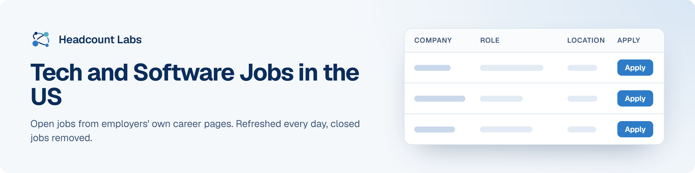

# Tech and Software Jobs in the US

Software, data, AI, security, cloud and IT jobs at US employers, sorted by field.

**302 open jobs** · 299 new since the last update · 397 removed because they closed or left the employer's board · updated November 5, 2026 at 5:01 AM EST

This list is built and refreshed every day by [Headcount Labs](https://headcountlabs.com/?utm_source=github&utm_medium=job-list&utm_campaign=tech-jobs), which reads jobs straight from employers' own career pages and job boards. Every job here was still listed on its source board when we last read that board, within the past 3 days, and was posted in the past 30 days. Copies of the same job are merged into one row, and jobs that close are removed at the next update.

Want this data in your own app or agent? Use the [Headcount Labs jobs API](https://headcountlabs.com/docs/?utm_source=github&utm_medium=job-list&utm_campaign=tech-jobs) (free tier), the [MCP server](https://headcountlabs.com/mcp/?utm_source=github&utm_medium=job-list&utm_campaign=tech-jobs) for Claude, ChatGPT and other AI assistants, or the [public dataset subsets](https://huggingface.co/HeadcountLabs) on Hugging Face (the full dataset is coming soon).

**Full dataset.** A bigger, one-off snapshot dated 2026-10-19 (all matching jobs, not only the open jobs below) is on Hugging Face: [Tech and software jobs](https://huggingface.co/datasets/HeadcountLabs/tech-jobs). It loads with `datasets.load_dataset` and is under the Open Database License (ODbL) 1.0.

**Jump to:** [Software engineering (135)](#software-engineering) · [Data, AI and machine learning (134)](#data-ai-and-machine-learning) · [Product and design (4)](#product-and-design) · [Hardware and engineering (21)](#hardware-and-engineering) · [Business, finance and operations (2)](#business-finance-and-operations) · [Healthcare (1)](#healthcare) · [Other roles (5)](#other-roles)

**Columns.** *Apply* opens the original posting on the employer's site. *Details* opens the job on Headcount Labs, with every posting we found for it. *Remote* shows what the employer states; a dash means the posting doesn't say. *Pay* is the range the employer published.

## Software engineering

| Company | Role | Location | Remote | Pay | Posted | Apply | Details |
| --- | --- | --- | --- | --- | --- | :---: | :---: |
| **Sonova Group** | Software Verification Manager, Medical Software &#124; REMOTE | 

3 locations
Valencia (CA) Valencia city
 | — | $114k–$145k/yr | Nov 5 |  | <a href="https://headcountlabs.com/catalog/jobs/0f09de4e-3f43-475f-9c6d-1a8753951587?utm_source=github&utm_medium=job-list&utm_campaign=tech-jobs">via Headcount Labs</a> |
| **Sonova Group** | Senior Engineer, Embedded Software | 

3 locations
Valencia (CA) Valencia city
 | Hybrid | $100k–$125k/yr | Nov 5 |  | <a href="https://headcountlabs.com/catalog/jobs/7d5fb130-36ca-42f8-a6bb-5dedd7066218?utm_source=github&utm_medium=job-list&utm_campaign=tech-jobs">via Headcount Labs</a> |
| **Yahoo Holdings Inc.** | Paranoids Endpoint Security Engineer | United States of America | — | $111k–$231k/yr | Nov 4 |  | <a href="https://headcountlabs.com/catalog/jobs/c2f10a71-cfb2-470c-801f-7beb724bac51?utm_source=github&utm_medium=job-list&utm_campaign=tech-jobs">via Headcount Labs</a> |
| **UM Corp (Enterprise)** | Sr. Software Engineer | Miami, FL | On-site | — | Nov 4 |  | <a href="https://headcountlabs.com/catalog/jobs/889d7d22-f9d1-4ed4-8ae2-bb52ba8df0bc?utm_source=github&utm_medium=job-list&utm_campaign=tech-jobs">via Headcount Labs</a> |
| **SSB&amp;T** | Cyber Policy Enforcement Lead, VP | Quincy, MA | — | $120k–$202k/yr | Nov 4 |  | <a href="https://headcountlabs.com/catalog/jobs/459c6804-cc94-4add-a080-e58eb88441e3?utm_source=github&utm_medium=job-list&utm_campaign=tech-jobs">via Headcount Labs</a> |
| **Proseal America, Inc.** | New Business Developer - End of Line Processing Equipment | Richmond, VA | Remote | — | Nov 4 |  | <a href="https://headcountlabs.com/catalog/jobs/8cb449da-2565-4ca3-a72a-32f28c84a4ab?utm_source=github&utm_medium=job-list&utm_campaign=tech-jobs">via Headcount Labs</a> |
| **MPATHIC LLC** | Full Stack Software Engineer | United States | — | $65–$80/hr | Nov 4 |  | <a href="https://headcountlabs.com/catalog/jobs/30c728d7-a56e-4473-9257-283adc901eaa?utm_source=github&utm_medium=job-list&utm_campaign=tech-jobs">via Headcount Labs</a> |
| **Micron Technology, Inc.** | IT Software Engineer, EA EPS | Boise, ID | — | — | Nov 4 |  | <a href="https://headcountlabs.com/catalog/jobs/c7649d85-52f1-428d-8122-5b76a6d82a28?utm_source=github&utm_medium=job-list&utm_campaign=tech-jobs">via Headcount Labs</a> |
| **Fortive Corporation** | Software QA Engineer Lead | United States | Remote | $110k–$183k/yr | Nov 4 |  | <a href="https://headcountlabs.com/catalog/jobs/9a844304-91cd-4993-b200-a20e184e6a76?utm_source=github&utm_medium=job-list&utm_campaign=tech-jobs">via Headcount Labs</a> |
| **CACI, INC.-FEDERAL** | Full Stack Application Engineer | Laurel, MD | On-site | $104k–$218k/yr | Nov 4 |  | <a href="https://headcountlabs.com/catalog/jobs/4a26450c-5223-4cf5-b77f-5838d2a54771?utm_source=github&utm_medium=job-list&utm_campaign=tech-jobs">via Headcount Labs</a> |
| **CACI, INC.-FEDERAL** | Cyber Security ISSO | F.E. Warren AFB, WY | On-site | $68k–$142k/yr | Nov 4 |  | <a href="https://headcountlabs.com/catalog/jobs/acc2dac9-9f48-40f1-a5c3-32ba07b5e413?utm_source=github&utm_medium=job-list&utm_campaign=tech-jobs">via Headcount Labs</a> |
| **CACI, INC.-FEDERAL** | Java Developer | Sarasota, FL | On-site | $66k–$134k/yr | Nov 4 |  | <a href="https://headcountlabs.com/catalog/jobs/8c35dc4b-004e-498e-b479-abbde5f9d5ba?utm_source=github&utm_medium=job-list&utm_campaign=tech-jobs">via Headcount Labs</a> |
| **CACI, INC.-FEDERAL** | Cloud Cyber Engineer (Linux) | 

2 locations
Sterling, VA Denver, CO
 | On-site | $75k–$158k/yr | Nov 4 |  | <a href="https://headcountlabs.com/catalog/jobs/80c2aa29-49aa-4ddc-9e2a-811aee8fa247?utm_source=github&utm_medium=job-list&utm_campaign=tech-jobs">via Headcount Labs</a> |
| **Booz Allen Hamilton_United States** | Cloud Engineer | Colorado Springs, CO | — | $99k–$225k/yr | Nov 4 |  | <a href="https://headcountlabs.com/catalog/jobs/e915d287-6e61-446c-8c93-c4b75037e0a6?utm_source=github&utm_medium=job-list&utm_campaign=tech-jobs">via Headcount Labs</a> |
| **Booz Allen Hamilton_United States** | Software and Documentation Support Engineer, Junior | Port Hueneme, CA | — | $53k–$108k/yr | Nov 4 |  | <a href="https://headcountlabs.com/catalog/jobs/dc61d95f-19da-4775-a79a-cdd64a358210?utm_source=github&utm_medium=job-list&utm_campaign=tech-jobs">via Headcount Labs</a> |
| **Booz Allen Hamilton_United States** | DevOps Engineer | Beavercreek, OH | — | $62k–$141k/yr | Nov 4 |  | <a href="https://headcountlabs.com/catalog/jobs/91210af0-35cd-4da8-866a-c4594fab65a1?utm_source=github&utm_medium=job-list&utm_campaign=tech-jobs">via Headcount Labs</a> |
| **Booz Allen Hamilton_United States** | Cyber Portfolio Manager, Lead | 

2 locations
McLean, VA Arlington, VA
 | — | $99k–$225k/yr | Nov 4 |  | <a href="https://headcountlabs.com/catalog/jobs/90a6f559-d788-4376-b860-50eadf709d11?utm_source=github&utm_medium=job-list&utm_campaign=tech-jobs">via Headcount Labs</a> |
| **57 ID Technologies, LLC** | Senior Cloud Engineer | 

2 locations
Bethesda, MD Mclean, VA
 | Hybrid | $90k–$190k/yr | Nov 4 |  | <a href="https://headcountlabs.com/catalog/jobs/bb81a7ec-ea0c-408d-98c7-7b0a2627d6e2?utm_source=github&utm_medium=job-list&utm_campaign=tech-jobs">via Headcount Labs</a> |
| **48 Mastodon Design LLC** | Software Engineering Co-op/Intern - Summer 2027 | Rochester, NY | On-site | $40k–$80k/yr | Nov 4 |  | <a href="https://headcountlabs.com/catalog/jobs/f4e1bdbe-069c-4739-9618-c9d6724b0470?utm_source=github&utm_medium=job-list&utm_campaign=tech-jobs">via Headcount Labs</a> |
| **Southern Company** | Application Developer | 

2 locations
Atlanta, GA Birmingham, AL
 | Hybrid | — | Nov 3 |  | <a href="https://headcountlabs.com/catalog/jobs/b3ff1e03-85d3-40b3-b381-4fe28eb149c8?utm_source=github&utm_medium=job-list&utm_campaign=tech-jobs">via Headcount Labs</a> |
| **Ochsner Clinic Foundation** | IS Application Developer - Apex/BI | United States | On-site | — | Nov 3 |  | <a href="https://headcountlabs.com/catalog/jobs/cd8ace77-7411-4327-bf8a-138f0b6eb571?utm_source=github&utm_medium=job-list&utm_campaign=tech-jobs">via Headcount Labs</a> |
| **Yahoo Holdings Inc.** | Paranoids Senior Container Security Engineer | United States of America | — | $128k–$267k/yr | Nov 2 |  | <a href="https://headcountlabs.com/catalog/jobs/7e360661-e2d1-4f7c-9788-f07f5af0a22c?utm_source=github&utm_medium=job-list&utm_campaign=tech-jobs">via Headcount Labs</a> |
| **VyStar Credit Union** | Senior Dynamics 365 &amp; Power Platform Developer | Jacksonville, FL | Hybrid | — | Nov 2 |  | <a href="https://headcountlabs.com/catalog/jobs/9f845c00-ded9-42ae-82e1-7190097995cf?utm_source=github&utm_medium=job-list&utm_campaign=tech-jobs">via Headcount Labs</a> |
| **Southern Company** | Documentum Developer, Jr | Birmingham, AL | — | — | Nov 2 |  | <a href="https://headcountlabs.com/catalog/jobs/2e53ddf8-7baf-47f4-b786-3f45774838fa?utm_source=github&utm_medium=job-list&utm_campaign=tech-jobs">via Headcount Labs</a> |
| **Santa Fe College** | Part-time IR Developer and Analyst | Gainesville, FL | — | — | Nov 2 |  | <a href="https://headcountlabs.com/catalog/jobs/8025a439-9089-4d08-a660-05d807c63d7a?utm_source=github&utm_medium=job-list&utm_campaign=tech-jobs">via Headcount Labs</a> |
| **R08_DBRSLtdCanada DBRS Limited - Canada Legal Entity** | Credit Technology, Senior Software Engineer – Chicago | Chicago | On-site | $118k–$172k/yr | Nov 2 |  | <a href="https://headcountlabs.com/catalog/jobs/b330e95c-ae4f-4a7c-a836-a969d443d2eb?utm_source=github&utm_medium=job-list&utm_campaign=tech-jobs">via Headcount Labs</a> |
| **Phoenix Operations Group** | Product Champion – Cyber Operations &amp; Data Analytics | Washington, DC | On-site | — | Nov 2 |  | <a href="https://headcountlabs.com/catalog/jobs/70146358-3854-46cb-a218-5fec99b7a5e6?utm_source=github&utm_medium=job-list&utm_campaign=tech-jobs">via Headcount Labs</a> |
| **Lockheed Martin** | Software Engineering Intern | Fort Worth, TX | — | — | Nov 2 |  | <a href="https://headcountlabs.com/catalog/jobs/c6747d37-e596-48b3-a689-b4e11d78261f?utm_source=github&utm_medium=job-list&utm_campaign=tech-jobs">via Headcount Labs</a> |
| **HP** | Software Product Manager Graduate Roles - HP Solutions (HPS) | 

2 locations
Fort Collins, CO Spring, TX
 | On-site | $66k–$101k/yr | Nov 2 |  | <a href="https://headcountlabs.com/catalog/jobs/62768689-488b-4221-8e24-968036701d56?utm_source=github&utm_medium=job-list&utm_campaign=tech-jobs">via Headcount Labs</a> |
| **Carnegie Mellon University** | Cybersecurity Engineer | Pittsburgh, PA | — | — | Nov 2 |  | <a href="https://headcountlabs.com/catalog/jobs/f51a4f04-5201-4b7e-9a66-6eaf259275c7?utm_source=github&utm_medium=job-list&utm_campaign=tech-jobs">via Headcount Labs</a> |
| **Premera Blue Cross** | Cybersecurity Threat Intelligence Engineer II - Att@ck | Mountlake Terrace, WA | Hybrid | $92k–$157k/yr | Oct 31 |  | <a href="https://headcountlabs.com/catalog/jobs/f7ff31e0-54bd-4870-b707-15dada388cd9?utm_source=github&utm_medium=job-list&utm_campaign=tech-jobs">via Headcount Labs</a> |
| **Urrly** | QA Engineer — Wearables, Mobile &amp; Cloud | Austin, TX | Remote | $130k–$155k/yr | Oct 30 |  | <a href="https://headcountlabs.com/catalog/jobs/c34dfe0b-b027-450c-bdc6-8fcb7775e5eb?utm_source=github&utm_medium=job-list&utm_campaign=tech-jobs">via Headcount Labs</a> |
| **RSM US LLP** | Senior Database Developer | 

16 locations
Atlanta, GA Baltimore Blue Bell Boston Cedar Rapids Chicago Cleveland Dallas Edison Indianapolis Kansas City McLean +4 more
 | On-site | $38–$56/hr | Oct 30 |  | <a href="https://headcountlabs.com/catalog/jobs/7dfdfd65-f671-4531-bc8a-12c24adfdfff?utm_source=github&utm_medium=job-list&utm_campaign=tech-jobs">via Headcount Labs</a> |
| **RLG International** | Digital Solutions Developer | Houston, TX | On-site | — | Oct 30 |  | <a href="https://headcountlabs.com/catalog/jobs/bcb61813-b3cf-4a08-bcdc-6ea9260b7c9b?utm_source=github&utm_medium=job-list&utm_campaign=tech-jobs">via Headcount Labs</a> |
| **CUNY** | Backend Developer | New York, NY | Hybrid | $90k–$102k/yr | Oct 30 |  | <a href="https://headcountlabs.com/catalog/jobs/18bf7792-bea4-4dcf-8611-b0d5f8b90504?utm_source=github&utm_medium=job-list&utm_campaign=tech-jobs">via Headcount Labs</a> |
| **Charles River Systems Inc MA** | Cloud Platform Engineer - AuthN/Z | Burlington Massachusetts | — | $90k–$158k/yr | Oct 30 |  | <a href="https://headcountlabs.com/catalog/jobs/ab206a7a-d17a-496f-9d96-3b0139db9e81?utm_source=github&utm_medium=job-list&utm_campaign=tech-jobs">via Headcount Labs</a> |
| **CAI Cox Automotive Corp Svcs., LLC** | Software Engineer II | 

2 locations
Carmel IN Carmel, IN
 | — | $89k–$134k/yr | Oct 30 |  | <a href="https://headcountlabs.com/catalog/jobs/462d3eed-2ef6-44fe-8ab8-78ef153f458c?utm_source=github&utm_medium=job-list&utm_campaign=tech-jobs">via Headcount Labs</a> |
| **1 Vizient, Inc.** | Senior EDI Developer | 

2 locations
Irving, TX Chicago, IL
 | Hybrid | — | Oct 30 |  | <a href="https://headcountlabs.com/catalog/jobs/0866575b-e81c-40d8-9aff-db0a72fc4eba?utm_source=github&utm_medium=job-list&utm_campaign=tech-jobs">via Headcount Labs</a> |
| **Zekiah Technologies** | Software Engineer III | Dahlgren, VA | — | $130k–$150k/yr | Oct 29 |  | <a href="https://headcountlabs.com/catalog/jobs/8dbc0bbf-cdaa-4ed3-b728-14802e9d02a6?utm_source=github&utm_medium=job-list&utm_campaign=tech-jobs">via Headcount Labs</a> |
| **WesleyLife** | Software Applications Manager | Johnston, IA | On-site | — | Oct 29 |  | <a href="https://headcountlabs.com/catalog/jobs/57ec9ea9-264c-4be7-ad1f-21a58de225d4?utm_source=github&utm_medium=job-list&utm_campaign=tech-jobs">via Headcount Labs</a> |
| **Southern Company** | Cyber Threat Analyst | Atlanta, GA | Hybrid | — | Oct 29 |  | <a href="https://headcountlabs.com/catalog/jobs/2b786cf3-bad8-4743-ac4c-577ec5323cc0?utm_source=github&utm_medium=job-list&utm_campaign=tech-jobs">via Headcount Labs</a> |
| **RSM US LLP** | Software Engineering Enablement Manager | 

7 locations
Chicago United States Dallas Denver Downtown Minneapolis Orlando Raleigh
 | On-site | $126k–$224k/yr | Oct 29 |  | <a href="https://headcountlabs.com/catalog/jobs/e4b5797b-188c-4269-b51d-41684ca51924?utm_source=github&utm_medium=job-list&utm_campaign=tech-jobs">via Headcount Labs</a> |
| **Lockheed Martin** | Software Engineer - Intern | Fort Worth, TX | — | — | Oct 29 |  | <a href="https://headcountlabs.com/catalog/jobs/c18bf4a3-76e4-4844-96fc-25f3ab3bc853?utm_source=github&utm_medium=job-list&utm_campaign=tech-jobs">via Headcount Labs</a> |
| **Chewy** | Software Engineer II | 

2 locations
Boston, MA Minneapolis, MN
 | — | — | Oct 29 |  | <a href="https://headcountlabs.com/catalog/jobs/46fc4472-c08c-4355-8189-54f91530e6f3?utm_source=github&utm_medium=job-list&utm_campaign=tech-jobs">via Headcount Labs</a> |
| **Charles River Systems Inc MA** | Client Manager, AVP Investment Trading Software - Charles River Development | Sacramento, CA | — | $90k–$158k/yr | Oct 29 |  | <a href="https://headcountlabs.com/catalog/jobs/13d1edfa-431a-4c47-963d-172e25dd925b?utm_source=github&utm_medium=job-list&utm_campaign=tech-jobs">via Headcount Labs</a> |
| **Carnegie Mellon University** | Senior Software Acquisition Innovation Specialist | 

2 locations
Pittsburgh, PA Arlington, VA
 | — | — | Oct 29 |  | <a href="https://headcountlabs.com/catalog/jobs/d10d6cb2-dafc-4fa1-a731-d15ad793a923?utm_source=github&utm_medium=job-list&utm_campaign=tech-jobs">via Headcount Labs</a> |
| **Southern Company** | Application Developer II | Atlanta, GA | — | — | Oct 28 |  | <a href="https://headcountlabs.com/catalog/jobs/e25b0f2f-d638-46ea-bb7d-e4fbfc9e9282?utm_source=github&utm_medium=job-list&utm_campaign=tech-jobs">via Headcount Labs</a> |
| **RSM US LLP** | Associate – Microsoft 365 Security Engineer | 

5 locations
Chicago Cedar Rapids Davenport Dubuque Iowa City
 | On-site | $63k–$103k/yr | Oct 28 |  | <a href="https://headcountlabs.com/catalog/jobs/0958e5dc-64a2-49be-b353-6114d7fc0c3b?utm_source=github&utm_medium=job-list&utm_campaign=tech-jobs">via Headcount Labs</a> |
| **Fortive Corporation** | Software Engineer II | United States | Remote | $110k–$183k/yr | Oct 28 |  | <a href="https://headcountlabs.com/catalog/jobs/f19e5f45-605f-48a0-8a04-867f852c4639?utm_source=github&utm_medium=job-list&utm_campaign=tech-jobs">via Headcount Labs</a> |
| **CareSource** | LTSS &amp; Dual Eligible Program Report Developer IV-HEALTHCARE EXPERIENCE HIGHLY PREFERRED! | United States | — | $94k–$165k/yr | Oct 28 |  | <a href="https://headcountlabs.com/catalog/jobs/52ea847a-16ff-4098-823f-79ed42b87792?utm_source=github&utm_medium=job-list&utm_campaign=tech-jobs">via Headcount Labs</a> |
| **CAI Cox Automotive Corp Svcs., LLC** | Senior Software Engineer | 

2 locations
Atlanta, GA Atlanta GA
 | Hybrid | $102k–$169k/yr | Oct 28 |  | <a href="https://headcountlabs.com/catalog/jobs/4a795b5c-afb8-4ef8-967c-e345606f570a?utm_source=github&utm_medium=job-list&utm_campaign=tech-jobs">via Headcount Labs</a> |
| **CAI Cox Automotive Corp Svcs., LLC** | Cybersecurity Engineer II | Atlanta, GA | — | $89k–$134k/yr | Oct 28 |  | <a href="https://headcountlabs.com/catalog/jobs/001ded5d-1b1f-4e6a-aa04-ab31b29d7fa1?utm_source=github&utm_medium=job-list&utm_campaign=tech-jobs">via Headcount Labs</a> |
| **Blue Yonder** | Software Engineer (Java backend) | Dallas | Hybrid | $86k–$108k/yr | Oct 28 |  | <a href="https://headcountlabs.com/catalog/jobs/d4568f87-8733-41fd-86d8-6c6a6d0a95d0?utm_source=github&utm_medium=job-list&utm_campaign=tech-jobs">via Headcount Labs</a> |
| **Micron Technology, Inc.** | Embedded Software Lead | Boise, ID | On-site | — | Oct 27 |  | <a href="https://headcountlabs.com/catalog/jobs/bbe52037-ed8c-46a8-968e-3020bec80be9?utm_source=github&utm_medium=job-list&utm_campaign=tech-jobs">via Headcount Labs</a> |
| **Micron Technology, Inc.** | Front End Central Product Integration Engineer – Test &amp; Product Yield Integration (Senior / Staff / Principal) | Boise, ID | On-site | — | Oct 27 |  | <a href="https://headcountlabs.com/catalog/jobs/6d0f2ba4-7692-4663-81e4-6261a47f9e6e?utm_source=github&utm_medium=job-list&utm_campaign=tech-jobs">via Headcount Labs</a> |
| **Micron Technology, Inc.** | Intern - Product Yield Software Engineer | Boise, ID | — | — | Oct 27 |  | <a href="https://headcountlabs.com/catalog/jobs/62223aa4-23d2-4a99-bd74-7cfd1e33c6d6?utm_source=github&utm_medium=job-list&utm_campaign=tech-jobs">via Headcount Labs</a> |
| **Keystone Service Systems, Inc** | Autism - Job Developer (Job Coach) | 

2 locations
Harrisburg, PA Exton, PA
 | — | $24/hr | Oct 27 |  | <a href="https://headcountlabs.com/catalog/jobs/2f7a8a51-4816-4ad0-a09b-0b8911565a88?utm_source=github&utm_medium=job-list&utm_campaign=tech-jobs">via Headcount Labs</a> |
| **Fortive Corporation** | Sr. Technical Application Developer | Everett, WA | — | — | Oct 27 |  | <a href="https://headcountlabs.com/catalog/jobs/42cc1883-48c9-4691-bf08-b48813af4b48?utm_source=github&utm_medium=job-list&utm_campaign=tech-jobs">via Headcount Labs</a> |
| **CAI Cox Automotive Corp Svcs., LLC** | Lead Software Engineer - 19999 | Atlanta, GA | — | $123k–$204k/yr | Oct 27 |  | <a href="https://headcountlabs.com/catalog/jobs/dd94d4a4-3ba1-4d7b-b48c-60915d5418f6?utm_source=github&utm_medium=job-list&utm_campaign=tech-jobs">via Headcount Labs</a> |
| **1 Vizient, Inc.** | Senior Software Quality Engineer (Hybrid) | United States | Hybrid | $89k–$156k/yr | Oct 27 |  | <a href="https://headcountlabs.com/catalog/jobs/2fab503b-59d7-4157-8246-d53fb74e544a?utm_source=github&utm_medium=job-list&utm_campaign=tech-jobs">via Headcount Labs</a> |
| **NYB Banco Santander S.A.** | Senior Application Developer - Securitized Products (Java &amp; .NET) | United States | — | $175k/yr | Oct 26 |  | <a href="https://headcountlabs.com/catalog/jobs/3b8386fb-5bc0-4d5d-8ec5-954898be34b9?utm_source=github&utm_medium=job-list&utm_campaign=tech-jobs">via Headcount Labs</a> |
| **Doble** | TEMP Principal DevOps Engineer | Marlborough, MA | On-site | — | Oct 26 |  | <a href="https://headcountlabs.com/catalog/jobs/4320b4f3-0588-4b15-84db-6468426ca47e?utm_source=github&utm_medium=job-list&utm_campaign=tech-jobs">via Headcount Labs</a> |
| **Chewy** | Software Engineer III | Boston, MA | — | — | Oct 26 |  | <a href="https://headcountlabs.com/catalog/jobs/5ef4e90e-d354-4e03-afd2-975bec9e52c9?utm_source=github&utm_medium=job-list&utm_campaign=tech-jobs">via Headcount Labs</a> |
| **ARES Enterprise** | Senior ServiceNow Developer &#124; Remote &#124; Secret Clearance &#124; Active | Adelphi | Remote | — | Oct 26 |  | <a href="https://headcountlabs.com/catalog/jobs/743313a9-e0c2-40e5-ac8d-e57978774208?utm_source=github&utm_medium=job-list&utm_campaign=tech-jobs">via Headcount Labs</a> |
| **Lockheed Martin** | Embedded Software Engineer Intern | Grand Prairie, TX | On-site | — | Oct 25 |  | <a href="https://headcountlabs.com/catalog/jobs/dbe728ff-3f64-46db-bc05-526b35f26c08?utm_source=github&utm_medium=job-list&utm_campaign=tech-jobs">via Headcount Labs</a> |
| **CompuCom** | Senior Cloud and Software Licensing Consultant | Bismarck, ND | — | $150k–$200k/yr | Oct 24 |  | <a href="https://headcountlabs.com/catalog/jobs/dea987e4-2936-401d-90bd-2ab5fc629f46?utm_source=github&utm_medium=job-list&utm_campaign=tech-jobs">via Headcount Labs</a> |
| **YPO, Inc.** | Sr. Developer, API | United States | Remote | $119k–$155k/yr | Oct 23 |  | <a href="https://headcountlabs.com/catalog/jobs/bc0d4d9e-6795-45b1-a7b6-cba2179a9941?utm_source=github&utm_medium=job-list&utm_campaign=tech-jobs">via Headcount Labs</a> |
| **Wildhorse Resort &amp; Casino** | MIS Security Engineer | Pendleton, OR | On-site | $90k–$125k/yr | Oct 23 |  | <a href="https://headcountlabs.com/catalog/jobs/f8e8d5fd-53b6-4e52-9d77-58736c569c16?utm_source=github&utm_medium=job-list&utm_campaign=tech-jobs">via Headcount Labs</a> |
| **UCM Santander US Capital Markets LLC** | CIB Executive Director, Software Investment Banking | United States | — | $290k/yr | Oct 23 |  | <a href="https://headcountlabs.com/catalog/jobs/7cbd3d21-79c8-4c15-b59d-45d97a8268f3?utm_source=github&utm_medium=job-list&utm_campaign=tech-jobs">via Headcount Labs</a> |
| **Grubhub Holdings Inc.** | Software Engineer II (Backend) | United States | — | $140k–$158k/yr | Oct 23 |  | <a href="https://headcountlabs.com/catalog/jobs/0ef7873b-0b50-4f78-95dc-d0322e1c9a94?utm_source=github&utm_medium=job-list&utm_campaign=tech-jobs">via Headcount Labs</a> |
| **Charles River Systems Inc MA** | Sr. Software Engineer - Full Stack (Java/React), AVP | Burlington Massachusetts | — | $90k–$158k/yr | Oct 23 |  | <a href="https://headcountlabs.com/catalog/jobs/eddda663-e5ef-4bba-9dcc-d5629ebd4318?utm_source=github&utm_medium=job-list&utm_campaign=tech-jobs">via Headcount Labs</a> |
| **Chapters Health System, Inc** | Enterprise Analytics Developer | Temple Terrace, FL | — | $85k–$133k/yr | Oct 23 |  | <a href="https://headcountlabs.com/catalog/jobs/a0de1db2-8b40-4573-8fe5-05dc2374f28a?utm_source=github&utm_medium=job-list&utm_campaign=tech-jobs">via Headcount Labs</a> |
| **CAI Cox Automotive Corp Svcs., LLC** | Lead Software Engineer - IBM iSeries | Atlanta, GA | — | $123k–$204k/yr | Oct 23 |  | <a href="https://headcountlabs.com/catalog/jobs/f39a1a17-772e-420a-8876-72eb25bcf347?utm_source=github&utm_medium=job-list&utm_campaign=tech-jobs">via Headcount Labs</a> |
| **CAI Cox Automotive Corp Svcs., LLC** | Lead Cybersecurity Detection Engineer | Atlanta, GA | — | $123k–$204k/yr | Oct 23 |  | <a href="https://headcountlabs.com/catalog/jobs/4a1f2ee3-a441-4aec-bec0-bf439e13f3eb?utm_source=github&utm_medium=job-list&utm_campaign=tech-jobs">via Headcount Labs</a> |
| **25 LGS Innovations LLC** | Embedded Software Engineer | Florham Park, NJ | On-site | $94k–$198k/yr | Oct 23 |  | <a href="https://headcountlabs.com/catalog/jobs/cfdac077-3fcf-4c45-92e3-4bda7d277278?utm_source=github&utm_medium=job-list&utm_campaign=tech-jobs">via Headcount Labs</a> |
| **Western Alliance Bank** | Staff Engineer II - Full Stack Developer | 

2 locations
Dallas, TX Columbus, OH
 | — | — | Oct 22 |  | <a href="https://headcountlabs.com/catalog/jobs/b634cc61-9095-454e-94c1-5078c4e1a495?utm_source=github&utm_medium=job-list&utm_campaign=tech-jobs">via Headcount Labs</a> |
| **Twin City Die Castings Company** | CMM (Coordinate Measuring Machine) Programmer | Minneapolis, MN | On-site | $29–$36/hr | Oct 22 |  | <a href="https://headcountlabs.com/catalog/jobs/670398ae-56e6-48c1-8505-67aabbf8cb9d?utm_source=github&utm_medium=job-list&utm_campaign=tech-jobs">via Headcount Labs</a> |
| **SonoSim** | Full Stack Application Remediation Engineer | Venice, CA | Remote | $120k–$130k/yr | Oct 22 |  | <a href="https://headcountlabs.com/catalog/jobs/aa2f1b1c-09e3-4a3f-893b-29efab2bd1b1?utm_source=github&utm_medium=job-list&utm_campaign=tech-jobs">via Headcount Labs</a> |
| **SonoSim** | Full Stack Software Engineer | Venice, CA | Remote | $120k–$130k/yr | Oct 22 |  | <a href="https://headcountlabs.com/catalog/jobs/9a31e920-b56b-4fd7-accc-dbd2e4ff7d94?utm_source=github&utm_medium=job-list&utm_campaign=tech-jobs">via Headcount Labs</a> |
| **DA Brand** | Software Developer | Deerfield, MA | On-site | — | Oct 22 |  | <a href="https://headcountlabs.com/catalog/jobs/26fe76fd-d2c4-415a-bc46-809d68c9f25e?utm_source=github&utm_medium=job-list&utm_campaign=tech-jobs">via Headcount Labs</a> |
| **Charles River Systems Inc MA** | Data Integration Framework Developer - Java, AVP | Burlington Massachusetts | — | $90k–$158k/yr | Oct 22 |  | <a href="https://headcountlabs.com/catalog/jobs/e29d7a86-66ee-4907-bd10-9bd6183d1431?utm_source=github&utm_medium=job-list&utm_campaign=tech-jobs">via Headcount Labs</a> |
| **Zekiah Technologies** | Software Developer III | Dahlgren, VA | — | $130k–$170k/yr | Oct 21 |  | <a href="https://headcountlabs.com/catalog/jobs/8f22e07e-4b41-470f-8f8d-b5424cbc6583?utm_source=github&utm_medium=job-list&utm_campaign=tech-jobs">via Headcount Labs</a> |
| **UM Corp (Enterprise)** | AI Security Engineer Specialist | Miami, FL | — | — | Oct 21 |  | <a href="https://headcountlabs.com/catalog/jobs/fd888e89-d38e-4af5-ad7b-53c7bb9d5eb8?utm_source=github&utm_medium=job-list&utm_campaign=tech-jobs">via Headcount Labs</a> |
| **Sony Engagement Platform Services, LLC** | Sr. Software Engineer, AI Native | United States | Hybrid | $180k–$205k/yr | Oct 21 |  | <a href="https://headcountlabs.com/catalog/jobs/a05f1d21-cdf9-454b-be26-88c81605bcf2?utm_source=github&utm_medium=job-list&utm_campaign=tech-jobs">via Headcount Labs</a> |
| **Humana Inc.** | Software Engineer 2 | 

2 locations
Helena, MT United States
 | Remote | $81k–$110k/yr | Oct 21 |  | <a href="https://headcountlabs.com/catalog/jobs/933bf112-f605-4330-a55d-4631c2ef022e?utm_source=github&utm_medium=job-list&utm_campaign=tech-jobs">via Headcount Labs</a> |
| **Dart Bank** | IT Cloud Infrastructure Engineer | Mason, MI | — | — | Oct 21 |  | <a href="https://headcountlabs.com/catalog/jobs/fa9313bc-e8bc-437f-978c-c1925bd3f37b?utm_source=github&utm_medium=job-list&utm_campaign=tech-jobs">via Headcount Labs</a> |
| **1 Vizient, Inc.** | Senior Software Engineer | 

2 locations
Edina, MN United States
 | — | $102k–$179k/yr | Oct 21 |  | <a href="https://headcountlabs.com/catalog/jobs/68cd5d68-b16a-42ee-816c-1f47e590a3fb?utm_source=github&utm_medium=job-list&utm_campaign=tech-jobs">via Headcount Labs</a> |
| **1 Vizient, Inc.** | Staff Software Engineer | 

3 locations
Edina, MN Chicago, IL United States
 | — | $118k–$206k/yr | Oct 21 |  | <a href="https://headcountlabs.com/catalog/jobs/40d5f6cb-8c7a-4ec6-8999-907533817b04?utm_source=github&utm_medium=job-list&utm_campaign=tech-jobs">via Headcount Labs</a> |
| **1 Vizient, Inc.** | Associate Software Engineer | United States | — | $60k–$101k/yr | Oct 21 |  | <a href="https://headcountlabs.com/catalog/jobs/396ace33-96e8-4954-af0f-0474a8e94352?utm_source=github&utm_medium=job-list&utm_campaign=tech-jobs">via Headcount Labs</a> |
| **TravisMathew, LLC** | Jr Materials Developer | United States | On-site | $33.99–$40.77/hr | Oct 20 |  | <a href="https://headcountlabs.com/catalog/jobs/839bb405-4ebb-4cec-ba90-6879e8e1f6bc?utm_source=github&utm_medium=job-list&utm_campaign=tech-jobs">via Headcount Labs</a> |
| **TEXAS MUNICIPAL RETIREMENT SYSTEM** | Software Engineer (SR) | Austin, TX | — | $130k–$170k/yr | Oct 20 |  | <a href="https://headcountlabs.com/catalog/jobs/5ab968b0-d751-4144-883b-1aff9d44fb35?utm_source=github&utm_medium=job-list&utm_campaign=tech-jobs">via Headcount Labs</a> |
| **TEXAS MUNICIPAL RETIREMENT SYSTEM** | Senior DevOps Engineer | Austin, TX | — | $130k–$170k/yr | Oct 20 |  | <a href="https://headcountlabs.com/catalog/jobs/4b3371dd-8133-4a17-8d5f-24c546ce02f5?utm_source=github&utm_medium=job-list&utm_campaign=tech-jobs">via Headcount Labs</a> |
| **Priority-1 Inc.** | Software Engineer | Little Rock, AR | — | — | Oct 20 |  | <a href="https://headcountlabs.com/catalog/jobs/26c5cce4-35aa-47b4-bea2-10517cd60502?utm_source=github&utm_medium=job-list&utm_campaign=tech-jobs">via Headcount Labs</a> |
| **Micron Idaho Semiconductor Manufacturing (Triton) LLC** | Intern - IT Software Engineer | Boise, ID | — | — | Oct 20 |  | <a href="https://headcountlabs.com/catalog/jobs/8f0e8b71-1311-4935-88ed-10ba400c7e15?utm_source=github&utm_medium=job-list&utm_campaign=tech-jobs">via Headcount Labs</a> |
| **DCSD** | Implementation Specialist: College and Career Readiness Software Support | Wilcox | — | $75k–$114k/yr | Oct 20 |  | <a href="https://headcountlabs.com/catalog/jobs/e162b83b-071f-4620-b2fe-75c2bfa68dfe?utm_source=github&utm_medium=job-list&utm_campaign=tech-jobs">via Headcount Labs</a> |
| **Cupertino Electric** | Assistant Product Developer - Modular - Data Center | 

5 locations
Edgerton, WI United States Houston, TX Salt Lake City, UT San Francisco, CA
 | Remote | $80k–$104k/yr | Oct 20 |  | <a href="https://headcountlabs.com/catalog/jobs/0123c1f4-c35c-41f8-b8b2-6d88de360114?utm_source=github&utm_medium=job-list&utm_campaign=tech-jobs">via Headcount Labs</a> |
| **CACI** | Cyber Threat Analyst | Chantilly, VA | On-site | $113k–$238k/yr | Oct 20 |  | <a href="https://headcountlabs.com/catalog/jobs/80b97278-881f-4031-8a72-1915f0940e5c?utm_source=github&utm_medium=job-list&utm_campaign=tech-jobs">via Headcount Labs</a> |
| **Phoenix Operations Group** | Full Stack AWS Engineer, Senior &#124; Active Clearance Required | Maryland | — | — | Oct 19 |  | <a href="https://headcountlabs.com/catalog/jobs/4e38521e-2a1e-42f2-b4fa-28f062f88fcd?utm_source=github&utm_medium=job-list&utm_campaign=tech-jobs">via Headcount Labs</a> |
| **Global Outsourcing Svcs** | Mainframe Software Engineering | 

2 locations
Any City, CT USA - CT - ANY CITY
 | On-site | $61k–$112k/yr | Oct 19 |  | <a href="https://headcountlabs.com/catalog/jobs/dbabf940-927e-4db9-98ab-be31e674ed64?utm_source=github&utm_medium=job-list&utm_campaign=tech-jobs">via Headcount Labs</a> |
| **CAI Cox Automotive Corp Svcs., LLC** | Senior Cybersecurity Engineer | Atlanta, GA | — | $102k–$169k/yr | Oct 19 |  | <a href="https://headcountlabs.com/catalog/jobs/64e6a4aa-1091-4eb5-9d3c-39f2d6c9c9af?utm_source=github&utm_medium=job-list&utm_campaign=tech-jobs">via Headcount Labs</a> |
| **AJL Atlanta Journal Constitution, LLC** | Sr. Mobile Engineer | Atlanta, GA | — | $102k–$169k/yr | Oct 19 |  | <a href="https://headcountlabs.com/catalog/jobs/6a9e4059-236c-4e62-9a70-8072bacdc165?utm_source=github&utm_medium=job-list&utm_campaign=tech-jobs">via Headcount Labs</a> |
| **Volvo Group** | Senior Software Engineer - MuleSoft/Salesforce | Greensboro, NC | — | $128k–$158k/yr | Oct 18 |  | <a href="https://headcountlabs.com/catalog/jobs/1d63e8ff-6a0b-4360-8e92-a983692ca878?utm_source=github&utm_medium=job-list&utm_campaign=tech-jobs">via Headcount Labs</a> |
| **Unum Group** | Principal Cloud Engineer | 

2 locations
Chattanooga, TN Portland, ME
 | Hybrid | $109k–$224k/yr | Oct 17 |  | <a href="https://headcountlabs.com/catalog/jobs/f1d119fd-3ab5-48bc-a2c6-cf6c23e6a69d?utm_source=github&utm_medium=job-list&utm_campaign=tech-jobs">via Headcount Labs</a> |
| **Simms Fishing Products LLC** | Sr. Product Developer, Packs &amp; Bags - Simms | Bozeman, MT | — | $70k–$90k/yr | Oct 16 |  | <a href="https://headcountlabs.com/catalog/jobs/08604529-d379-4b8f-9405-20d083e7fdf2?utm_source=github&utm_medium=job-list&utm_campaign=tech-jobs">via Headcount Labs</a> |
| **Ryan, LLC** | Summer 2027 Intern, Software Development | Plano | On-site | — | Oct 16 |  | <a href="https://headcountlabs.com/catalog/jobs/fb59df13-e051-4ae7-b2ad-8d56328a224c?utm_source=github&utm_medium=job-list&utm_campaign=tech-jobs">via Headcount Labs</a> |
| **Ryan, LLC** | Summer 2027 Intern, Software Engineering | Plano | On-site | — | Oct 16 |  | <a href="https://headcountlabs.com/catalog/jobs/b8c3f867-0535-4810-a9c0-52cdfdff18e4?utm_source=github&utm_medium=job-list&utm_campaign=tech-jobs">via Headcount Labs</a> |
| **JBT MAREL CORPORATION** | Software and Controls Engineer | Sandusky, OH | On-site | — | Oct 16 |  | <a href="https://headcountlabs.com/catalog/jobs/839be3f6-795a-4ab7-a9cd-830ffcfcc7fe?utm_source=github&utm_medium=job-list&utm_campaign=tech-jobs">via Headcount Labs</a> |
| **JBT MAREL CORPORATION** | Sr. Software and Controls Engineer | Sandusky, OH | On-site | — | Oct 16 |  | <a href="https://headcountlabs.com/catalog/jobs/cfa78027-5a60-4298-8159-ab86fdfd1834?utm_source=github&utm_medium=job-list&utm_campaign=tech-jobs">via Headcount Labs</a> |
| **NextEra Energy** | Senior IT Programmer Analyst - Cloud DevOps | Juno Beach, FL | — | — | Oct 15 |  | <a href="https://headcountlabs.com/catalog/jobs/0454325a-6cb3-4d4e-8a40-710b1ca92c1d?utm_source=github&utm_medium=job-list&utm_campaign=tech-jobs">via Headcount Labs</a> |
| **Chewy** | Principal Software Engineer - Fulfillment Technology | Minneapolis, MN | — | $190k–$300k/yr | Oct 15 |  | <a href="https://headcountlabs.com/catalog/jobs/2cc17fc5-a2df-43c8-bf21-bfc745d0e5c7?utm_source=github&utm_medium=job-list&utm_campaign=tech-jobs">via Headcount Labs</a> |
| **Western Alliance Bank** | Staff Engineer II - AI Forward Full Stack Engineer | 

2 locations
Phoenix, AZ Dallas, TX
 | — | — | Oct 14 |  | <a href="https://headcountlabs.com/catalog/jobs/6a655aca-6cab-42b5-920c-f6825f6a8b2f?utm_source=github&utm_medium=job-list&utm_campaign=tech-jobs">via Headcount Labs</a> |
| **RSM US LLP** | Temporary Manager – Python Developer, Risk Technology &amp; AI | New York | — | $62–$92/hr | Oct 14 |  | <a href="https://headcountlabs.com/catalog/jobs/a05f28a2-5f02-45c1-a169-f9845f7b43c6?utm_source=github&utm_medium=job-list&utm_campaign=tech-jobs">via Headcount Labs</a> |
| **INOTIV INC** | Sr Security Engineer | 

2 locations
Sydney Melbourne
 | Remote | — | Oct 14 |  | <a href="https://headcountlabs.com/catalog/jobs/f13e84fa-e716-4981-8b36-389c46c5dcf9?utm_source=github&utm_medium=job-list&utm_campaign=tech-jobs">via Headcount Labs</a> |
| **HP** | Linux/Android Embedded Firmware Developer | Austin, TX | — | — | Oct 14 |  | <a href="https://headcountlabs.com/catalog/jobs/5ae5f311-234a-4551-8b3d-ef1c38719e7b?utm_source=github&utm_medium=job-list&utm_campaign=tech-jobs">via Headcount Labs</a> |
| **Global Outsourcing Svcs** | Analyst I Software Engineering | Any City, CT | On-site | $50k–$94k/yr | Oct 14 |  | <a href="https://headcountlabs.com/catalog/jobs/92ace0c0-382b-44b8-99c8-66b990691c0d?utm_source=github&utm_medium=job-list&utm_campaign=tech-jobs">via Headcount Labs</a> |
| **Wonder Group, INC** | Sr. Software Engineer (Back End) | 

2 locations
Spyce Boston
 | Hybrid | $176k–$184k/yr | Oct 13 |  | <a href="https://headcountlabs.com/catalog/jobs/718ba6db-f8ba-4d1c-829b-1c843073b8e9?utm_source=github&utm_medium=job-list&utm_campaign=tech-jobs">via Headcount Labs</a> |
| **Illinois Tool Works Inc.** | Embedded Software Engineer | Mts | — | $105k–$150k/yr | Oct 13 |  | <a href="https://headcountlabs.com/catalog/jobs/2b331fe4-881a-4ca2-a4b9-b1e9e03d5474?utm_source=github&utm_medium=job-list&utm_campaign=tech-jobs">via Headcount Labs</a> |
| **USA7 DXC Technology Services LLC** | Senior Site Reliability &amp; Performance Engineer | Charleston, SC | Hybrid | — | Oct 12 |  | <a href="https://headcountlabs.com/catalog/jobs/0d13aa65-9cc1-44a3-8d68-4aaa4d9bdc49?utm_source=github&utm_medium=job-list&utm_campaign=tech-jobs">via Headcount Labs</a> |
| **ITW Food Equipment Group LLC** | Software Engineer | 

2 locations
United States Orting, WA
 | — | $80k–$85k/yr | Oct 12 |  | <a href="https://headcountlabs.com/catalog/jobs/388b33fe-a4c1-47ae-8bfd-53c216c78b2e?utm_source=github&utm_medium=job-list&utm_campaign=tech-jobs">via Headcount Labs</a> |
| **Ochsner Clinic Foundation** | AI/ML Back-end Engineer | New Orleans | — | — | Oct 10 |  | <a href="https://headcountlabs.com/catalog/jobs/5af7049d-8154-4d81-bd6a-2a48a6aafe9b?utm_source=github&utm_medium=job-list&utm_campaign=tech-jobs">via Headcount Labs</a> |
| **Palomar Health** | Application Architect III-Report Developer for EMR(Cerner/EPIC) | Escondido, CA | — | $71.94–$108.07/hr | Oct 9 |  | <a href="https://headcountlabs.com/catalog/jobs/cf109a1c-9b88-4f0c-8e09-05ca16656616?utm_source=github&utm_medium=job-list&utm_campaign=tech-jobs">via Headcount Labs</a> |
| **Blue Yonder** | Principal Cloud Security Engineer | Dallas | Remote | $167k–$192k/yr | Oct 9 |  | <a href="https://headcountlabs.com/catalog/jobs/c7522d0d-8f2b-4bd3-b690-5fb5ac418a37?utm_source=github&utm_medium=job-list&utm_campaign=tech-jobs">via Headcount Labs</a> |
| **USA016 Refinitiv US LLC** | Sr. Site Reliability Engineer | Saint Louis | — | — | Oct 8 |  | <a href="https://headcountlabs.com/catalog/jobs/f42eac23-7ce7-41b7-91df-0e4b170a6053?utm_source=github&utm_medium=job-list&utm_campaign=tech-jobs">via Headcount Labs</a> |
| **SSGA Trust Company** | Data Platform Engineering - Senior Lead, AVP - State Street Investment Management | Boston, MA | — | $90k–$158k/yr | Oct 8 |  | <a href="https://headcountlabs.com/catalog/jobs/d8c143f6-8c42-4e0e-83b1-bb2fdaf34de2?utm_source=github&utm_medium=job-list&utm_campaign=tech-jobs">via Headcount Labs</a> |
| **SRS Distribution Inc.** | Software Engineering Manager - Heritage Integrations | McKinney, TX | — | — | Oct 8 |  | <a href="https://headcountlabs.com/catalog/jobs/59365262-88b9-4bf9-9091-b56f09209176?utm_source=github&utm_medium=job-list&utm_campaign=tech-jobs">via Headcount Labs</a> |
| **Markel Service Inc.** | Sr. Underwriter/Underwriting Specialist - Cyber &amp; Professional Liability | 

3 locations
New York, NY Boston, MA Conshohocken, PA
 | — | $87k–$181k/yr | Oct 8 |  | <a href="https://headcountlabs.com/catalog/jobs/40a07534-05ae-4712-b3f8-ac3efd3bb691?utm_source=github&utm_medium=job-list&utm_campaign=tech-jobs">via Headcount Labs</a> |
| **Blue Yonder** | DevOps Security Engineer ( US Citizen) | Dallas | — | — | Oct 8 |  | <a href="https://headcountlabs.com/catalog/jobs/54f06d9d-c667-453b-a4fc-7635b998c509?utm_source=github&utm_medium=job-list&utm_campaign=tech-jobs">via Headcount Labs</a> |
| **NextEra Energy** | Prin Software Development Eng | Juno Beach, FL | — | $150k–$224k/yr | Oct 7 |  | <a href="https://headcountlabs.com/catalog/jobs/f94abaa0-94ac-4cb7-b8d5-8e73061d650f?utm_source=github&utm_medium=job-list&utm_campaign=tech-jobs">via Headcount Labs</a> |
| **Illinois Tool Works Inc.** | Summer 2027 Software Engineer Intern (Application Software) | Mts | On-site | $20–$28/hr | Oct 7 |  | <a href="https://headcountlabs.com/catalog/jobs/c8db78d1-bf9e-4767-bcd4-d38133c2addb?utm_source=github&utm_medium=job-list&utm_campaign=tech-jobs">via Headcount Labs</a> |
| **HP** | Software Product Management Intern | 

2 locations
Austin, TX Fort Collins, CO
 | — | $23–$35/hr | Oct 7 |  | <a href="https://headcountlabs.com/catalog/jobs/0bf709ad-483e-4a8e-b53f-c3e11d696713?utm_source=github&utm_medium=job-list&utm_campaign=tech-jobs">via Headcount Labs</a> |
| **Apptium Technologies** | Senior Software Developer | 

2 locations
Reston Virginia Reston, VA
 | On-site | $120k–$145k/yr | Oct 7 |  | <a href="https://headcountlabs.com/catalog/jobs/93332a4b-6a18-4c5e-8a3b-50fa2a02f59f?utm_source=github&utm_medium=job-list&utm_campaign=tech-jobs">via Headcount Labs</a> |
| **Acuity Inc.** | Senior Software Engineer | Washington, MO | — | $121k–$217k/yr | Oct 7 |  | <a href="https://headcountlabs.com/catalog/jobs/700bcb85-90ef-486d-845a-e19e7d616c5f?utm_source=github&utm_medium=job-list&utm_campaign=tech-jobs">via Headcount Labs</a> |
| **Univision Communications, Inc** | Senior Looker Developer | Miami, FL | — | — | Oct 6 |  | <a href="https://headcountlabs.com/catalog/jobs/d4bba825-8c8a-47df-b65f-4d5fae303ca8?utm_source=github&utm_medium=job-list&utm_campaign=tech-jobs">via Headcount Labs</a> |
| **American Exchange Group** | Product Developer / Assortment Planner, Home Textiles | New York, NY | Hybrid | $90k–$120k/yr | Oct 6 |  | <a href="https://headcountlabs.com/catalog/jobs/9e788872-c441-4c64-adea-5ad700ab9d2e?utm_source=github&utm_medium=job-list&utm_campaign=tech-jobs">via Headcount Labs</a> |
| **25 LGS Innovations LLC** | Senior Embedded Software Engineer | Florham Park, NJ | On-site | $113k–$238k/yr | Oct 6 |  | <a href="https://headcountlabs.com/catalog/jobs/f826f4cb-6925-4e0e-9564-176283df8f41?utm_source=github&utm_medium=job-list&utm_campaign=tech-jobs">via Headcount Labs</a> |

## Data, AI and machine learning

| Company | Role | Location | Remote | Pay | Posted | Apply | Details |
| --- | --- | --- | --- | --- | --- | :---: | :---: |
| **Valero** | Information Lifecycle Management &amp; Data Archiving Specialist | SAN ANTONIO, TX | On-site | — | Nov 5 |  | <a href="https://headcountlabs.com/catalog/jobs/341a88ac-3c3b-431d-a754-4a9474205ddd?utm_source=github&utm_medium=job-list&utm_campaign=tech-jobs">via Headcount Labs</a> |
| **Georgia Power** | Staff, Data Analytics Analyst | Atlanta, GA | — | — | Nov 5 |  | <a href="https://headcountlabs.com/catalog/jobs/ccbb2e06-fb48-49ec-9a37-18391a1e2df8?utm_source=github&utm_medium=job-list&utm_campaign=tech-jobs">via Headcount Labs</a> |
| **Unum Group** | Director, Data Analytics &amp; Insights | 

3 locations
Dunwoody, GA Portland, ME Chattanooga, TN
 | — | $109k–$224k/yr | Nov 4 |  | <a href="https://headcountlabs.com/catalog/jobs/4b8e9339-a3bd-4a10-8597-63ef57ad8e8e?utm_source=github&utm_medium=job-list&utm_campaign=tech-jobs">via Headcount Labs</a> |
| **Unum Group** | Senior Data Engineer | 

4 locations
Chattanooga, TN Dunwoody, GA Portland, ME Columbia, SC
 | — | $98k–$202k/yr | Nov 4 |  | <a href="https://headcountlabs.com/catalog/jobs/daa1257a-6249-4b99-8f23-db6dcbd7a27b?utm_source=github&utm_medium=job-list&utm_campaign=tech-jobs">via Headcount Labs</a> |
| **The Bison Group** | Senior Data Engineer | Springfield, VA | — | — | Nov 4 |  | <a href="https://headcountlabs.com/catalog/jobs/ef9597da-06a3-4c70-804b-2f34b977537f?utm_source=github&utm_medium=job-list&utm_campaign=tech-jobs">via Headcount Labs</a> |
| **The Bison Group** | Junior Data Engineer | Springfield, VA | — | — | Nov 4 |  | <a href="https://headcountlabs.com/catalog/jobs/8c0a09cf-a37c-4e70-8a1b-e7d0b537dda9?utm_source=github&utm_medium=job-list&utm_campaign=tech-jobs">via Headcount Labs</a> |
| **The Bison Group** | Mid Data Engineer | Springfield, VA | — | — | Nov 4 |  | <a href="https://headcountlabs.com/catalog/jobs/43814fbf-cb57-4522-9536-f81b32146539?utm_source=github&utm_medium=job-list&utm_campaign=tech-jobs">via Headcount Labs</a> |
| **The Bison Group** | Machine Learning Engineer II (Model Training) | El Paso, TX | — | — | Nov 4 |  | <a href="https://headcountlabs.com/catalog/jobs/3f1f09f4-fea7-4fac-8d8a-e83926ba393a?utm_source=github&utm_medium=job-list&utm_campaign=tech-jobs">via Headcount Labs</a> |
| **The Bison Group** | Junior Data Scientist | Springfield, VA | — | — | Nov 4 |  | <a href="https://headcountlabs.com/catalog/jobs/7c4e5d55-ffdd-4c79-a2ba-4a11b89d9c73?utm_source=github&utm_medium=job-list&utm_campaign=tech-jobs">via Headcount Labs</a> |
| **SSB&amp;T** | Environments and Data Strategy Practice Manager, Assistant Vice President | Quincy, MA | — | $90k–$158k/yr | Nov 4 |  | <a href="https://headcountlabs.com/catalog/jobs/3176f522-d0bc-42ab-9ff6-7ea0a105e3b2?utm_source=github&utm_medium=job-list&utm_campaign=tech-jobs">via Headcount Labs</a> |
| **SSB&amp;T** | GCS, Data Scientist, AVP | Quincy, MA | — | $90k–$158k/yr | Nov 4 |  | <a href="https://headcountlabs.com/catalog/jobs/66453376-de97-4fb7-ad86-7b7a37c94f15?utm_source=github&utm_medium=job-list&utm_campaign=tech-jobs">via Headcount Labs</a> |
| **Skanska** | Forward Deployed AI Engineer | Durham, NC | — | — | Nov 4 |  | <a href="https://headcountlabs.com/catalog/jobs/f1727512-ffd1-4a5d-b748-230ad0635262?utm_source=github&utm_medium=job-list&utm_campaign=tech-jobs">via Headcount Labs</a> |
| **RSM US LLP** | Senior Analytics Engineer (Financial Services) | 

4 locations
McLean Boston Philadelphia Tampa
 | On-site | $42–$62/hr | Nov 4 |  | <a href="https://headcountlabs.com/catalog/jobs/de72b4ed-3131-40db-a8f3-3d6152c9b7d4?utm_source=github&utm_medium=job-list&utm_campaign=tech-jobs">via Headcount Labs</a> |
| **Providence** | Data Abstractor RN - Providence Alaska Medical Center | Anchorage, AK | On-site | $45.94/hr | Nov 4 |  | <a href="https://headcountlabs.com/catalog/jobs/1505487f-fd43-4976-81f2-945f0980c5d2?utm_source=github&utm_medium=job-list&utm_campaign=tech-jobs">via Headcount Labs</a> |
| **Lemartec** | Senior MEP Superintendent- Data Center | Edgerton, KS | — | $150k–$195k/yr | Nov 4 |  | <a href="https://headcountlabs.com/catalog/jobs/4d3474fd-958f-400a-bd0a-fc62c38c6438?utm_source=github&utm_medium=job-list&utm_campaign=tech-jobs">via Headcount Labs</a> |
| **Govcio LLC** | Sr. Data Architect (Remote) | 

2 locations
Helena, MT United States
 | Remote | $165k–$185k/yr | Nov 4 |  | <a href="https://headcountlabs.com/catalog/jobs/43960cef-d8d3-4199-9cee-ee547980b1d7?utm_source=github&utm_medium=job-list&utm_campaign=tech-jobs">via Headcount Labs</a> |
| **Gifthealth Inc** | Lead Data Analyst | Columbus, OH | Remote | $132k–$165k/yr | Nov 4 |  | <a href="https://headcountlabs.com/catalog/jobs/6c6c8d96-fc48-4ef9-9682-a060db012194?utm_source=github&utm_medium=job-list&utm_campaign=tech-jobs">via Headcount Labs</a> |
| **Empower** | Lead Engineer Data | Greenwood Village, CO | — | $125k–$182k/yr | Nov 4 |  | <a href="https://headcountlabs.com/catalog/jobs/22df30e7-b64d-47b4-b794-80d3d422eb92?utm_source=github&utm_medium=job-list&utm_campaign=tech-jobs">via Headcount Labs</a> |
| **CACI, INC.-FEDERAL** | DAI Databricks Data Engineer | United States | Remote | $75k–$158k/yr | Nov 4 |  | <a href="https://headcountlabs.com/catalog/jobs/bb0282ea-2831-4507-b224-66d091325fab?utm_source=github&utm_medium=job-list&utm_campaign=tech-jobs">via Headcount Labs</a> |
| **CACI, INC.-FEDERAL** | Data Scientist (Foundry Data Analyst) | 

2 locations
Fort Belvoir, VA Washington, DC
 | On-site | $75k–$158k/yr | Nov 4 |  | <a href="https://headcountlabs.com/catalog/jobs/b9d6c570-4dc7-40db-b9d2-bb83f30e4a20?utm_source=github&utm_medium=job-list&utm_campaign=tech-jobs">via Headcount Labs</a> |
| **CACI, INC.-FEDERAL** | Data Visualization and Reporting | Chantilly, VA | On-site | $104k–$218k/yr | Nov 4 |  | <a href="https://headcountlabs.com/catalog/jobs/fbc709b8-6ddf-4aae-8304-d2d366e9edcb?utm_source=github&utm_medium=job-list&utm_campaign=tech-jobs">via Headcount Labs</a> |
| **Booz Allen Hamilton_United States** | Data Engineer | 

2 locations
Arlington, VA Tampa, FL
 | — | $62k–$141k/yr | Nov 4 |  | <a href="https://headcountlabs.com/catalog/jobs/9b1563bb-9d7e-4b55-9b66-f6f4d3b70ebb?utm_source=github&utm_medium=job-list&utm_campaign=tech-jobs">via Headcount Labs</a> |
| **Booz Allen Hamilton_United States** | University, AI RAN Telecommunications Engineer Intern | McLean, VA | — | $53k–$108k/yr | Nov 4 |  | <a href="https://headcountlabs.com/catalog/jobs/f1f05b50-a87d-4cdf-9678-74b136d447e2?utm_source=github&utm_medium=job-list&utm_campaign=tech-jobs">via Headcount Labs</a> |
| **Booz Allen Hamilton_United States** | Health Insurance Data Analyst | Bethesda, MD | — | $99k–$225k/yr | Nov 4 |  | <a href="https://headcountlabs.com/catalog/jobs/eeb11749-0033-42b3-af60-a9b46fc4bc3b?utm_source=github&utm_medium=job-list&utm_campaign=tech-jobs">via Headcount Labs</a> |
| **AECOM** | Inside Plant (ISP) Fiber Optic Engineer – High-Tech Connectivity, Data Centers - Remote (U.S.) | 

3 locations
Phoenix, AZ Chicago, IL Atlanta, GA
 | Remote | $90k–$120k/yr | Nov 4 |  | <a href="https://headcountlabs.com/catalog/jobs/8e18159b-794d-4232-a5aa-d02417a8c955?utm_source=github&utm_medium=job-list&utm_campaign=tech-jobs">via Headcount Labs</a> |
| **5H0 Hub International Limited** | AI Engineer | Chicago, IL | Hybrid | $135k–$160k/yr | Nov 4 |  | <a href="https://headcountlabs.com/catalog/jobs/51f226a5-1133-4b88-a5c8-4fda56898c66?utm_source=github&utm_medium=job-list&utm_campaign=tech-jobs">via Headcount Labs</a> |
| **5H0 Hub International Limited** | Senior AI Engineer | Chicago, IL | Hybrid | $130k–$190k/yr | Nov 4 |  | <a href="https://headcountlabs.com/catalog/jobs/4b5d8540-62a2-4fd9-96ae-30f3c9aa0840?utm_source=github&utm_medium=job-list&utm_campaign=tech-jobs">via Headcount Labs</a> |
| **Yahoo Inc.** | Senior Staff AI/ML Engineer / Architect - Yahoo Mail | United States of America | — | $161k–$350k/yr | Nov 3 |  | <a href="https://headcountlabs.com/catalog/jobs/1b781df6-4bc0-4b42-b8cb-e4f3de068c9d?utm_source=github&utm_medium=job-list&utm_campaign=tech-jobs">via Headcount Labs</a> |
| **TEXAS MUNICIPAL RETIREMENT SYSTEM** | Senior Data Engineer | Austin, TX | — | $130k–$170k/yr | Nov 3 |  | <a href="https://headcountlabs.com/catalog/jobs/8139c579-a779-4a0c-8961-768a04f8880a?utm_source=github&utm_medium=job-list&utm_campaign=tech-jobs">via Headcount Labs</a> |
| **SSB&amp;T** | Senior SIEM Data Engineer | Quincy, MA | Hybrid | $120k–$202k/yr | Nov 3 |  | <a href="https://headcountlabs.com/catalog/jobs/096cba66-c6fb-4f7f-abc6-de0b2581afe2?utm_source=github&utm_medium=job-list&utm_campaign=tech-jobs">via Headcount Labs</a> |
| **Southern Company** | Data Architect Sr | Birmingham, AL | Hybrid | — | Nov 3 |  | <a href="https://headcountlabs.com/catalog/jobs/694aa1df-8270-436b-b40b-29dcff312c5c?utm_source=github&utm_medium=job-list&utm_campaign=tech-jobs">via Headcount Labs</a> |
| **Micron Technology, Inc.** | MTS, AI Optimized Memory Digital Design Engineer | 

2 locations
Folsom, CA Richardson, TX
 | On-site | $175k–$309k/yr | Nov 3 |  | <a href="https://headcountlabs.com/catalog/jobs/9b27e9a5-f42d-4f65-9e36-38f123677923?utm_source=github&utm_medium=job-list&utm_campaign=tech-jobs">via Headcount Labs</a> |
| **MasTec Utility Services** | Safety Specialist - Data Center | Boling, TX | — | — | Nov 3 |  | <a href="https://headcountlabs.com/catalog/jobs/86966684-b070-4aab-a3c0-985ec86d4dbe?utm_source=github&utm_medium=job-list&utm_campaign=tech-jobs">via Headcount Labs</a> |
| **CUNY** | Business Data and Reporting Analyst 1 (Hourly) | New York, NY | — | $24.48/hr | Nov 3 |  | <a href="https://headcountlabs.com/catalog/jobs/c28b7615-7317-4d69-91e8-963ce98d481e?utm_source=github&utm_medium=job-list&utm_campaign=tech-jobs">via Headcount Labs</a> |
| **CareSource** | 2027 Summer Internship Program - Data Science Intern | United States | — | $41k–$66k/yr | Nov 3 |  | <a href="https://headcountlabs.com/catalog/jobs/e133f161-c859-4cea-9572-786c0c9e1778?utm_source=github&utm_medium=job-list&utm_campaign=tech-jobs">via Headcount Labs</a> |
| **SSB&amp;T** | Senior Solution Architect - AI &amp; Cloud Systems, Vice President | 

2 locations
Quincy, MA Princeton, NJ
 | — | $120k–$202k/yr | Nov 2 |  | <a href="https://headcountlabs.com/catalog/jobs/9b4b1b8e-effa-4a62-8854-006f5bed1523?utm_source=github&utm_medium=job-list&utm_campaign=tech-jobs">via Headcount Labs</a> |
| **SSB&amp;T** | Client Data Integration (CDI) Analyst, Senior Associate | Quincy, MA | — | $52k–$88k/yr | Nov 2 |  | <a href="https://headcountlabs.com/catalog/jobs/076edbce-ca77-43cb-8698-01a87f20bb05?utm_source=github&utm_medium=job-list&utm_campaign=tech-jobs">via Headcount Labs</a> |
| **Southern Company** | Data Engineer | 

2 locations
Atlanta, GA Birmingham, AL
 | Hybrid | — | Nov 2 |  | <a href="https://headcountlabs.com/catalog/jobs/234186f6-f76e-4bab-8ff7-46c6b9303fe4?utm_source=github&utm_medium=job-list&utm_campaign=tech-jobs">via Headcount Labs</a> |
| **Revantage Corporate Services, LLC** | Sr. Associate, Data Scientist | United States | Hybrid | — | Nov 2 |  | <a href="https://headcountlabs.com/catalog/jobs/ce40cef8-294d-4f9e-a739-a57957699a4e?utm_source=github&utm_medium=job-list&utm_campaign=tech-jobs">via Headcount Labs</a> |
| **MasTec Utility Services** | UGE Foreman-Data Center-Medium Voltage | Boling, TX | — | — | Nov 2 |  | <a href="https://headcountlabs.com/catalog/jobs/5f346598-8079-483b-9393-09b5d59783a4?utm_source=github&utm_medium=job-list&utm_campaign=tech-jobs">via Headcount Labs</a> |
| **Lemartec** | Senior Electrical Project Manager- Data Center | Pontoon Beach, IL | — | $150k–$195k/yr | Nov 2 |  | <a href="https://headcountlabs.com/catalog/jobs/36a130dc-3f71-4c92-b9cc-a75102322246?utm_source=github&utm_medium=job-list&utm_campaign=tech-jobs">via Headcount Labs</a> |
| **Carnegie Mellon University** | Senior Machine Learning Engineer - Secure AI Lab | Pittsburgh, PA | — | — | Nov 2 |  | <a href="https://headcountlabs.com/catalog/jobs/b44c7867-6edc-484d-8b3f-0fea68f21df1?utm_source=github&utm_medium=job-list&utm_campaign=tech-jobs">via Headcount Labs</a> |
| **Carnegie Mellon University** | Machine Learning Engineer - Secure AI Lab | Pittsburgh, PA | — | — | Nov 2 |  | <a href="https://headcountlabs.com/catalog/jobs/8fa4ee21-b46b-429c-a41f-418ad33feb81?utm_source=github&utm_medium=job-list&utm_campaign=tech-jobs">via Headcount Labs</a> |
| **Blue Cross and Blue Shield of Massachusetts, Inc.** | AI Engineer | 

2 locations
Boston Hingham
 | — | $140k–$171k/yr | Nov 2 |  | <a href="https://headcountlabs.com/catalog/jobs/bb6625c0-3907-4dca-920b-5e8ea9637ca6?utm_source=github&utm_medium=job-list&utm_campaign=tech-jobs">via Headcount Labs</a> |
| **Veolia North America** | GIS &amp; Data Management Analyst | Holyoke, MA | — | $30–$35/hr | Oct 30 |  | <a href="https://headcountlabs.com/catalog/jobs/d5f0c901-00fc-422f-b073-dc0b4ba74688?utm_source=github&utm_medium=job-list&utm_campaign=tech-jobs">via Headcount Labs</a> |
| **Unum Group** | AVP, GenAI &amp; Agentic Data Science | 

3 locations
Portland, ME Chattanooga, TN Dunwoody, GA
 | — | $134k–$274k/yr | Oct 30 |  | <a href="https://headcountlabs.com/catalog/jobs/a1130ec7-fa2b-4d99-8a9d-1477733320f9?utm_source=github&utm_medium=job-list&utm_campaign=tech-jobs">via Headcount Labs</a> |
| **UM Corp (Enterprise)** | Postdoctoral Associate - Cancer, Lifestyle Medicine &amp; Data Analytics | Miami, FL | On-site | — | Oct 30 |  | <a href="https://headcountlabs.com/catalog/jobs/0b12c646-0510-4efd-81c4-1271616729e0?utm_source=github&utm_medium=job-list&utm_campaign=tech-jobs">via Headcount Labs</a> |
| **SSGA Trust Company** | Senior Data Platform Architect (Snowflake, Databricks, Open Platforms &amp; Data Virtualization), VP I - State Street Investment Management | Boston, MA | — | $120k–$202k/yr | Oct 30 |  | <a href="https://headcountlabs.com/catalog/jobs/5ad3b8bc-ec5e-416e-98b8-8fce5b8e251e?utm_source=github&utm_medium=job-list&utm_campaign=tech-jobs">via Headcount Labs</a> |
| **Wake Forest University** | Data Reporting &amp; Systems Coordinator, OPCD | Winston Salem, NC | — | — | Oct 29 |  | <a href="https://headcountlabs.com/catalog/jobs/7c991e05-c8fa-4fa0-95d0-41d6babb11a7?utm_source=github&utm_medium=job-list&utm_campaign=tech-jobs">via Headcount Labs</a> |
| **Micron Technology, Inc.** | New College Grad - Data Scientist, AI for Business Functions | Boise, ID | — | — | Oct 29 |  | <a href="https://headcountlabs.com/catalog/jobs/1efa4225-0d71-45e2-93ed-3752bbd243bb?utm_source=github&utm_medium=job-list&utm_campaign=tech-jobs">via Headcount Labs</a> |
| **MasTec Utility Services** | UGE Laborer/Groundman-Data Center | Boling, TX | — | — | Oct 29 |  | <a href="https://headcountlabs.com/catalog/jobs/d6ceafa7-7c3c-4904-aa53-58f2165d420e?utm_source=github&utm_medium=job-list&utm_campaign=tech-jobs">via Headcount Labs</a> |
| **AECOM** | Data Center Quality Assurance Managers | 

12 locations
Afton, TX Culpeper, VA McGregor, TX Salt Lake City, UT Killeen, TX Fredericksburg, VA Denver, CO Columbus, OH Indianapolis, IN Pierre, SD Dallas, TX North Las Vegas, NV
 | On-site | $160k–$205k/yr | Oct 29 |  | <a href="https://headcountlabs.com/catalog/jobs/c8358721-9b14-439c-8441-35857bcc3caf?utm_source=github&utm_medium=job-list&utm_campaign=tech-jobs">via Headcount Labs</a> |
| **AECOM** | Electrical Engineer, Data Centers - Remote (U.S.) | 

7 locations
Dallas, TX Los Angeles, CA Chicago, IL Phoenix, AZ Atlanta, TX Arlington, VA Atlanta, GA
 | Remote | $90k–$125k/yr | Oct 29 |  | <a href="https://headcountlabs.com/catalog/jobs/93bc7461-cb80-4f86-b6a4-770d18745220?utm_source=github&utm_medium=job-list&utm_campaign=tech-jobs">via Headcount Labs</a> |
| **AECOM** | Design Manager, Data Centers - Remote (U.S.) | 

5 locations
Arlington, VA Phoenix, AZ Los Angeles, CA Atlanta, GA Chicago, IL
 | Remote | $190k–$240k/yr | Oct 29 |  | <a href="https://headcountlabs.com/catalog/jobs/0040288a-604b-46ff-ab6d-ac9c73f4979b?utm_source=github&utm_medium=job-list&utm_campaign=tech-jobs">via Headcount Labs</a> |
| **AECOM** | CFD Engineer, Data Centers - Remote (U.S.) | Arlington, VA | Remote | $120k–$200k/yr | Oct 29 |  | <a href="https://headcountlabs.com/catalog/jobs/5493b3bb-d6a4-4dd9-a9f2-dfebb7940bad?utm_source=github&utm_medium=job-list&utm_campaign=tech-jobs">via Headcount Labs</a> |
| **1 Vizient, Inc.** | Executive Assistant - Data &amp; Digital ( Sales, Service &amp; Insights Delivery) | Chicago, IL | Hybrid | $68k–$116k/yr | Oct 29 |  | <a href="https://headcountlabs.com/catalog/jobs/c6028711-c0bd-4f35-9c19-76905befcd70?utm_source=github&utm_medium=job-list&utm_campaign=tech-jobs">via Headcount Labs</a> |
| **RSM US LLP** | Supervisor, Data Architect | 

4 locations
Chicago Denver Downtown Des Moines Irvine
 | On-site | $95k–$192k/yr | Oct 28 |  | <a href="https://headcountlabs.com/catalog/jobs/6b03e349-0157-4f6f-995e-9685dac7162f?utm_source=github&utm_medium=job-list&utm_campaign=tech-jobs">via Headcount Labs</a> |
| **RSM US LLP** | AI Consulting Engineer - Senior Associate | 

10 locations
Chicago Birmingham Cedar Rapids Cincinnati Dallas Davenport Dubuque Iowa City Kansas City Philadelphia
 | On-site | $85k–$162k/yr | Oct 28 |  | <a href="https://headcountlabs.com/catalog/jobs/550272ca-e8cc-4b13-87ed-d0a2bedc6581?utm_source=github&utm_medium=job-list&utm_campaign=tech-jobs">via Headcount Labs</a> |
| **Northern Technologies Group** | Data Center Architect SME | Washington, VA | — | — | Oct 28 |  | <a href="https://headcountlabs.com/catalog/jobs/94db69e8-f358-4677-897a-d49231734e86?utm_source=github&utm_medium=job-list&utm_campaign=tech-jobs">via Headcount Labs</a> |
| **Micron Technology, Inc.** | Intern - Data Science | 

2 locations
Folsom, CA San Jose, CA
 | — | $36.55–$55.82/hr | Oct 28 |  | <a href="https://headcountlabs.com/catalog/jobs/1b541052-ee1f-410f-92ed-ce8cbf265f8e?utm_source=github&utm_medium=job-list&utm_campaign=tech-jobs">via Headcount Labs</a> |
| **CloudHQ LLC** | Senior Development Manager (Data Center) | Ashburn, VA | — | — | Oct 28 |  | <a href="https://headcountlabs.com/catalog/jobs/e1410652-7bad-485d-843b-60d8712b2e38?utm_source=github&utm_medium=job-list&utm_campaign=tech-jobs">via Headcount Labs</a> |
| **CloudHQ LLC** | Development Manager (Data Center) | United States | — | — | Oct 28 |  | <a href="https://headcountlabs.com/catalog/jobs/f0e3d6c1-33f2-4993-bc6d-cae944b47b87?utm_source=github&utm_medium=job-list&utm_campaign=tech-jobs">via Headcount Labs</a> |
| **AECOM** | Data Center Construction Scheduler | Buffalo, NY | On-site | $120k–$150k/yr | Oct 28 |  | <a href="https://headcountlabs.com/catalog/jobs/fe927728-574e-48d7-ae7b-c1acef160fac?utm_source=github&utm_medium=job-list&utm_campaign=tech-jobs">via Headcount Labs</a> |
| **AECOM** | Project Manager - Data Center | 

3 locations
Dallas, TX Pierre, SD North Las Vegas, NV
 | On-site | $115k–$205k/yr | Oct 28 |  | <a href="https://headcountlabs.com/catalog/jobs/7b834460-54c4-486a-892d-85bf240dd85c?utm_source=github&utm_medium=job-list&utm_campaign=tech-jobs">via Headcount Labs</a> |
| **AECOM** | Scheduling Manager - Data Center | 

4 locations
Indianapolis, IN North Las Vegas, NV Salt Lake City, UT Pierre, SD
 | On-site | $137k–$214k/yr | Oct 28 |  | <a href="https://headcountlabs.com/catalog/jobs/6d913966-cd42-4f36-8dcd-886aec84e72c?utm_source=github&utm_medium=job-list&utm_campaign=tech-jobs">via Headcount Labs</a> |
| **UM Corp (Enterprise)** | Data Analyst 3 | Miami, FL | Hybrid | — | Oct 27 |  | <a href="https://headcountlabs.com/catalog/jobs/cf67cf5b-67d2-4fdd-8212-ded6f41e1fb6?utm_source=github&utm_medium=job-list&utm_campaign=tech-jobs">via Headcount Labs</a> |
| **Sony Corporate Technology Center America Inc.** | Research Engineer Intern (Ethical Creative and Protective AI Lab) | United States | Remote | $50/hr | Oct 27 |  | <a href="https://headcountlabs.com/catalog/jobs/aaf64de3-d798-4d49-a040-81b9144681ef?utm_source=github&utm_medium=job-list&utm_campaign=tech-jobs">via Headcount Labs</a> |
| **Micron Technology, Inc.** | Intern - HBM Data Scientist | Richardson, TX | — | — | Oct 27 |  | <a href="https://headcountlabs.com/catalog/jobs/93e97465-c078-4e17-8fbb-d9161b121e42?utm_source=github&utm_medium=job-list&utm_campaign=tech-jobs">via Headcount Labs</a> |
| **Charles River Systems Inc MA** | Product Manager - Enterprise Data Management Platform Services, Charles River Development, Vice President | Burlington Massachusetts | — | $110k–$208k/yr | Oct 27 |  | <a href="https://headcountlabs.com/catalog/jobs/ee994b86-0c8d-4f02-9f17-ac4fac284335?utm_source=github&utm_medium=job-list&utm_campaign=tech-jobs">via Headcount Labs</a> |
| **Charles River Systems Inc MA** | Product Management, Enterprise Data Management Platform Services, Charles River Development, Officer | Burlington Massachusetts | — | $65k–$114k/yr | Oct 27 |  | <a href="https://headcountlabs.com/catalog/jobs/ad2145c1-f0d2-4012-b078-9d7295cdbb6f?utm_source=github&utm_medium=job-list&utm_campaign=tech-jobs">via Headcount Labs</a> |
| **Charles River Systems Inc MA** | Product Manager - Enterprise Data Management Platform Services, Charles River Development, Assistant Vice President | Burlington Massachusetts | — | $90k–$158k/yr | Oct 27 |  | <a href="https://headcountlabs.com/catalog/jobs/48c7b3ab-d19e-48dc-bcaa-1bb2ae5d2d76?utm_source=github&utm_medium=job-list&utm_campaign=tech-jobs">via Headcount Labs</a> |
| **Southern Company** | Data &amp; AI Solutions Analyst | Birmingham, AL | Hybrid | — | Oct 26 |  | <a href="https://headcountlabs.com/catalog/jobs/8f93a928-87bb-4879-9183-b8a1ba0ae909?utm_source=github&utm_medium=job-list&utm_campaign=tech-jobs">via Headcount Labs</a> |
| **Lido Advisors, LLC** | Senior Vice President, Senior Data and AI Engineer | Dallas, TX | — | — | Oct 26 |  | <a href="https://headcountlabs.com/catalog/jobs/6ec4f4ff-9f5a-4827-9798-22684fcd2e45?utm_source=github&utm_medium=job-list&utm_campaign=tech-jobs">via Headcount Labs</a> |
| **Legends Sales &amp; Marketing, LLC** | Manager, Data &amp; Analytics &#124; Univ. of Florida | Gainesville, FL | On-site | — | Oct 26 |  | <a href="https://headcountlabs.com/catalog/jobs/cb9d4003-8643-4d5b-9352-bbb1a47869f8?utm_source=github&utm_medium=job-list&utm_campaign=tech-jobs">via Headcount Labs</a> |
| **City of Dallas** | Geographic Information System Analyst III (Data Analytics &amp; Business Intelligence [DBI] Dept., Non-Civil Service) | United States | — | $61k–$74k/yr | Oct 26 |  | <a href="https://headcountlabs.com/catalog/jobs/c779d477-5b67-42fa-909b-0338a5fefe05?utm_source=github&utm_medium=job-list&utm_campaign=tech-jobs">via Headcount Labs</a> |
| **City of Dallas** | Data Science Analyst II - Data Business Intelligence (DBI) | United States | — | $64k–$80k/yr | Oct 26 |  | <a href="https://headcountlabs.com/catalog/jobs/22ed4b00-d084-487d-8a5c-7052ec6f414c?utm_source=github&utm_medium=job-list&utm_campaign=tech-jobs">via Headcount Labs</a> |
| **Chewy** | Business Intelligence Engineer III, Fulfillment Center Technology Analytics | Bellevue, WA | — | $126k–$220k/yr | Oct 26 |  | <a href="https://headcountlabs.com/catalog/jobs/eac6a7a3-b6df-46c5-b9ab-8a72bc5a07ab?utm_source=github&utm_medium=job-list&utm_campaign=tech-jobs">via Headcount Labs</a> |
| **Blue Cross and Blue Shield of Massachusetts, Inc.** | Associate Director, Data Product Management | Boston | — | $161k–$196k/yr | Oct 26 |  | <a href="https://headcountlabs.com/catalog/jobs/c4a2b179-d7ab-4d5b-84b0-e54daff394a5?utm_source=github&utm_medium=job-list&utm_campaign=tech-jobs">via Headcount Labs</a> |
| **Somerville-Cambridge Elder Service Inc** | Data Analyst | Somerville, MA | — | $90k–$110k/yr | Oct 23 |  | <a href="https://headcountlabs.com/catalog/jobs/3edc31fb-3e18-43f3-a57c-97fd1fa0f841?utm_source=github&utm_medium=job-list&utm_campaign=tech-jobs">via Headcount Labs</a> |
| **Pacific Life Insurance Company** | Data Center and Infrastructure Platform Manager | United States | — | $152k–$186k/yr | Oct 23 |  | <a href="https://headcountlabs.com/catalog/jobs/081969c5-c99f-4875-94ed-5fdc26b22276?utm_source=github&utm_medium=job-list&utm_campaign=tech-jobs">via Headcount Labs</a> |
| **CUNY** | Associate Director for Slate CRM &amp; Data Analytics (HEA) | New York, NY | — | $106k–$114k/yr | Oct 23 |  | <a href="https://headcountlabs.com/catalog/jobs/2babcf40-7913-4ed7-825e-b49f20c406b6?utm_source=github&utm_medium=job-list&utm_campaign=tech-jobs">via Headcount Labs</a> |
| **UM Corp (Enterprise)** | Clinical Research Data Specialist | Miami, FL | On-site | — | Oct 22 |  | <a href="https://headcountlabs.com/catalog/jobs/453f8345-5548-48e2-a31b-241d179dde82?utm_source=github&utm_medium=job-list&utm_campaign=tech-jobs">via Headcount Labs</a> |
| **Lemartec** | Structural Steel Project Superintendent- Data Center | South Carolina, SC | — | $100k–$150k/yr | Oct 22 |  | <a href="https://headcountlabs.com/catalog/jobs/b9938a7e-85a9-4751-90a2-3b1a025821e0?utm_source=github&utm_medium=job-list&utm_campaign=tech-jobs">via Headcount Labs</a> |
| **Carnegie Mellon University** | Associate AI Red Team Engineer | Pittsburgh, PA | — | — | Oct 22 |  | <a href="https://headcountlabs.com/catalog/jobs/fd181efe-39af-474d-92c6-a0a777d2cf68?utm_source=github&utm_medium=job-list&utm_campaign=tech-jobs">via Headcount Labs</a> |
| **CareSource** | Data Scientist I | United States | — | $72k–$116k/yr | Oct 22 |  | <a href="https://headcountlabs.com/catalog/jobs/8b5f2ecb-5b23-4744-a444-8df768f92dee?utm_source=github&utm_medium=job-list&utm_campaign=tech-jobs">via Headcount Labs</a> |
| **Wonder Data Science** | Data Scientist (Staff - Senior Staff Levels) | 

2 locations
New York, NY Chicago
 | — | $208k–$225k/yr | Oct 21 |  | <a href="https://headcountlabs.com/catalog/jobs/3417ce8d-8d90-4da7-a62e-9394f2ca8265?utm_source=github&utm_medium=job-list&utm_campaign=tech-jobs">via Headcount Labs</a> |
| **Unum Group** | Manager, Data &amp; AI Platforms | 

3 locations
Dunwoody, GA Chattanooga, TN Portland, ME
 | Hybrid | $98k–$202k/yr | Oct 21 |  | <a href="https://headcountlabs.com/catalog/jobs/db77b528-ea63-4f9e-ba65-cd3c975a876c?utm_source=github&utm_medium=job-list&utm_campaign=tech-jobs">via Headcount Labs</a> |
| **Grubhub Holdings Inc.** | Staff Data Engineer | United States | — | $208k–$225k/yr | Oct 21 |  | <a href="https://headcountlabs.com/catalog/jobs/f023bad0-571a-480e-98b5-0928e5645319?utm_source=github&utm_medium=job-list&utm_campaign=tech-jobs">via Headcount Labs</a> |
| **Univision Communications, Inc** | Principal Data Engineer | Miami, FL | — | — | Oct 20 |  | <a href="https://headcountlabs.com/catalog/jobs/9c2e1f31-10a6-4786-8400-d3a2816b6530?utm_source=github&utm_medium=job-list&utm_campaign=tech-jobs">via Headcount Labs</a> |
| **Univision Communications, Inc** | Senior Data Engineer | Miami, FL | — | — | Oct 20 |  | <a href="https://headcountlabs.com/catalog/jobs/52a1e7bb-ae7a-4cbb-a060-1de73bce71ee?utm_source=github&utm_medium=job-list&utm_campaign=tech-jobs">via Headcount Labs</a> |
| **TEXAS MUNICIPAL RETIREMENT SYSTEM** | Data Engineer (SR) | Austin, TX | — | $130k–$170k/yr | Oct 20 |  | <a href="https://headcountlabs.com/catalog/jobs/96fe9c30-bf5e-43ab-9761-09145c8290ea?utm_source=github&utm_medium=job-list&utm_campaign=tech-jobs">via Headcount Labs</a> |
| **Stormont-Vail HealthCare, Inc.** | Electronic Data Interchange (EDI) Architect 3 - Information System Applications - FT - Day | Topeka, KS | — | — | Oct 20 |  | <a href="https://headcountlabs.com/catalog/jobs/4c8676c7-5b9a-41f9-bdd4-926e979b3dc1?utm_source=github&utm_medium=job-list&utm_campaign=tech-jobs">via Headcount Labs</a> |
| **Cupertino Electric** | Project Engineer - Modular - Data Center | 

3 locations
Salt Lake City, UT Edgerton, WI Houston, TX
 | — | $66k–$103k/yr | Oct 20 |  | <a href="https://headcountlabs.com/catalog/jobs/86497767-a789-44d6-ba0f-85f78d902eb3?utm_source=github&utm_medium=job-list&utm_campaign=tech-jobs">via Headcount Labs</a> |
| **Carnegie Mellon University** | Senior Machine Learning Research Scientist - Secure AI Lab | 

2 locations
Pittsburgh, PA Arlington, VA
 | — | — | Oct 20 |  | <a href="https://headcountlabs.com/catalog/jobs/f2ea8a03-6447-4ad0-8f07-8aad79cb438c?utm_source=github&utm_medium=job-list&utm_campaign=tech-jobs">via Headcount Labs</a> |
| **SSGA Trust Company** | Data Engineer - Cloud &amp; Analytics, Officer - State Street Investment Management | 

2 locations
Boston, MA Quincy, MA
 | — | $70k–$119k/yr | Oct 19 |  | <a href="https://headcountlabs.com/catalog/jobs/2478d9b7-85d2-4d54-9b73-e08efa7f2f26?utm_source=github&utm_medium=job-list&utm_campaign=tech-jobs">via Headcount Labs</a> |
| **Grubhub Holdings Inc.** | Senior Staff Data Scientist | 

2 locations
New York, NY Chicago
 | Hybrid | $240k–$250k/yr | Oct 19 |  | <a href="https://headcountlabs.com/catalog/jobs/ae790360-3cca-41cf-8941-dcf71d47d5d4?utm_source=github&utm_medium=job-list&utm_campaign=tech-jobs">via Headcount Labs</a> |
| **Grubhub Holdings Inc.** | Senior Staff Machine Learning Engineer | New York, NY | Hybrid | $240k–$250k/yr | Oct 19 |  | <a href="https://headcountlabs.com/catalog/jobs/57d8cbbe-4bd8-424c-935c-ae61121c9b13?utm_source=github&utm_medium=job-list&utm_campaign=tech-jobs">via Headcount Labs</a> |
| **CCS Cox Corporate Services, Inc.** | Senior Analyst, ESG Data and Reporting | Atlanta, GA | — | $81k–$122k/yr | Oct 19 |  | <a href="https://headcountlabs.com/catalog/jobs/5adc9b7d-efcf-4a82-9422-5cf58c4225e4?utm_source=github&utm_medium=job-list&utm_campaign=tech-jobs">via Headcount Labs</a> |
| **1 Vizient, Inc.** | Senior AI Quality &amp; Reliability Engineer | 

3 locations
Chicago, IL Edina, MN United States
 | — | $102k–$179k/yr | Oct 19 |  | <a href="https://headcountlabs.com/catalog/jobs/bd28c7dd-a914-4079-9d7b-b839a7ac1c56?utm_source=github&utm_medium=job-list&utm_campaign=tech-jobs">via Headcount Labs</a> |
| **1 Vizient, Inc.** | Senior AI Tooling Engineer | 

2 locations
Chicago, IL Edina, MN
 | — | $118k–$206k/yr | Oct 19 |  | <a href="https://headcountlabs.com/catalog/jobs/bc868eae-886a-4297-ade2-1fb418a0b08f?utm_source=github&utm_medium=job-list&utm_campaign=tech-jobs">via Headcount Labs</a> |
| **Urrly** | AI Automation Engineer (Remote - U.S.) | Beverly Hills, CA | Remote | $120k–$150k/yr | Oct 16 |  | <a href="https://headcountlabs.com/catalog/jobs/31f4fa55-c335-4aae-90be-0c9ec61a879d?utm_source=github&utm_medium=job-list&utm_campaign=tech-jobs">via Headcount Labs</a> |
| **Ryan, LLC** | Manager, Financial Reporting and Data Analytics | Plano | — | — | Oct 16 |  | <a href="https://headcountlabs.com/catalog/jobs/9e8c6d53-035c-4573-bd33-1d437d0aaa0f?utm_source=github&utm_medium=job-list&utm_campaign=tech-jobs">via Headcount Labs</a> |
| **Unum Group** | Data Scientist II - Gen AI/Python/AWS/SQL | 

3 locations
Portland, ME Chattanooga, TN Dunwoody, GA
 | Hybrid | $73k–$150k/yr | Oct 15 |  | <a href="https://headcountlabs.com/catalog/jobs/b35c82cc-295c-4782-9509-bc119c653389?utm_source=github&utm_medium=job-list&utm_campaign=tech-jobs">via Headcount Labs</a> |
| **UM Corp (Enterprise)** | Clinical Research Data Specialist 2 | Miami, FL | Hybrid | — | Oct 15 |  | <a href="https://headcountlabs.com/catalog/jobs/5ffc4761-e773-49b5-8448-0410079a53df?utm_source=github&utm_medium=job-list&utm_campaign=tech-jobs">via Headcount Labs</a> |
| **Micron Idaho Semiconductor Manufacturing (Triton) LLC** | Senior Industrial Engineer – AI Enablement | Boise, ID | On-site | — | Oct 15 |  | <a href="https://headcountlabs.com/catalog/jobs/3d8d3484-acf4-4455-b165-e4aaae519d78?utm_source=github&utm_medium=job-list&utm_campaign=tech-jobs">via Headcount Labs</a> |
| **KENSHO TECHNOLOGIES LLC** | Machine Learning Operations Engineer I | 

2 locations
Cambridge, MA New York, NY
 | — | — | Oct 15 |  | <a href="https://headcountlabs.com/catalog/jobs/be2203df-08b2-4ca5-af0b-179ffd1ee3c2?utm_source=github&utm_medium=job-list&utm_campaign=tech-jobs">via Headcount Labs</a> |
| **Corner Alliance** | Data and Analytics Program Manager | Washington, DC | On-site | $175k–$200k/yr | Oct 15 |  | <a href="https://headcountlabs.com/catalog/jobs/f8b75f17-a19f-4732-ba00-91254e8359df?utm_source=github&utm_medium=job-list&utm_campaign=tech-jobs">via Headcount Labs</a> |
| **Wake Forest University** | Senior Analytics Engineer | Winston Salem, NC | Hybrid | — | Oct 14 |  | <a href="https://headcountlabs.com/catalog/jobs/5b13db89-f9cc-47ea-861d-77dea5442862?utm_source=github&utm_medium=job-list&utm_campaign=tech-jobs">via Headcount Labs</a> |
| **Veolia North America** | HR Manager, Data and Analytics | Milwaukee, WI | — | — | Oct 14 |  | <a href="https://headcountlabs.com/catalog/jobs/2caa927e-7538-4667-95f3-d13b074ffd15?utm_source=github&utm_medium=job-list&utm_campaign=tech-jobs">via Headcount Labs</a> |
| **DNU_London Stock Exchange Group Holdings Inc** | Fixed Income Data Analyst | United States | — | $58k–$97k/yr | Oct 14 |  | <a href="https://headcountlabs.com/catalog/jobs/c770c450-6aa2-420e-9e38-704708683c52?utm_source=github&utm_medium=job-list&utm_campaign=tech-jobs">via Headcount Labs</a> |
| **CSL Behring** | Director, AI &amp; Data Science | King of Prussia, PA | — | — | Oct 14 |  | <a href="https://headcountlabs.com/catalog/jobs/317c8354-2ecd-49a7-8ccb-ac2f5c9eec6a?utm_source=github&utm_medium=job-list&utm_campaign=tech-jobs">via Headcount Labs</a> |
| **Carnegie Mellon University** | Associate Data Scientist | 

2 locations
Pittsburgh, PA Arlington, VA
 | — | — | Oct 14 |  | <a href="https://headcountlabs.com/catalog/jobs/b53a92a7-df44-4100-9e2f-2fe9d95cc917?utm_source=github&utm_medium=job-list&utm_campaign=tech-jobs">via Headcount Labs</a> |
| **AJL Atlanta Journal Constitution, LLC** | Senior Manager, Data Engineering | Atlanta, GA | — | $135k–$225k/yr | Oct 14 |  | <a href="https://headcountlabs.com/catalog/jobs/554ec981-27a3-4bdb-a07b-fee2ff7a807a?utm_source=github&utm_medium=job-list&utm_campaign=tech-jobs">via Headcount Labs</a> |
| **NextEra Energy** | Data Engineering Manager | North Palm Beach, FL | — | — | Oct 13 |  | <a href="https://headcountlabs.com/catalog/jobs/368dd03d-5f1e-4cdf-b079-0d55687aa326?utm_source=github&utm_medium=job-list&utm_campaign=tech-jobs">via Headcount Labs</a> |
| **CareSource** | Product Manager - Data Migration | United States | — | $113k–$198k/yr | Oct 13 |  | <a href="https://headcountlabs.com/catalog/jobs/bae9ebd0-0361-468b-9beb-d73d25395fad?utm_source=github&utm_medium=job-list&utm_campaign=tech-jobs">via Headcount Labs</a> |
| **Shared Staffing Services LLC** | Principal AI Engineer | Beverly Hills, CA | — | — | Oct 12 |  | <a href="https://headcountlabs.com/catalog/jobs/91e4f6d0-faf6-43cc-9a42-15efa82d5a09?utm_source=github&utm_medium=job-list&utm_campaign=tech-jobs">via Headcount Labs</a> |
| **Millennium Healthcare Management Serv LLC** | Manager, Risk Adjustment Data Science | New York | Remote | $138k–$207k/yr | Oct 12 |  | <a href="https://headcountlabs.com/catalog/jobs/931f96f9-91c4-4dc8-930e-1acc39dcbd80?utm_source=github&utm_medium=job-list&utm_campaign=tech-jobs">via Headcount Labs</a> |
| **Method Workers Compensation LLC** | Data Scientist | United States | Remote | $114k–$160k/yr | Oct 12 |  | <a href="https://headcountlabs.com/catalog/jobs/14bd68c0-fcf0-47e7-8e29-01d9fca0ca89?utm_source=github&utm_medium=job-list&utm_campaign=tech-jobs">via Headcount Labs</a> |
| **BPI Burrell Preferred Inc.** | Principal AI Engineer | Springfield, MO | — | — | Oct 12 |  | <a href="https://headcountlabs.com/catalog/jobs/2fd49938-9b83-4119-ac70-c3cb18289764?utm_source=github&utm_medium=job-list&utm_campaign=tech-jobs">via Headcount Labs</a> |
| **UM Corp (Enterprise)** | Data Management Coordinator | Boca Raton, FL | On-site | — | Oct 11 |  | <a href="https://headcountlabs.com/catalog/jobs/3d4102bf-b132-4753-b4cb-bb72ffd71974?utm_source=github&utm_medium=job-list&utm_campaign=tech-jobs">via Headcount Labs</a> |
| **Cupertino Electric** | Quality Technician - Modular - Data Center | 

2 locations
Salt Lake City, UT Houston, TX
 | — | $31–$41/hr | Oct 10 |  | <a href="https://headcountlabs.com/catalog/jobs/0d1d08c6-d1aa-44b2-9625-1ef636befe26?utm_source=github&utm_medium=job-list&utm_campaign=tech-jobs">via Headcount Labs</a> |
| **Cupertino Electric** | Materials Supervisor - Modular - Data Center | Houston, TX | — | $52k–$68k/yr | Oct 10 |  | <a href="https://headcountlabs.com/catalog/jobs/7642f211-342b-470c-8ef6-b829f16e2946?utm_source=github&utm_medium=job-list&utm_campaign=tech-jobs">via Headcount Labs</a> |
| **Cupertino Electric** | Warehouse Assistant - Modular - Data Center | Houston, TX | — | $18–$28/hr | Oct 9 |  | <a href="https://headcountlabs.com/catalog/jobs/86607ead-df83-4545-afee-6e8a33143be3?utm_source=github&utm_medium=job-list&utm_campaign=tech-jobs">via Headcount Labs</a> |
| **Cupertino Electric** | Quality Manager - Modular - Data Center | Houston, TX | — | $95k–$125k/yr | Oct 9 |  | <a href="https://headcountlabs.com/catalog/jobs/642d6132-5ac2-4405-8e3c-584e0d2786db?utm_source=github&utm_medium=job-list&utm_campaign=tech-jobs">via Headcount Labs</a> |
| **A-dec, Inc. (USA)** | Data Engineer | Oregon | On-site | — | Oct 9 |  | <a href="https://headcountlabs.com/catalog/jobs/ec87363d-0db8-4539-8c8c-0719abd7f784?utm_source=github&utm_medium=job-list&utm_campaign=tech-jobs">via Headcount Labs</a> |
| **USA7 DXC Technology Services LLC** | Senior Product Manager-Knowledge/Data | 

2 locations
USA - NY - NEW YORK New York, NY
 | On-site | $110k–$205k/yr | Oct 8 |  | <a href="https://headcountlabs.com/catalog/jobs/5d11b30f-41aa-4780-bc85-1c3e45e42b18?utm_source=github&utm_medium=job-list&utm_campaign=tech-jobs">via Headcount Labs</a> |
| **SSGA Trust Company** | Sr. Product Manager - Investment Management Data, Analytics, &amp; AI, VP III - State Street Investment Management | Boston, MA | — | $120k–$218k/yr | Oct 8 |  | <a href="https://headcountlabs.com/catalog/jobs/f07dfe7a-08ed-4adf-805f-583032005581?utm_source=github&utm_medium=job-list&utm_campaign=tech-jobs">via Headcount Labs</a> |
| **Ochsner Clinic Foundation** | Planning Data Analyst - Strategic Planning | New Orleans | — | — | Oct 8 |  | <a href="https://headcountlabs.com/catalog/jobs/55614b9f-77c4-4cfc-8d3a-526105eb53e9?utm_source=github&utm_medium=job-list&utm_campaign=tech-jobs">via Headcount Labs</a> |
| **Cupertino Electric** | Manager, Constructability - Modular - Data Center | 

5 locations
San Francisco, CA Salt Lake City, UT Houston, TX Edgerton, WI United States
 | Remote | $106k–$200k/yr | Oct 8 |  | <a href="https://headcountlabs.com/catalog/jobs/49990f02-0e0e-44fc-9448-f446b2e00dc4?utm_source=github&utm_medium=job-list&utm_campaign=tech-jobs">via Headcount Labs</a> |
| **Sony Engagement Platform Services, LLC** | Senior Data Engineer | San Diego | — | $180k–$205k/yr | Oct 7 |  | <a href="https://headcountlabs.com/catalog/jobs/2cd26bf5-bf6a-4146-959b-e36a7b47382e?utm_source=github&utm_medium=job-list&utm_campaign=tech-jobs">via Headcount Labs</a> |
| **Pacific Life Insurance Company** | Data Analytics Director | 

2 locations
United States Charlotte -, NC
 | — | $185k–$226k/yr | Oct 7 |  | <a href="https://headcountlabs.com/catalog/jobs/39456c0e-815c-4293-bd98-76cfc6676111?utm_source=github&utm_medium=job-list&utm_campaign=tech-jobs">via Headcount Labs</a> |
| **Fortive Corporation** | GLDP Associate- Data Analytics and Engineering Track | Irvine, CA | — | $81k–$135k/yr | Oct 7 |  | <a href="https://headcountlabs.com/catalog/jobs/1986050e-e98c-4ac4-8aba-517af8c3b8b6?utm_source=github&utm_medium=job-list&utm_campaign=tech-jobs">via Headcount Labs</a> |
| **Blue Cross and Blue Shield of Massachusetts, Inc.** | Sr. AI Engineer | 

2 locations
Boston Hingham
 | — | $151k–$185k/yr | Oct 7 |  | <a href="https://headcountlabs.com/catalog/jobs/2fb2ab9d-ef3a-4226-917a-07bab9829148?utm_source=github&utm_medium=job-list&utm_campaign=tech-jobs">via Headcount Labs</a> |
| **Cupertino Electric** | Project Engineer - Data Center Construction | Cedar Rapids, IA | — | $66k–$86k/yr | Oct 6 |  | <a href="https://headcountlabs.com/catalog/jobs/44023116-f99a-4f6a-9386-00ea488f06f3?utm_source=github&utm_medium=job-list&utm_campaign=tech-jobs">via Headcount Labs</a> |

## Product and design

| Company | Role | Location | Remote | Pay | Posted | Apply | Details |
| --- | --- | --- | --- | --- | --- | :---: | :---: |
| **SSB&amp;T** | AWS Cloud Product Manager, Vice President | 

4 locations
Quincy, MA Austin, TX Clifton, NJ Princeton, NJ
 | — | $120k–$218k/yr | Nov 3 |  | <a href="https://headcountlabs.com/catalog/jobs/683e47bb-6e6a-457d-b384-0eafebf12fce?utm_source=github&utm_medium=job-list&utm_campaign=tech-jobs">via Headcount Labs</a> |
| **Southern Company** | Designer/Engineer – Substation Engineering Contractor Oversight | 

3 locations
Atlanta, GA Forest Park, GA United States
 | — | — | Nov 3 |  | <a href="https://headcountlabs.com/catalog/jobs/ae7d362a-dbf1-4d30-aaf3-6267345905de?utm_source=github&utm_medium=job-list&utm_campaign=tech-jobs">via Headcount Labs</a> |
| **PCI RFD Anderson Brecon dba PCI of IL** | Packaging Engineer Designer | Rockford, IL | — | $70k–$79k/yr | Oct 29 |  | <a href="https://headcountlabs.com/catalog/jobs/7fcbb4bb-67c3-4897-9d43-b22ab49f2358?utm_source=github&utm_medium=job-list&utm_campaign=tech-jobs">via Headcount Labs</a> |
| **RSM US LLP** | UX Engineer Supervisor | 

6 locations
Chicago Dallas Denver Downtown Minneapolis Orlando Raleigh
 | On-site | $111k–$190k/yr | Oct 21 |  | <a href="https://headcountlabs.com/catalog/jobs/ef2c9fbb-ddc7-4bc9-b9a4-4b3e8e0fdb97?utm_source=github&utm_medium=job-list&utm_campaign=tech-jobs">via Headcount Labs</a> |

## Hardware and engineering

| Company | Role | Location | Remote | Pay | Posted | Apply | Details |
| --- | --- | --- | --- | --- | --- | :---: | :---: |
| **Sonova Group** | Principal Systems Engineer | 

2 locations
Valencia, CA city
 | On-site | — | Nov 5 |  | <a href="https://headcountlabs.com/catalog/jobs/a92af0f8-8f10-4d3b-926d-6e4875fef92e?utm_source=github&utm_medium=job-list&utm_campaign=tech-jobs">via Headcount Labs</a> |
| **Charles River Systems Inc MA** | SaaS Onboarding -Systems Engineer &amp; Automation - AVP | 

3 locations
Burlington Massachusetts Toronto Burlington, MA
 | — | — | Nov 4 |  | <a href="https://headcountlabs.com/catalog/jobs/72a00249-f280-44d1-ab0f-86f3b6b12db0?utm_source=github&utm_medium=job-list&utm_campaign=tech-jobs">via Headcount Labs</a> |
| **Booz Allen Hamilton_United States** | Cross Domain Network Engineer, Lead | 

3 locations
Washington, DC McLean, VA Reston, VA
 | — | $99k–$225k/yr | Nov 4 |  | <a href="https://headcountlabs.com/catalog/jobs/c0fb6337-5bd2-4ca2-bf7c-9bf2e0f11546?utm_source=github&utm_medium=job-list&utm_campaign=tech-jobs">via Headcount Labs</a> |
| **SSB&amp;T** | Linux Systems Engineer (Patching &amp; Vulnerability Management) , AVP | New York, NY | — | $110k–$178k/yr | Nov 3 |  | <a href="https://headcountlabs.com/catalog/jobs/3b9e9a5d-236b-43fa-ad96-12d4f8f9b12d?utm_source=github&utm_medium=job-list&utm_campaign=tech-jobs">via Headcount Labs</a> |
| **Cyber Advisors** | Systems Engineer | Salt Lake City, UT | Remote | $65k–$75k/yr | Nov 3 |  | <a href="https://headcountlabs.com/catalog/jobs/ff9ffa4e-7ed3-4a7c-99f5-c1769b57181d?utm_source=github&utm_medium=job-list&utm_campaign=tech-jobs">via Headcount Labs</a> |
| **Western Alliance Bank** | Principal Engineer I - Cloud Automations Engineer | 

2 locations
Columbus, OH Phoenix, AZ
 | — | — | Nov 2 |  | <a href="https://headcountlabs.com/catalog/jobs/8831a2fa-ae49-4c72-84f0-b681d3ad2e84?utm_source=github&utm_medium=job-list&utm_campaign=tech-jobs">via Headcount Labs</a> |
| **Noblis** | Systems Engineer | 

2 locations
Helena, MT United States
 | On-site | $96k–$149k/yr | Nov 2 |  | <a href="https://headcountlabs.com/catalog/jobs/3c61ac13-c364-4775-ae81-7b54cc87c2f7?utm_source=github&utm_medium=job-list&utm_campaign=tech-jobs">via Headcount Labs</a> |
| **Univision Communications, Inc** | Systems Engineer, Media Systems Support | Miami, FL | On-site | — | Oct 30 |  | <a href="https://headcountlabs.com/catalog/jobs/43cb5bda-00b5-4205-ae38-388b8c59743f?utm_source=github&utm_medium=job-list&utm_campaign=tech-jobs">via Headcount Labs</a> |
| **Crane Aerospace &amp; Electronics** | Systems Engineer III | Lynnwood, WA | On-site | — | Oct 29 |  | <a href="https://headcountlabs.com/catalog/jobs/a4719d40-160c-4c66-9bdd-398bc0826369?utm_source=github&utm_medium=job-list&utm_campaign=tech-jobs">via Headcount Labs</a> |
| **CloudHQ LLC** | Telecom Infrastructure Network Engineer | Ashburn, VA | — | — | Oct 28 |  | <a href="https://headcountlabs.com/catalog/jobs/1f9cf111-2915-44c4-9fef-4c5ef49049de?utm_source=github&utm_medium=job-list&utm_campaign=tech-jobs">via Headcount Labs</a> |
| **EVOLUTION WELL SERVICES OPERATING L** | Medium Voltage Distribution Systems Engineer | The Woodlands, TX | — | — | Oct 19 |  | <a href="https://headcountlabs.com/catalog/jobs/40d3eee4-5437-4248-9c67-0cabec19bb17?utm_source=github&utm_medium=job-list&utm_campaign=tech-jobs">via Headcount Labs</a> |
| **TD SYNNEX CALA, Inc.** | Presales Systems Engineer (HPE Networking) - CCA | Miramar, FL | On-site | — | Oct 16 |  | <a href="https://headcountlabs.com/catalog/jobs/7524c98e-d21c-4723-8c18-cc51c75257d3?utm_source=github&utm_medium=job-list&utm_campaign=tech-jobs">via Headcount Labs</a> |
| **UM Corp (Enterprise)** | Systems Engineer 2 | Miami, FL | Remote | — | Oct 15 |  | <a href="https://headcountlabs.com/catalog/jobs/95c34a8b-6591-4053-b781-de571d690a32?utm_source=github&utm_medium=job-list&utm_campaign=tech-jobs">via Headcount Labs</a> |
| **Crane Aerospace &amp; Electronics** | IT Systems Engineer - PLM Systems | 

2 locations
Lynnwood, WA Burbank, CA
 | On-site | $133k–$155k/yr | Oct 14 |  | <a href="https://headcountlabs.com/catalog/jobs/463890d6-6f03-42e2-8263-022da04c9d1b?utm_source=github&utm_medium=job-list&utm_campaign=tech-jobs">via Headcount Labs</a> |
| **Micron Idaho Semiconductor Manufacturing (Triton) LLC** | New College Grad - F4 IT Network Engineer | Boise, ID | On-site | — | Oct 12 |  | <a href="https://headcountlabs.com/catalog/jobs/83d746e8-c561-4447-a6ac-c603f6cf62df?utm_source=github&utm_medium=job-list&utm_campaign=tech-jobs">via Headcount Labs</a> |
| **CompuCom** | Network Engineer | Miami, FL | — | $36–$48/hr | Oct 9 |  | <a href="https://headcountlabs.com/catalog/jobs/fc07c802-a27c-45fc-a717-17ab944fcf10?utm_source=github&utm_medium=job-list&utm_campaign=tech-jobs">via Headcount Labs</a> |
| **Carollo Engineers** | Network Engineer | Phoenix, AZ | Hybrid | — | Oct 8 |  | <a href="https://headcountlabs.com/catalog/jobs/b9ebebae-12dd-4547-8511-9339f5767d17?utm_source=github&utm_medium=job-list&utm_campaign=tech-jobs">via Headcount Labs</a> |
| **USA016 Refinitiv US LLC** | Principal Network Engineer | Saint Louis | — | — | Oct 7 |  | <a href="https://headcountlabs.com/catalog/jobs/1087e9c2-b0c7-4bf3-b8a5-28fb14c87c2b?utm_source=github&utm_medium=job-list&utm_campaign=tech-jobs">via Headcount Labs</a> |
| **Northern Technologies Group** | Systems Engineer - Cloud Storage, Backup &amp; Disaster Recovery | DAYTON, OH | — | $130k–$170k/yr | Oct 7 |  | <a href="https://headcountlabs.com/catalog/jobs/0bfa0a62-24e1-4954-9869-7729210f663c?utm_source=github&utm_medium=job-list&utm_campaign=tech-jobs">via Headcount Labs</a> |
| **18 CACI AZURE SUMMIT TECHNOLOGY, LLC** | Senior RF Systems Engineer | Melbourne, FL | On-site | $78k–$164k/yr | Oct 7 |  | <a href="https://headcountlabs.com/catalog/jobs/4700fd9d-f7ae-4e19-b0e7-c26031c7e639?utm_source=github&utm_medium=job-list&utm_campaign=tech-jobs">via Headcount Labs</a> |
| **Chewy** | Control Systems Engineer | Houston, TX | — | — | Oct 6 |  | <a href="https://headcountlabs.com/catalog/jobs/e00cce66-f941-43b9-bec9-375e66262f06?utm_source=github&utm_medium=job-list&utm_campaign=tech-jobs">via Headcount Labs</a> |

## Business, finance and operations

| Company | Role | Location | Remote | Pay | Posted | Apply | Details |
| --- | --- | --- | --- | --- | --- | :---: | :---: |
| **Micron Semiconductor Prds** | Principal Product Marketing Manager - Cloud Memory | 

2 locations
Boise, ID San Jose, CA
 | On-site | $141k–$319k/yr | Oct 26 |  | <a href="https://headcountlabs.com/catalog/jobs/00b2f228-ef84-4734-ba1f-92e75951b0b0?utm_source=github&utm_medium=job-list&utm_campaign=tech-jobs">via Headcount Labs</a> |
| **Micron Semiconductor Prds** | Principal Business Development Manager, Memory Cloud Portfolio | 

3 locations
San Jose, CA Meridian, ID Seattle, WA
 | — | $141k–$319k/yr | Oct 21 |  | <a href="https://headcountlabs.com/catalog/jobs/8dbec5cc-f337-49cb-8b06-20b220f200eb?utm_source=github&utm_medium=job-list&utm_campaign=tech-jobs">via Headcount Labs</a> |

## Healthcare

| Company | Role | Location | Remote | Pay | Posted | Apply | Details |
| --- | --- | --- | --- | --- | --- | :---: | :---: |
| **Sonova Group** | Director Commercial Execution USA - Digital Health (Silent Cloud) | 

2 locations
United States city
 | Remote | $163k–$203k/yr | Nov 5 |  | <a href="https://headcountlabs.com/catalog/jobs/9339c7a7-f0b5-4774-a4e0-3ef68222ad5b?utm_source=github&utm_medium=job-list&utm_campaign=tech-jobs">via Headcount Labs</a> |

## Other roles

| Company | Role | Location | Remote | Pay | Posted | Apply | Details |
| --- | --- | --- | --- | --- | --- | :---: | :---: |
| **CACI, INC.-FEDERAL** | HCM Cloud Scrum Master | 

2 locations
United States Reston, VA
 | Remote | $63k–$130k/yr | Nov 4 |  | <a href="https://headcountlabs.com/catalog/jobs/94e4e9ce-ea98-4fa7-b20d-a7839dc8eaa9?utm_source=github&utm_medium=job-list&utm_campaign=tech-jobs">via Headcount Labs</a> |
| **CAI Cox Automotive Corp Svcs., LLC** | Senior Lead Cloud Security Architect | 

2 locations
Atlanta GA Atlanta, GA
 | — | $148k–$248k/yr | Oct 27 |  | <a href="https://headcountlabs.com/catalog/jobs/fc8d5f81-f88f-439c-a341-c96ac635466a?utm_source=github&utm_medium=job-list&utm_campaign=tech-jobs">via Headcount Labs</a> |
| **Tetrad Digital Integrity LLC** | DoW Information Systems Security Manager - Cloud (On-site) | Arlington, VA | On-site | $165k–$215k/yr | Oct 20 |  | <a href="https://headcountlabs.com/catalog/jobs/b9ebbcd4-6e0a-4fd6-a0b1-5e5005d182ee?utm_source=github&utm_medium=job-list&utm_campaign=tech-jobs">via Headcount Labs</a> |
| **Seamen's Society For Children and Families** | Systems &amp; Cloud Administrator | Staten Island, NY | On-site | $77k–$80k/yr | Oct 16 |  | <a href="https://headcountlabs.com/catalog/jobs/bc27ca1d-e8bb-4219-9cc5-2ee587baacb1?utm_source=github&utm_medium=job-list&utm_campaign=tech-jobs">via Headcount Labs</a> |
| **NextEra Energy** | Associate Power Generation Technical Services Specialist - QA/Cloud | Palm Beach Gardens, FL | On-site | — | Oct 9 |  | <a href="https://headcountlabs.com/catalog/jobs/280f42f1-d580-4393-8c49-bd6462184487?utm_source=github&utm_medium=job-list&utm_campaign=tech-jobs">via Headcount Labs</a> |

## Related data on Headcount Labs

- [US job market report: open jobs by state, top employers, pay and remote share](https://headcountlabs.com/reports/us-job-market/)

## More lists from Headcount Labs

[Software Engineering Internships](https://github.com/HeadcountLabs/software-engineering-internships) · [Data Science, AI and Machine Learning Internships](https://github.com/HeadcountLabs/data-science-ai-internships) · [Engineering Internships](https://github.com/HeadcountLabs/engineering-internships) · [Business, Finance and Marketing Internships](https://github.com/HeadcountLabs/business-finance-internships) · [Internships in the US](https://github.com/HeadcountLabs/internships) · [New Grad Software Engineer Jobs](https://github.com/HeadcountLabs/new-grad-software-engineer-jobs) · [Entry-Level and New Grad Jobs](https://github.com/HeadcountLabs/entry-level-jobs) · [Entry-Level Data Analyst Jobs](https://github.com/HeadcountLabs/entry-level-data-analyst-jobs) · [Remote Software Engineer Jobs](https://github.com/HeadcountLabs/remote-software-engineer-jobs) · [Remote Data, AI and Machine Learning Jobs](https://github.com/HeadcountLabs/remote-data-jobs) · [Remote Product Manager Jobs](https://github.com/HeadcountLabs/remote-product-manager-jobs) · [Remote Marketing Jobs](https://github.com/HeadcountLabs/remote-marketing-jobs) · [Remote Sales Jobs](https://github.com/HeadcountLabs/remote-sales-jobs) · [Remote Customer Support and Success Jobs](https://github.com/HeadcountLabs/remote-customer-support-jobs) · [Remote Healthcare Jobs](https://github.com/HeadcountLabs/remote-healthcare-jobs) · [Remote Finance and Accounting Jobs](https://github.com/HeadcountLabs/remote-finance-accounting-jobs) · [Remote Jobs in the US](https://github.com/HeadcountLabs/remote-jobs) · [AI and Machine Learning Engineer Jobs](https://github.com/HeadcountLabs/ai-ml-engineer-jobs) · [Data Engineer Jobs](https://github.com/HeadcountLabs/data-engineer-jobs) · [Cybersecurity Jobs](https://github.com/HeadcountLabs/cybersecurity-jobs) · [Product Manager Jobs](https://github.com/HeadcountLabs/product-manager-jobs) · [Registered Nurse Jobs](https://github.com/HeadcountLabs/registered-nurse-jobs) · [Software Jobs Paying $200k+](https://github.com/HeadcountLabs/high-paying-software-jobs) · [Jobs with Salary Listed in the US](https://github.com/HeadcountLabs/pay-transparency-jobs) · [San Francisco Bay Area Tech Jobs](https://github.com/HeadcountLabs/bay-area-tech-jobs) · [New York City Tech Jobs](https://github.com/HeadcountLabs/new-york-tech-jobs) · [Seattle Tech Jobs](https://github.com/HeadcountLabs/seattle-tech-jobs) · [Austin Tech Jobs](https://github.com/HeadcountLabs/austin-tech-jobs) · [Boston Tech Jobs](https://github.com/HeadcountLabs/boston-tech-jobs) · [Los Angeles Tech Jobs](https://github.com/HeadcountLabs/los-angeles-tech-jobs) · [Washington, DC Tech Jobs](https://github.com/HeadcountLabs/washington-dc-tech-jobs)

## Contributing

This README is generated, so edits to it are overwritten at the next update. If a job is closed, a link is broken or a detail is wrong, [open an issue](../../issues/new) with the link and we'll fix it in the data, which fixes it everywhere. Requests for new lists are welcome too.

## License

The list data is under the [Open Database License (ODbL) 1.0](LICENSE). Our own values in it are under the [Database Contents License (DbCL) 1.0](https://opendatacommons.org/licenses/dbcl/1-0/). Credit "Headcount Labs (https://headcountlabs.com)" when you reuse it. Job description text is the employer's own text and is not licensed by us. Takedown requests: [https://headcountlabs.com/remove/](https://headcountlabs.com/remove/). Location data includes data from OpenStreetMap contributors (ODbL) and Overture Maps. The same rows are in [`data/jobs.csv`](data/jobs.csv).

Generated by Headcount Labs from the jobs API on November 5, 2026 at 5:01 AM EST. At most 8 jobs per employer are shown in each list.
